<a id="s00"></a>

# MASTERPLAN — Ecossistema de E-commerce para Ministérios

> **Fonte central de verdade do projeto.** Este documento especifica o que será construído, por que, com quais plataformas, regras de negócio, dados, interfaces, integrações, controles financeiros, segurança, testes, custos e plano de implantação.

| Campo | Valor |
|---|---|
| Projeto | Loja unificada de produtos dos ministérios da Igreja (codinome provisório: **Atitude Commerce**) |
| Documento | `docs/MASTERPLAN_ECOMMERCE_MINISTERIOS.md` |
| Versão | 1.0.0 — rascunho para validação |
| Data | 21/10/2026 |
| Status | **Em validação** — depende das decisões bloqueadoras da [seção 30](#s30) |
| Autoria | Time multidisciplinar (arquitetura, e-commerce, ERP/WMS, finanças, produto, UX, segurança, DevOps, dados, QA) — elaborado com apoio de IA |
| Público | Liderança da Igreja, administração/financeiro, responsáveis por ministérios, equipe de desenvolvimento, fornecedores |
| Confidencialidade | Interno |

**Como ler este documento**

- Quem decide (liderança, chefia): leia [1. Sumário executivo](#s01), [8. Cenários e recomendação](#s08), [26. Custos](#s26), [27. Plano e MVP](#s27) e [30. Decisões pendentes](#s30).
- Quem implementa: leia tudo, com atenção especial a [9](#s09) a [14](#s14), [25](#s25), [28](#s28) e [29](#s29).
- Quem opera (estoque, expedição, financeiro, ministérios): [11](#s11), [12](#s12), [13](#s13), [16](#s16), [20](#s20).

**Convenções de identificação (usadas em todo o documento)**

| Prefixo | Significado | Catálogo |
|---|---|---|
| `BR-xxx` | Regra de negócio | [32.1](#s32) |
| `FR-xxx` | Requisito funcional | [32.2](#s32) |
| `NFR-xxx` | Requisito não funcional | [21](#s21) |
| `UI-xxx` | Tela ou interface | [16](#s16) / [17](#s17) |
| `INT-xxx` | Integração | [25](#s25) |
| `TEST-xxx` | Caso de teste | [28](#s28) |
| `DEC-xxx` | Decisão pendente | [30](#s30) |
| `RSK-xxx` | Risco | [22.6](#s22) |
| `PRC-xxx` | Processo operacional | [20](#s20) |
| `ADR-xxx` | Registro de decisão de arquitetura | [8.6](#s08) |

**Legenda de confirmação de capacidades (usada nas análises de tecnologia)**

| Marca | Significado |
|---|---|
| **[N]** | Nativo da plataforma |
| **[E]** | Disponível por extensão/plugin/app (gratuito ou pago) |
| **[I]** | Depende de integração com sistema externo |
| **[D]** | Exige desenvolvimento personalizado |
| **[?]** | Não confirmado — validar com fornecedor/prova de conceito |

---

## Sumário

0. [Capa e convenções](#s00)
1. [Sumário executivo](#s01)
2. [Contexto e problemas de negócio](#s02)
3. [Objetivos e indicadores de sucesso](#s03)
4. [Escopo](#s04)
5. [Premissas e hipóteses de trabalho](#s05)
6. [Glossário](#s06)
7. [Análise de mercado e tecnologias](#s07)
8. [Cenários de arquitetura e recomendação](#s08)
9. [Arquitetura organizacional dos ministérios](#s09)
10. [Estratégia de SKU e catálogo](#s10)
11. [Gestão de estoque](#s11)
12. [Arquitetura financeira por ministério](#s12)
13. [Usuários, perfis e permissões](#s13)
14. [Arquitetura técnica e modelo de dados](#s14)
15. [Jornada completa do cliente](#s15)
16. [Inventário de interfaces](#s16)
17. [Especificação UX/UI de cada tela](#s17)
18. [Design system, responsividade e acessibilidade](#s18)
19. [Home e conversão](#s19)
20. [Processos operacionais e matriz RACI](#s20)
21. [Requisitos não funcionais](#s21)
22. [Segurança, privacidade e conformidade](#s22)
23. [Analytics, métricas e observabilidade](#s23)
24. [SEO e aquisição](#s24)
25. [Integrações e contratos técnicos](#s25)
26. [Custos e viabilidade financeira](#s26)
27. [Plano de implementação e MVP](#s27)
28. [Plano de testes e critérios de aceite](#s28)
29. [Documentação para desenvolvedores](#s29)
30. [Decisões pendentes e perguntas ao responsável](#s30)
31. [Matriz de rastreabilidade](#s31)
32. [Catálogo de regras de negócio e requisitos funcionais](#s32)
33. [Fontes consultadas](#s33)
34. [Histórico de versões](#s34)
35. [Anexo — revisão de consistência](#s35)

---
<a id="s01"></a>

## 1. Sumário executivo

**O que construiremos.** Uma loja on-line única da Igreja, com uma só experiência de compra (celular em primeiro lugar), onde cada produto pertence a um ministério. Cada centavo vendido é atribuído, item por item, ao ministério responsável ou à Loja Central, por regras aprovadas e versionadas. Cada ministério tem um painel com vendas, estoque, custos e resultado, sem acesso aos dados dos outros.

**Arquitetura recomendada (cenário B — [8.2](#s08)).**

| Camada | Escolha | Por quê |
|---|---|---|
| Loja, checkout, pedidos | **WooCommerce** (HPOS, checkout em blocos) | Open source, sem taxa sobre vendas, ecossistema brasileiro amplo, extensível sem editar o núcleo |
| Regras dos ministérios | **Plugin próprio `amc-core`** | Nenhuma plataforma avaliada faz atribuição por item com rateio versionado e livro-razão auditável. Concentrar isso em um único componente testável é mais seguro que espalhar em plugins |
| Estoque físico, compras, NF-e | **Bling** (ERP) | Multidepósito, NF-e, API v3 e webhooks; custo por faixa de pedidos (R$ 120–200/mês na faixa prevista) |
| Pagamentos | **Mercado Pago ou Pagar.me**, por cotação | Plugin oficial, sandbox, reembolso parcial por API, relatórios de recebíveis para conciliação |
| Frete | **Melhor Envio** + retirada na Igreja | Sem mensalidade, plugin oficial, várias transportadoras |
| Borda e operação | Cloudflare, Sentry, Better Stack, SES/Postmark, GA4 com consentimento | Segurança, desempenho e observabilidade com custo baixo |

**Principais decisões técnicas.**

1. O **ministério é uma entidade própria e um centro de resultado**, não uma categoria (ADR-004).
2. O **SKU** segue `MMM-TT-NNNNN[-COR][-TAM]`. O prefixo indica o ministério de origem e o SKU não muda depois da primeira movimentação. O responsável atual fica registrado no dado, com vigência (ADR-005).
3. A atribuição financeira é congelada no **item do pedido**. Os descontos, as taxas e o frete são rateados pelo método do maior resto, então a soma fecha ao centavo (12.2, 12.3).
4. Há um **ledger gerencial de partidas dobradas, somente inserção e com cadeia de hash**. Ele não substitui a contabilidade oficial (ADR-006).
5. **Sem split no MVP.** Todos os provedores pesquisados exigem um CPF ou CNPJ por recebedor, e ministérios sem CNPJ não podem receber. A atribuição é gerencial; o repasse, se houver, é interno (12.8).
6. **Uma fonte oficial por dado.** O estoque físico fica no ERP. O estoque vendável é calculado pelo plugin descontando os pedidos pagos ainda não refletidos no ERP. A integração nativa Bling↔WooCommerce fica desligada para estoque e pedidos (ADR-007, a validar na PoC).
7. Integrações com **outbox/inbox, idempotência, repetição e reconciliação diária** (11.7).
8. As **permissões por ministério são aplicadas no backend**. Usuários de ministério não acessam as telas nativas de pedidos do WooCommerce (13.3).

**Principais riscos ([22.6](#s22)).** Indefinição fiscal (NF-e, ICMS, imunidade, IBS/CBS); regras de rateio contestadas pelos ministérios; vazamento de dados entre ministérios; divergência de estoque entre loja e ERP; vulnerabilidades em plugins; erros de operação com equipe voluntária; dependência de um único fornecedor de desenvolvimento; tratamento de dado sensível (convicção religiosa) em marketing; lançamento colado a um evento.

**Custos estimados ([26](#s26), com premissas explícitas).** O MVP do cenário B exige cerca de **1.100 a 1.700 horas** (R$ 165 mil a R$ 374 mil, com valor-hora de R$ 150 a 220, que é hipótese a cotar). O custo fixo mensal da plataforma fica em **R$ 3,7 mil a R$ 11,3 mil**, e a maior parte é manutenção. As taxas de pagamento somam de 2,5% a 4,5% do volume vendido. O prazo do MVP é de **5 a 8 meses depois das decisões bloqueadoras**.

**Decisões para levar à chefia ([30.4](#s30)).**

1. Qual CNPJ opera a loja e qual o tratamento fiscal (com o contador).
2. Os ministérios recebem dinheiro ou apenas relatórios? Quem paga taxas, frete e custos da plataforma?
3. Quem opera estoque e expedição, e onde fica o estoque?
4. Orçamento, prazo e quem desenvolve e mantém.
5. Volume esperado de pedidos, que confirma se o cenário B é viável ou se o A basta.

**Próximos passos.** (1) Fase 0: responder DEC-001 a DEC-012, levantar a planilha de produtos atuais e obter o parecer fiscal; (2) pedir cotações de gateway, hospedagem e desenvolvimento; (3) aprovar as regras de rateio v1; (4) executar a PoC de 2 a 3 semanas ([8.7](#s08)); (5) revisar este documento para a versão 1.1.

---
<a id="s02"></a>

## 2. Contexto e problemas de negócio

### 2.1. Situação

A Igreja possui diversos ministérios (ex.: Jovens, Mulheres, Homens, Infantil, Louvor, Missões, Casais, Ensino/Escola Bíblica, Conferências). Vários deles produzem ou revendem produtos — camisetas, livros, materiais de estudo, itens de conferências, acessórios, materiais institucionais — hoje com controles dispersos (premissa a confirmar em [DEC-003](#s30)).

O projeto quer **centralizar a venda** em uma única loja on-line, com uma única experiência de compra, mantendo para **cada ministério**:

- seus produtos e SKUs identificáveis;
- seu estoque identificável;
- seu resultado financeiro apurável (vendas, custos, taxas, descontos, devoluções, margem e valor atribuído).

### 2.2. Problemas de negócio que o sistema precisa resolver

| # | Problema | Consequência se não resolvido | Onde é tratado |
|---|---|---|---|
| P1 | Um pedido pode conter itens de vários ministérios, mas o pagamento é único | Impossível dizer quanto cada ministério vendeu de fato | [12.2](#s12) (atribuição no item) |
| P2 | Descontos, frete e taxas incidem sobre o pedido inteiro | Resultado por ministério distorcido ou contado em dobro | [12.3](#s12) (regras de rateio) |
| P3 | Categoria comercial não é igual a responsável financeiro | Relatórios errados quando produto muda de vitrine | [9](#s09), BR-001, BR-005 |
| P4 | Estoque físico pode estar em um ou mais locais, com itens reservados para eventos | Venda de item inexistente, ruptura, perda | [11](#s11) |
| P5 | Venda on-line concorrente da última unidade | Venda duplicada, cancelamento e desgaste com o cliente | [11.6](#s11), TEST-001 |
| P6 | Integrações (gateway, ERP, frete) falham ou repetem eventos | Pedido pago sem baixa, baixa duplicada, conciliação quebrada | [14.6](#s14), [25](#s25) |
| P7 | Ministérios não devem ver dados de outros ministérios | Exposição indevida, conflitos internos, risco LGPD | [13](#s13) |
| P8 | Regras financeiras mudam com o tempo | Reescrita indevida de resultados passados | BR-011, [12.4](#s12) |
| P9 | Recebimento do dinheiro (gateway → banco) acontece em datas diferentes da venda | Confusão entre "vendeu", "recebeu" e "resultado" | [12.1](#s12), [12.7](#s12) |
| P10 | Obrigações fiscais de uma organização religiosa vendendo bens não estão definidas | Risco fiscal e de autuação | [7.6](#s07), [DEC-010](#s30) |
| P11 | Operação provavelmente feita por voluntários e equipe enxuta | Processos frágeis, erros de cadastro e de expedição | [16.4](#s16), [20](#s20) |

### 2.3. O que este projeto **não** é

- Não é um sistema contábil oficial. O controle por ministério é **gerencial**; a escrituração contábil e fiscal oficial continua sob responsabilidade da contabilidade da Igreja (ver [12.5](#s12)).
- Não é, no MVP, um marketplace em que cada ministério recebe diretamente em sua própria conta bancária. Essa possibilidade (split de pagamento) é analisada em [12.8](#s12) e depende de decisões jurídicas ([DEC-008](#s30)).
- Não é, nesta etapa, uma aplicação implementada. Este documento especifica; a implementação começa após as decisões bloqueadoras.

---

<a id="s03"></a>

## 3. Objetivos e indicadores de sucesso

### 3.1. Objetivos

| ID | Objetivo | Indicador | Meta inicial proposta (validar) |
|---|---|---|---|
| OBJ-1 | Vender on-line com segurança, em reais, com Pix e cartão | Taxa de aprovação de pagamentos; incidentes de segurança | Aprovação de cartão ≥ 85% das tentativas válidas; 0 incidente com vazamento de dados |
| OBJ-2 | Atribuir cada centavo vendido a um ministério ou à Loja Central | Diferença entre soma dos lançamentos por ministério e total do pedido | **R$ 0,00** de diferença (invariante — BR-006) |
| OBJ-3 | Controlar estoque com confiabilidade | Acurácia de inventário (contado ÷ sistema por SKU) | ≥ 98% dos SKUs sem divergência no inventário cíclico |
| OBJ-4 | Conciliar pagamentos com o extrato do gateway | Pedidos pagos sem conciliação após D+3 do repasse previsto | 0 pendências não justificadas no fechamento mensal |
| OBJ-5 | Oferecer experiência de compra excelente em celular | Conversão mobile; Core Web Vitals | Conversão a medir na linha de base; LCP ≤ 2,5 s, INP ≤ 200 ms, CLS ≤ 0,1 (p75) |
| OBJ-6 | Dar autonomia de informação aos ministérios sem expor dados de outros | Testes de autorização aprovados | 100% dos testes de isolamento (TEST-007, TEST-040 a TEST-044) |
| OBJ-7 | Operar com custo compatível com o porte | Custo fixo mensal da plataforma | Dentro da faixa do cenário aprovado ([26](#s26)) |
| OBJ-8 | Expedir pedidos rapidamente | Tempo entre pagamento confirmado e postagem | ≤ 2 dias úteis (validar com a equipe de expedição) |

### 3.2. Critérios de sucesso do MVP

O MVP é considerado bem-sucedido quando, por 60 dias consecutivos de operação real:

1. todos os pedidos pagos tiverem lançamentos gerenciais completos e balanceados (soma = valor cobrado);
2. o fechamento mensal for concluído com divergências explicadas;
3. nenhum responsável por ministério conseguir acessar dado de outro ministério (verificado por teste e por auditoria de logs);
4. a acurácia de estoque no inventário cíclico for ≥ 98%;
5. nenhum pedido tiver sido vendido sem estoque, exceto pré-vendas e produtos sob demanda explicitamente configurados.

---

<a id="s04"></a>

## 4. Escopo

### 4.1. Dentro do escopo (visão completa do produto)

- Loja pública única (desktop e mobile), com navegação por ministério e por categoria.
- Catálogo com produtos simples, variáveis (tamanho/cor), kits, personalizados e digitais (digitais condicionados a [DEC-018](#s30)).
- Checkout com Pix e cartão (parcelado), cálculo de frete e retirada presencial.
- Gestão de pedidos, expedição, rastreamento, trocas, devoluções e reembolsos.
- Gestão de estoque com movimentações rastreáveis, depósitos/locais, reservas, inventário e alertas.
- Compras e fornecedores (no ERP, quando adotado).
- Atribuição financeira por item de pedido, regras de rateio versionadas, livro-razão gerencial e conciliação.
- Painel do ministério, painel financeiro, painel de estoque/expedição e painel administrativo.
- Perfis, permissões com escopo por ministério, MFA para contas privilegiadas e auditoria.
- Integrações: gateway, frete, e-mail transacional, ERP/fiscal (condicional), analytics.

### 4.2. Fora do escopo (nesta versão)

| Item | Motivo | Quando reavaliar |
|---|---|---|
| Split automático de pagamento entre contas bancárias de ministérios | Exige personalidade jurídica/contas próprias e contratos de subconta ([12.8](#s12)) | Após [DEC-008](#s30) |
| Venda de ingressos/inscrições com controle de acesso (QR code, check-in) | Domínio diferente (eventos), costuma ser melhor atendido por plataforma especializada | Fase 11, após [DEC-019](#s30) |
| Marketplaces externos (Mercado Livre, Shopee etc.) | Aumenta a complexidade de estoque e fiscal antes de validar o canal próprio | Pós-MVP |
| Ponto de venda físico (PDV) em eventos | Desejável, mas exige hardware, fiscal de varejo (NFC-e) e operação | Pós-MVP — ver [11.9](#s11) e [DEC-021](#s30) |
| Assinaturas/recorrência de cobrança | Necessidade não confirmada | Futuro |
| Aplicativo nativo | A loja responsiva atende; app só com justificativa | Futuro |
| Contabilidade oficial, folha, patrimônio | Responsabilidade do sistema contábil da Igreja | Não previsto |
| Doações/dízimos | Natureza jurídica distinta de venda; não deve ser misturada no mesmo fluxo de pedido | Não previsto (ver [DEC-024](#s30)) |

### 4.3. Possibilidades de catálogo a validar

Todas as categorias abaixo são **hipóteses** — nenhuma é requisito definitivo até [DEC-002](#s30) e [DEC-018](#s30).

| Categoria | Status | Observação técnica |
|---|---|---|
| Camisetas e vestuário | Provável | Variações tamanho × cor; maior volume de SKUs |
| Livros e materiais de estudo | Provável | Podem ter ISBN (que é também um GTIN-13); atenção a consignação de editoras |
| Produtos de conferências e eventos | Provável | Sazonais, estoque reservado para o evento, pré-venda |
| Acessórios (canecas, bonés, ecobags, chaveiros) | Provável | Produtos simples |
| Materiais institucionais | A validar | Podem ser de uso interno, não vendáveis — avaliar se entram na loja |
| Produtos personalizados (nome, número) | A validar | Produção sob demanda; regras de troca diferentes (validar juridicamente) |
| Produtos digitais (e-books, estudos em PDF, áudios) | A validar | Entrega por download com limite; direitos autorais |
| Ingressos/inscrições | A validar — recomendação: fora do MVP | Ver 4.2 |

---

<a id="s05"></a>

## 5. Premissas e hipóteses de trabalho

Premissas são o que adotamos para poder projetar. **Cada premissa tem uma decisão pendente que a confirma ou derruba.** Se uma premissa cair, a seção indicada deve ser revista.

| ID | Premissa adotada | Impacto se for falsa | Decisão que valida | Seções afetadas |
|---|---|---|---|---|
| PRM-01 | Existe **uma pessoa jurídica** (CNPJ da Igreja ou entidade vinculada) que vende, recebe e emite documentos fiscais por todos os ministérios | Se cada ministério tiver CNPJ próprio, passa a ser marketplace com split — arquitetura muda | DEC-001, DEC-008 | 8, 12, 25 |
| PRM-02 | Haverá **uma única conta de recebimento** no gateway | Idem acima | DEC-008 | 12.7, 12.8 |
| PRM-03 | Os ministérios **não** têm autonomia bancária; recebem **relatórios gerenciais** e, eventualmente, repasses internos decididos pela administração | Se houver repasse automático, exige processo de pagamento e controles adicionais | DEC-007 | 12.6 |
| PRM-04 | Haverá **um depósito central** (pode ter locais/prateleiras por ministério); eventos podem ter estoque reservado | Múltiplos depósitos físicos exigem transferência e expedição multi-origem | DEC-004, DEC-005 | 11 |
| PRM-05 | A expedição é **centralizada** (uma equipe embala e envia tudo) | Expedição por ministério implica pedidos divididos em múltiplos envios | DEC-005 | 11, 15, 20 |
| PRM-06 | Volume inicial estimado: **até 1.500 pedidos/mês** e **até 2.000 SKUs** nos primeiros 12 meses, com picos em conferências (10× a média diária) | Volumes muito maiores exigem infraestrutura e ERP mais robustos | DEC-012, DEC-013 | 21, 26 |
| PRM-07 | Haverá necessidade de **emissão de NF-e** para venda de mercadorias (hipótese conservadora; imunidade tributária não dispensa automaticamente obrigações acessórias) | Se dispensada, o ERP perde parte da justificativa (cenário A fica mais viável) | DEC-010 | 7.6, 8, 25 |
| PRM-08 | A equipe operacional é pequena e pode envolver voluntários | Treinamento, interfaces simples e controles de erro são prioridade | DEC-014 | 16.4, 20 |
| PRM-09 | Clientes compram majoritariamente pelo **celular**; operação administrativa é majoritariamente **desktop** | — | Validar com analytics após lançamento | 17, 18 |
| PRM-10 | A identidade visual institucional existe, mas ainda não foi entregue ao projeto | Design system pode precisar de ajuste | DEC-020 | 18 |
| PRM-11 | Não existe ERP nem gateway contratados | Se existir, a análise deve priorizá-los para reduzir custo de troca | DEC-011 | 7, 8 |
| PRM-12 | Ingressos/inscrições de eventos ficam **fora do MVP** | Inclusão exige módulo de eventos, check-in, regras de cancelamento próprias | DEC-019 | 4.2 |

---

<a id="s06"></a>

## 6. Glossário

| Termo | Definição neste projeto |
|---|---|
| **Igreja / Organização** | Pessoa jurídica responsável pela loja (PRM-01). Nível mais alto da hierarquia. |
| **Loja Central** | Unidade administrativa que opera a loja. É também um **centro de resultado** que recebe receitas e custos não atribuíveis a ministérios (ex.: frete, taxas compartilhadas, conforme regras). |
| **Ministério** | Entidade administrativa própria que é **responsável** por produtos e **centro de resultado** gerencial. Não é uma categoria comercial ([9](#s09)). |
| **Centro de resultado** | Unidade para a qual se apuram receitas, custos e margem. Ministérios e a Loja Central são centros de resultado. |
| **Categoria** | Agrupamento comercial de vitrine (ex.: "Camisetas"). Serve à navegação e SEO; **não** define responsável financeiro. |
| **Coleção** | Agrupamento temporário de vitrine (ex.: "Conferência de Jovens 2027"). |
| **Produto** | Item comercial com descrição, imagens e regras; pode ter variações. |
| **Variação** | Combinação de atributos (ex.: cor Preta, tamanho M) de um produto variável. |
| **SKU** | *Stock Keeping Unit*: código único de uma unidade vendável e estocável (produto simples ou variação). |
| **GTIN / EAN** | Código de barras padronizado globalmente (GS1). Diferente do SKU. |
| **ID interno** | Identificador técnico imutável gerado pelo sistema (UUID/ULID). Nunca é exibido como código comercial. |
| **Kit** | Produto vendido como conjunto de outros SKUs, com baixa de estoque dos componentes. |
| **Combo** | Promoção que concede desconto quando certos produtos são comprados juntos, sem criar um SKU próprio. |
| **Estoque físico** | Quantidade fisicamente presente em um local. |
| **Estoque disponível (vendável)** | Físico − reservado − comprometido − danificado − bloqueado. É o que a loja pode vender. |
| **Reserva** | Bloqueio temporário de quantidade para um carrinho/pedido em pagamento, com expiração. |
| **Comprometido** | Quantidade de pedidos pagos ainda não expedidos. |
| **Faturamento** | Valor dos documentos de venda emitidos/pedidos concluídos (bruto). |
| **Recebimento** | Entrada efetiva de dinheiro na conta (após prazos do gateway). |
| **Receita líquida** | Faturamento bruto − descontos − cancelamentos − devoluções − impostos sobre venda. |
| **CMV** | Custo da mercadoria vendida: custo dos itens efetivamente vendidos. |
| **Margem de contribuição** | Receita líquida − custos variáveis (CMV, taxas de pagamento, frete pago não recuperado, embalagem). |
| **Resultado gerencial** | Margem de contribuição − despesas fixas/compartilhadas rateadas ao centro de resultado. |
| **Lucro** | Termo contábil/fiscal oficial; **não** é calculado por este sistema. Em entidades sem fins lucrativos, o termo usual é *superávit*. |
| **Ledger / Livro-razão gerencial** | Registro imutável (somente inserção) de lançamentos financeiros gerenciais, com débitos e créditos balanceados. |
| **Lançamento** | Linha do ledger: valor, conta gerencial, centro de resultado, referência ao pedido/item, datas. |
| **Competência** | Data em que o fato econômico ocorreu (ex.: pagamento aprovado). |
| **Conciliação** | Conferência entre o que o sistema espera receber e o que o gateway/banco efetivamente liquidou. |
| **Repasse** | Movimentação interna (decidida pela administração) de valores gerenciais a um ministério. Não confundir com split. |
| **Split** | Divisão automática de um pagamento entre contas de recebedores distintos no gateway. |
| **Webhook** | Notificação HTTP enviada por um sistema externo quando um evento ocorre. |
| **Idempotência** | Propriedade de processar o mesmo evento mais de uma vez sem duplicar efeitos. |
| **Outbox** | Padrão em que eventos a enviar são gravados na mesma transação do dado e despachados depois por um processo assíncrono. |
| **HPOS** | *High-Performance Order Storage*: armazenamento de pedidos do WooCommerce em tabelas próprias. |
| **ERP** | Sistema de gestão empresarial (estoque, compras, fiscal, financeiro). |
| **OMS / WMS** | Gestão de pedidos / gestão de armazém. Neste projeto, funções de OMS ficam no e-commerce + plugin; funções de WMS ficam no ERP (cenário B) ou no plugin (cenário A). |
| **RBAC / ABAC** | Controle de acesso por papel / por atributo (aqui: escopo de ministério). |
| **PDP / PLP** | Página de produto / página de listagem de produtos. |
| **MVP** | Menor versão capaz de vender com segurança, controlar estoque e atribuir resultados por ministério. |

---
<a id="s07"></a>

## 7. Análise de mercado e tecnologias

### 7.0. Método e limitações da pesquisa

- Pesquisa realizada em **21/10/2026**, priorizando documentação oficial, páginas de preço e centrais de ajuda dos fornecedores.
- **Limitação importante:** o ambiente de pesquisa bloqueou a leitura direta de várias páginas oficiais (respostas 403 do proxy). Nesses casos, os dados foram obtidos de trechos indexados por mecanismos de busca que citam as páginas oficiais, ou de fontes secundárias. Cada dado está marcado com sua confiabilidade:
  - **(O)** confirmado em trecho de fonte oficial;
  - **(S)** fonte secundária (blog, review, agregador);
  - **(NV)** não verificado.
- **Todos os preços e taxas são referência da data da consulta, sujeitos a alteração e negociação.** Antes de contratar, cada valor deve ser confirmado na página oficial ou por cotação formal (tarefa da Fase 0, [27](#s27)).
- A lista completa de fontes está em [33](#s33).

### 7.1. Plataforma de e-commerce

#### 7.1.1. WooCommerce

| Aspecto | Situação (21/10/2026) | Marca |
|---|---|---|
| Versão | 11.2.1 (09/10/2026), linha 11.x desde 04/08/2026 (O) | [N] |
| Licença / custo | Open source (GPL), gratuito; custo em hospedagem, extensões e manutenção | [N] |
| Armazenamento de pedidos | **HPOS** é padrão em instalações novas desde a 8.2; tabelas `wc_orders`, `wc_order_addresses`, `wc_order_operational_data`, `wc_orders_meta` (O) | [N] |
| APIs | REST API `wc/v3` (chaves de consumidor); Store API `wc/store/v1` (pública, base dos blocos de carrinho/checkout) (O) | [N] |
| Webhooks | Tópicos `order.created`, `order.updated`, `product.updated` etc.; assinatura `X-WC-Webhook-Signature` (HMAC-SHA256 base64 do corpo); desativado após 5 falhas consecutivas (O/S) | [N] |
| Fila assíncrona | Action Scheduler embutido (tabelas `actionscheduler_*`); exige rotina de limpeza em volume alto (S) | [N] |
| Reserva de estoque no checkout | Tabela `wc_reserved_stock`; duração por `woocommerce_hold_stock_minutes` e filtro `woocommerce_order_hold_stock_minutes` (O/S) | [N] |
| Variações | SKU, preço e estoque por variação | [N] |
| Retirada local | *Local Pickup* do checkout em blocos (exige o bloco de checkout; aparece para todos os clientes) (O) | [N] |
| Kits | Product Bundles (US$ 79/ano), Composite Products (US$ 149/ano) (O) | [E] |
| Campos brasileiros (CPF/CNPJ, número, bairro) | Plugin "Brazilian Market on WooCommerce" (gratuito, não oficial da Woo; alerta de não testado nas últimas versões do WordPress — (O) WordPress.org). Forks/alternativas existem. **Validar suporte ao CNPJ alfanumérico** (S) | [E] / [?] |
| Ministério como entidade + atribuição financeira | Não existe | **[D]** |
| Multivendedor | Dokan, WC Vendors, WCFM, Product Vendors (preços (S)) — modelados para **vendedores independentes que recebem**, não para centros de resultado internos | [E] (inadequado — 7.1.5) |
| Permissões com escopo por ministério | Não existe (papéis WordPress são globais) | **[D]** |

**Viabilidade de WooCommerce para este projeto:** alta, **desde que** o domínio específico (ministérios, titularidade de SKU, atribuição, ledger, permissões com escopo, conciliação) fique em **um plugin próprio bem delimitado** e não espalhado em dezenas de plugins de terceiros. O WooCommerce oferece o que é comum (catálogo, carrinho, checkout, pedidos, cupons, e-mails, REST, webhooks, reserva de estoque), e é extensível por hooks e tabelas próprias sem editar o núcleo.

**Riscos específicos:** manutenção contínua (atualizações de WordPress, WooCommerce e plugins), superfície de ataque de plugins, desempenho dependente da hospedagem, qualidade irregular de plugins brasileiros (avaliações mistas em alguns plugins de gateway).

#### 7.1.2. Shopify

| Aspecto | Situação | Marca |
|---|---|---|
| Planos (USD, mensal) | Basic US$ 39, Grow US$ 105, Advanced US$ 399 (anual: 29/79/299); Plus a partir de US$ 2.300 (O). Preço regional para o Brasil citado por blogs (US$ 19/52) — (NV) | — |
| Shopify Payments no Brasil | Não disponível (S) → paga **taxa adicional por transação** com gateway de terceiros: 2% Basic, 1% Grow, 0,6% Advanced, 0,2% Plus (O) | — |
| Estoque multi-local | 10 locais (Basic a Advanced), 200 (Plus) (O) | [N] |
| Checkout | Checkout Extensibility; personalizações nas etapas centrais restritas ao Plus (S) | [N] limitado |
| Metadados | Metafields/metaobjects nativos | [N] |
| Ministério + atribuição + ledger | App próprio externo (Shopify não permite tabelas no seu banco) | **[D]** + [I] |

**Avaliação:** tecnicamente robusta e de baixa manutenção de infraestrutura, mas para o Brasil soma **custo em dólar + taxa de transação de 1–2% sobre o GMV** (sem Shopify Payments), e a lógica de ministérios teria de viver em um app externo de qualquer forma. Não recomendada como principal.

#### 7.1.3. Nuvemshop

| Aspecto | Situação | Marca |
|---|---|---|
| Planos | Começo (grátis), Essencial, Impulso, Escala, Next (sob consulta); preço de tabela mensal citado R$ 69 / R$ 164 / R$ 449 (S) | — |
| Taxa por venda com meio de pagamento externo | 2,0% / 1,0% / 0,7% conforme plano (S) | — |
| Meio de pagamento próprio | Nuvem Pago; cartão à vista 4,19%–5,69% + R$ 0,35 conforme plano e prazo (O) | [N] |
| Múltiplos centros de distribuição | 1 a 8 conforme plano (O) | [N] |
| API e webhooks | REST (Tiendanube), estoque por local; webhooks com HMAC (`x-linkedstore-hmac-sha256`), payload mínimo (S) | [N] |
| Ministério + atribuição + ledger | App externo via API | **[D]** + [I] |

**Avaliação:** a mais simples de operar no Brasil e com ecossistema local (ERPs, frete). Para este projeto, porém, a lógica central (ministérios, rateio, ledger, painéis com escopo) teria de ser um **aplicativo externo completo**, consumindo pedidos via API/webhook — custo de desenvolvimento semelhante ao do plugin WooCommerce, com menos controle sobre checkout e dados, mais taxa sobre vendas. É a **melhor alternativa SaaS** se a Igreja não quiser manter WordPress (ver critérios em 8.5).

#### 7.1.4. Outras plataformas

| Plataforma | Posicionamento | Avaliação para o projeto |
|---|---|---|
| VTEX | Enterprise, composable, marketplace nativo; preço sob consulta, com mínimos elevados (S) | Desproporcional ao porte |
| Tray (Locaweb) | SaaS PME; planos de R$ 19 a R$ 189/mês (anual) (S) | Semelhante à Nuvemshop; mesma necessidade de app externo |
| Loja Integrada | SaaS de entrada, sem taxa sobre vendas; planos de ~R$ 49 a ~R$ 359 (S) | Extensibilidade limitada para regras próprias |
| Medusa.js v2 | Headless open source (Node/TypeScript); módulos de Inventory, Stock Location, Sales Channel; reservas nativas (O). Licença MIT (NV nesta pesquisa) | Excelente modelo de dados; exige construir storefront, admin específico, integrações brasileiras (pagamento, frete, fiscal) — cenário C |
| Saleor | Headless GraphQL (Python), BSD-3; warehouses por canal, estratégia de alocação (O) | Semelhante ao Medusa; ecossistema brasileiro menor |

#### 7.1.5. Por que não usar um plugin multivendedor (Dokan, WCFM etc.)?

Multivendedor modela **vendedores independentes** com comissão, saque e, em geral, split ou carteira por vendedor. Os ministérios **não** são vendedores independentes: não recebem pagamento direto (PRM-02), não emitem nota (PRM-01) e não devem controlar checkout ou frete. Usar multivendedor traria telas e conceitos inadequados (saque, comissão de marketplace), dependência de um plugin grande e pouca auditabilidade das regras de rateio. **Decisão: não usar** (ADR-003), salvo se DEC-008 indicar ministérios com CNPJ próprio.

### 7.2. ERP e gestão de estoque

| Critério | Bling | Olist ERP (antigo Tiny) | Odoo | Omie | Conta Azul | ERPNext |
|---|---|---|---|---|---|---|
| Situação comercial | Controlado pela Locaweb (LWSA) desde 2021 (S) | Marca "Sistema ERP da Olist (antigo Tiny)" (O) | Community (LGPL) + Enterprise (pago por usuário) | SaaS brasileiro | SaaS brasileiro | Open source (GPL) |
| Preço | Planos por **faixa de pedidos/mês** desde ago/2026: Cobalto R$ 60 (≤200), Titânio F1 R$ 120 (≤500), F2 R$ 200 (≤2.000), F3 R$ 450 (≤5.000), Diamante R$ 650 (≤10.000) (O). **Pedidos importados via API contam no limite** (O) | Avance R$ 66 … Domine R$ 948/mês (S) | Enterprise ~R$ 48–108/usuário/mês conforme plano e ciclo (S); hospedagem própria exige plano Custom (NV) | A partir de R$ 309/mês conforme faturamento (O) | R$ 259,90 a R$ 929,90 (S) | Gratuito (custo de hospedagem e implantação) |
| Produtos, SKUs, variações | [N] | [N] | [N] | [N] | [N] | [N] |
| Multidepósito | [N], com transferência e mapeamento por canal (O) | [N], com transferência (O) | [N] | [N] "Local de estoque" (O) | [N] filtro por local (O) | [N] |
| Compras e fornecedores | [N] | [N] | [N] | [N] | [N] | [N] |
| NF-e | [N] | [N] | Enterprise via Avalara (créditos IAP) ou OCA `l10n-brazil` no Community (O) | [N] | [N] | Não nativo [D]/[E] |
| Integração WooCommerce | [N] integração própria via chaves REST (O) | [N] — **ajuda oficial cita compatibilidade antiga ("7.0 não compatível")**, confirmar (O) | Sem conector oficial; apps de terceiros US$ 55–400 (S) | Via Omie.Hub, ativação com suporte (O) | Só via iPaaS (S) | Conectores comunitários (NV) |
| API / webhooks | API v3 OAuth2; 3 req/s e 120 mil/dia por conta; webhooks de pedido, produto, estoque, NF-e (O) | API v3 OAuth2 com limites por plano (30–140/min); webhooks na v2 (O) | XML-RPC/JSON-RPC completos | API com limites; webhooks (O, detalhes NV) | REST OAuth2 + PKCE (O) | REST completo |
| **Centro de custo/resultado** | **Não há recurso de centro de custo confirmado**; categorias financeiras hierárquicas + DRE (O) → por configuração, limitado | Categorias + marcadores; "centros de custo" citados em relatórios (NV) | **[N] contabilidade analítica** com planos e modelos de distribuição automáticos (O) | **[N] "Departamentos" com rateio** (O) | [N] centro de custo (plano NV) | **[N] Cost Center** |
| Permissões por ministério | Usuários por módulo (NV para escopo) | (NV) | [N] regras de acesso por registro (configuração) | (NV) | (NV) | [N] permissões por documento |
| Exportação | CSV/API | CSV/API | Completa | CSV/API | CSV/API | Completa |

**Conclusões**

1. **Nenhum ERP faz a atribuição por item do pedido com as regras deste projeto** (rateio de cupom, taxa, frete, versionamento) a partir da integração nativa com o WooCommerce. Mesmo Odoo/Omie, com centro de custo nativo, recebem o pedido consolidado da integração e exigiriam desenvolvimento para distribuir por item e por regra.
2. Por isso, a **atribuição e o ledger gerencial ficam no plugin próprio** (fonte oficial), e o ERP fica com o que faz bem: **estoque físico multidepósito, compras/fornecedores e NF-e**.
3. Para esse papel, o **Bling** tem a melhor relação custo/aderência: integração conhecida com WooCommerce, multidepósito, NF-e, webhooks e API v3. Atenção: o preço depende do volume de pedidos via API (para ~1.500 pedidos/mês → faixa até 2.000, **R$ 200/mês** na tabela de ago/2026), e o limite de 3 req/s exige fila.
4. Odoo é a melhor opção se a Igreja quiser **também** contabilidade/gestão analítica integrada no futuro (cenário C).
5. Se DEC-010 concluir que **não há necessidade de NF-e**, o ERP deixa de ser obrigatório no MVP (cenário A).

### 7.3. Pagamentos

> Taxas: referência de 21/10/2026 **sujeita a negociação e mudança**; a maior parte vem de fontes secundárias ou trechos oficiais. Cotação formal obrigatória (Fase 0).

| Critério | Mercado Pago | Pagar.me (Stone) | Asaas | PagBank | Stripe Brasil |
|---|---|---|---|---|---|
| Pix | ~0,99% (S) | 0,99%–1,19% + R$ 0,99 (S) | R$ 1,99 por Pix (S) | 1,89% (O) | 1,19% (O), acesso por convite |
| Cartão à vista | 4,98% na hora / 4,48% D+14 / 3,99% D+30 (O, página possivelmente desatualizada) | 4,19% D+1 no plano Essencial (S) | 2,99% + R$ 0,49 (S) | 4,99% + R$ 0,40 D+14 / 3,99% + R$ 0,40 D+30 (O) | 3,99% + R$ 0,39 (O) |
| Parcelado | Taxa crescente por nº de parcelas (NV) | 6× 13,63%, 12× 20,95% com antecipação (S) | 2–6×: 3,49% + R$ 0,49; 7–12×: 3,99% + R$ 0,49; D+32 por parcela (S) | +2,99% a.m. (O) | (NV) |
| Boleto | R$ 3,49 (S) | R$ 3,49 (S) | R$ 1,99 (S) | (NV) | R$ 3,45 (O) |
| Reembolso parcial via API | Sim (O) | Sim (S) | Sim; **taxas não devolvidas** (O) | (NV) | Sim (NV) |
| Chargeback via API | Sim — consulta e envio de documentação (O) | Responsável definido no split (O) | Webhooks específicos (O) | (NV) | Sim (NV) |
| Autenticação de webhook | **HMAC-SHA256** (`x-signature` com `ts` e `v1`) (O) | Basic Auth opcional (NV) → reconsultar a API | **Token estático** no header + restrição de IP; sem HMAC (O) | SHA-256 de token+payload (O) | HMAC `Stripe-Signature` |
| Sandbox | Sim (O) | Sim (O) | Sim (O) | Sim (O) | Sim |
| Plugin WooCommerce | Oficial do Mercado Pago (O) | "Stone para WooCommerce" oficial; avaliações mistas (O) | Oficial do Asaas (O) | De parceiro (não do PagBank); novos cadastros suspensos, segundo a listagem (O) | Oficial WooCommerce (NV) |
| Conciliação | Relatório de Liberações via API (O) | `GET /core/v5/payables` com filtros (O) | Extrato via API (NV detalhe) | (NV) | Balance transactions |
| Split | 1:1 self-service; 1:N via comercial (O) | Recebedores + regras (O) | `splits[]` (O) | Exige conta por beneficiário (O) | Connect (NV) |

**Separação entre atribuição e dinheiro:** o gateway só sabe que a Igreja recebeu R$ 205,00 e pagou R$ 10,25 de taxa. A atribuição por ministério é feita no plugin, a partir dos itens do pedido (12.2), e reconciliada com o relatório de recebíveis do gateway (12.7).

**Recomendação (ADR-008):** fazer cotação com **Mercado Pago** e **Pagar.me** (finalistas: plugin oficial, sandbox, API de recebíveis para conciliação, reembolso parcial por API) e, opcionalmente, Asaas e Efí. Critérios de desempate: taxa efetiva no mix esperado (Pix × cartão × parcelas), prazo de recebimento, qualidade do relatório de recebíveis por transação, segurança do webhook (HMAC preferível), estabilidade do plugin. O plugin de domínio terá um **adaptador por gateway** (interface `PaymentProviderAdapter`) para permitir troca futura.

**Contexto regulatório:** Pix Automático em vigor desde 16/06/2025 (O, via imprensa); MED 2.0 obrigatório desde 02/02/2026, permitindo devolução de Pix por fraude — manter evidências de entrega e acompanhar devoluções MED como evento de chargeback (S).

### 7.4. Frete e logística

| Solução | Modelo | WooCommerce | API | Logística reversa | Observações |
|---|---|---|---|---|---|
| **Melhor Envio** | Sem mensalidade; paga etiquetas com saldo (S) | Plugin oficial `melhor-envio-cotacao` (cotação no produto/carrinho, compra e impressão de etiquetas; exige "Brazilian Market") (O) | OAuth2 authorization code; access token 30 dias, refresh 45 dias (O) | Pelo painel (O); endpoint na API (NV) | Transportadoras: Correios, Jadlog, Loggi, Azul Cargo, LATAM Cargo, Buslog, J&T (O). Webhooks (NV) → usar consulta periódica de rastreio |
| SuperFrete | Sem mensalidade; paga por frete (O) | Plugin no WordPress.org, com webhook HMAC (O) | API pública não confirmada (NV) | (NV) | Foco Correios (PAC, SEDEX, Mini Envios) |
| Correios direto (contrato) | Contrato comercial + CWS (O) | Via plugins de terceiros | API com token (O) | Sim (contrato) | Relatos de dificuldade em liberar APIs (S); volume mínimo (NV) |
| Frenet | Gateway de frete; planos (S) | Plugin (S) | (NV) | (NV) | Alternativa ao Melhor Envio |
| Retirada local | — | *Local Pickup* nativo do checkout em blocos (O) | — | — | Recomendado para retirada na Igreja |

**Recomendação:** **Melhor Envio** como agregador no MVP (sem custo fixo, plugin oficial, várias transportadoras) + **retirada local** nativa. Reavaliar contrato direto com Correios se o volume justificar.

### 7.5. Infraestrutura e ferramentas complementares

| Necessidade | Opção recomendada | Alternativas | Custo de referência (21/10/2026) | Finalidade |
|---|---|---|---|---|
| Hospedagem WordPress gerenciada | Hospedagem gerenciada com data center em São Paulo, PHP 8.3+, MySQL 8 InnoDB, Redis, staging, backups diários, SSH/WP-CLI e Git (ex.: Kinsta — a partir de US$ 35/mês, plano básico (S)) | Cloudways (a partir de ~US$ 11–14/mês (S)); WP Engine (~US$ 20–35 (S)) | Para WooCommerce com ~1.500 pedidos/mês, orçar **R$ 300 a R$ 1.200/mês** (plano intermediário — cotação) | Executar WordPress com desempenho e backups |
| Hospedagem compartilhada (Hostinger, HostGator, Locaweb) | **Não recomendada** para a loja | — | R$ 6–20/mês (S) | — |
| CDN + WAF + DNS | Cloudflare **Pro** (US$ 20/mês anual ou US$ 25 mensal, por domínio (O)) | Cloudflare Free (WAF gerenciado básico) | US$ 0–25/mês | Cache, proteção, regras de taxa |
| Anti-bot em formulários | Cloudflare Turnstile (gratuito (O)) | reCAPTCHA | 0 | Login, cadastro, checkout, cupom |
| Monitoramento de erros | Sentry (Developer grátis 5 mil erros; Team ~US$ 26–29/mês (S)) | — | 0–US$ 29 | Erros PHP/JS com contexto |
| Monitoramento de disponibilidade | Better Stack (Free comercial, 10 monitores (S)) | UptimeRobot (Free agora não comercial (S)) | 0–US$ 30 | Alertas de indisponibilidade, status page |
| Logs centralizados | Logs da hospedagem + envio estruturado para Better Stack Logs (ou equivalente) | — | Conforme volume | Investigação, auditoria técnica |
| E-mail transacional | Amazon SES (US$ 0,10/mil no modelo avulso; pacotes novos (NV)) ou Postmark (US$ 15/10 mil (S)) | Brevo (300/dia grátis (S)), Mailgun | US$ 1–15/mês | Confirmações, rastreio, senhas; SPF/DKIM/DMARC |
| Backup externo | Backup diário da hospedagem + cópia semanal para bucket externo (S3-compatível, com *object lock*) | — | US$ 1–10/mês | Recuperação independente do provedor |
| Controle de versão e CI | GitHub (repositório já existe) + GitHub Actions | — | Plano conforme org | Código, revisão, pipeline |
| Gestão de segredos | Variáveis de ambiente da hospedagem + GitHub Actions Secrets; cofre de senhas da organização (ex.: 1Password/Bitwarden Teams) | — | US$ 4–8/usuário/mês | Credenciais de integração, acesso humano |
| Analytics | GA4 + GTM (com consentimento) | Plausible/Matomo (privacidade) | 0 | Funil e marketing |
| BI (opcional, pós-MVP) | Metabase OSS lendo réplica/exports | Looker Studio | 0 + hospedagem | Relatórios ad hoc |
| Ambientes | Desenvolvimento local (Docker/wp-env), **homologação** (staging da hospedagem, com sandbox de gateway e frete), produção | — | Incluído na hospedagem | Testar antes de publicar |

### 7.6. Contexto fiscal (requer validação por contador e advogado tributarista)

> ⚖️ Este item **não é parecer jurídico**. Ele registra o que a pesquisa encontrou para orientar as perguntas certas (DEC-010).

- **Imunidade dos templos (CF art. 150, VI, "b"):** o STF (RE 325.822) estendeu a imunidade a patrimônio, renda e serviços **relacionados às finalidades essenciais** das entidades religiosas. A EC 132/2023 passou a mencionar "entidades religiosas e templos de qualquer culto, inclusive suas organizações assistenciais e beneficentes" (S).
- **ICMS:** a imunidade não alcança a entidade como contribuinte de fato (Tema 342/RE 608.872 — ICMS embutido nas compras) (O). Na venda, como contribuinte de direito, há precedente favorável para entidade assistencial (RE 210.251), **mas não foi encontrada tese vinculante específica para loja de igreja com venda habitual** (S). Na prática, o Fisco estadual tende a exigir inscrição estadual e emissão de NF-e para venda habitual de mercadorias; o reconhecimento da imunidade pode exigir pedido administrativo ou judicial.
- **Obrigações acessórias:** a imunidade, quando reconhecida, não dispensa automaticamente emissão de documentos fiscais e cadastros. Daí a premissa conservadora PRM-07.
- **Reforma tributária (EC 132/2023, LC 214/2025):** 2026 é ano-teste (CBS 0,9% e IBS 0,1%, com dispensa de recolhimento condicionada ao cumprimento de obrigações acessórias); grupos IBS/CBS na NF-e (NT 2025.002, com cronograma de rejeição ajustado). O art. 9º, II da LC 214/2025 prevê imunidade de IBS/CBS para fornecimentos por entidades religiosas, **não** alcançando as aquisições (S/O). O ERP escolhido precisa estar atualizado com esses campos — requisito de PoC.
- **NFS-e Padrão Nacional:** obrigatória para municípios desde 01/01/2026 (S). Só se aplica se a loja vender serviços (ex.: taxa de personalização tratada como serviço — validar).
- **Produtos digitais:** tributação de bens digitais tem regras próprias por estado — validar se o catálogo incluir digitais.
- **CNPJ alfanumérico:** a Receita Federal passou a emitir CNPJ alfanumérico em 2026 (S, NV quanto à data exata). Todos os campos de CNPJ do sistema devem aceitar `[0-9A-Z]{12}[0-9]{2}` (FR-070).

### 7.6.1. Consumidor e LGPD (resumo; detalhes em [22](#s22))

- **CDC art. 49:** direito de arrependimento de 7 dias em compras fora do estabelecimento, com devolução dos valores pagos (O).
- **Decreto 7.962/2013:** identificação do fornecedor (razão social, CNPJ, endereço), informações claras de preço e despesas (frete), sumário do contrato, confirmação imediata e canal de atendimento eletrônico; arrependimento pela mesma ferramenta (O).
- **LGPD:** Resolução CD/ANPD nº 15/2024 (incidentes: comunicação em 3 dias úteis quando houver risco ou dano relevante; registro por 5 anos); Resolução CD/ANPD nº 18/2024 (encarregado); Guia Orientativo de Cookies (2022) (S).

### 7.7. Matriz comparativa consolidada

| Solução | Finalidade | Nativo | Por extensão | Desenvolvimento próprio | Integrações | Limitações relevantes | Custo estimado | Complexidade | Dependência do fornecedor | Riscos | Adequação |
|---|---|---|---|---|---|---|---|---|---|---|---|
| WooCommerce + plugin próprio | Loja + domínio | Catálogo, checkout, pedidos, cupons, REST, webhooks, reserva | Gateways, frete, kits, campos BR | Ministérios, atribuição, ledger, painéis, conciliação | Amplas | Manutenção contínua; plugins de qualidade variável | Hospedagem R$ 300–1.200/mês + extensões | Média | Baixa (open source) | Segurança de plugins; desempenho | **Alta** |
| Shopify + app externo | Loja SaaS | Catálogo, checkout, estoque multi-local | Apps | App externo completo | Amplas | Taxa 1–2% por transação; USD; checkout restrito | US$ 39–399/mês + taxas | Média | Alta | Câmbio; regras da plataforma | Baixa |
| Nuvemshop + app externo | Loja SaaS BR | Catálogo, checkout, multi-CD, Nuvem Pago | Apps BR | App externo completo | Boas no BR | Taxa por venda; controle limitado | R$ 0–449/mês + taxas | Média | Alta | Mudanças de plano/API | Média |
| Medusa v2 (headless) | Commerce engine | Inventory, stock locations, sales channels | Plugins comunitários | Storefront, admin, integrações BR, domínio | A construir | Ecossistema BR pequeno | Desenvolvimento alto | Alta | Baixa | Prazo/custo; equipe Node | Média (cenário C) |
| Bling | ERP: estoque, compras, NF-e | Multidepósito, NF-e, webhooks | — | Conector próprio (recomendado) | WooCommerce nativo | Sem centro de custo confirmado; 3 req/s; preço por pedido | R$ 60–650/mês | Baixa | Média | Mudança de tabela de preços | **Alta (papel ERP)** |
| Olist ERP | ERP | Multidepósito, NF-e | — | Conector | WooCommerce (compatibilidade a confirmar) | Limites de API por plano | R$ 66–948/mês (S) | Baixa | Média | Compatibilidade Woo | Média |
| Odoo | ERP completo | Analítica, multiarmazém, NF-e (Enterprise) | Conectores Woo de terceiros | Conector/rateio por item | Amplas (RPC) | Custo de implantação; parceiro necessário | Por usuário + implantação | Alta | Média | Projeto de implantação longo | Média (cenário C) |
| Omie | ERP | Departamentos com rateio | Omie.Hub | Conector | WooCommerce via Hub | Preço por faturamento | A partir de R$ 309/mês | Média | Média | — | Média |
| Mercado Pago | Pagamentos | Pix, cartão, reembolso, chargeback API, HMAC | Plugin oficial | Adaptador de conciliação | Boas | Taxas sob negociação | Variável | Baixa | Média | Mudança de taxas | **Alta (finalista)** |
| Pagar.me | Pagamentos | Pix, cartão, payables API | Plugin oficial | Adaptador | Boas | Webhook sem HMAC confirmado | Variável | Baixa | Média | Qualidade do plugin | **Alta (finalista)** |
| Asaas | Pagamentos | Pix, cartão, split | Plugin oficial | Adaptador | Boas | Webhook com token estático | Variável | Baixa | Média | Autenticidade de webhook | Média |
| Melhor Envio | Frete | Cotação, etiquetas, várias transportadoras | Plugin oficial | Integração com expedição (UI-405) | Boas | Webhooks não confirmados | Por etiqueta | Baixa | Média | Plugin "tal como está" | **Alta** |
| Cloudflare | CDN/WAF | Cache, WAF, Turnstile | — | Regras | — | Cache de páginas dinâmicas exige regras | US$ 0–25/mês | Baixa | Baixa | Má configuração de cache | **Alta** |

---
<a id="s08"></a>

## 8. Cenários de arquitetura e recomendação

### 8.1. Cenário A — Menor custo inicial e menor complexidade

**Composição:** WooCommerce (HPOS, checkout em blocos) + plugin próprio **reduzido** (`amc-core` "lite": ministérios, titularidade, snapshot de atribuição por item, ledger, relatórios, painel do ministério) + gateway (plugin oficial) + Melhor Envio + retirada local. **Sem ERP.** Estoque físico no WooCommerce (um depósito), com movimentações registradas pelo plugin. NF-e por emissor avulso/contador ou integração de emissão simples (a definir — [?]).

| Prós | Contras |
|---|---|
| Menor custo fixo e menor número de fornecedores | WooCommerce não tem multidepósito nativo: eventos e avarias viram controles do plugin |
| Implantação mais rápida | Compras/fornecedores ficam fora do sistema (planilha ou contabilidade) |
| Um só sistema para treinar | NF-e manual ou por ferramenta à parte é frágil acima de poucas dezenas de pedidos/dia |
| — | Inventário, recebimento e ajustes precisam ser telas próprias (mais desenvolvimento no plugin) |

**Indicado quando:** DEC-010 dispensar NF-e (ou houver volume muito baixo), estoque for pequeno e centralizado, até ~300 pedidos/mês.

### 8.2. Cenário B — Melhor equilíbrio (RECOMENDADO)

**Composição:**

| Camada | Componente | Papel |
|---|---|---|
| Loja e pedidos | **WooCommerce** (HPOS, checkout e carrinho em blocos, Store API) | Catálogo público, carrinho, checkout, cupons, pedidos, e-mails, reservas de estoque, área do cliente |
| Domínio | **Plugin próprio `amc-core`** | Ministérios, titularidade de SKU, governança de SKU, atribuição por item, regras versionadas, ledger, conciliação, permissões com escopo, painéis (ministério, financeiro, expedição), outbox/inbox de integrações, auditoria |
| Tema | **Tema de blocos próprio** (filho de tema leve) | Loja pública, design system |
| ERP | **Bling** | Estoque físico multidepósito, compras/fornecedores, NF-e, inventário |
| Pagamento | **Mercado Pago ou Pagar.me** (por cotação) | Pix, cartão, parcelamento, reembolso, recebíveis |
| Frete | **Melhor Envio** + retirada local | Cotação, etiqueta, rastreio, reversa |
| Borda | **Cloudflare Pro** | DNS, CDN, WAF, rate limit, Turnstile |
| E-mail | **Amazon SES ou Postmark** | E-mail transacional autenticado |
| Observabilidade | **Sentry + Better Stack** | Erros, disponibilidade, logs |
| Analytics | **GA4 + GTM** (com consentimento) | Funil e marketing |

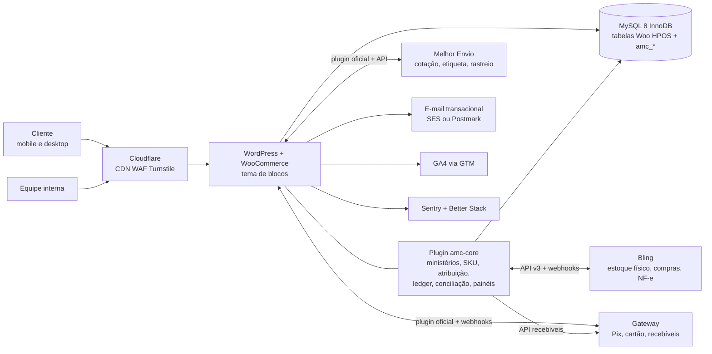

**Por que este cenário**

1. **Usa plataformas existentes para o que é comum** (checkout, catálogo, NF-e, estoque físico, frete, pagamento) — sem reinventar.
2. **Concentra o que é específico em um único componente próprio, testável e auditável** (`amc-core`), em vez de espalhar regras em plugins de terceiros (ADR-002).
3. O plugin **é dono dos dados que diferenciam o projeto** (ministério, atribuição, ledger), o que permite trocar ERP, gateway ou até a plataforma de loja sem perder o histórico financeiro (portabilidade).
4. Custo fixo moderado e previsível ([26](#s26)); sem taxa sobre GMV da plataforma.
5. Ecossistema WooCommerce amplo no Brasil: profissionais disponíveis para manutenção.

**Limitações aceitas**

- Manutenção contínua de WordPress/WooCommerce/plugins (plano em [29.17](#s29)).
- O painel do ministério é uma aplicação dentro do wp-admin (React) — não é um produto separado.
- Dependência do Bling para estoque físico e NF-e; mitigada pelo espelho de saldos e pela exportação.
- Limite de API do Bling (3 req/s) exige fila; aceitável para o volume previsto.

### 8.3. Cenário C — Maior flexibilidade e capacidade de expansão

**Composição:** **Medusa.js v2** (commerce engine headless) + **storefront Next.js** + **Odoo** (ERP com contabilidade analítica por ministério, multiarmazém e NF-e via Enterprise/Avalara ou OCA) + serviço próprio de atribuição/ledger (PostgreSQL) + gateway + Melhor Envio + infraestrutura em nuvem (containers, Postgres gerenciado, Redis, fila).

| Prós | Contras |
|---|---|
| Modelo de dados moderno (stock locations, sales channels, reservas nativas) | Custo de desenvolvimento 2–3× o cenário B |
| Storefront com desempenho máximo e liberdade total de UX | Integrações brasileiras (pagamento, frete, fiscal) precisam ser construídas ou adaptadas |
| Odoo resolve contabilidade analítica, compras e estoque em um só ERP | Implantação do Odoo é um projeto próprio (parceiro, meses) |
| Escala horizontal | Equipe especializada (Node/TypeScript, DevOps) — custo e risco de dependência de pessoas |

**Indicado quando:** volume > ~10 mil pedidos/mês, múltiplos canais (app, PDV, marketplaces), necessidade de ERP contábil integrado, equipe técnica interna permanente.

### 8.4. Comparação dos cenários

| Critério (peso) | A | **B** | C |
|---|---|---|---|
| Custo de implantação (20%) | 5 | 4 | 1 |
| Custo mensal (15%) | 5 | 4 | 2 |
| Atende atribuição por ministério com auditoria (20%) | 4 | 5 | 5 |
| Estoque multidepósito, compras, fiscal (15%) | 2 | 4 | 5 |
| Risco de implantação (10%) | 4 | 4 | 2 |
| Manutenibilidade com equipe pequena (10%) | 4 | 4 | 2 |
| Capacidade de expansão (10%) | 2 | 3 | 5 |
| **Total ponderado (1–5)** | **3,85** | **4,10** | **3,15** |

Notas qualitativas (5 = melhor) atribuídas pela equipe; reavaliar após as decisões bloqueadoras.

### 8.5. Critérios que levariam a outra escolha

| Se… | Então considerar… |
|---|---|
| DEC-010 dispensar NF-e e o volume for < 300 pedidos/mês | Cenário A (sem ERP); o plugin assume o estoque físico |
| A Igreja não quiser manter WordPress (sem equipe/fornecedor de manutenção) | Nuvemshop + Bling + **aplicativo externo** de atribuição/ledger (consome webhooks); mesmo modelo financeiro deste documento |
| Ministérios virarem pessoas jurídicas próprias (DEC-008) | Split de pagamento + marketplace (reavaliar multivendedor e gateway com recebedores) |
| A Igreja já usar Odoo/Omie para a contabilidade | Usar esse ERP no lugar do Bling (centro de custo nativo facilita o espelhamento contábil) |
| Volume > 10 mil pedidos/mês ou multicanal (app, PDV, marketplaces) | Cenário C |
| Venda de ingressos/inscrições for prioritária | Plataforma especializada de eventos integrada (não construir no WooCommerce) |

### 8.6. Registros de decisão de arquitetura (ADR)

| ID | Decisão | Status | Justificativa | Revisitar se |
|---|---|---|---|---|
| ADR-001 | Cenário B como arquitetura principal | Proposta | 8.2, 8.4 | Critérios 8.5 |
| ADR-002 | Domínio específico em **um** plugin próprio (`amc-core`), com tabelas próprias; sem editar núcleo do WooCommerce | Proposta | Testabilidade, auditoria, compatibilidade com atualizações | — |
| ADR-003 | Não usar plugin multivendedor | Proposta | 7.1.5 | DEC-008 |
| ADR-004 | Ministério = entidade administrativa + centro de resultado; categoria é só vitrine | Proposta | 9.1 | — |
| ADR-005 | SKU `MMM-TT-NNNNN[-COR][-TAM]`, prefixo = origem, imutável | Proposta | 10.2 | Limite de caracteres do ERP |
| ADR-006 | Ledger gerencial de partidas dobradas, append-only, com cadeia de hash | Proposta | 12.5 | — |
| ADR-007 | Conector próprio WooCommerce↔Bling (outbox/inbox), com a integração nativa do Bling **desligada** para estoque e pedidos | Proposta — **validar na PoC** | Evitar dois escritores de estoque; controle de idempotência, kits e observabilidade | Se a PoC mostrar que a integração nativa atende aos testes TEST-020 a TEST-026, usar a nativa e reduzir escopo do conector |
| ADR-008 | Gateway único, escolhido por cotação entre Mercado Pago e Pagar.me; adaptador no plugin | Proposta | 7.3 | Cotação |
| ADR-009 | Sem split no MVP; atribuição gerencial + repasse interno opcional | Proposta | 12.8 | DEC-008 |
| ADR-010 | Melhor Envio + retirada local | Proposta | 7.4 | Volume |
| ADR-011 | Checkout e carrinho em **blocos** (Store API), não shortcodes legados | Proposta | Direção oficial do WooCommerce; Local Pickup nativo exige blocos | Incompatibilidade de plugin de gateway com blocos (validar na PoC) |
| ADR-012 | Painéis internos (ministério, financeiro, expedição) como aplicação React dentro do wp-admin, consumindo REST `amc/v1` com autorização no servidor | Proposta | Reaproveita autenticação, MFA e infraestrutura | Se houver muitos usuários externos ao wp-admin |
| ADR-013 | Valores monetários em centavos inteiros (`BIGINT`) em todas as tabelas próprias | Proposta | Evita erros de ponto flutuante | — |

### 8.7. Prova de conceito obrigatória (Fase 1)

Antes de desenvolver, uma PoC de **2 a 3 semanas** deve validar, em ambiente de homologação:

1. Gateway finalista no checkout em blocos (Pix + cartão parcelado + reembolso parcial + webhook assinado) — TEST-010, TEST-011.
2. Melhor Envio no checkout em blocos + compra de etiqueta pelo plugin `amc-core` — TEST-030.
3. Bling: criar produto com SKU de 22 caracteres; criar pedido via API com idempotência; receber webhook de estoque; ler custo; emitir NF-e de homologação com grupos IBS/CBS; medir limites — TEST-020 a TEST-026.
4. Reserva de estoque sob concorrência (100 checkouts simultâneos para 1 unidade) — TEST-001.
5. Hospedagem: usuário de banco com privilégios restritos e/ou *triggers* permitidos (12.5.1); Redis; WP-CLI; staging.

Resultado: relatório da PoC com go/no-go para cada ADR "validar na PoC".

---
<a id="s09"></a>

## 9. Arquitetura organizacional dos ministérios

### 9.1. Como o ministério deve ser tratado

| Opção | Funciona para | Falha em | Veredito |
|---|---|---|---|
| Categoria comercial | Navegação ("Ver produtos do Ministério Jovem") | Produto em mais de uma categoria; mudança de vitrine altera relatório; não carrega permissões nem regras financeiras; não tem histórico | **Insuficiente sozinha** |
| Entidade administrativa própria | Cadastro, responsáveis, status, permissões, identidade visual, contato | — | **Necessária** |
| Centro de resultado financeiro | Apuração de receita, custo, margem; regras de rateio | — | **Necessária** |
| Unidade de gestão de estoque (depósito próprio) | Ministérios que guardam seus produtos fisicamente separados | Se o estoque for central, criar um depósito por ministério multiplica transferências e complica a expedição | **Opcional, por configuração** |

**Recomendação (ADR-004):** o ministério é uma **entidade administrativa própria (`Ministry`) que é ao mesmo tempo centro de resultado**. A loja expõe uma **vitrine por ministério** gerada a partir da entidade (não de uma categoria). A titularidade de estoque é registrada por **propriedade do SKU** (o SKU pertence a um ministério), e não por depósito; depósitos/locais físicos são independentes e podem, opcionalmente, ser dedicados a um ministério.

**Consequências da decisão**

- Um produto tem **exatamente um ministério responsável vigente** (BR-001). Produto co-produzido por dois ministérios exige regra de repartição explícita (`ownership_share`, ver 9.4), **não** duas categorias.
- Relatórios financeiros nunca leem a árvore de categorias; leem `order_item.ministry_id` congelado no momento da venda (BR-003).
- A vitrine do ministério pode ser desligada sem afetar o resultado financeiro (ex.: ministério que vende apenas em eventos).
- Permissões são aplicadas pelo vínculo usuário ↔ ministério (ABAC), não pela categoria.
- O custo: o plugin de domínio precisa manter a entidade, sua vigência e sua relação com produtos — algo que nenhuma das plataformas avaliadas oferece nativamente ([7](#s07)).

### 9.2. Hierarquia lógica

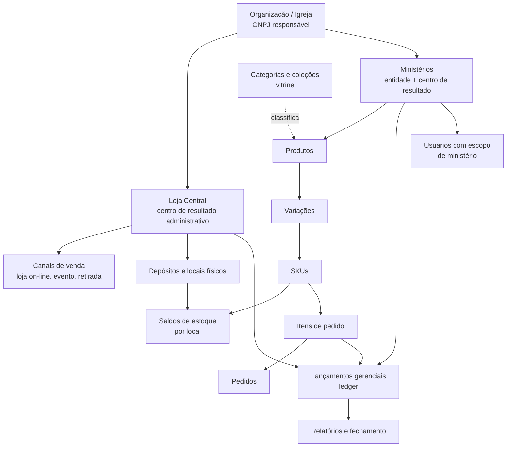

### 9.3. Atributos do ministério

| Atributo | Exemplo | Regra |
|---|---|---|
| `id` | `01J9Z...` (ULID) | Imutável, nunca reutilizado |
| `code` | `JOV` | 3 letras maiúsculas, único, imutável após o primeiro produto (BR-033) |
| `name` | "Ministério Jovem" | Editável; alteração registrada em auditoria |
| `slug` | `jovens` | Usado na URL da vitrine; alteração gera redirecionamento 301 |
| `status` | `active`, `suspended`, `archived` | `archived` não aceita novos produtos; histórico preservado |
| `parent_id` | Ministério "Família" → "Casais" | Opcional, para submínistérios; relatórios agregam pela árvore |
| `result_center_type` | `ministry`, `central`, `event` | `central` existe exatamente uma vez (Loja Central) |
| `storefront_enabled` | `true` | Exibe ou não a vitrine pública |
| `brand_color`, `logo` | `#...` | Identificação visual secundária na loja (não substitui a marca da Igreja) |
| `leaders` | Usuários responsáveis | Pelo menos 1 responsável ativo para `active` |
| `financial_policy_id` | Política de rateio vigente | Herda a política global se vazio |
| `transfer_policy` | `report_only` / `internal_transfer` | Depende de DEC-007 |
| `created_at`, `archived_at` | — | — |

### 9.4. Propriedade de produto com vigência

A responsabilidade do produto é um registro temporal (`ProductOwnership`):

| product_id | ministry_id | share_bp | valid_from | valid_to | motivo |
|---|---|---|---|---|---|
| P-100 | JOV | 10000 | 2026-11-01 | 2027-03-31 | Cadastro inicial |
| P-100 | MIS | 10000 | 2027-04-01 | — | Transferência aprovada (PRC-024) |

- `share_bp` em pontos-base (10000 = 100%). Coprodução: duas linhas na mesma vigência somando 10000 (BR-034). O MVP aceita só 100% (FR-012); a coprodução fica preparada no modelo, mas desativada até DEC-022.
- Na venda, o item do pedido copia o(s) ministério(s) vigente(s) **no momento da criação do pedido** (BR-003). Mudar a titularidade depois não altera vendas passadas.

### 9.5. Escala

- Dezenas de ministérios: suportado sem mudança de modelo (tabela pequena).
- Milhares de produtos: índices por `ministry_id` em propriedade, itens de pedido e ledger ([14](#s14)).
- Novos ministérios são cadastro, não desenvolvimento (FR-001). Nenhuma lógica pode depender de códigos de ministérios fixos no código-fonte (regra de revisão de código, [29](#s29)).

---
<a id="s10"></a>

## 10. Estratégia de SKU e catálogo

### 10.1. Identificadores — o que é cada um

| Identificador | Quem gera | Formato | Mutável? | Visível ao cliente? | Uso |
|---|---|---|---|---|---|
| **ID interno** (`product_uid`, `sku_uid`) | Plugin de domínio | ULID (26 caracteres, ordenável por tempo) | **Nunca** | Não | Chave de todas as relações do domínio, ledger, integrações. Sobrevive a migração de plataforma. |
| **SKU** | Plugin de domínio, por regra (10.3) | `MMM-TT-NNNNN[-V1][-V2]` | Imutável após a 1ª movimentação ou venda (BR-004) | Sim (PDP, nota, etiqueta) | Identificação operacional de unidade vendável/estocável; chave de integração com ERP e frete |
| **Código de barras interno** | Plugin | Code 128 contendo o SKU | Segue o SKU | Na etiqueta | Leitura no recebimento, separação e inventário |
| **GTIN/EAN-13** | GS1 Brasil (associação paga) ou fabricante/editora (ISBN) | 13 dígitos | Não | Sim | Obrigatório apenas se houver venda em marketplaces/varejo que exijam (DEC-023); livros normalmente já têm ISBN/GTIN |
| **ID no WooCommerce** (`post_id` do produto/variação) | WooCommerce | Inteiro | Não, mas não é portável | Não | Uso interno do WooCommerce. **Nunca** usado como chave de negócio fora dele |
| **ID no ERP** | ERP | Inteiro/string do ERP | Não | Não | Guardado na tabela de mapeamento `amc_external_ref` |
| **ID no gateway / frete** | Provedores | Variados | — | Não | Guardados em pagamentos/remessas |

**Regra:** toda integração cruza sistemas pelo **SKU** (legível, estável) e grava o par `(sistema, id_externo) ↔ sku_uid` em `amc_external_ref`. Se o SKU precisar mudar (caso excepcional, 10.8), o `sku_uid` garante a rastreabilidade.

### 10.2. Avaliação do formato sugerido `MIN-CAT-PROD-VAR`

Exemplo do briefing: `JOV-CAM-001-PRE-M`.

| Aspecto | Avaliação |
|---|---|
| Legibilidade | Boa — operador entende de que se trata |
| `MIN` no início | **Risco**: se o produto mudar de ministério, o SKU "mente". Mitigação: o prefixo significa **ministério de origem**, não responsável atual (BR-005). A responsabilidade fica no dado ([9.4](#s09)). |
| `CAT` (categoria comercial) | **Inadequado**: categorias de vitrine mudam (ex.: "Camisetas" vira "Vestuário"). Substituir por **tipo de produto** (`TT`), lista curta e estável. |
| `001` (3 dígitos) | **Insuficiente**: 999 produtos por combinação pode estourar e obriga a reiniciar a sequência. Usar 5 dígitos de sequência **global por tipo** (não por ministério), evitando colisão em transferências. |
| `PRE-M` | Bom, desde que de dicionário controlado. |
| Comprimento | 17 caracteres no exemplo — adequado. |

**Formato recomendado (ADR-005):**

```
MMM-TT-NNNNN[-COR][-TAM]
│   │   │      │     └─ tamanho (dicionário), opcional
│   │   │      └─ cor/acabamento (dicionário), opcional
│   │   └─ sequência numérica global por TT, 5 dígitos, nunca reutilizada
│   └─ tipo de produto (dicionário estável, 2 letras)
└─ código do ministério de ORIGEM (3 letras), congelado
```

Exemplos: `JOV-VS-00012-PRE-M`, `MUL-LV-00003`, `CON-KT-00001`.

### 10.3. Regras de criação

| Regra | Especificação |
|---|---|
| Alfabeto | `A–Z`, `0–9` e hífen. Sem acentos, espaços, minúsculas, `/`, `.` ou `_` (compatibilidade com ERP, etiquetas, planilhas e URLs). Regex: `^[A-Z]{3}-[A-Z]{2}-[0-9]{5}(-[A-Z0-9]{1,4}){0,2}$` |
| Comprimento | Máximo **24** caracteres (o padrão gera no máximo 22). Margem para limites de campo de ERPs e transportadoras — **validar o limite do ERP escolhido na PoC** (FR-020). |
| Unicidade | Única globalmente, sem distinção de maiúsculas, incluindo SKUs arquivados. Garantida por índice único no plugin **e** checada no WooCommerce (que também exige SKU único). |
| Geração | Automática pelo plugin ao salvar o produto (o operador escolhe ministério e tipo; a sequência vem de um contador transacional `amc_sku_sequence` com `SELECT ... FOR UPDATE`). Digitação manual só para importação legada (10.9). |
| Produto pai de variáveis | O produto pai recebe o **SKU base** `MMM-TT-NNNNN` (não estocável); cada variação recebe sufixos. |
| Ordem dos sufixos | Sempre cor → tamanho. Para outros atributos (ex.: capa dura/brochura), o dicionário define a ordem. |
| Imutabilidade | Após a 1ª movimentação de estoque **ou** 1ª venda, o SKU fica bloqueado na interface e na API (BR-004). Alteração só pelo procedimento excepcional 10.8. |
| Reutilização | Proibida. SKU arquivado continua reservado para sempre. |
| Dependência de nome | O SKU não carrega nome do produto, ano ou preço. |

### 10.4. Dicionários controlados

**Tipos de produto (`TT`) — lista inicial proposta**

| TT | Tipo | TT | Tipo |
|---|---|---|---|
| VS | Vestuário (camiseta, moletom, boné) | AC | Acessório (caneca, chaveiro, ecobag) |
| LV | Livro | MS | Material de estudo (apostila, revista) |
| MD | Mídia física (CD, DVD, pen drive) | DG | Digital (e-book, PDF, áudio) |
| PP | Papelaria (caderno, adesivo, cartão) | IN | Institucional |
| KT | Kit (SKU composto) | PS | Personalizado sob demanda |
| EV | Item de evento (credencial física, crachá, kit de evento) | SV | Serviço/taxa (ex.: taxa de personalização) |

**Cores (amostra)**: `PRE` preto, `BRA` branco, `AZM` azul-marinho, `AZC` azul-claro, `CIN` cinza, `CIM` cinza mescla, `VRM` vermelho, `VRD` verde, `AMR` amarelo, `ROS` rosa, `BEG` bege, `OFW` off-white.

**Tamanhos (amostra)**: adulto `PP`, `P`, `M`, `G`, `GG`, `XG`, `XGG`; baby look `BLP`, `BLM`, `BLG`; infantil `I02`, `I04`, `I06`, `I08`, `I10`, `I12`, `I14`; único `UN` (evitar — use produto simples).

**Outros atributos**: livro `BRC` brochura, `CDR` capa dura; idioma `PT`, `EN`, `ES`.

Os dicionários são tabelas administráveis (UI-219) com código, rótulo, ordem de exibição e status. Um código **não** pode ser excluído depois de usado — apenas desativado.

### 10.5. Casos especiais

| Caso | Tratamento | Exemplo |
|---|---|---|
| Produto sem variação | Produto simples, SKU sem sufixo; estocável | `MUL-LV-00003` — Livro "Mulheres da Bíblia" |
| Variação de tamanho | Uma variação por tamanho | `JOV-VS-00012-M` |
| Variação de cor | Uma variação por cor | `LOU-AC-00007-PRE` — Caneca preta |
| Cor × tamanho | Uma variação por combinação existente (não gerar combinações inexistentes) | `JOV-VS-00012-PRE-G` |
| **Kit** | SKU próprio `TT=KT`, **não estocável por si**; baixa os componentes (`KitComponent`). Disponibilidade = mínimo(disponível do componente ÷ quantidade no kit). Preço do kit rateado entre componentes pelo **preço de referência** de cada componente (BR-023) | `CON-KT-00001` = 1× `CON-VS-00020-PRE-M` + 1× `CON-AC-00004` + 1× `CON-PP-00009` |
| Kit com componentes de ministérios diferentes | Permitido; o rateio gera itens de atribuição para cada ministério; o **dono do kit** é o ministério que o propôs (usado para vitrine e aprovação) | `CON-KT-00002` com livro do `ENS` e camiseta do `CON` |
| **Combo** | Não cria SKU; é uma **promoção** ("leve camiseta + caneca com 10%") aplicada como desconto de itens (12.3) | — |
| **Personalizado** | SKU base (`TT=PS`) + campos de personalização no item do pedido (nome, número), sem SKU por personalização. Estoque: da peça base (se houver) ou "sob demanda" | `JOV-PS-00002-PRE-M` + personalização "LUCAS 10" |
| Taxa de personalização | Item de serviço `TT=SV` (não estocável) vinculado ao item personalizado | `JOV-SV-00001` |
| **Digital** | `TT=DG`, não estocável, entrega por link com expiração e limite de downloads; sem frete | `ENS-DG-00004` — E-book "Estudo de Romanos" |
| Pré-venda | Mesmo SKU; flag `preorder` com data prevista e limite de quantidade (BR-030) | — |
| Produto de evento | `TT=EV` ou tipo normal + coleção do evento; estoque reservado para o evento em local lógico (11.9) | `CON-EV-00010` — Kit credencial |
| Descontinuado | Status `archived`; SKU permanece reservado; PDP com 301 ou página "indisponível" (24.6) | — |
| Reposição de produto igual | **Mesmo SKU** (mesmo produto). Novo lote só gera novo SKU se houver diferença perceptível ao cliente (tecido, edição do livro, arte) | Camiseta com nova arte → novo SKU `JOV-VS-00045` |
| Nova edição de livro | Novo SKU (ISBN muda) e vínculo `replaces_sku_uid` para histórico | `MUL-LV-00011` substitui `MUL-LV-00003` |

### 10.6. Exemplo concreto de cadastro

**Produto:** Camiseta "Conferência Ide 2027" — Ministério de Missões; tipo Vestuário; cores Preta e Off-white; tamanhos P, M, G, GG; P e GG só na cor preta.

| Campo | Pai | Variação 1 | Variação 2 | Variação 3 |
|---|---|---|---|---|
| ID interno | `01JAX3K4...P` | `01JAX3K5...A` | `01JAX3K5...B` | `01JAX3K5...C` |
| SKU | `MIS-VS-00031` | `MIS-VS-00031-PRE-P` | `MIS-VS-00031-PRE-M` | `MIS-VS-00031-OFW-M` |
| Ministério responsável | MIS (100%, desde 01/11/2026) | herda | herda | herda |
| Tipo | VS | VS | VS | VS |
| Categorias (vitrine) | Vestuário › Camisetas; Coleção "Ide 2027" | — | — | — |
| Preço de venda | — | R$ 69,90 | R$ 69,90 | R$ 69,90 |
| Custo unitário (média) | — | R$ 31,40 | R$ 31,40 | R$ 33,10 |
| Peso / dimensões | — | 0,25 kg / 30×25×3 cm | idem | idem |
| Código de barras | — | Code128 `MIS-VS-00031-PRE-P` | ... | ... |
| GTIN | — | vazio (não exigido) | vazio | vazio |
| NCM (fiscal) | — | 6109.10.00 (**validar com a contabilidade**) | idem | idem |
| ID WooCommerce | 4512 | 4513 | 4514 | 4515 |
| ID ERP | 99812 | 99813 | 99814 | 99815 |

**Livro simples:** `ENS-LV-00008` — "Fundamentos da Fé", Ministério de Ensino, ISBN/GTIN `978...` do fornecedor, preço R$ 49,90, custo R$ 26,00.

**Kit:** `JOV-KT-00003` — "Kit Acampamento" = 1× `JOV-VS-00012-PRE-M` (ref. R$ 59,90) + 1× `JOV-AC-00005` squeeze (ref. R$ 29,90) + 1× `ENS-MS-00002` devocional (ref. R$ 24,90). Soma de referência R$ 114,70; preço do kit R$ 99,90. Rateio: JOV 52,22% + 26,07% = 78,29% → R$ 78,21; ENS 21,71% → R$ 21,69 (maior resto, soma R$ 99,90) — ver BR-023 e 12.3.

### 10.7. Rastreabilidade em mudanças

| Mudança | O que acontece | O que **não** acontece |
|---|---|---|
| Nome do produto | Registro em `amc_audit_log` (antes/depois). Slug novo gera 301. | SKU não muda. Pedidos antigos mantêm o nome gravado no item. |
| Categoria | Atualiza vitrine/SEO. | Nenhum relatório financeiro muda. |
| Ministério responsável | Nova linha em `ProductOwnership` com vigência futura (PRC-024); estoque existente tratado por transferência de titularidade (BR-025). | SKU não muda (prefixo é origem). Vendas anteriores ficam no ministério antigo. |
| Preço | Registro em `amc_price_history` com vigência e autor (BR-018). | Pedidos já criados não mudam. |
| Custo | Novo custo médio calculado na entrada (BR-020). | CMV de vendas passadas não muda. |

### 10.8. Procedimento excepcional de correção de SKU

Para SKU criado errado **com** movimentação (ex.: ministério de origem errado digitado em importação):

1. Solicitação por Gestor de e-commerce com justificativa (UI-212).
2. Aprovação do Administrador da loja (segregação — BR-017).
3. O plugin cria **novo SKU**, marca o antigo como `superseded_by`, transfere saldo por movimento `SKU_RECODE` (saída do antigo, entrada no novo, mesmo custo), atualiza integrações (`amc_external_ref`) e mantém o antigo como alias de busca por 24 meses.
4. Ledger e pedidos antigos continuam referenciando o `sku_uid` antigo. Relatórios por produto unem os dois pelo vínculo.

Teste: TEST-008.

### 10.9. Importação em massa e produtos legados

- Formato: CSV UTF-8 com cabeçalhos fixos (modelo em UI-213), um registro por SKU vendável; colunas: `ministry_code, product_type, parent_ref, name, color_code, size_code, price, cost, weight_kg, length_cm, width_cm, height_cm, gtin, ncm, legacy_code, initial_qty, location_code`.
- Etapas: upload → validação completa sem gravar (relatório de erros por linha) → simulação (mostra SKUs que serão gerados) → confirmação → gravação em lote via fila (Action Scheduler) → relatório final.
- Estoque inicial **não** é gravado pela importação de catálogo: gera um documento de inventário inicial (`INITIAL_COUNT`) que precisa ser aprovado (BR-012).
- Códigos legados ficam em `legacy_code` (pesquisável) e em `amc_external_ref` com sistema `legacy`.
- Idempotência: reimportar o mesmo arquivo não duplica (chave `legacy_code` + `ministry_code`).

### 10.10. Etiquetas e códigos de barras

- Etiqueta de produto (gôndola/prateleira e peça): 50×30 mm, Code 128 do SKU, nome curto (≤ 30 caracteres), cor/tamanho legíveis, código do ministério. Impressão térmica (203 dpi) a partir de UI-407.
- Etiqueta de local (endereço de estoque): `A-01-03` (rua-prateleira-nível) em Code 128.
- GTIN só onde exigido (DEC-023). Não gerar "EAN falso" com prefixo inventado: GTIN com prefixo não licenciado é inválido para o varejo.

### 10.11. Compatibilidade com ERP e migração futura

- O SKU recomendado usa somente caracteres aceitos por qualquer ERP/planilha comum e ≤ 24 caracteres.
- O catálogo mestre (identidade, SKU, titularidade, dicionários) fica no **plugin de domínio** e é exportável em CSV/JSON a qualquer momento (FR-021, NFR-018).
- Em uma migração de plataforma, o `sku_uid` e o SKU são preservados; IDs do WooCommerce são descartados e remapeados via `amc_external_ref`.

---
<a id="s11"></a>

## 11. Gestão de estoque

### 11.1. Fontes oficiais (cenário recomendado B)

| Informação | Fonte oficial | Cópias/projeções | Observação |
|---|---|---|---|
| Saldo **físico** por depósito | **ERP (Bling)** | Espelho `amc_inventory_balance` no plugin | Toda movimentação física (entrada, ajuste, inventário, transferência, avaria) é documento no ERP (BR-012) |
| Custo unitário (custo médio) | **Plugin** (`amc_cost_history`), alimentado pelas entradas do ERP ou por lançamento aprovado do financeiro | — | O ERP pode ter custo próprio; o do plugin é o usado no ledger gerencial. Validar na PoC se a API do Bling expõe custo por entrada ([?]) |
| **Reservas** de checkout | **WooCommerce** (`wc_reserved_stock`) | — | Mecanismo nativo de *hold stock* |
| **Comprometido** (pago, não expedido) | **Plugin** (derivado dos pedidos) | Enviado ao ERP como pedido de venda | — |
| Estoque **vendável** exibido na loja | **Plugin** calcula e grava no WooCommerce (`_stock`) | WooCommerce | Fórmula 11.3 |
| Titularidade (ministério) | **Plugin** (`ProductOwnership`) | ERP não precisa saber | Relatório de estoque por ministério = saldo × titularidade |
| Estoque reservado para evento | **ERP** (depósito "EVENTO-xxxx") | Espelho | Transferência entre depósitos (11.9) |

No **cenário A** (sem ERP), o plugin passa a ser a fonte oficial do saldo físico (as telas UI-401 a UI-404 e UI-411 a UI-412 passam a ser próprias). No **cenário C**, a fonte é o ERP Odoo (módulo Inventário).

### 11.2. Tipos de estoque

| Tipo | Definição | Onde vive | Entra no vendável? |
|---|---|---|---|
| Físico | Unidades presentes no local | ERP, por depósito | Base |
| Reservado | Bloqueado por checkout em pagamento (com expiração) | WooCommerce | Subtrai |
| Comprometido | Pedido pago, ainda não baixado no ERP / não expedido | Plugin | Subtrai |
| Danificado | Avariado, aguardando destino (descarte, conserto, doação) | ERP, depósito `AVARIA` | Não (está em outro depósito) |
| Em trânsito | Transferência entre depósitos iniciada e não recebida; ou compra faturada pelo fornecedor e não recebida | ERP | Não |
| Bloqueado / quarentena | Em conferência, divergente ou aguardando decisão | ERP, depósito `QUARENTENA` | Não |
| Reservado para evento | Separado para venda presencial em evento | ERP, depósito `EVENTO-xxxx` | Não (online) |
| Pré-venda | Quantidade autorizada para venda sem estoque físico | Plugin (`preorder_limit`) | Soma, até o limite (BR-030) |

### 11.3. Fórmula do estoque vendável

```
vendável(sku) = max(0,
      físico_ERP(sku, depósito = "LOJA-ONLINE")
    − comprometido_não_refletido_no_ERP(sku)
    − margem_de_segurança(sku)          # padrão 0; configurável por SKU/tipo
) + limite_pré_venda_restante(sku)
```

- `comprometido_não_refletido_no_ERP` = itens de pedidos pagos (ou em pagamento com reserva convertida) cujo pedido de venda **ainda não foi confirmado** pelo ERP (estado `erp_sync != confirmed`). Isso elimina a janela clássica em que o ERP devolve um saldo "antigo" e sobrescreve o WooCommerce (RSK-004).
- As **reservas** de checkout não entram na fórmula porque o WooCommerce já as subtrai ao verificar disponibilidade no checkout (mecanismo de *hold stock*); o `_stock` publicado é o saldo antes das reservas.
- Kit: `vendável(kit) = min( floor(vendável(componente_i) ÷ qtd_i) )`, recalculado sempre que um componente muda (FR-034).

### 11.4. Ciclo de vida do estoque por pedido

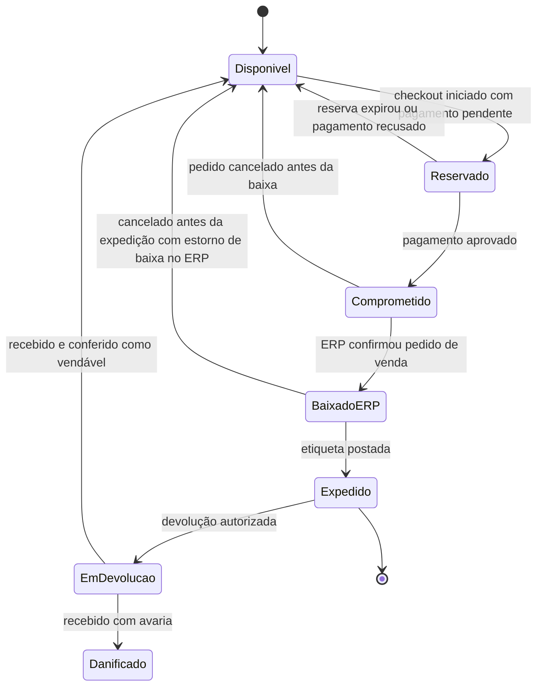

### 11.5. Operação de ponta a ponta

| # | Etapa | Sistema | Responsável | Regra / controle | Saída |
|---|---|---|---|---|---|
| 1 | Cadastro inicial do SKU | Plugin → ERP (INT-004) | Gestor de e-commerce | SKU gerado pelo plugin; produto criado no ERP com o mesmo SKU | Produto no ERP com `amc_external_ref` |
| 2 | Pedido de compra / produção | ERP | Financeiro central + responsável do ministério | Aprovação conforme alçada (DEC-016) | Pedido de compra |
| 3 | Recebimento | ERP (ou UI-401 no cenário A) | Estoquista | Recebe contra pedido de compra ou NF do fornecedor | Entrada em `QUARENTENA` |
| 4 | Conferência | ERP + coletor/leitor (UI-402) | Estoquista (≠ quem comprou — BR-017) | Contagem cega: o conferente não vê a quantidade esperada; divergência > 0 abre ocorrência | Quantidade conferida, ocorrências |
| 5 | Entrada definitiva | ERP | Estoquista | Transferência `QUARENTENA → LOJA-ONLINE` (ou depósito de destino) | Saldo físico; webhook de estoque |
| 6 | Custo | Plugin (UI-511) | Financeiro | Custo da entrada informado/importado; custo médio recalculado (BR-020) | `amc_cost_history` |
| 7 | Armazenamento | Físico | Estoquista | Endereço de local (`A-01-03`) cadastrado no SKU | Local registrado |
| 8 | Reserva | WooCommerce | Automático | Hold stock no checkout; Pix: reserva = expiração do Pix + 5 min (BR-013) | `wc_reserved_stock` |
| 9 | Confirmação de pagamento | Gateway → WooCommerce/plugin | Automático | Webhook idempotente (BR-015) | Pedido `processing`; comprometido |
| 10 | Envio ao ERP | Plugin → ERP (INT-003) | Automático (fila) | Outbox; retry exponencial; ERP indisponível não bloqueia a venda | Pedido de venda no ERP; baixa |
| 11 | Separação (picking) | Plugin UI-403 | Operador de expedição | Lista por local; leitura do código de barras de cada unidade (FR-040) | Itens separados |
| 12 | Conferência de embalagem (packing) | Plugin UI-404 | Operador (idealmente ≠ separador) | Divergência bloqueia etiqueta | Volume fechado, peso real |
| 13 | Etiqueta e postagem | Plugin ↔ Melhor Envio (INT-006) | Operador | Etiqueta comprada só após conferência | Código de rastreio |
| 14 | Cancelamento | Woo/plugin → ERP | Atendimento (com permissão) | Antes da expedição: estorna baixa; depois: vira devolução | Saldo restaurado |
| 15 | Devolução/troca | Plugin UI-410 + ERP | Atendimento + estoquista | Inspeção define: vendável, avaria ou descarte | Entrada de devolução |
| 16 | Avaria/perda | ERP | Estoquista + aprovação do gestor | Motivo obrigatório; acima de R$ 200 (proposta) exige aprovação do financeiro | Saída por perda; lançamento `INVENTORY_LOSS` no ledger |
| 17 | Ajuste de inventário | ERP | Estoquista + aprovação | Só a partir de contagem registrada; nunca edição direta | Ajuste; lançamento `INVENTORY_ADJUSTMENT` |
| 18 | Transferência entre depósitos | ERP | Estoquista | Sai do origem → em trânsito → entra no destino na confirmação | Saldos atualizados |
| 19 | Inventário periódico | ERP + UI-412 | Estoquista | Cíclico semanal por curva ABC; geral anual com loja em modo "vitrine" (sem venda) se necessário | Acurácia (KPI) |
| 20 | Estoque mínimo e alerta | Plugin | Automático → responsável do ministério e estoquista | Alerta quando vendável ≤ mínimo; e-mail diário consolidado (FR-036) | Sugestão de reposição |
| 21 | Esgotado | Plugin/Woo | Automático | Status "Esgotado"; opção "Avise-me" (FR-037); PDP continua indexável se houver reposição prevista | — |

### 11.6. Venda simultânea da última unidade

**Mecanismo:**

1. O WooCommerce reserva estoque ao criar o pedido no checkout (`wc_reserved_stock`, com expiração por `woocommerce_hold_stock_minutes`/filtro `woocommerce_order_hold_stock_minutes`). A gravação da reserva usa um `INSERT ... SELECT` condicional que só tem sucesso se `estoque − reservas ativas ≥ quantidade` — em InnoDB, a disputa por linha resolve a concorrência (comportamento a confirmar em teste de carga — TEST-001, pois a confirmação disponível é de fonte secundária).
2. A redução definitiva do `_stock` usa atualização atômica (`wc_update_product_stock` com operação `decrease`).
3. O plugin acrescenta uma **verificação final** no hook de processamento do pagamento: se o item já não tiver reserva válida (expirou) e não houver estoque, o pedido não é concluído e o pagamento é cancelado/estornado automaticamente (BR-014).
4. Banco de dados deve ser **InnoDB** com nível de isolamento padrão (REPEATABLE READ) — requisito de hospedagem (NFR-012).

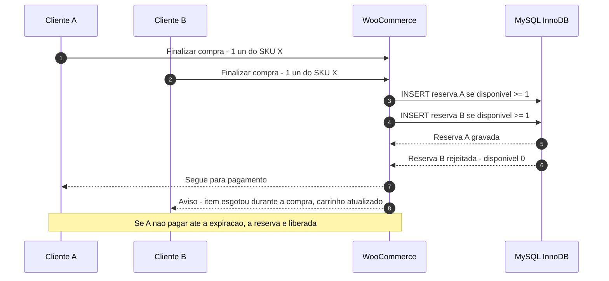

### 11.7. Sincronização WooCommerce ↔ ERP

**Princípios**

| Princípio | Implementação |
|---|---|
| Uma fonte por dado | Tabela 11.1. A integração nativa Bling↔WooCommerce fica **desligada** para estoque e pedidos (ADR-007), para evitar dois escritores |
| Assíncrono | Nenhuma chamada ao ERP no caminho síncrono do checkout |
| Outbox | Evento gravado em `amc_outbox` na mesma transação da mudança; despachado por Action Scheduler a cada 1 min |
| Idempotência | Chave `idempotency_key` = `{tipo}:{entidade}:{versão}`; o conector consulta `amc_external_ref` antes de criar no ERP (ex.: pedido `WC-10234` já existe? então atualiza) |
| Webhooks de entrada | Bling envia eventos de estoque/produto/pedido/NF-e; o receptor apenas valida, grava em `amc_inbox` e responde 2xx; o processamento é assíncrono |
| Repetição | Backoff exponencial: 1, 2, 4, 8, 16, 32 min, depois a cada 60 min até 24 h; então `dead_letter` + alerta |
| Limite de taxa | Bling: 3 req/s e 120 mil req/dia por conta (HTTP 429 acima disso) — o despachante respeita 2 req/s com *token bucket* |
| Reconciliação | Diária (03:00): compara saldo de todos os SKUs ativos (ERP × espelho × `_stock` publicado) e pedidos do dia (Woo × ERP). Divergências viram registros em `amc_sync_discrepancy` com alerta |
| Logs | Toda chamada registra: correlação, endpoint, status, duração, tentativa, hash do payload (sem dados pessoais em texto aberto) |
| Contingência manual | Se o ERP ficar indisponível > 2 h: pedidos continuam sendo aceitos (estoque vendável congelado no último valor, menos o comprometido); expedição segue pela lista do plugin; NF-e emitida quando o ERP voltar. Se > 24 h: modo "estoque conservador" (margem de segurança = 1 un em todos os SKUs com saldo ≤ 5) |

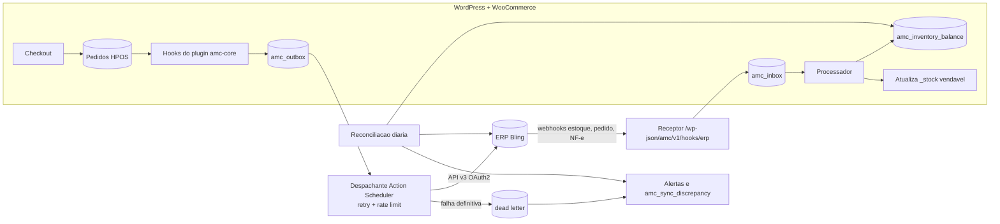

**Mapa de riscos de inconsistência**

| Risco | Causa | Detecção | Correção |
|---|---|---|---|
| Saldo publicado maior que o real | ERP devolve saldo antes de importar pedido pago | Fórmula 11.3 já desconta; reconciliação diária | Recalcular vendável |
| Pedido pago não chegou ao ERP | ERP fora, token expirado, erro de validação | Pedido com `erp_sync=pending` > 30 min → alerta | Reprocessar da fila; corrigir cadastro |
| Pedido duplicado no ERP | Repetição após timeout sem resposta | Chave idempotente + busca por número do pedido antes de criar | Cancelar duplicado no ERP; registrar |
| SKU inexistente no ERP | Produto criado só no Woo | Validação na publicação: produto só publica com `erp_ref` (FR-019) | Criar no ERP, reprocessar |
| Ajuste manual no Woo | Alguém editou estoque no wp-admin | Capacidade de editar estoque removida dos papéis; reconciliação | Sobrescrever pelo vendável calculado; auditoria |
| Webhook do ERP perdido | Falha de entrega | Reconciliação diária + consulta incremental a cada 15 min (saldos alterados desde X, se a API suportar — [?] validar) | Recalcular |
| Kit com componente zerado | Componente vendido avulso | Recalcular kits a cada mudança de componente | Automático |

### 11.8. Pré-venda, encomenda e sob demanda

| Modalidade | Quando usar | Regras |
|---|---|---|
| Pré-venda | Produto com data de chegada conhecida (ex.: camiseta da conferência) | `preorder_limit` obrigatório; data prevista exibida no PDP, carrinho, e-mail e pedido; pedido misto (pré-venda + pronta entrega) → cliente escolhe envio único (aguarda tudo) ou dividido (frete adicional, se houver) — FR-038; se a data atrasar > 7 dias, e-mail ao cliente com opção de cancelamento sem custo |
| Encomenda | Item que só é comprado após pedido (ex.: livro sob encomenda da editora) | Prazo de entrega somado ao frete; cancelamento conforme política |
| Sob demanda (personalizado) | Produção após o pedido | Sem estoque do item final; pode consumir estoque da peça base; prazo de produção configurável |

### 11.9. Estoque para eventos

- Depósito lógico `EVENTO-{código}` no ERP (ex.: `EVENTO-CONFJOV27`), criado por evento.
- Transferência `LOJA-ONLINE → EVENTO-x` antes do evento (separação física + documento).
- Venda presencial no evento: fora do MVP como PDV integrado (DEC-021). Paliativo no MVP: pedidos manuais no WooCommerce com canal `evento` (FR-039) e pagamento por link/Pix, baixando do depósito do evento — a atribuição financeira funciona igual.
- Retorno: transferência `EVENTO-x → QUARENTENA` com conferência; divergência vira perda/ajuste aprovado.

### 11.10. Estoque compartilhado

Um mesmo SKU físico não pode ter dois donos. Quando dois ministérios usam o mesmo item (ex.: Bíblia vendida pelo Ensino e pelo Jovens), recomenda-se **um SKU, um dono**, e a outra vitrine exibe o produto por categoria/coleção. Se for necessário dividir o resultado, usar coprodução (`share_bp`, [9.4](#s09)) — desativada no MVP (DEC-022).

---
<a id="s12"></a>

## 12. Arquitetura financeira por ministério

> **Escopo:** controle **gerencial** interno. Não substitui a contabilidade oficial nem a apuração fiscal (12.5). Todos os valores são armazenados em **centavos inteiros** (BR-006).

### 12.1. Conceitos que não podem ser confundidos

| Conceito | Pergunta que responde | Quando acontece | Exemplo (pedido de 12.6) |
|---|---|---|---|
| **Venda bruta (GMV)** | Quanto foi vendido a preço de tabela? | Aprovação do pagamento | R$ 200,00 em produtos |
| **Faturamento** | Quanto foi documentado como venda (pedido concluído/NF-e)? | Emissão do documento | R$ 205,00 (com frete) |
| **Recebimento** | Quanto dinheiro entrou na conta? | Liquidação pelo gateway (D+x, por parcela) | R$ 194,75 em 3 parcelas |
| **Receita líquida** | Quanto da venda fica após deduções comerciais? | Competência | R$ 205,00 (R$ 180,00 de produtos líquidos + R$ 25,00 de frete da Central) |
| **Custo (CMV)** | Quanto custaram os itens vendidos? | Baixa de estoque | R$ 109,00 |
| **Margem de contribuição** | Quanto sobra para cobrir despesas fixas? | Competência | R$ 63,35 |
| **Resultado gerencial** | Quanto sobra após rateio de despesas compartilhadas? | Fechamento mensal | Depende do rateio do mês |
| **Lucro / superávit** | Resultado contábil oficial | Escrituração contábil | **Fora do sistema** |
| **Valor atribuído ao ministério** | Quanto da venda é "do" ministério segundo as regras? | Competência | JOV R$ 102,60; ENS R$ 68,40 (após taxa) |
| **Valor a repassar** | Quanto será efetivamente transferido ao ministério? | Decisão da administração (DEC-007) | Pode ser zero (só relatório) |

> **Atribuição gerencial ≠ movimentação bancária.** O sistema calcula *a quem pertence* cada centavo segundo regras. Isso não move dinheiro. O dinheiro entra **em uma única conta** (PRM-02). Se houver repasse, ele é um ato administrativo posterior, registrado como lançamento `INTERNAL_TRANSFER` com aprovação do financeiro (12.6.5).

### 12.2. Atribuição no nível do item do pedido

Cada `order_item` recebe, no momento da criação do pedido, um **snapshot financeiro** gravado em `amc_order_item_allocation`:

| Campo | Exemplo | Origem |
|---|---|---|
| `order_item_id` | 88123 | WooCommerce |
| `sku_uid`, `sku` | `01JA...`, `JOV-VS-00012-PRE-M` | Plugin |
| `ministry_id` | JOV | `ProductOwnership` vigente (BR-003) |
| `share_bp` | 10000 | Idem |
| `unit_list_price_cents` | 6000 | Preço vigente |
| `qty` | 2 | Pedido |
| `gross_cents` | 12000 | `unit × qty` |
| `item_discount_cents` | 0 | Promoção de item |
| `order_discount_alloc_cents` | 1200 | Rateio 12.3 |
| `net_cents` | 10800 | `gross − descontos` |
| `rule_set_version_id` | `RS-2026.11-v1` | Regra vigente |
| `unit_cost_cents_snapshot` | 3200 | Custo médio no momento (confirmado na baixa) |

Kits são "explodidos" em linhas de atribuição por componente (BR-023), mantendo um único item no pedido do cliente.

### 12.3. Regras de rateio padrão (propostas — validar em DEC-006)

| Componente | Regra padrão | Base de cálculo | Alternativas configuráveis |
|---|---|---|---|
| Desconto de item (promoção de produto) | 100% do ministério do item | — | — |
| Cupom/desconto de pedido **global** (emitido pela Loja Central) | Rateado entre itens elegíveis, proporcional ao `gross` após descontos de item (BR-007) | Valor líquido de item | Absorvido 100% pela Loja Central (custo de marketing) |
| Cupom **de ministério** | Aplica-se só a itens do ministério emissor; custo 100% dele (BR-027) | — | — |
| Frete cobrado do cliente | Receita da **Loja Central** (BR-008) | — | Rateado por peso ou valor dos itens |
| Custo de frete pago | Custo da **Loja Central** | — | Rateado por peso ou valor |
| Frete grátis promocional | Custo da Loja Central, ou do ministério que patrocinou a campanha | — | — |
| Taxa de pagamento (MDR, Pix, antecipação) | Proporcional ao valor cobrado de cada centro (itens líquidos + frete para a Central) (BR-009) | Valor cobrado | Absorvida 100% pela Central |
| Taxa não devolvida em reembolso | Permanece no centro original | — | Absorvida pela Central |
| Chargeback (valor) | Estorna a receita dos itens contestados, proporcional (BR-026) | Itens | — |
| Tarifa de chargeback | Central | — | Ministério dos itens |
| Logística reversa | Ministério dos itens devolvidos | — | Central |
| CMV | Ministério dono do SKU | Custo médio | — |
| Embalagem | Central (custo operacional) | — | Por pedido aos ministérios, proporcional |
| Perda/avaria de estoque | Ministério dono do SKU | Custo | Central, se causada pela operação |
| Despesas compartilhadas mensais (hospedagem, plugins, equipe, ERP) | Rateio mensal proporcional à receita líquida do mês (BR-021) | Receita líquida | Igualitário; por nº de pedidos; percentual fixo; não ratear |
| Impostos sobre venda (se houver) | Ministério do item | Base fiscal do item | — |

**Arredondamento (BR-006):** todo rateio usa o **método do maior resto**: calcula-se a parte ideal de cada linha, trunca-se para centavos, e os centavos restantes vão para as linhas com maiores restos (empate: ordem do item no pedido). Isso garante soma exata.

**Prevenção de dupla contagem (BR-035):**

1. Unicidade em `amc_ledger_entry (source_event_id, entry_type, order_item_id, ministry_id)`.
2. Todo evento externo (webhook) passa por `amc_inbox` com chave única `(provider, external_event_id)` (BR-015).
3. **Invariantes verificados a cada lançamento e no fechamento** (FR-058):
   - Σ créditos = Σ débitos por diário (*journal*).
   - Σ `net_cents` dos itens + frete cobrado = total cobrado do pedido.
   - Σ taxas rateadas = taxa informada pelo gateway.
   - Receita líquida de um item nunca é negativa; reembolso acumulado de um item ≤ valor líquido do item.
4. Correções nunca atualizam linhas: criam reversão + novo lançamento (BR-010).

### 12.4. Regras configuráveis, versionadas e auditáveis

**Estrutura (`amc_allocation_rule_set`)**

```json
{
  "id": "RS-2026.11-v1",
  "effective_from": "2026-11-01T00:00:00-03:00",
  "effective_to": null,
  "status": "active",
  "approved_by": ["user:financeiro.central", "user:admin.loja"],
  "rules": {
    "order_discount":   {"method": "proportional", "base": "item_net_after_item_discounts", "bearer": "item_ministry"},
    "ministry_coupon":  {"scope": "issuer_items_only", "bearer": "issuer_ministry"},
    "shipping_revenue": {"bearer": "CENTRAL"},
    "shipping_cost":    {"bearer": "CENTRAL"},
    "payment_fee":      {"method": "proportional", "base": "charged_amount_by_center"},
    "fee_on_refund":    {"bearer": "original_center"},
    "chargeback_fee":   {"bearer": "CENTRAL"},
    "reverse_logistics":{"bearer": "item_ministry"},
    "packaging":        {"bearer": "CENTRAL"},
    "inventory_loss":   {"bearer": "sku_owner"},
    "shared_expenses":  {"method": "proportional", "base": "net_revenue_month", "exclude_centers": ["CENTRAL"]},
    "rounding":         {"method": "largest_remainder", "tie_break": "item_position"}
  },
  "hash": "sha256:6f1c..."
}
```

**Regras de versionamento (BR-011)**

- Uma regra nova é criada como `draft`, simulada (UI-508 mostra o impacto sobre o mês anterior, sem gravar), e ativada com **dupla aprovação** (Financeiro central + Administrador — BR-017).
- `effective_from` não pode ser retroativo. Cada lançamento grava `rule_set_version_id`.
- Pedidos já criados continuam com a versão gravada, mesmo que eventos posteriores (reembolso, chargeback) ocorram após a mudança: **o reembolso segue a regra do pedido original** (consistência do estorno).
- Recálculo retroativo só por "Reprocessamento autorizado" (UI-509): gera lançamentos de ajuste `RULE_RESTATEMENT` no período aberto, com referência à versão antiga e nova, justificativa e aprovação dupla. Períodos fechados não são alterados (BR-022).
- O `hash` do JSON é gravado; qualquer alteração de conteúdo exige nova versão.

### 12.5. Ledger gerencial — necessidade e limites

**Recomendação (ADR-006): sim, ledger gerencial de partidas dobradas, append-only.** Motivos:

- Pedidos do WooCommerce são mutáveis (status, itens, reembolsos editáveis pelo admin); relatórios lidos direto das tabelas de pedido mudam retroativamente.
- Reembolsos parciais, chargebacks e rateios exigem histórico imutável para explicar "por que o resultado de outubro mudou".
- Partidas dobradas tornam erros detectáveis (diário desbalanceado = bug).

**O que o ledger NÃO é:** não é plano de contas oficial, não gera SPED, não substitui o balancete. O plano de contas gerencial é pequeno e mapeável para o contábil (DEC-017). Exportação mensal em CSV para a contabilidade (FR-061).

**Plano de contas gerencial (inicial)**

| Código | Conta | Natureza |
|---|---|---|
| 1.1 | Recebíveis do gateway | Ativo |
| 1.2 | Banco | Ativo |
| 1.3 | Estoque ao custo (gerencial) | Ativo |
| 1.4 | Saldo pré-pago de frete | Ativo |
| 2.1 | Reembolsos a pagar a clientes | Passivo |
| 2.2 | Repasses a ministérios a pagar | Passivo |
| 3.1 | Receita bruta de produtos | Receita |
| 3.2 | (−) Descontos concedidos | Redutora |
| 3.3 | (−) Devoluções e cancelamentos | Redutora |
| 3.4 | Receita de frete | Receita |
| 4.1 | CMV | Custo |
| 4.2 | Taxas de pagamento | Custo |
| 4.3 | Custo de frete | Custo |
| 4.4 | Logística reversa | Custo |
| 4.5 | Perdas e ajustes de estoque | Custo |
| 4.6 | Chargebacks e tarifas | Custo |
| 4.7 | Embalagens | Custo |
| 4.8 | Impostos sobre vendas (se aplicável) | Custo |
| 5.1 | Despesas compartilhadas rateadas | Despesa |
| 5.9 | Despesas compartilhadas a ratear (Central) | Despesa (contrapartida) |
| 9.1 | Diferenças de conciliação | Transitória |

**Estrutura do lançamento (`amc_ledger_entry`)**

| Campo | Descrição |
|---|---|
| `id` | ULID |
| `journal_id` | Agrupa linhas que somam zero |
| `entry_type` | Ver tabela abaixo |
| `account_code` | Conta gerencial |
| `center_id` | Ministério ou Central (obrigatório em toda linha) |
| `direction` | `D` / `C` |
| `amount_cents` | Inteiro positivo |
| `order_id`, `order_item_id`, `refund_id`, `payment_id`, `shipment_id` | Referências (quando aplicáveis) |
| `occurred_at` | Data/hora do evento (fato) |
| `competence_date` | Data de competência (define o mês do resultado) |
| `cash_date` | Data de liquidação prevista/real (para recebíveis) |
| `rule_set_version_id` | Regra usada |
| `source_event_id` | Evento originador (idempotência) |
| `reverses_entry_id` | Para reversões |
| `period_id` | Período contábil gerencial (aberto/fechado) |
| `created_by` | Usuário ou serviço |
| `prev_hash`, `hash` | Encadeamento para evidência de adulteração (12.5.1) |

**Tipos de lançamento**

| `entry_type` | Gatilho | Partidas (D / C) |
|---|---|---|
| `SALE` | Pagamento aprovado | D 1.1 (líquido por centro) + D 3.2 (desconto por item) / C 3.1 (bruto por item) + C 3.4 (frete, Central) |
| `PAYMENT_FEE` | Pagamento aprovado (taxa conhecida) ou liquidação (taxa real) | D 4.2 / C 1.1 |
| `COGS` | Baixa de estoque confirmada | D 4.1 / C 1.3 |
| `SHIPPING_COST` | Etiqueta comprada | D 4.3 / C 1.4 |
| `REFUND` | Reembolso confirmado pelo gateway | D 3.3 / C 2.1 → na liquidação D 2.1 / C 1.1 |
| `COGS_REVERSAL` | Devolução recebida como vendável | D 1.3 / C 4.1 |
| `INVENTORY_LOSS` | Avaria/perda aprovada | D 4.5 / C 1.3 |
| `INVENTORY_ADJUSTMENT` | Ajuste de inventário aprovado | D 1.3 / C 4.5 (ou inverso) |
| `CHARGEBACK` | Chargeback confirmado | D 4.6 / C 1.1 (+ reversão de COGS se a mercadoria voltar) |
| `CHARGEBACK_FEE` | Tarifa cobrada | D 4.6 / C 1.1 |
| `REVERSE_LOGISTICS` | Etiqueta de reversa comprada | D 4.4 / C 1.4 |
| `SETTLEMENT` | Liquidação no extrato do gateway | D 1.2 / C 1.1 |
| `SHARED_EXPENSE_ALLOC` | Fechamento mensal | D 5.1 (ministério) / C 5.9 (Central) |
| `INTERNAL_TRANSFER` | Repasse aprovado | D 2.2 / C 1.2 (e provisão D resultado / C 2.2) — conforme DEC-007 |
| `RECON_DIFFERENCE` | Divergência de conciliação | D/C 9.1 até resolução |
| `RULE_RESTATEMENT` | Reprocessamento autorizado | Reversão + novo cálculo |
| `REVERSAL` | Correção de erro | Espelho da linha original |

\* *Convenção adotada:* a venda é registrada **bruta** em 3.1 e o desconto em 3.2 (redutora), ambos com o centro do item; o recebível (1.1) recebe o líquido. O diário `SALE` do pedido agrupa venda, desconto e frete (os tipos analíticos `ORDER_DISCOUNT` e `SHIPPING_REVENUE` ficam como subtipo da linha), e precisa fechar em zero.

#### 12.5.1. Imutabilidade e auditoria

- O usuário do banco usado pelo WordPress não recebe `UPDATE`/`DELETE` nas tabelas `amc_ledger_*` **se a hospedagem permitir usuários de banco distintos** ([?] validar com o provedor); quando não permitir, *triggers* `BEFORE UPDATE/DELETE` com `SIGNAL SQLSTATE '45000'` bloqueiam alterações.
- Cada linha grava `hash = SHA-256(prev_hash || conteúdo canônico)`. Um job diário recalcula a cadeia e exporta o hash do dia para armazenamento externo imutável (bucket com *object lock* ou e-mail para o auditor) — permite provar que nada foi alterado.
- Permissões: só serviços do plugin escrevem; nenhum perfil humano escreve diretamente. Humanos criam **documentos** (reembolso, ajuste, repasse) que, aprovados, geram lançamentos.
- Leitura: escopo de ministério aplicado (BR-016).

### 12.6. Exemplo numérico completo

> Taxa de cartão **ilustrativa de 5,00%** (não é a taxa de nenhum provedor; ver [7.3](#s07)). Regras: conjunto `RS-2026.11-v1` (12.4).

**Pedido WC-10234 — 05/11/2026 — cartão em 3×**

| Item | Ministério | Qtd | Unit. | Bruto | Custo unit. |
|---|---|---|---|---|---|
| Camiseta `JOV-VS-00012-PRE-M` | JOV | 2 | 60,00 | 120,00 | 32,00 |
| Livro `ENS-LV-00008` | ENS | 2 | 40,00 | 80,00 | 22,50 |
| **Subtotal** | | | | **200,00** | |
| Cupom global `BEMVINDO10` (10%) | Central emitiu; rateio aos itens | | | −20,00 | |
| Frete PAC cobrado | Central | | | 25,00 | custo real 22,40 |
| **Total cobrado** | | | | **205,00** | |

#### 12.6.1. Rateio

| Centro | Bruto | Desconto rateado | Líquido itens | Frete | Valor cobrado | Taxa 5% rateada | Valor a receber | CMV | Custo frete | **Margem de contribuição** |
|---|---|---|---|---|---|---|---|---|---|---|
| JOV | 120,00 | 12,00 | 108,00 | — | 108,00 | 5,40 | 102,60 | 64,00 | — | **38,60** |
| ENS | 80,00 | 8,00 | 72,00 | — | 72,00 | 3,60 | 68,40 | 45,00 | — | **23,40** |
| Central | — | — | — | 25,00 | 25,00 | 1,25 | 23,75 | — | 22,40 | **1,35** |
| **Total** | 200,00 | 20,00 | 180,00 | 25,00 | **205,00** | **10,25** | **194,75** | 109,00 | 22,40 | **63,35** |

Conferência: 205,00 − 10,25 − 109,00 − 22,40 = **63,35** ✔ (soma das margens).

#### 12.6.2. Lançamentos gerados

| Diário | Tipo | Conta | Centro | D | C |
|---|---|---|---|---|---|
| J1 | SALE | 1.1 Recebíveis | JOV | 108,00 | |
| J1 | SALE | 1.1 Recebíveis | ENS | 72,00 | |
| J1 | SALE | 1.1 Recebíveis | Central | 25,00 | |
| J1 | SALE | 3.2 Descontos | JOV | 12,00 | |
| J1 | SALE | 3.2 Descontos | ENS | 8,00 | |
| J1 | SALE | 3.1 Receita bruta | JOV | | 120,00 |
| J1 | SALE | 3.1 Receita bruta | ENS | | 80,00 |
| J1 | SALE | 3.4 Receita de frete | Central | | 25,00 |
| | | | **Soma J1** | **225,00** | **225,00** |
| J2 | PAYMENT_FEE | 4.2 Taxas | JOV / ENS / Central | 5,40 / 3,60 / 1,25 | |
| J2 | PAYMENT_FEE | 1.1 Recebíveis | JOV / ENS / Central | | 5,40 / 3,60 / 1,25 |
| J3 | COGS | 4.1 CMV | JOV / ENS | 64,00 / 45,00 | |
| J3 | COGS | 1.3 Estoque | JOV / ENS | | 64,00 / 45,00 |
| J4 | SHIPPING_COST | 4.3 Custo de frete | Central | 22,40 | |
| J4 | SHIPPING_COST | 1.4 Saldo de frete | Central | | 22,40 |

#### 12.6.3. Conciliação do recebimento

O gateway informa 3 recebíveis (valores e datas **ilustrativos**): 64,92 (05/12), 64,92 (05/01), 64,91 (05/02) = 194,75.

| Recebível | Esperado | Liquidado | Diferença | Status |
|---|---|---|---|---|
| Parcela 1/3 | 64,92 | 64,92 | 0,00 | `matched` → `SETTLEMENT` D 1.2 / C 1.1 |
| Parcela 2/3 | 64,92 | 64,90 | −0,02 | `difference` → `RECON_DIFFERENCE` 0,02 em 9.1 até análise |
| Parcela 3/3 | 64,91 | — | — | `pending` (a receber) |

Se a diferença for confirmada como taxa adicional do gateway, o financeiro a classifica (UI-506) e o sistema gera `PAYMENT_FEE` complementar rateado pela mesma regra, zerando a conta 9.1.

#### 12.6.4. Reembolso parcial

Em 09/11 o cliente devolve **1 livro** (arrependimento). Política aplicada no exemplo: devolver o valor líquido do item (40,00 − 4,00 de desconto rateado = 36,00). Logística reversa: 18,90 (ministério do item, pela regra). Taxa do gateway: não devolvida (fica com ENS). Livro volta vendável.

> ⚖️ No arrependimento (CDC art. 49), a lei determina a devolução dos valores pagos "a qualquer título". O tratamento do **frete de ida em devoluções parciais** deve ser validado juridicamente (DEC-025). O exemplo não devolve frete apenas para simplificar.

| Diário | Tipo | Conta | Centro | D | C |
|---|---|---|---|---|---|
| J5 | REFUND | 3.3 Devoluções | ENS | 36,00 | |
| J5 | REFUND | 2.1 Reembolsos a pagar | ENS | | 36,00 |
| J6 | COGS_REVERSAL | 1.3 Estoque | ENS | 22,50 | |
| J6 | COGS_REVERSAL | 4.1 CMV | ENS | | 22,50 |
| J7 | REVERSE_LOGISTICS | 4.4 Logística reversa | ENS | 18,90 | |
| J7 | REVERSE_LOGISTICS | 1.4 Saldo de frete | ENS | | 18,90 |

**Margem do ENS após o reembolso:** 23,40 − 36,00 + 22,50 − 18,90 = **−9,00**. O painel do ministério mostra esse resultado negativo com a explicação "devolução de 1 un. do pedido WC-10234" (rastreabilidade).

#### 12.6.5. Repasse (se DEC-007 = repasse interno)

No fechamento de novembro, o financeiro aprova repasse ao JOV do **resultado gerencial positivo** (não da venda bruta). O sistema gera `INTERNAL_TRANSFER` vinculado ao comprovante bancário anexado. Ministérios com resultado negativo não recebem; o saldo negativo é carregado para o mês seguinte ou absorvido pela Central conforme a política (DEC-007).

### 12.7. Conciliação de pagamentos

**Fontes:** (1) eventos de pagamento (webhooks) — registram aprovação, recusa, reembolso, chargeback; (2) **relatório/API de recebíveis do gateway** (ex.: Relatório de Liberações do Mercado Pago; `GET /core/v5/payables` da Pagar.me) — registra o que será/foi liquidado, com taxas reais; (3) extrato bancário (OFX/CSV) — confirma a chegada ao banco.

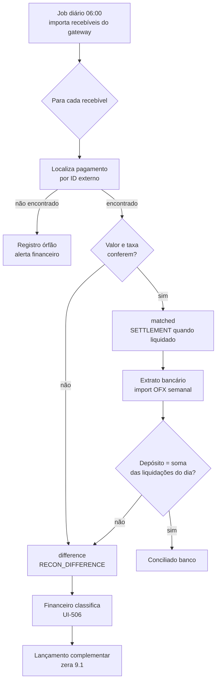

**Estados de `amc_reconciliation_record`:** `pending` (aguardando liquidação), `matched`, `difference`, `orphan` (recebível sem pedido), `missing` (pedido pago sem recebível após prazo esperado + 3 dias), `resolved` (com justificativa e usuário).

**Tolerância:** zero centavo (BR-031). Toda diferença é registrada; o financeiro pode resolvê-la, mas não ocultá-la.

### 12.8. Split de pagamento — análise

| Aspecto | Situação verificada (21/10/2026) |
|---|---|
| Disponibilidade técnica | Mercado Pago (1:1 self-service; 1:N só via comercial), Pagar.me (recebedores + regras de split), Asaas (`splits[]` com `walletId`) e PagBank oferecem split |
| Requisito | **Cada recebedor precisa ser um titular (CPF/CNPJ) com conta/KYC no provedor** ou conta bancária do mesmo titular |
| Ministérios sem CNPJ | **Não podem ser recebedores.** Usar CPF de um líder é inadequado do ponto de vista fiscal, de governança e de LGPD |
| Implicações fiscais | Cada recebedor seria vendedor/prestador: obrigações fiscais próprias; a loja passaria a operar como marketplace (intermediação) — **validar com contador/advogado** |
| Implicações contratuais | Contrato de marketplace com o gateway; responsabilidade por chargeback definida por recebedor |
| Implicações operacionais | Reembolsos e chargebacks precisam ser debitados do recebedor certo; frete e taxas exigem regra de split por transação |
| **Recomendação** | **Não usar split no MVP.** Usar atribuição gerencial + repasse interno. Reavaliar só se ministérios virarem pessoas jurídicas (ou filiais com CNPJ) — DEC-008 |

### 12.9. Relatórios e dashboards financeiros

**Filtros comuns:** período (competência ou caixa — seletor explícito), ministério (limitado ao escopo), produto/SKU, categoria, pedido, status do pagamento, status da entrega, canal (`online`, `evento`, `manual`), versão da regra.

**KPIs e fórmulas**

| KPI | Fórmula (a partir do ledger) | Limitação |
|---|---|---|
| Venda bruta | Σ C 3.1 | Inclui pedidos depois reembolsados |
| Descontos | Σ D 3.2 | — |
| Devoluções/cancelamentos | Σ D 3.3 | Data de competência do reembolso, não da venda |
| Receita líquida | 3.1 − 3.2 − 3.3 (+ 3.4 para a Central) | — |
| Taxas de pagamento | Σ D 4.2 | Taxa estimada até a liquidação; ajustada depois |
| CMV | Σ D 4.1 − Σ C 4.1 | Depende da qualidade do custo cadastrado |
| Margem de contribuição | Receita líquida − (4.1 + 4.2 + 4.3 + 4.4 + 4.6 + 4.7 + 4.8) | — |
| Margem % | Margem de contribuição ÷ receita líquida | Indefinida se receita = 0 |
| Resultado gerencial | Margem de contribuição − 5.1 | Só após fechamento |
| A receber | Saldo de 1.1 por centro | Por data de liquidação prevista |
| Recebido | Σ D 1.2 por `SETTLEMENT` | — |
| Diferenças de conciliação | Saldo de 9.1 | Deve ser zero no fechamento |
| Ticket médio do ministério | Receita líquida ÷ nº de pedidos com item do ministério | Um pedido conta para vários ministérios |

**Dashboard da administração central (UI-501):** consolidado do período; tabela de ministérios (receita líquida, margem, margem %, devoluções, a receber) ordenável; pendências (conciliação, reembolsos aguardando aprovação, divergências de sincronização); gráfico de receita líquida por semana (barras empilhadas por ministério, no máximo 8 séries + "Outros").

**Dashboard do ministério (UI-301):** somente seu(s) centro(s); receita líquida, margem, produtos mais vendidos, devoluções, estoque baixo, comparação com período anterior, e o extrato de lançamentos com explicação em linguagem simples ("Taxa do cartão do pedido WC-10234 — parte proporcional do ministério").

### 12.10. Fechamento mensal (PRC-020)

1. Até D+5 do mês seguinte: importar todos os recebíveis e extratos do mês.
2. Resolver todas as diferenças em 9.1 (ou justificar e transferir para o mês seguinte).
3. Lançar despesas compartilhadas do mês (UI-510) e executar o rateio (`SHARED_EXPENSE_ALLOC`).
4. Executar a verificação de invariantes (FR-058) e da cadeia de hash.
5. Gerar relatórios por ministério (PDF + CSV) e o arquivo para a contabilidade.
6. Fechar o período (BR-022): bloqueia lançamentos com competência no mês; eventos tardios (ex.: chargeback de um pedido de outubro recebido em dezembro) entram no período aberto com referência ao pedido original.
7. Aprovação: Financeiro central fecha; Auditor revisa; responsáveis de ministério recebem o relatório.

---
<a id="s13"></a>

## 13. Usuários, perfis e permissões

### 13.1. Perfis

| # | Perfil (papel WordPress) | Quem é | Escopo | MFA | Observação |
|---|---|---|---|---|---|
| 1 | **Superadministrador** (`amc_superadmin`) | Responsável técnico (máx. 2 pessoas) | Global | Obrigatório (chave de segurança preferível) | Único com instalação de plugins e configurações técnicas; **sem** acesso operacional diário. Conta separada da conta pessoal |
| 2 | **Administrador da loja** (`amc_store_admin`) | Coordenação da loja | Global | Obrigatório | Configurações de loja, usuários (exceto superadmin), aprovações |
| 3 | **Gestor de e-commerce** (`amc_ecom_manager`) | Operação comercial | Global (catálogo, pedidos, promoções) | Obrigatório | Não vê ledger detalhado nem altera regras financeiras |
| 4 | **Financeiro central** (`amc_finance`) | Tesouraria/financeiro da Igreja | Global (financeiro) | Obrigatório | Regras, conciliação, reembolsos acima do limite, fechamento |
| 5 | **Responsável por ministério** (`amc_ministry_lead`) | Líder ou tesoureiro do ministério | **Seus ministérios** | Obrigatório | Vê resultado do seu ministério; solicita produtos e preços |
| 6 | **Operador de ministério** (`amc_ministry_operator`) | Voluntário do ministério | **Seus ministérios** | Recomendado (obrigatório se exportar) | Cadastra rascunhos de produtos, vê estoque e vendas por produto, **sem** dados financeiros de margem |
| 7 | **Estoquista** (`amc_stock`) | Equipe de depósito | Global (estoque) | Recomendado | Recebimento, conferência, inventário; não vê preços de custo (opcional, DEC-016) |
| 8 | **Operador de expedição** (`amc_shipping`) | Equipe de expedição | Global (pedidos a expedir) | Recomendado | Picking, packing, etiquetas; vê nome e endereço só do pedido em expedição |
| 9 | **Atendimento ao cliente** (`amc_support`) | SAC | Global (pedidos e clientes) | Obrigatório | Consulta pedidos, solicita cancelamento/reembolso até o limite |
| 10 | **Auditor / relatórios** (`amc_auditor`) | Conselho fiscal, auditor interno | Global, **somente leitura** | Obrigatório | Lê ledger, logs de auditoria e relatórios; não altera nada |
| 11 | **Cliente** (`customer`) | Comprador | Próprios dados | Opcional | Área do cliente |
| 12 | **Integração** (usuários técnicos) | Serviços (ERP, gateway, frete) | Por integração | N/A (credenciais rotacionáveis) | Chaves REST do Woo com permissão mínima; segredos de webhook; nunca usuário humano compartilhado |

Ajuste em relação à lista do briefing: foi separado **Operador de ministério** de **Responsável** para que voluntários possam ajudar sem acesso a margens; e o **Superadministrador** é técnico, não de negócio.

### 13.2. Matriz de permissões

Legenda: ✔ permitido · **E** somente no próprio escopo de ministério · **S** solicita (vai para aprovação) · **L** até limite configurado · — negado.

| Ação | Super | Admin loja | Gestor e-com | Financeiro | Resp. ministério | Operador ministério | Estoquista | Expedição | Atendimento | Auditor | Cliente |
|---|---|---|---|---|---|---|---|---|---|---|---|
| Visualizar produtos (admin) | ✔ | ✔ | ✔ | ✔ | E | E | ✔ | ✔ | ✔ | ✔ | — |
| Criar produto (rascunho) | ✔ | ✔ | ✔ | — | E | E | — | — | — | — | — |
| Publicar produto | ✔ | ✔ | ✔ | — | S | — | — | — | — | — | — |
| Editar preço | ✔ | ✔ | ✔ | — | S (E) | — | — | — | — | — | — |
| Alterar SKU (antes de movimentação) | ✔ | ✔ | ✔ | — | — | — | — | — | — | — | — |
| Alterar SKU (após movimentação — 10.8) | — | aprova | S | — | — | — | — | — | — | — | — |
| Alterar ministério responsável | — | aprova (com Financeiro) | S | aprova | S (E) | — | — | — | — | — | — |
| Alterar estoque (documento) | — | ✔ | — | — | — | — | ✔ (ajuste com aprovação) | — | — | — | — |
| Editar estoque diretamente no Woo | — | — | — | — | — | — | — | — | — | — | — |
| Visualizar pedidos | ✔ | ✔ | ✔ | ✔ | E (itens do ministério, cliente mascarado) | E (itens, sem dados do cliente) | — | ✔ (fila) | ✔ | ✔ | Próprios |
| Cancelar pedido não expedido | — | ✔ | ✔ | ✔ | — | — | — | — | S | — | Próprio, antes do pagamento ou em até X h (DEC-025) |
| Autorizar reembolso | — | ✔ (L) | ✔ (L) | ✔ | — | — | — | — | S/L | — | Solicita |
| Ver dados financeiros (receita) | ✔ | ✔ | ✔ | ✔ | E | E (só receita por produto) | — | — | — | ✔ | — |
| Ver margem, custos, ledger | — | ✔ | — | ✔ | E | — | — | — | — | ✔ | — |
| Exportar relatórios | — | ✔ | ✔ | ✔ | E | — | ✔ (estoque) | — | — | ✔ | Próprios dados (LGPD) |
| Exportar dados pessoais de clientes | — | ✔ (com registro) | — | — | — | — | — | — | — | — | — |
| Gerenciar usuários | ✔ | ✔ (exceto super) | — | — | Convida operadores (E), sujeito a aprovação | — | — | — | — | — | — |
| Alterar regras financeiras | — | aprova | — | ✔ (dupla aprovação) | — | — | — | — | — | — | — |
| Fechar período | — | — | — | ✔ | — | — | — | — | — | — | — |
| Alterar configurações globais | ✔ (técnicas) | ✔ (loja) | — | — | — | — | — | — | — | — | — |
| Instalar/atualizar plugins | ✔ (via pipeline) | — | — | — | — | — | — | — | — | — | — |
| Ver logs de auditoria | ✔ | ✔ | — | ✔ (financeiro) | E (do seu ministério) | — | — | — | — | ✔ | — |

**Limites propostos (validar em DEC-016):** atendimento pode solicitar reembolsos; aprovação por Gestor/Admin até R$ 300 por pedido; acima disso, Financeiro. Ajuste de estoque com valor ao custo > R$ 200 exige aprovação do Financeiro.

### 13.3. Aplicação no backend (não só na interface)

1. **Capacidades WordPress próprias** (`amc_view_ministry_finance`, `amc_manage_products`, `amc_approve_refund`, …) atribuídas aos papéis; papéis nativos do WooCommerce (`shop_manager`) **não** são usados por usuários de ministério.
2. **Escopo de ministério** em `amc_user_scope (user_id, ministry_id, role_in_ministry, granted_by, valid_from, valid_to)`.
3. **Endpoints REST `amc/v1/*`**: todo `permission_callback` verifica capacidade **e** escopo. O repositório de dados recebe o contexto do usuário e **injeta obrigatoriamente** `WHERE ministry_id IN (:escopo)` — a consulta sem escopo é impossível fora de serviços marcados como globais (padrão *Scoped Repository*; revisão de código bloqueia SQL direto fora dos repositórios).
4. **Usuários de ministério não acessam as telas nativas de pedidos do WooCommerce** (sem `edit_shop_orders`/`read_shop_order`), porque elas não respeitam escopo. Eles usam o painel do ministério (UI-301 a UI-314), que só lê via REST com escopo.
5. **Mascaramento de dados pessoais** no serializer do endpoint (não no front): nome do cliente como "Maria S.", sem e-mail/telefone/endereço/CPF para perfis de ministério.
6. **Exportações** são geradas no servidor com o mesmo repositório escopado, registradas em `amc_audit_log` e disponibilizadas por link assinado que expira em 15 min.
7. **Testes automatizados** de autorização para cada endpoint (TEST-040 a TEST-044) — um endpoint sem teste de escopo não passa no CI.
8. **Integrações**: chaves REST WooCommerce com permissão mínima (leitura ou leitura/escrita conforme necessidade) e por integração; webhooks verificados por assinatura.

### 13.4. Segregação de funções (BR-017)

| Conflito | Regra |
|---|---|
| Quem solicita reembolso ≠ quem aprova (acima do limite) | Sistema impede aprovar a própria solicitação |
| Quem compra ≠ quem confere o recebimento | Conferência cega; conferente diferente do comprador |
| Quem cria regra financeira ≠ único aprovador | Dupla aprovação |
| Quem ajusta estoque ≠ quem aprova ajustes acima do limite | Aprovação do Financeiro |
| Superadmin técnico não opera financeiro | Papéis distintos; conta técnica não tem `amc_finance` |
| Responsável por ministério não aprova o próprio preço | Aprovação do Gestor de e-commerce |

### 13.5. Autenticação

- MFA (TOTP ou chave de segurança/WebAuthn) obrigatório para perfis 1–5, 9 e 10, via plugin de 2FA mantido (ex.: "Two-Factor", do projeto WordPress) — validar na Fase 1.
- Senhas: mínimo 12 caracteres, verificação contra listas de senhas vazadas; bloqueio progressivo após falhas; Turnstile no login.
- Sessões administrativas expiram após 8 h; reautenticação para ações sensíveis (aprovar reembolso, alterar regra, exportar dados pessoais).
- `wp-admin` e `wp-login.php` protegidos por regras de WAF/rate limit; XML-RPC desativado.
- Cliente: login por e-mail e senha, com opção de *magic link* (pós-MVP); checkout como convidado permitido (FR-071).

### 13.6. Auditoria

`amc_audit_log` (append-only) registra: quem, quando, IP (truncado após 90 dias), ação, entidade, antes/depois (campos alterados; dados pessoais mascarados), motivo, correlação. Eventos mínimos: login administrativo, falha de login, mudança de papel/escopo, mudança de preço, SKU, titularidade, regra financeira, aprovação/recusa, reembolso, ajuste de estoque, exportação, mudança de configuração, falha de verificação de webhook. Retenção: 5 anos para eventos financeiros (validar com a contabilidade — DEC-017), 1 ano para demais.

---
<a id="s14"></a>

## 14. Arquitetura técnica e modelo de dados

### 14.1. Componentes e responsabilidades

| Componente | Responsabilidade | Não faz |
|---|---|---|
| **Cloudflare** | DNS, TLS, CDN de estáticos e páginas anônimas, WAF, rate limit, Turnstile | Não guarda dados |
| **WordPress + WooCommerce** | Catálogo público, carrinho, checkout (Store API), pedidos (HPOS), cupons, reservas, e-mails, área do cliente | Não decide titularidade nem calcula resultado |
| **Tema `amc-theme`** | Templates de blocos, design system, componentes de loja | Sem regra de negócio |
| **Plugin `amc-core`** | Domínio: ministérios, SKU, titularidade, atribuição, regras, ledger, conciliação, permissões com escopo, painéis React, conectores (ERP, gateway — recebíveis, frete), outbox/inbox, auditoria, relatórios | Não altera tabelas do núcleo do WooCommerce diretamente |
| **Plugins de terceiros (mínimos)** | Gateway (oficial), Melhor Envio (oficial), campos brasileiros, 2FA, SMTP/SES, cache de objetos (Redis), Product Bundles (se kits usarem a extensão) | — |
| **MySQL 8 (InnoDB)** | Tabelas WordPress/WooCommerce + `amc_*` | — |
| **Redis** | Cache de objetos e sessões | Não é fonte de verdade |
| **Action Scheduler + WP-Cron real** (cron do sistema chamando `wp cron event run` a cada minuto; `DISABLE_WP_CRON=true`) | Filas: outbox, webhooks de entrada, reconciliações, alertas, e-mails | — |
| **Bling** | Estoque físico, compras, NF-e | — |
| **Gateway** | Pagamento, reembolso, recebíveis | — |
| **Melhor Envio** | Cotação, etiqueta, rastreio | — |
| **SES/Postmark** | Entrega de e-mail | — |
| **Sentry / Better Stack** | Erros, uptime, logs | — |
| **Bucket externo** | Backups e cadeia de hash do ledger | — |

### 14.2. Fontes oficiais de cada informação

| Dado | Fonte oficial | Consumidores |
|---|---|---|
| Ministérios, escopos de usuário | `amc-core` | Todos |
| Identidade do produto, SKU, titularidade, dicionários | `amc-core` | Woo (projeção), ERP |
| Conteúdo de vitrine (descrição, imagens, categorias, SEO) | WooCommerce | — |
| Preço de venda | WooCommerce, com histórico em `amc_price_history` (gravado por hook) | ERP (informativo) |
| Custo | `amc-core` | Ledger |
| Saldo físico | Bling | `amc-core` (espelho), Woo (vendável) |
| Reservas de checkout | WooCommerce | — |
| Pedido e itens (comerciais) | WooCommerce | `amc-core`, ERP, frete |
| Atribuição e resultado | `amc-core` (ledger) | Relatórios |
| Pagamento (status) | Gateway | Woo, `amc-core` |
| Recebíveis/liquidação | Gateway (relatório) | `amc-core` (conciliação) |
| Documento fiscal | Bling | Woo (link/chave no pedido) |
| Remessa e rastreio | Melhor Envio | Woo, `amc-core` |
| Dados do cliente | WooCommerce | Gateway, frete, ERP (mínimo necessário) |

### 14.3. Fluxo de dados — pedido pago

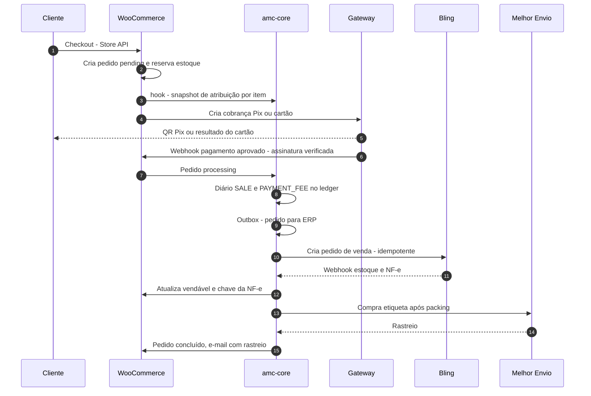

### 14.4. Dados nas tabelas nativas × tabelas próprias

| Dado | Onde | Como | Observação |
|---|---|---|---|
| Produtos, variações, preços, estoque vendável, imagens, categorias | Nativo (`wp_posts`, `wp_postmeta`, `wc_product_meta_lookup`, taxonomias) | API de produtos do WooCommerce (`WC_Product`) | Nunca SQL direto |
| `sku_uid` no produto | Meta do produto `_amc_sku_uid` | `update_meta_data()` | Também na tabela própria `amc_sku` |
| Pedidos, itens, endereços | Nativo HPOS (`wc_orders`, `wc_order_addresses`, `wc_order_operational_data`, `wc_orders_meta`, `woocommerce_order_items`, `woocommerce_order_itemmeta`) | `WC_Order` / CRUD | Compatível com HPOS declarado (`FeaturesUtil::declare_compatibility('custom_order_tables', ...)`) |
| `ministry_id` no item | Meta do item `_amc_ministry_id` (exibição) **e** `amc_order_item_allocation` (fonte) | Hook `woocommerce_checkout_create_order_line_item` / evento da Store API | A tabela própria é a fonte de relatório |
| Reservas | Nativo `wc_reserved_stock` | Mecanismo nativo | — |
| Cupons | Nativo (`shop_coupon`) + meta `_amc_issuer_ministry_id` | — | — |
| Reembolsos | Nativo (pedido de reembolso) + `amc_refund_request` (workflow) | — | — |
| Clientes | Nativo (`wp_users`, `wc_customer_lookup`) | — | — |
| Todo o resto do domínio | Tabelas `{prefix}amc_*` | `dbDelta` + migrações versionadas | 14.5 |

**Compatibilidade com atualizações:** nenhuma alteração em arquivos ou tabelas do núcleo; uso apenas de hooks, CRUD e APIs públicas; testes de regressão automatizados rodando contra a próxima versão do WooCommerce (beta/RC) em homologação antes de atualizar a produção ([29.17](#s29)).

### 14.5. Modelo de dados (tabelas próprias)

Convenções: prefixo `{wp_prefix}amc_`; PK `id` `CHAR(26)` ULID (exceto tabelas de altíssimo volume, que usam `BIGINT UNSIGNED AUTO_INCREMENT` + `uid`); valores em `BIGINT` centavos; datas `DATETIME(6)` em UTC (exibição em America/Sao_Paulo); `created_at`, `updated_at` (exceto tabelas append-only).

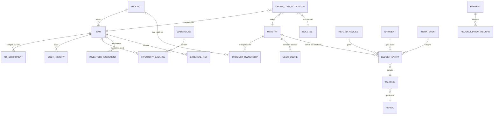

*Pedidos e itens do WooCommerce (`wc_orders`, `woocommerce_order_items`) são referenciados por `order_id`/`order_item_id`; não aparecem no diagrama por serem nativos.*

#### Entidades

**`amc_ministry`** — Ministérios e Loja Central.
- Campos: `id`, `code` CHAR(3), `name`, `slug`, `status` ENUM(active,suspended,archived), `parent_id`, `result_center_type` ENUM(ministry,central,event), `storefront_enabled`, `brand_color`, `logo_attachment_id`, `financial_policy_id`, `transfer_policy`, timestamps.
- Restrições: `UNIQUE(code)`, `UNIQUE(slug)`; exatamente um `central` (verificado na aplicação); `code` imutável após primeiro produto (BR-033).
- Índices: `status`, `parent_id`.
- Sensível: não.

**`amc_user_scope`** — Escopo de usuário por ministério.
- Campos: `id`, `user_id` (wp_users), `ministry_id`, `role_in_ministry` ENUM(lead,operator,viewer), `granted_by`, `valid_from`, `valid_to`, `reason`.
- Restrições: `UNIQUE(user_id, ministry_id, valid_from)`; FK lógica para `wp_users`.
- Índices: `(user_id, valid_to)`, `(ministry_id)`.
- Regra: escopo vencido não concede acesso; mudanças auditadas.

**`amc_product`** — Identidade do produto (espelha o produto pai/simples do Woo).
- Campos: `id` (ULID = `product_uid`), `wc_product_id`, `base_sku`, `product_type_code` (TT), `origin_ministry_code`, `status` ENUM(draft,pending_approval,active,archived), `replaces_product_id`, `legacy_code`, timestamps.
- Restrições: `UNIQUE(wc_product_id)`, `UNIQUE(base_sku)`.
- Índices: `status`, `legacy_code`.

**`amc_sku`** — Unidade vendável/estocável (produto simples ou variação).
- Campos: `id` (`sku_uid`), `product_id`, `wc_variation_id` (ou id do produto simples), `sku` VARCHAR(24), `color_code`, `size_code`, `is_stockable`, `is_kit`, `is_digital`, `preorder_enabled`, `preorder_limit`, `preorder_eta`, `min_stock`, `safety_margin`, `barcode`, `gtin`, `ncm`, `weight_g`, `length_mm`, `width_mm`, `height_mm`, `location_code`, `locked_at` (1ª movimentação/venda), `superseded_by`, `status`.
- Restrições: `UNIQUE(sku)` (comparação em maiúsculas), `UNIQUE(gtin)` quando não nulo; `CHECK` de formato na aplicação (regex 10.3); `locked_at` não nulo impede alteração de `sku`.
- Índices: `product_id`, `status`, `gtin`.

**`amc_sku_sequence`** — Contador de sequência por TT.
- Campos: `product_type_code` (PK), `next_value`. Acesso com `SELECT … FOR UPDATE`.

**`amc_dictionary`** — Dicionários (tipos, cores, tamanhos, atributos).
- Campos: `id`, `dict` ENUM(type,color,size,attr), `code`, `label`, `sort`, `active`.
- Restrições: `UNIQUE(dict, code)`; não pode ser excluído se usado.

**`amc_product_ownership`** — Titularidade com vigência.
- Campos: `id`, `product_id`, `ministry_id`, `share_bp`, `valid_from`, `valid_to`, `reason`, `approved_by`, `request_id`.
- Restrições: soma de `share_bp` = 10000 em qualquer instante (validação transacional); sem sobreposição de vigência para o mesmo produto/ministério.
- Índices: `(product_id, valid_from)`, `(ministry_id)`.

**`amc_kit_component`** — Composição de kits.
- Campos: `kit_sku_id`, `component_sku_id`, `qty`, `reference_price_cents`.
- PK: `(kit_sku_id, component_sku_id)`. Restrição: componente não pode ser kit (sem kits aninhados no MVP).

**`amc_price_history`** — Histórico de preço.
- Campos: `id`, `sku_id`, `regular_price_cents`, `sale_price_cents`, `sale_from`, `sale_to`, `changed_by`, `reason`, `changed_at`. Append-only.

**`amc_cost_history`** — Custo unitário e custo médio.
- Campos: `id`, `sku_id`, `event` ENUM(receipt,manual,adjustment), `qty`, `unit_cost_cents`, `avg_cost_after_cents`, `source_ref` (entrada no ERP), `created_by`, `created_at`. Append-only.
- Regra: custo médio ponderado (BR-020).

**`amc_warehouse`** — Depósitos (espelho dos depósitos do ERP).
- Campos: `id`, `code` (`LOJA-ONLINE`, `QUARENTENA`, `AVARIA`, `EVENTO-xxx`), `name`, `type` ENUM(sellable,quarantine,damaged,event,transit), `erp_ref`, `ministry_id` (opcional), `active`.

**`amc_inventory_balance`** — Espelho de saldo por SKU × depósito.
- Campos: `sku_id`, `warehouse_id`, `physical_qty`, `erp_updated_at`, `synced_at`.
- PK: `(sku_id, warehouse_id)`. Não é fonte oficial no cenário B.

**`amc_inventory_movement`** — Movimentos (fonte oficial no cenário A; espelho/auditoria no B).
- Campos: `id` BIGINT, `uid`, `sku_id`, `warehouse_id`, `type` ENUM(receipt,sale,cancel,return,transfer_out,transfer_in,adjustment,loss,count,sku_recode,initial), `qty` (com sinal), `unit_cost_cents`, `document_ref`, `order_id`, `reason`, `created_by`, `approved_by`, `occurred_at`. Append-only.
- Índices: `(sku_id, occurred_at)`, `(document_ref)`.

**`amc_order_item_allocation`** — Snapshot de atribuição (12.2).
- Campos: `id` BIGINT, `order_id`, `order_item_id`, `component_sku_id` (para kits), `sku_id`, `ministry_id`, `share_bp`, `qty`, `unit_list_price_cents`, `gross_cents`, `item_discount_cents`, `order_discount_alloc_cents`, `net_cents`, `unit_cost_cents_snapshot`, `rule_set_version_id`, `created_at`.
- Restrições: `UNIQUE(order_item_id, component_sku_id, ministry_id)`; `net_cents ≥ 0`.
- Índices: `(ministry_id, created_at)`, `(order_id)`, `(sku_id)`.

**`amc_allocation_rule_set`** — Regras versionadas (12.4).
- Campos: `id`, `version_label`, `effective_from`, `effective_to`, `status` ENUM(draft,simulated,active,retired), `definition_json`, `hash`, `created_by`, `approved_by_1`, `approved_by_2`, `approved_at`.
- Restrições: sem sobreposição de vigência entre `active`; `definition_json` imutável após `active`.

**`amc_payment`** — Pagamentos e eventos de pagamento normalizados.
- Campos: `id`, `order_id`, `provider`, `provider_payment_id`, `method` ENUM(pix,card,boleto), `installments`, `amount_cents`, `fee_estimated_cents`, `fee_actual_cents`, `status`, `approved_at`, `pix_expires_at`, `raw_ref` (id em inbox).
- Restrições: `UNIQUE(provider, provider_payment_id)`.
- Sensível: não armazena dados de cartão (apenas bandeira e últimos 4 dígitos, se o gateway fornecer).

**`amc_receivable`** — Recebíveis/parcelas informados pelo gateway.
- Campos: `id`, `payment_id`, `provider_receivable_id`, `installment`, `gross_cents`, `fee_cents`, `net_cents`, `expected_date`, `settled_date`, `status`.
- Restrições: `UNIQUE(provider, provider_receivable_id)`.

**`amc_reconciliation_record`** — Conciliação (12.7).
- Campos: `id`, `receivable_id`, `payment_id`, `expected_cents`, `actual_cents`, `difference_cents`, `status`, `classification`, `resolved_by`, `resolved_at`, `note`.

**`amc_refund_request`** — Workflow de reembolso.
- Campos: `id`, `order_id`, `items_json` (itens e quantidades), `amount_cents`, `reason_code`, `requested_by`, `approved_by`, `status` ENUM(requested,approved,rejected,processing,completed,failed), `wc_refund_id`, `provider_refund_id`, `return_required`, `return_received_at`.
- Regra: soma de reembolsos ≤ valor pago; aprovador ≠ solicitante quando acima do limite (BR-017).

**`amc_shipment`** — Remessas.
- Campos: `id`, `order_id`, `carrier`, `service`, `provider_label_id`, `tracking_code`, `cost_cents`, `status`, `weight_g`, `packed_by`, `picked_by`, `posted_at`, `delivered_at`, `is_reverse`.

**`amc_period`** — Períodos gerenciais.
- Campos: `id` (`2026-11`), `status` ENUM(open,closing,closed), `closed_by`, `closed_at`.

**`amc_journal`** e **`amc_ledger_entry`** — Ledger (12.5).
- `amc_journal`: `id`, `entry_type`, `period_id`, `source_event_id`, `order_id`, `created_at`, `balanced` (verificado).
- `amc_ledger_entry`: campos de 12.5; `id` BIGINT + `uid`.
- Restrições: `UNIQUE(source_event_id, entry_type, order_item_id, center_id, account_code, direction)`; triggers anti-UPDATE/DELETE; Σ D = Σ C por `journal_id` (verificado antes do commit).
- Índices: `(center_id, competence_date)`, `(order_id)`, `(account_code, competence_date)`, `(period_id)`.

**`amc_shared_expense`** — Despesas compartilhadas do mês a ratear.
- Campos: `id`, `period_id`, `description`, `category`, `amount_cents`, `document_ref`, `created_by`.

**`amc_inbox_event`** — Eventos recebidos (webhooks).
- Campos: `id` BIGINT, `provider`, `external_event_id`, `topic`, `signature_valid`, `payload_encrypted` (ou referência), `received_at`, `processed_at`, `status` ENUM(received,processed,failed,ignored), `attempts`, `last_error`.
- Restrições: `UNIQUE(provider, external_event_id)` (idempotência — BR-015).
- Retenção: payload 90 dias; metadados 2 anos.
- Sensível: sim (payload pode conter dados pessoais) → criptografia em repouso no nível da aplicação (libsodium) com chave fora do banco.

**`amc_outbox_event`** — Eventos a enviar.
- Campos: `id` BIGINT, `destination`, `type`, `aggregate_id`, `idempotency_key`, `payload_json`, `status`, `attempts`, `next_attempt_at`, `last_error`, `created_at`, `dispatched_at`.
- Restrições: `UNIQUE(destination, idempotency_key)`.
- Índices: `(status, next_attempt_at)`.

**`amc_external_ref`** — Mapeamento de IDs externos.
- Campos: `entity_type`, `internal_id`, `system` (woo, bling, gateway, melhorenvio, legacy), `external_id`, `created_at`.
- PK: `(entity_type, internal_id, system)`; `UNIQUE(system, entity_type, external_id)`.

**`amc_sync_discrepancy`** — Divergências de sincronização/reconciliação.
- Campos: `id`, `kind`, `entity_ref`, `expected`, `actual`, `detected_at`, `status`, `resolved_by`, `note`.

**`amc_audit_log`** — Auditoria (13.6). Append-only; índices `(entity_type, entity_id)`, `(user_id, created_at)`.

**`amc_approval`** — Aprovações genéricas (preço, produto, titularidade, regra, ajuste, reembolso).
- Campos: `id`, `subject_type`, `subject_id`, `requested_by`, `status`, `decided_by`, `decided_at`, `comment`.

**`amc_product_request`** — Solicitação de novo produto por ministério (PRC-001).
- Campos: `id`, `ministry_id`, `payload_json`, `status`, `requested_by`, `reviewed_by`, `product_id`.

**Entidades da lista do briefing não criadas como tabela própria:** `Customers`, `Orders`, `OrderItems`, `Categories`, `Users`, `Roles`, `Permissions` (nativos do WordPress/WooCommerce); `Suppliers` e `PurchaseOrders` (no ERP — no cenário A, adicionar `amc_supplier` e `amc_purchase_order`); `FinancialEntries` = `amc_ledger_entry`; `ProductVariants` = `amc_sku` + variações nativas.

### 14.6. Tratamento de falhas

| Falha | Comportamento | Recuperação |
|---|---|---|
| Gateway fora do ar | Checkout mostra erro amigável e permite outro método; pedido fica `pending`/`failed` | Cliente tenta novamente; alerta se taxa de erro > 20% em 10 min |
| Webhook do gateway não chega | Job de consulta de pedidos `pending` com pagamento iniciado (a cada 5 min por até 24 h) consulta status na API | Automática |
| Webhook duplicado | `UNIQUE(provider, external_event_id)` → ignorado com registro | Automática |
| Webhook com assinatura inválida | Rejeitado (401), registrado, alerta de segurança após 5 em 10 min | Investigação |
| ERP indisponível | Outbox acumula; venda continua (11.7) | Retry; dead letter; alerta |
| Melhor Envio indisponível | Cotação cai para tabela de contingência por faixa de CEP/peso (FR-045) com aviso "prazo estimado"; etiqueta adiada | Automática ao voltar |
| E-mail não entregue | Fila com retry; log de bounce | Atendimento reenvia |
| Falha no lançamento do ledger | Transação revertida; pedido marcado `ledger_pending`; job reprocessa; alerta | Automática/manual |
| Divergência de invariante | Bloqueia fechamento do período; alerta ao financeiro e à tecnologia | Correção por reversão |

### 14.7. Escalabilidade

- Página de produto e listagens anônimas servidas por cache de página (Cloudflare/hospedagem) com purga por evento (mudança de preço/estoque); carrinho/checkout sem cache.
- Cache de objetos (Redis) obrigatório.
- Consultas de relatório nunca leem `wp_postmeta`/tabelas de pedido diretamente: leem `amc_order_item_allocation` e `amc_ledger_entry`, indexadas; agregados mensais materializados (`amc_ledger_monthly_summary`) recalculados por job.
- Picos de conferência: teste de carga (21.3) com 10× a média; plano de escalonamento vertical temporário da hospedagem.
- Limpeza periódica do Action Scheduler (ações concluídas > 30 dias).

---
<a id="s15"></a>

## 15. Jornada completa do cliente

### 15.1. Fluxo principal

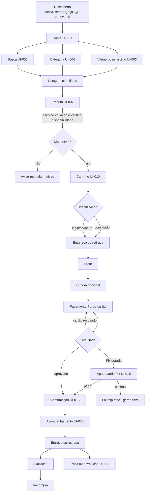

### 15.2. Etapas

| # | Etapa | Objetivo do usuário | Interface | Ações | Dados | Regras de negócio | Erros | Próxima | Eventos de analytics |
|---|---|---|---|---|---|---|---|---|---|
| 1 | Descoberta | Encontrar a loja | Resultado de busca, post, QR code em evento | Clicar link | UTM | Links de campanha com UTM padronizado (24.7) | Link quebrado → 404 útil | 2 ou 8 | `page_view` com UTM |
| 2 | Home | Entender o que há e onde ir | UI-001 | Buscar, escolher ministério/categoria, ver destaques | Coleções ativas | Destaques definidos pelo Gestor; evento ativo ganha destaque | Falha de bloco dinâmico → oculta seção | 3–5 | `view_item_list` (vitrines), `select_promotion` |
| 3 | Exploração por ministério | Ver produtos de um ministério | UI-003 | Filtrar, ordenar, abrir produto | Ministério, produtos ativos | Só ministérios com `storefront_enabled` | Ministério sem produtos → estado vazio com sugestões | 8 | `view_item_list` (`item_list_id=min_{code}`) |
| 4 | Exploração por categoria | Ver um tipo de produto | UI-004 | Idem | Categoria | Selo do ministério em cada card | Idem | 8 | `view_item_list` |
| 5 | Busca | Achar algo específico | UI-005 | Digitar, ver sugestões, enviar | Termo | Busca por nome, SKU, autor, ministério; sinônimos ("camisa"→"camiseta"); tolera acentos | Sem resultados → sugestões e categorias | 6/8 | `search` (`search_term`) |
| 6 | Filtros | Reduzir resultados | Painel de filtros (drawer no mobile) | Ministério, categoria, tamanho, cor, faixa de preço, disponibilidade | Atributos | Contagem por opção; filtros sem resultado desabilitados | — | 7/8 | `filter_apply` (custom) |
| 7 | Ordenação | Ver primeiro o que importa | Seletor | Relevância, mais vendidos, menor/maior preço, novidades | — | Padrão: relevância (busca) / mais vendidos (listas) | — | 8 | `sort_apply` (custom) |
| 8 | Página de produto | Decidir a compra | UI-007 | Ver fotos, escolher variação, calcular frete, adicionar | Produto, variações, estoque, preço, parcelamento | Preço à vista e parcelado exibidos de forma clara; ministério identificado | Variação indisponível → desabilitada com rótulo | 9 | `view_item`, `select_item` |
| 9 | Escolha de variações | Selecionar cor e tamanho | Seletor visual (swatch) + guia de medidas | Selecionar | Variações | Combinação inexistente não aparece; esgotada aparece riscada com "Avise-me" | — | 10 | `select_variant` (custom) |
| 10 | Disponibilidade | Saber se tem e quando chega | PDP | Calcular frete por CEP | CEP | Mostra "Em estoque", "Últimas unidades" (≤ 3, só se verdadeiro), "Pré-venda — envio a partir de dd/mm", "Esgotado" | CEP inválido | 11 | `shipping_estimate` (custom) |
| 11 | Adição ao carrinho | Guardar o item | Mini-carrinho (drawer) | Adicionar, continuar ou ir ao carrinho | Item, qtd | Qtd máx. por pedido configurável (padrão 10 por SKU); limite de pré-venda | Sem estoque no momento → mensagem e sugestão | 12 | `add_to_cart` |
| 12 | Carrinho | Revisar | UI-010 | Alterar qtd, remover, cupom, frete estimado | Carrinho | Agrupa visualmente por ministério? **Não** (uma loja); mostra selo do ministério no item. Aviso se preço mudou (BR-019) | Item esgotou → destaque e remoção assistida | 13 | `view_cart`, `remove_from_cart` |
| 13 | Identificação | Comprar rápido | Checkout etapa 1 (UI-011) | E-mail; convidado ou login; cadastro opcional após a compra | E-mail, nome, CPF (para NF-e e transportadora), telefone | CPF/CNPJ validados (dígito; CNPJ alfanumérico — FR-070); consentimentos separados (termos obrigatório; marketing opcional desmarcado) | E-mail já cadastrado → oferecer login sem bloquear | 14 | `begin_checkout`, `login`, `sign_up` |
| 14 | Endereço | Informar onde receber | Checkout etapa 2 | CEP preenche endereço; número, complemento | Endereço | Autopreenchimento por CEP (API de CEP — INT-011); retirada local dispensa endereço de entrega | CEP não encontrado → preenchimento manual | 15 | — |
| 15 | Frete | Escolher entrega | Lista de opções | Escolher PAC, SEDEX, transportadora, retirada | Cotação | Preço e prazo em dias úteis; mais barata e mais rápida destacadas; frete grátis acima de X (se campanha) | Falha da cotação → tabela de contingência (FR-045) | 16 | `add_shipping_info` (`shipping_tier`) |
| 16 | Cupom | Aplicar desconto | Campo recolhido "Tem cupom?" | Aplicar/remover | Código | Validação no servidor; limite por CPF/e-mail; escopo (global/ministério/produto); não acumulativo por padrão | Inválido/expirado/não aplicável com motivo claro; tentativas limitadas (rate limit) | 17 | `apply_coupon` (custom) |
| 17 | Checkout (revisão) | Conferir tudo | Resumo fixo (desktop: lateral; mobile: recolhível) | Editar etapas | Pedido | Termos e políticas com link; total com frete discriminado (Decreto 7.962/2013) | — | 18 | — |
| 18 | Pagamento | Pagar com segurança | Pix ou cartão (campos do gateway — tokenização) | Escolher método, parcelas | Dados do cartão **no componente do gateway** | Parcelas com e sem juros claras (valor total por opção); Pix com tempo de expiração (padrão 30 min, DEC-026) | Recusa com motivo genérico e sugestão; timeout | 19 | `add_payment_info` (`payment_type`) |
| 19 | Confirmação | Saber que deu certo | UI-016 | Ver número do pedido, copiar Pix, criar conta | Pedido | E-mail imediato de confirmação (Decreto 7.962/2013 art. 4º) | E-mail não entregue → reenvio pela área do cliente | 20 | `purchase` (somente quando pago — 23.3) |
| 20 | Acompanhamento | Saber onde está | UI-017 (sem login, por nº do pedido + e-mail) e área do cliente | Ver status, rastreio, NF-e | Pedido, remessa | Linha do tempo: Pago → Em separação → Enviado → Entregue | Rastreio indisponível | 21 | `order_tracking_view` (custom) |
| 21 | Entrega ou retirada | Receber | E-mail/WhatsApp (pós-MVP) de status; aviso "pronto para retirada" | Retirar com documento + nº do pedido | — | Retirada: prazo de guarda 30 dias (proposta); conferência do documento | Não retirado → contato e política | 22/23 | — |
| 22 | Avaliação | Opinar | E-mail após 10 dias da entrega; formulário | Nota 1–5, comentário, foto opcional | Avaliação | Só compradores verificados; moderação antes de publicar; nenhuma avaliação é filtrada por ser negativa (sem manipulação) | — | 25 | `review_submit` (custom) |
| 23 | Troca e devolução | Resolver problema | UI-023/UI-024 | Selecionar itens, motivo, fotos | Pedido, itens | Arrependimento 7 dias (CDC art. 49); troca por tamanho conforme política; reversa gerada pelo sistema | Fora do prazo → explicação e canal | 24 | `return_request` (custom) |
| 24 | Atendimento | Falar com alguém | UI-027 (contato), e-mail, WhatsApp (link) | Enviar mensagem com nº do pedido | Contato | SLA de 1ª resposta proposto: 1 dia útil | — | — | `contact_submit` |
| 25 | Compra recorrente | Comprar de novo | Área do cliente "Comprar novamente" | Readicionar itens | Histórico | Recalcula preço e estoque atuais | Item indisponível | 12 | `reorder` (custom) |

### 15.3. Fluxos de exceção

| Situação | Comportamento do sistema | Mensagem ao cliente (exemplo) | Teste |
|---|---|---|---|
| **Carrinho abandonado** | Cliente identificado (e-mail informado e **consentimento de marketing**) recebe até 2 lembretes (1 h e 24 h); sem consentimento, nenhum e-mail de marketing (LGPD); carrinho persistido 7 dias | "Você deixou itens no carrinho. Eles não estão reservados." | TEST-060 |
| **Falha de pagamento (cartão)** | Pedido permanece `pending`; reserva mantida até expirar; cliente pode tentar outro cartão ou Pix sem refazer o checkout; após 3 recusas em 15 min, exigir Turnstile | "O pagamento não foi aprovado pelo emissor. Você pode tentar outro cartão ou pagar com Pix." | TEST-012 |
| **Pix expirado** | Reserva liberada na expiração + 5 min; pedido `cancelled` com motivo `pix_expired`; e-mail com link "gerar novo Pix" que recria a cobrança se houver estoque | "Seu Pix expirou. Gerar novo código" | TEST-011 |
| **Pix pago após expiração/cancelamento** | Webhook de pagamento para pedido cancelado → se houver estoque, reabre o pedido e segue normalmente (BR-014); se não houver, reembolso automático integral via API e e-mail explicativo; registro em ledger (`SALE` + `REFUND` no mesmo dia) | "Recebemos seu Pix, mas o item esgotou. Devolvemos o valor integral." | TEST-011 |
| **Produto esgotado durante o checkout** | Na finalização, reserva falha → retorna ao carrinho com o item marcado, demais itens preservados | "O item X esgotou enquanto você finalizava. Atualizamos seu carrinho." | TEST-001 |
| **Preço mudou no carrinho** | Recalcula ao abrir carrinho/checkout; mostra aviso com preço antigo e novo; o pedido é criado com o preço vigente (BR-019) | "O preço de X mudou de R$ 69,90 para R$ 59,90." | TEST-016 |
| **Alteração de endereço** | Permitida pelo cliente até o status "Em separação" (via atendimento); após etiqueta: só com cancelamento da etiqueta (custo, se houver) ou redirecionamento pela transportadora | — | TEST-061 |
| **Pedido cancelado** | Antes do pagamento: automático; após pagamento e antes da expedição: atendimento solicita, sistema estorna integral e libera estoque; após expedição: vira devolução | E-mail de cancelamento com valor e prazo de estorno | TEST-010 |
| **Reembolso parcial** | Seleção de itens/quantidades; cálculo automático do valor líquido (com desconto rateado); aprovação conforme limite; reembolso via API; ledger `REFUND` por ministério | E-mail com itens e valor devolvido; prazo do estorno no cartão depende do emissor | TEST-006 |
| **Problemas na entrega** (extravio, atraso, avaria) | Atendimento abre ocorrência na transportadora/Melhor Envio; opções: reenvio (nova remessa sem custo ao cliente) ou reembolso; custo atribuído conforme regra (Central por padrão) | "Abrimos uma ocorrência com a transportadora. Você receberá retorno em até X dias úteis." | TEST-062 |

---
<a id="s16"></a>

## 16. Inventário de interfaces

Legenda de **hospedagem**: **T** = tema da loja (WooCommerce + blocos) · **W** = tela nativa do WooCommerce/WordPress ajustada · **A** = tela própria do `amc-core` (React no wp-admin) · **ERP** = executada no Bling no cenário B (a especificação vale como requisito da PoC e como tela própria nos cenários A/C). **MVP**: ✔ entra no MVP · ◐ versão simplificada no MVP · — pós-MVP.

### 16.1. Loja pública

| ID | Tela | Hosp. | MVP | Perfil |
|---|---|---|---|---|
| UI-001 | Home | T | ✔ | Visitante |
| UI-002 | Todos os produtos | T | ✔ | Visitante |
| UI-003 | Vitrine do ministério | T | ✔ | Visitante |
| UI-004 | Categoria / coleção | T | ✔ | Visitante |
| UI-005 | Busca (sugestões instantâneas e página de resultados) | T | ✔ | Visitante |
| UI-006 | Resultados filtrados (estado da listagem com filtros) | T | ✔ | Visitante |
| UI-007 | Página de produto | T | ✔ | Visitante |
| UI-008 | Kits | T | ◐ | Visitante |
| UI-009 | Ofertas | T | ◐ | Visitante |
| UI-010 | Carrinho (página + mini-carrinho) | T | ✔ | Visitante |
| UI-011 | Checkout | T | ✔ | Visitante |
| UI-012 | Login | T | ✔ | Cliente |
| UI-013 | Cadastro | T | ✔ | Visitante |
| UI-014 | Recuperação de senha | T | ✔ | Cliente |
| UI-015 | Aguardando pagamento Pix | T | ✔ | Cliente |
| UI-016 | Confirmação de pedido | T | ✔ | Cliente |
| UI-017 | Acompanhamento de pedido (público) | T | ✔ | Cliente |
| UI-018 | Área do cliente — painel | T | ✔ | Cliente |
| UI-019 | Histórico de compras e detalhe do pedido | T | ✔ | Cliente |
| UI-020 | Endereços | T | ✔ | Cliente |
| UI-021 | Dados da conta e privacidade | T | ✔ | Cliente |
| UI-022 | Downloads (produtos digitais) | T | — (DEC-018) | Cliente |
| UI-023 | Solicitação de troca | T | ◐ | Cliente |
| UI-024 | Solicitação de devolução / arrependimento | T | ✔ | Cliente |
| UI-025 | Institucional (sobre a loja e os ministérios) | T | ✔ | Visitante |
| UI-026 | FAQ | T | ✔ | Visitante |
| UI-027 | Contato | T | ✔ | Visitante |
| UI-028 | Política de privacidade | T | ✔ | Visitante |
| UI-029 | Termos de uso | T | ✔ | Visitante |
| UI-030 | Política de entrega | T | ✔ | Visitante |
| UI-031 | Política de troca e devolução | T | ✔ | Visitante |
| UI-032 | Página 404 | T | ✔ | Visitante |
| UI-033 | Indisponibilidade / manutenção / erro | T | ✔ | Visitante |
| UI-034 | Preferências de cookies (banner e painel) | T | ✔ | Visitante |
| UI-035 | Landing de evento/coleção sazonal | T | ◐ | Visitante |
| UI-036 | Avise-me (disponibilidade) | T | ◐ | Visitante |
| UI-037 | Avaliação de produto (formulário) | T | — | Cliente |

### 16.2. Painel administrativo central

| ID | Tela | Hosp. | MVP | Perfil principal |
|---|---|---|---|---|
| UI-201 | Dashboard operacional | A | ✔ | Admin, Gestor |
| UI-202 | Ministérios — lista | A | ✔ | Admin |
| UI-203 | Ministério — cadastro/edição | A | ✔ | Admin |
| UI-204 | Produtos — lista | W | ✔ | Gestor |
| UI-205 | Produto — cadastro/edição (com painel `amc`) | W + A | ✔ | Gestor |
| UI-206 | Variações (aba do produto) | W + A | ✔ | Gestor |
| UI-207 | Catálogo de SKUs | A | ✔ | Gestor, Estoquista |
| UI-208 | Categorias e coleções | W | ✔ | Gestor |
| UI-209 | Gestão de preços (individual e em massa) | A | ✔ | Gestor |
| UI-210 | Fila de aprovações | A | ✔ | Admin, Gestor, Financeiro |
| UI-211 | Solicitações de produto dos ministérios | A | ✔ | Gestor |
| UI-212 | Correção excepcional de SKU | A | ◐ | Gestor, Admin |
| UI-213 | Importação em massa | A | ✔ | Gestor |
| UI-214 | Estoque — visão por SKU e depósito | A | ✔ | Gestor, Estoquista |
| UI-215 | Movimentações de estoque | A (espelho) / ERP | ✔ | Estoquista, Auditor |
| UI-216 | Inventário — planejamento e resultados | ERP + A | ◐ | Estoquista |
| UI-217 | Compras e fornecedores | ERP | ◐ | Financeiro |
| UI-218 | Pedidos — lista | W (HPOS) + colunas `amc` | ✔ | Gestor, Atendimento |
| UI-219 | Dicionários de SKU | A | ✔ | Gestor |
| UI-220 | Pedido — detalhe | W + painel `amc` | ✔ | Gestor, Atendimento |
| UI-221 | Expedição — visão gerencial | A | ✔ | Gestor |
| UI-222 | Entregas e ocorrências | A | ✔ | Atendimento |
| UI-223 | Clientes | W | ✔ | Atendimento |
| UI-224 | Cupons | W + campos `amc` | ✔ | Gestor |
| UI-225 | Promoções (preço promocional por período, combos) | A | ◐ | Gestor |
| UI-226 | Reembolsos — fila e aprovação | A | ✔ | Atendimento, Financeiro |
| UI-227 | Usuários | W + A | ✔ | Admin |
| UI-228 | Papéis e escopos | A | ✔ | Admin |
| UI-229 | Integrações | A | ✔ | Superadmin, Admin |
| UI-230 | Monitoramento de sincronização | A | ✔ | Admin, Tecnologia |
| UI-231 | Configurações da loja | W + A | ✔ | Admin |
| UI-232 | Auditoria | A | ✔ | Admin, Auditor |
| UI-233 | Logs de erro | A (resumo) + Sentry | ✔ | Tecnologia |
| UI-234 | Transferência de titularidade | A | ◐ | Gestor, Financeiro |
| UI-235 | Central de relatórios | A | ✔ | Admin, Gestor |

### 16.3. Painel do ministério

| ID | Tela | Hosp. | MVP | Perfil |
|---|---|---|---|---|
| UI-301 | Dashboard de desempenho | A | ✔ | Resp. ministério (Operador: versão sem margem) |
| UI-302 | Vendas | A | ✔ | Resp., Operador |
| UI-303 | Produtos do ministério | A | ✔ | Resp., Operador |
| UI-304 | Solicitar novo produto / alteração | A | ✔ | Resp., Operador |
| UI-305 | Estoque do ministério | A | ✔ | Resp., Operador |
| UI-306 | Pedidos com itens do ministério | A | ✔ | Resp., Operador |
| UI-307 | Receita atribuída (extrato) | A | ✔ | Resp. |
| UI-308 | Custos | A | ✔ | Resp. |
| UI-309 | Margem e resultado | A | ✔ | Resp. |
| UI-310 | Comparação por período | A | ◐ | Resp. |
| UI-311 | Produtos mais vendidos | A | ✔ (bloco do 301) | Resp., Operador |
| UI-312 | Produtos com baixo estoque | A | ✔ (bloco do 301) | Resp., Operador |
| UI-313 | Relatórios exportáveis | A | ✔ | Resp. |
| UI-314 | Histórico de alterações | A | ◐ | Resp. |

### 16.4. Estoque e expedição

| ID | Tela | Hosp. | MVP | Perfil |
|---|---|---|---|---|
| UI-401 | Recebimento | ERP (A no cenário A) | ✔ | Estoquista |
| UI-402 | Conferência de recebimento (cega) | ERP + A (leitura) | ✔ | Estoquista |
| UI-403 | Separação — picking list | A | ✔ | Expedição |
| UI-404 | Embalagem — packing e conferência por leitura | A | ✔ | Expedição |
| UI-405 | Etiquetas de envio | A (Melhor Envio) | ✔ | Expedição |
| UI-406 | Consulta rápida por SKU/código de barras | A | ✔ | Estoquista, Expedição |
| UI-407 | Impressão de etiquetas de produto e local | A | ✔ | Estoquista |
| UI-408 | Expedição — manifesto e postagem | A | ✔ | Expedição |
| UI-409 | Retiradas no local | A | ✔ | Expedição, Atendimento |
| UI-410 | Devoluções — recebimento e inspeção | A + ERP | ✔ | Estoquista |
| UI-411 | Ajustes de estoque | ERP (A no cenário A) | ✔ | Estoquista |
| UI-412 | Contagem de inventário | ERP (A no cenário A) | ◐ | Estoquista |

### 16.5. Financeiro

| ID | Tela | Hosp. | MVP | Perfil |
|---|---|---|---|---|
| UI-501 | Visão financeira consolidada | A | ✔ | Financeiro, Admin, Auditor |
| UI-502 | Resultado por ministério | A | ✔ | Financeiro, Auditor |
| UI-503 | Vendas brutas e líquidas | A | ✔ | Financeiro |
| UI-504 | Custos e taxas | A | ✔ | Financeiro |
| UI-505 | Reembolsos e chargebacks | A | ✔ | Financeiro |
| UI-506 | Conciliação e divergências | A | ✔ | Financeiro |
| UI-507 | Valores a receber | A | ✔ | Financeiro |
| UI-508 | Regras de rateio — editor e simulação | A | ✔ | Financeiro |
| UI-509 | Reprocessamento autorizado | A | — | Financeiro |
| UI-510 | Despesas compartilhadas | A | ◐ | Financeiro |
| UI-511 | Custos de produto | A | ✔ | Financeiro |
| UI-512 | Lançamentos auditáveis (explorador do ledger) | A | ✔ | Financeiro, Auditor |
| UI-513 | Exportações | A | ✔ | Financeiro, Auditor |
| UI-514 | Repasses a ministérios | A | — (DEC-007) | Financeiro |
| UI-515 | Fechamento mensal | A | ✔ | Financeiro |

**Total:** 37 telas públicas, 35 administrativas, 14 do ministério, 12 de estoque/expedição, 15 financeiras = **113 interfaces**.

---
<a id="s17"></a>

## 17. Especificação UX/UI de cada tela

### 17.0. Como ler as especificações e padrões globais

Cada tela segue um bloco com os 20 itens pedidos, agrupados assim: **Objetivo** (2) · **Perfil e contexto** (3, 4) · **Hierarquia e layout** (5, 6) · **Componentes e campos** (7, 8) · **Ações** (9 — primária em destaque; secundárias em menu) · **Estados** (10 carregando, 11 vazio, 12 sucesso, 13 erro) · **Validações e feedback** (14, 15) · **Permissões** (16) · **Responsivo** (17) · **Acessibilidade** (18) · **Analytics** (19) · **Aceite** (20). O nome (1) é o título do bloco.

Quando um item diz **"Padrão Gx"**, aplica-se o padrão global abaixo, sem exceção.

| Padrão | Regra |
|---|---|
| **G1 — Carregando** | Loja: *skeleton* com as mesmas dimensões do conteúdo final (evita CLS); nunca spinner de tela inteira. Admin: skeleton de tabela (8 linhas) e botões de ação desabilitados até carregar. Operações > 1 s mostram progresso no próprio botão ("Salvando…"). |
| **G2 — Vazio** | Ilustração leve opcional + frase que explica **por que** está vazio + **uma** ação útil (ex.: "Nenhum pedido aguardando separação. Ver pedidos enviados hoje"). |
| **G3 — Sucesso** | Toast não bloqueante (5 s, com "Desfazer" quando a ação for reversível) para ações simples; página/estado de sucesso para conclusões (pedido, fechamento). |
| **G4 — Erro** | Mensagem em linguagem simples: o que aconteceu, o que fazer, código de suporte (ID de correlação) para erros de servidor. Erros de campo junto ao campo e resumidos no topo do formulário com links para cada campo. Nunca expor stack trace. |
| **G5 — Validação** | Validação no cliente para conveniência e **sempre** no servidor; validar ao sair do campo (não a cada tecla), exceto máscaras. |
| **G6 — Permissão** | O servidor recusa (403) e a interface **não renderiza** ações não permitidas; dados fora do escopo nunca são enviados ao navegador. |
| **G7 — Responsivo admin** | Admin é otimizado para ≥ 1280 px; em tablet (768–1279) tabelas viram listas com colunas prioritárias e ações em menu "⋯"; em celular, apenas consulta e aprovações (exceto telas de estoque/expedição, que são *mobile-first*). |
| **G8 — Acessibilidade** | WCAG 2.2 AA ([18.3](#s18)): foco visível, ordem lógica, rótulos, contraste ≥ 4,5:1, alvos ≥ 24×24 px (loja: 44×44 px recomendados), anúncios `aria-live` para mudanças dinâmicas, sem dependência exclusiva de cor. |
| **G9 — Tabelas admin** | Até 7 colunas visíveis por padrão; colunas configuráveis; ordenação e filtros persistidos por usuário; paginação de 25/50/100; seleção em lote só onde houver ação em lote; exportação respeita filtros e escopo; números alinhados à direita com formato `R$ 1.234,56`. |
| **G10 — Confirmação destrutiva** | Ações irreversíveis ou financeiras exigem modal com resumo do efeito e digitação/confirmação explícita; ações com aprovação mostram quem aprovará. |

---

### 17.1. Loja pública

#### UI-001 — Home
- **Objetivo:** orientar o visitante em até 5 s para o que procura (ministério, categoria, evento ou busca) e apresentar destaques reais.
- **Perfil e contexto:** visitante, majoritariamente em celular, vindo de redes sociais, link da igreja ou busca.
- **Hierarquia e layout:** cabeçalho (logo, busca, conta, carrinho) → hero (1 destaque, sem carrossel automático) → atalhos de ministérios → categorias → coleção/evento ativo (se houver) → mais vendidos → novidades → benefícios (entrega, pagamento, troca) → institucional curto → rodapé. Detalhes em [19](#s19).
- **Componentes e campos:** Header, SearchBar, HeroBanner, MinistryChips/Grid, CategoryTiles, ProductCarousel (rolagem manual, com botões), BenefitsStrip, Footer.
- **Ações:** primária — buscar/explorar; secundárias — ver ministério, ver categoria, abrir produto, adicionar ao carrinho a partir do card (somente produto simples; variável abre seletor).
- **Estados:** G1; vazio — se uma seção não tiver itens, ela não aparece; sucesso — G3 ao adicionar; erro — seção com falha é omitida e registrada.
- **Validações e feedback:** G5 (busca: mínimo 2 caracteres).
- **Permissões:** público.
- **Responsivo:** celular — hero com imagem 4:5 e texto curto; ministérios em chips roláveis horizontais; carrosséis com 2,2 cards visíveis (indica rolagem); desktop — hero 21:9, grade de ministérios 6 colunas, carrosséis com 4–5 cards.
- **Acessibilidade:** G8; carrosséis com botões anterior/próximo acessíveis e sem rotação automática; imagem do hero com `alt` descritivo ou decorativa se o texto estiver no HTML.
- **Analytics:** `page_view`, `view_item_list` (cada vitrine com `item_list_id`), `select_item`, `view_promotion`/`select_promotion` (hero).
- **Aceite:** LCP ≤ 2,5 s em 4G simulado (p75 de laboratório); nenhum produto esgotado em "mais vendidos" sem rótulo; todos os ministérios ativos com vitrine acessíveis em ≤ 2 toques.

#### UI-002 — Todos os produtos
- **Objetivo:** navegar todo o catálogo.
- **Perfil e contexto:** visitante explorando sem alvo definido.
- **Hierarquia e layout:** título + contagem → barra de filtros/ordenação → grade de produtos → paginação "Carregar mais" com URL paginada (`?page=2`) para SEO.
- **Componentes e campos:** ProductCard (imagem, selo do ministério, nome, preço, parcelamento "ou 3× de R$ 23,30", rótulo de estoque), FilterPanel, SortSelect, Pagination.
- **Ações:** filtrar, ordenar, abrir produto.
- **Estados:** G1–G4; vazio (catálogo sem produtos) — improvável; mensagem genérica.
- **Validações e feedback:** —
- **Permissões:** público.
- **Responsivo:** celular 2 colunas, filtros em drawer de baixo para cima com botão fixo "Filtrar (n)"; tablet 3; desktop 4 com filtros na lateral.
- **Acessibilidade:** G8; anúncio "48 produtos encontrados" ao filtrar (`aria-live=polite`).
- **Analytics:** `view_item_list` (`item_list_id=all`), `filter_apply`, `sort_apply`.
- **Aceite:** filtros refletidos na URL e compartilháveis; voltar do PDP preserva posição e filtros.

#### UI-003 — Vitrine do ministério
- **Objetivo:** apresentar a identidade e os produtos de um ministério.
- **Perfil e contexto:** membro do ministério ou visitante vindo de divulgação do próprio ministério.
- **Hierarquia e layout:** cabeçalho do ministério (nome, logo, cor secundária como detalhe, descrição curta de 1–2 linhas) → destaques do ministério → grade com filtros (categoria, tamanho, cor, preço) → link para outros ministérios.
- **Componentes e campos:** MinistryHeader, ProductGrid, FilterPanel, MinistryCrossLinks.
- **Ações:** filtrar, abrir produto.
- **Estados:** G1; vazio — "Este ministério ainda não tem produtos disponíveis. Veja outros ministérios."; erro G4.
- **Validações e feedback:** —
- **Permissões:** público; só `storefront_enabled = true` (senão 404 ou 301 para Home, configurável).
- **Responsivo:** como UI-002; cabeçalho compacto em celular (logo 48 px + nome).
- **Acessibilidade:** G8; cor do ministério nunca usada para texto sem garantir contraste; logo com `alt` = nome do ministério.
- **Analytics:** `view_item_list` (`item_list_id=min_{code}`, `item_list_name`).
- **Aceite:** a URL `/ministerios/{slug}/` lista somente produtos cujo ministério responsável vigente é o do slug (não por categoria — BR-001).

#### UI-004 — Categoria / coleção
- **Objetivo:** listar um tipo de produto ou uma coleção temporária.
- **Perfil e contexto:** visitante com intenção ("camisetas").
- **Hierarquia e layout:** breadcrumb → título e texto curto (SEO, recolhível) → subcategorias em chips → grade + filtros.
- **Componentes e campos:** Breadcrumb, CategoryIntro, SubcategoryChips, ProductGrid, FilterPanel.
- **Ações:** filtrar (inclui filtro por ministério), ordenar.
- **Estados:** G1–G4; vazio G2 com subcategorias irmãs.
- **Validações e feedback:** —
- **Permissões:** público.
- **Responsivo:** texto de SEO recolhido em celular ("Ler mais").
- **Acessibilidade:** G8.
- **Analytics:** `view_item_list` (`item_list_id=cat_{slug}`).
- **Aceite:** URLs canônicas por categoria; filtros não indexáveis (24.5).

#### UI-005 — Busca
- **Objetivo:** encontrar produto por nome, SKU, autor, ministério ou tema.
- **Perfil e contexto:** visitante com alvo definido; uso alto em celular.
- **Hierarquia e layout:** campo de busca no header (expansível em celular) → sugestões instantâneas após 2 caracteres (até 6 produtos com miniatura e preço + 3 categorias + ministérios) → página de resultados (UI-006).
- **Componentes e campos:** SearchInput (com botão limpar), SuggestionList, RecentSearches (local, sem dados pessoais).
- **Ações:** selecionar sugestão; Enter abre resultados.
- **Estados:** carregando — indicador discreto na lista; vazio — "Nenhum resultado para 'xyz'. Verifique a ortografia ou veja: [categorias populares]"; erro — busca degrada para resultados da página sem sugestões.
- **Validações e feedback:** debounce de 250 ms; tolerância a acentos e plural; busca por SKU exata.
- **Permissões:** público; somente produtos publicados.
- **Responsivo:** celular — busca em tela cheia ao focar, teclado com `enterkeyhint="search"`.
- **Acessibilidade:** padrão *combobox* ARIA (APG) com setas, Enter, Esc; número de sugestões anunciado.
- **Analytics:** `search` (`search_term`, nº resultados); `select_item` na sugestão (`item_list_id=search_suggest`).
- **Aceite:** sugestões em ≤ 300 ms (p75) com cache; busca por "camisa jovem" retorna camisetas do JOV.

#### UI-006 — Resultados filtrados
- **Objetivo:** refinar listagens.
- **Perfil e contexto:** qualquer listagem (UI-002 a UI-005, UI-008, UI-009).
- **Hierarquia e layout:** chips dos filtros ativos (removíveis) + "Limpar tudo" → contagem → grade.
- **Componentes e campos:** ActiveFilterChips, FilterGroup (checkbox para ministério/categoria/tamanho/cor; faixa de preço com dois campos numéricos; disponibilidade "somente em estoque").
- **Ações:** aplicar/remover filtro; no celular, "Ver n produtos" aplica o drawer.
- **Estados:** G1; vazio — "Nenhum produto com esses filtros" + sugestão de remover o último filtro; G4.
- **Validações e feedback:** faixa de preço mínima ≤ máxima.
- **Permissões:** público.
- **Responsivo:** desktop aplica na hora; celular aplica ao confirmar (evita recargas).
- **Acessibilidade:** grupos com `fieldset/legend`; contagem anunciada.
- **Analytics:** `filter_apply` (`filter_name`, `filter_value`).
- **Aceite:** combinação de filtros reflete a URL; contagem correta; filtros com 0 resultados desabilitados.

#### UI-007 — Página de produto (PDP)
- **Objetivo:** dar todas as informações para decidir e adicionar ao carrinho sem dúvida.
- **Perfil e contexto:** visitante decidido ou comparando; celular predominante.
- **Hierarquia e layout:** galeria → nome → selo do ministério (link para UI-003) → preço (à vista em destaque; parcelamento abaixo; preço "de/por" apenas se a promoção for real e registrada em `amc_price_history`) → seletor de variações → disponibilidade → quantidade → **Adicionar ao carrinho** → calcular frete (CEP) → descrição → guia de medidas → especificações (material, dimensões, autor/ISBN) → política de troca resumida → avaliações (pós-MVP) → relacionados/complementares.
- **Componentes e campos:** Gallery (zoom, swipe), MinistryBadge, PriceBlock, VariantSwatches, StockLabel, QtyStepper, AddToCart, ShippingEstimator, SizeGuideModal, Accordion, RelatedProducts.
- **Ações:** primária — Adicionar ao carrinho; secundárias — calcular frete, guia de medidas, compartilhar, Avise-me (se esgotado), comprar kit relacionado.
- **Estados:** G1 (galeria com proporção reservada); esgotado — botão vira "Avise-me quando chegar"; pré-venda — botão "Comprar na pré-venda" com data; sucesso — mini-carrinho abre com o item; erro — "Não foi possível adicionar. Tente novamente." (G4).
- **Validações e feedback:** variação obrigatória (mensagem "Escolha o tamanho"); quantidade ≤ disponível e ≤ limite por pedido; CEP com 8 dígitos.
- **Permissões:** público; produto `draft`/`archived` → 404 ou 301 conforme 24.6.
- **Responsivo:** celular — galeria em largura total com indicador de posição, barra fixa inferior com preço + botão ao rolar além do botão principal; desktop — galeria à esquerda (60%), informações fixas à direita (*sticky*).
- **Acessibilidade:** swatches são `radio` com rótulo textual ("Preto"), não só cor; estado esgotado anunciado; galeria navegável por teclado; guia de medidas como tabela real.
- **Analytics:** `view_item`, `select_variant`, `add_to_cart`, `shipping_estimate`, `notify_me`.
- **Aceite:** preço, parcelas e frete exibidos são iguais aos calculados no checkout para o mesmo cenário; variação esgotada não pode ser adicionada; ministério exibido = responsável vigente.

#### UI-008 — Kits
- **Objetivo:** apresentar kits com economia transparente.
- **Perfil e contexto:** comprador de conjuntos (acampamentos, conferências).
- **Hierarquia e layout:** grade de kits; no PDP do kit, lista dos componentes com imagem e escolha de variação por componente; "Economia de R$ X em relação aos itens avulsos" somente se verdadeiro.
- **Componentes e campos:** KitCard, KitComponentList, VariantSwatches por componente.
- **Ações:** escolher variações dos componentes; adicionar kit.
- **Estados:** kit indisponível quando qualquer componente obrigatório estiver indisponível (mensagem diz qual).
- **Validações e feedback:** todas as variações obrigatórias escolhidas.
- **Permissões:** público.
- **Responsivo:** componentes em lista vertical no celular.
- **Acessibilidade:** G8.
- **Analytics:** `view_item` com `item_category=kit`; `add_to_cart` com o kit como item.
- **Aceite:** disponibilidade = mínimo dos componentes (FR-034); baixa de estoque nos componentes.

#### UI-009 — Ofertas
- **Objetivo:** listar produtos com preço promocional vigente.
- **Perfil e contexto:** visitante sensível a preço.
- **Hierarquia e layout:** como UI-002 com selo "Oferta" e período ("até 30/11").
- **Componentes e campos:** ProductGrid, PromoBadge.
- **Ações:** filtrar, abrir produto.
- **Estados:** vazio — página redireciona 302 para "Todos os produtos" com aviso, ou exibe G2.
- **Validações e feedback:** —
- **Permissões:** público.
- **Responsivo:** como UI-002.
- **Acessibilidade:** preço anterior marcado como `<del>` com texto "Preço anterior".
- **Analytics:** `view_item_list` (`item_list_id=offers`).
- **Aceite:** só aparecem produtos com `sale_price` vigente; o preço "de" é o preço praticado antes da promoção (sem inflar).

#### UI-010 — Carrinho
- **Objetivo:** revisar itens e seguir para o pagamento.
- **Perfil e contexto:** comprador; alto abandono em celular.
- **Hierarquia e layout:** lista de itens (imagem, nome, variação, selo do ministério, preço unitário, quantidade, subtotal, remover) → estimativa de frete (CEP) → cupom recolhido → resumo (subtotal, desconto, frete, total) → **Finalizar compra** → formas de pagamento aceitas.
- **Componentes e campos:** CartLine, QtyStepper, CouponField, ShippingEstimator, OrderSummary. Mini-carrinho (drawer) com itens, subtotal e botões "Ver carrinho"/"Finalizar".
- **Ações:** primária — Finalizar compra; secundárias — alterar quantidade, remover (com "Desfazer"), aplicar cupom, continuar comprando.
- **Estados:** G1; vazio — "Seu carrinho está vazio" + mais vendidos; item esgotado/preço alterado — alerta no topo e na linha (BR-019); G4.
- **Validações e feedback:** quantidade 1–limite; cupom validado no servidor com motivo claro.
- **Permissões:** público.
- **Responsivo:** celular — resumo e botão fixos no rodapé; desktop — resumo na lateral direita.
- **Acessibilidade:** alterações de quantidade/total anunciadas; botão remover com rótulo "Remover Camiseta Ide 2027, tamanho M".
- **Analytics:** `view_cart`, `remove_from_cart`, `apply_coupon`, `begin_checkout` (ao clicar finalizar).
- **Aceite:** total do carrinho = total do checkout para mesmo CEP/cupom; mudança de preço sempre sinalizada.

#### UI-011 — Checkout
- **Objetivo:** concluir a compra com o menor esforço e erro possível.
- **Perfil e contexto:** comprador; celular; pode ser convidado.
- **Hierarquia e layout:** página única em seções (bloco de checkout do WooCommerce): 1 Contato (e-mail) → 2 Entrega (retirada × entrega; endereço com CEP) → 3 Frete → 4 Pagamento → Revisão e **Finalizar pedido**. Resumo do pedido lateral (desktop) ou recolhível no topo (celular). Sem menu de navegação nem distrações; logo leva à home com confirmação se houver dados preenchidos.
- **Componentes e campos:** e-mail, nome, sobrenome, CPF ou CNPJ (com seletor PF/PJ), telefone (celular), CEP, endereço, número, complemento, bairro, cidade, UF; opções de frete; método de pagamento (componentes do gateway); consentimentos: aceite de termos (obrigatório), novidades por e-mail (opcional, desmarcado); observações (opcional, 200 caracteres).
- **Ações:** primária — Finalizar pedido (rótulo com total: "Pagar R$ 205,00"); secundárias — editar carrinho, aplicar cupom, entrar na conta.
- **Estados:** G1; erro de campo — G4; erro de pagamento — mensagem no bloco de pagamento sem perder dados; esgotado na finalização — retorna ao carrinho (15.3).
- **Validações e feedback:** CPF/CNPJ (dígitos verificadores; CNPJ alfanumérico — FR-070); CEP via API (INT-011); telefone com DDD; e-mail; `autocomplete` correto em todos os campos.
- **Permissões:** público; preços, descontos e frete **sempre recalculados no servidor** (FR-075 — evita manipulação de preço).
- **Responsivo:** celular — campos em coluna única, teclados adequados (`inputmode=numeric` para CPF/CEP), botão de finalizar visível ao fim; desktop — 2 colunas (formulário 60%, resumo 40%).
- **Acessibilidade:** WCAG 2.2 — 3.3.7 *Redundant Entry* (não pedir o mesmo dado duas vezes; "endereço de cobrança igual ao de entrega" marcado), 3.3.8 *Accessible Authentication*; erros associados por `aria-describedby`; resumo de erros com foco.
- **Analytics:** `begin_checkout`, `add_shipping_info`, `add_payment_info`, `checkout_error` (tipo, sem dados pessoais).
- **Aceite:** checkout completo como convidado em ≤ 2 min (teste de usabilidade com 5 usuários); nenhum dado de cartão trafega pelo servidor da loja (tokenização do gateway); valores recalculados no servidor.

#### UI-012 — Login
- **Objetivo:** entrar na conta.
- **Perfil e contexto:** cliente recorrente.
- **Hierarquia e layout:** e-mail → senha (com mostrar/ocultar) → Entrar → "Esqueci a senha" → "Criar conta".
- **Componentes e campos:** e-mail, senha, Turnstile (invisível quando possível).
- **Ações:** Entrar; recuperar senha; criar conta.
- **Estados:** erro — "E-mail ou senha incorretos" (mensagem única, sem revelar se o e-mail existe); bloqueio temporário após 5 falhas.
- **Validações e feedback:** G5.
- **Permissões:** público.
- **Responsivo:** coluna única.
- **Acessibilidade:** permitir colar senha e gerenciadores de senha (WCAG 3.3.8).
- **Analytics:** `login` (método).
- **Aceite:** rate limit por IP e por conta; mensagens não enumeram usuários.

#### UI-013 — Cadastro
- **Objetivo:** criar conta (opcional; também oferecida após a compra).
- **Perfil e contexto:** visitante.
- **Hierarquia e layout:** nome, e-mail, senha (indicador de força), consentimentos → Criar conta.
- **Componentes e campos:** nome, e-mail, senha (≥ 8 caracteres para clientes; verificação contra senhas vazadas), aceite de termos, opt-in de marketing desmarcado.
- **Ações:** criar conta.
- **Estados:** e-mail já cadastrado — "Já existe uma conta com este e-mail. Entrar ou recuperar senha".
- **Validações e feedback:** G5.
- **Permissões:** público.
- **Responsivo:** coluna única.
- **Acessibilidade:** requisitos de senha visíveis antes de digitar.
- **Analytics:** `sign_up`.
- **Aceite:** consentimento de marketing registrado com data/hora e versão do texto.

#### UI-014 — Recuperação de senha
- **Objetivo:** redefinir senha com segurança.
- **Perfil e contexto:** cliente.
- **Hierarquia e layout:** e-mail → enviar → mensagem neutra → link (expira em 1 h, uso único) → nova senha.
- **Componentes e campos:** e-mail; nova senha + confirmação.
- **Ações:** enviar link; salvar nova senha.
- **Estados:** sempre "Se houver uma conta, enviaremos um link" (sem enumeração); link expirado → reenviar.
- **Validações e feedback:** G5.
- **Permissões:** público.
- **Responsivo:** coluna única.
- **Acessibilidade:** G8.
- **Analytics:** `password_reset_request`.
- **Aceite:** sessões anteriores invalidadas após redefinição.

#### UI-015 — Aguardando pagamento Pix
- **Objetivo:** pagar o Pix com facilidade.
- **Perfil e contexto:** comprador; no celular, normalmente paga no app do banco no mesmo aparelho.
- **Hierarquia e layout:** valor → **Copiar código Pix** (primário no celular) → QR code (primário no desktop) → tempo restante (contagem regressiva) → instruções em 3 passos → status atualizado automaticamente → resumo do pedido.
- **Componentes e campos:** PixCopyButton, QRCode, Countdown, PaymentStatusPoller (consulta a cada 5 s por até a expiração, via endpoint próprio que lê o status já recebido por webhook).
- **Ações:** copiar código; "Já paguei" (força nova consulta); gerar novo Pix (após expiração).
- **Estados:** aguardando; pago → redireciona para UI-016; expirado → "O Pix expirou" + gerar novo (se houver estoque).
- **Validações e feedback:** toast "Código copiado".
- **Permissões:** dono do pedido (chave do pedido na URL).
- **Responsivo:** celular — botão copiar primeiro; QR abaixo.
- **Acessibilidade:** contagem regressiva com anúncio apenas em marcos (5 min, 1 min); WCAG 2.2.1 — tempo limite informado e possibilidade de gerar novo código.
- **Analytics:** `pix_code_copied`, `pix_expired`.
- **Aceite:** status muda para pago em ≤ 10 s após o webhook; nunca mostra "pago" sem confirmação do gateway.

#### UI-016 — Confirmação de pedido
- **Objetivo:** confirmar a compra e orientar os próximos passos.
- **Perfil e contexto:** comprador.
- **Hierarquia e layout:** "Pedido nº 10234 confirmado" → status do pagamento → prazo estimado → resumo (itens, endereço/retirada, frete, total) → "Acompanhar pedido" → criar conta (se convidado, apenas senha).
- **Componentes e campos:** OrderSummary, NextSteps, CreateAccountInline.
- **Ações:** acompanhar; criar conta; voltar à loja.
- **Estados:** pagamento em análise (cartão) — mensagem clara.
- **Validações e feedback:** —
- **Permissões:** dono do pedido.
- **Responsivo:** coluna única no celular.
- **Acessibilidade:** título da página com o número do pedido; foco no título ao carregar.
- **Analytics:** `purchase` **somente** se pago e uma única vez por pedido (deduplicação por `transaction_id` — 23.3).
- **Aceite:** recarregar a página não dispara novo `purchase`; e-mail de confirmação enviado em ≤ 2 min.

#### UI-017 — Acompanhamento de pedido (público)
- **Objetivo:** ver status sem precisar de login.
- **Perfil e contexto:** cliente (inclusive convidado).
- **Hierarquia e layout:** formulário (nº do pedido + e-mail) → linha do tempo de status → rastreio por remessa → NF-e (link) → ações (solicitar devolução, falar com atendimento).
- **Componentes e campos:** OrderLookupForm, StatusTimeline, ShipmentCard.
- **Ações:** consultar; abrir rastreio; solicitar devolução.
- **Estados:** não encontrado — "Não encontramos um pedido com esses dados" (sem revelar qual campo está errado); rate limit.
- **Validações e feedback:** G5.
- **Permissões:** combinação nº + e-mail; não mostra endereço completo (apenas cidade/UF).
- **Responsivo:** linha do tempo vertical no celular.
- **Acessibilidade:** linha do tempo como lista ordenada com estado atual destacado por texto.
- **Analytics:** `order_tracking_view`.
- **Aceite:** máximo 10 consultas/hora por IP; dados pessoais mínimos.

#### UI-018 — Área do cliente — painel
- **Objetivo:** acesso rápido a pedidos, endereços, dados.
- **Perfil e contexto:** cliente logado.
- **Hierarquia e layout:** saudação → último pedido com status → atalhos (Pedidos, Endereços, Dados e privacidade, Downloads, Sair).
- **Componentes e campos:** AccountNav, LastOrderCard.
- **Ações:** navegar; comprar novamente.
- **Estados:** sem pedidos — G2 com link para a loja.
- **Validações e feedback:** —
- **Permissões:** próprio cliente.
- **Responsivo:** navegação em lista no celular; lateral no desktop.
- **Acessibilidade:** `aria-current` no item ativo.
- **Analytics:** —
- **Aceite:** nenhum dado de outro cliente acessível por troca de ID na URL (TEST-045).

#### UI-019 — Histórico de compras e detalhe do pedido
- **Objetivo:** consultar pedidos e agir sobre eles.
- **Perfil e contexto:** cliente.
- **Hierarquia e layout:** lista (nº, data, status, total) → detalhe (itens, pagamentos, remessas, NF-e, reembolsos) → ações.
- **Componentes e campos:** OrderList, OrderDetail.
- **Ações:** comprar novamente; solicitar troca/devolução (se elegível); baixar NF-e; cancelar (se ainda não pago).
- **Estados:** G1–G4.
- **Validações e feedback:** ações desabilitadas mostram motivo ("Prazo de devolução encerrado em 12/11").
- **Permissões:** próprio cliente.
- **Responsivo:** lista em cards no celular.
- **Acessibilidade:** G8.
- **Analytics:** `reorder`.
- **Aceite:** status e valores iguais aos do pedido no admin.

#### UI-020 — Endereços
- **Objetivo:** gerenciar endereços.
- **Perfil e contexto:** cliente.
- **Hierarquia e layout:** lista de endereços → adicionar/editar (formulário com CEP).
- **Componentes e campos:** AddressCard, AddressForm.
- **Ações:** adicionar, editar, excluir, definir padrão.
- **Estados:** G1–G4.
- **Validações e feedback:** CEP; número obrigatório ou "S/N".
- **Permissões:** próprio cliente.
- **Responsivo:** coluna única.
- **Acessibilidade:** G8.
- **Analytics:** —
- **Aceite:** alterar endereço aqui não altera pedidos já feitos.

#### UI-021 — Dados da conta e privacidade
- **Objetivo:** editar dados e exercer direitos da LGPD.
- **Perfil e contexto:** cliente.
- **Hierarquia e layout:** dados pessoais → senha → preferências de comunicação → "Baixar meus dados" → "Solicitar exclusão da conta".
- **Componentes e campos:** nome, e-mail (alteração com confirmação no novo e-mail), telefone, CPF (somente leitura após uso em pedido), opt-ins.
- **Ações:** salvar; exportar dados (arquivo JSON/CSV gerado em até 24 h, link por e-mail); solicitar exclusão (fluxo 22.2).
- **Estados:** G3/G4.
- **Validações e feedback:** reautenticação para exportar/excluir.
- **Permissões:** próprio cliente.
- **Responsivo:** coluna única.
- **Acessibilidade:** G8.
- **Analytics:** `privacy_export_request`, `privacy_delete_request` (sem dados pessoais).
- **Aceite:** exclusão anonimiza dados pessoais e preserva registros fiscais/financeiros pelo prazo legal (22.2).

#### UI-022 — Downloads (produtos digitais)
- **Objetivo:** baixar produtos digitais comprados.
- **Perfil e contexto:** cliente.
- **Hierarquia e layout:** lista de arquivos (produto, formato, downloads restantes, validade) → botão baixar.
- **Componentes e campos:** DownloadList.
- **Ações:** baixar (link assinado que expira).
- **Estados:** limite atingido — "Limite de downloads atingido. Fale com o atendimento".
- **Validações e feedback:** —
- **Permissões:** comprador com pagamento aprovado.
- **Responsivo:** cards no celular.
- **Acessibilidade:** formato e tamanho do arquivo no rótulo.
- **Analytics:** `digital_download`.
- **Aceite:** link não funciona para outro usuário nem após expiração.

#### UI-023 — Solicitação de troca
- **Objetivo:** trocar tamanho/cor ou produto com defeito.
- **Perfil e contexto:** cliente com pedido entregue.
- **Hierarquia e layout:** selecionar pedido → itens e quantidades → motivo (lista) → nova variação desejada (verifica estoque) → fotos (obrigatórias para defeito) → como devolver (etiqueta reversa ou entrega na igreja) → confirmar.
- **Componentes e campos:** ItemSelector, ReasonSelect, VariantPicker, PhotoUpload (até 3, 5 MB cada, JPG/PNG/HEIC), ReturnMethod.
- **Ações:** enviar solicitação.
- **Estados:** sucesso — protocolo + instruções; nova variação esgotada — oferecer reembolso ou outra variação.
- **Validações e feedback:** prazo conforme política (UI-031); item elegível (personalizados conforme política validada juridicamente).
- **Permissões:** dono do pedido.
- **Responsivo:** passos em tela cheia no celular.
- **Acessibilidade:** upload com instrução textual e alternativa (enviar por e-mail).
- **Analytics:** `return_request` (`type=exchange`).
- **Aceite:** solicitação cria registro na fila do atendimento (UI-222/UI-226) e não altera estoque até o recebimento (UI-410).

#### UI-024 — Solicitação de devolução / arrependimento
- **Objetivo:** devolver e receber o dinheiro.
- **Perfil e contexto:** cliente.
- **Hierarquia e layout:** como UI-023, com destino "reembolso"; para arrependimento (até 7 dias do recebimento), informação clara do direito (CDC art. 49) e da devolução integral dos valores.
- **Componentes e campos:** ItemSelector, ReasonSelect (inclui "Desisti da compra"), ReturnMethod.
- **Ações:** enviar.
- **Estados:** sucesso — protocolo, prazo e instruções de postagem; fora do prazo — explicação e canal.
- **Validações e feedback:** —
- **Permissões:** dono do pedido.
- **Responsivo:** como UI-023.
- **Acessibilidade:** G8.
- **Analytics:** `return_request` (`type=refund`).
- **Aceite:** o arrependimento é exercido pela mesma ferramenta da compra (Decreto 7.962/2013 art. 5º); valor estimado do reembolso exibido.

#### UI-025 — Institucional
- **Objetivo:** explicar a loja, a quem pertence (razão social, CNPJ) e como os recursos apoiam os ministérios.
- **Perfil e contexto:** visitante que quer confiar.
- **Hierarquia e layout:** texto curto, ministérios participantes, dados do fornecedor (Decreto 7.962/2013 art. 2º), contato.
- **Componentes e campos:** RichText, MinistryGrid, CompanyInfo.
- **Ações:** ver ministérios; contato.
- **Estados:** estático.
- **Validações e feedback:** —
- **Permissões:** público.
- **Responsivo:** coluna única.
- **Acessibilidade:** hierarquia de títulos correta.
- **Analytics:** `page_view`.
- **Aceite:** razão social, CNPJ e endereço também presentes no rodapé de todas as páginas.

#### UI-026 — FAQ
- **Objetivo:** responder dúvidas frequentes (prazos, pagamento, Pix, retirada, troca).
- **Hierarquia e layout:** busca no FAQ → categorias → perguntas em acordeão.
- **Perfil e contexto:** visitante/cliente com dúvida. **Componentes:** Accordion, FAQSearch. **Ações:** expandir, buscar, ir ao contato. **Estados:** busca sem resultado → link para contato. **Validações:** —. **Permissões:** público. **Responsivo:** coluna única. **Acessibilidade:** acordeão com `button` e `aria-expanded`. **Analytics:** `faq_open` (id da pergunta). **Aceite:** dados estruturados `FAQPage` somente se as perguntas forem visíveis na página.

#### UI-027 — Contato
- **Objetivo:** abrir atendimento.
- **Perfil e contexto:** cliente com problema ou dúvida.
- **Hierarquia e layout:** canais (e-mail, WhatsApp — link, horário) → formulário (nome, e-mail, nº do pedido opcional, assunto, mensagem).
- **Componentes e campos:** ContactForm, Turnstile.
- **Ações:** enviar.
- **Estados:** sucesso — protocolo e prazo de resposta; erro — G4 com e-mail alternativo.
- **Validações e feedback:** mensagem 10–2000 caracteres.
- **Permissões:** público; rate limit.
- **Responsivo:** coluna única.
- **Acessibilidade:** G8.
- **Analytics:** `contact_submit`.
- **Aceite:** mensagem chega à caixa de atendimento com nº do pedido vinculado quando informado.

#### UI-028 a UI-031 — Políticas (privacidade, termos, entrega, troca e devolução)
- **Objetivo:** informar regras de forma clara e versionada.
- **Perfil e contexto:** visitante, cliente, órgãos de defesa do consumidor.
- **Hierarquia e layout:** título, data de vigência e versão, sumário com âncoras, seções curtas, histórico de versões.
- **Componentes e campos:** LegalPage, TOC.
- **Ações:** navegar; imprimir.
- **Estados:** estático.
- **Validações e feedback:** —
- **Permissões:** público; edição por Admin com registro de versão.
- **Responsivo:** largura de leitura ≤ 75 caracteres por linha.
- **Acessibilidade:** títulos hierárquicos; linguagem simples.
- **Analytics:** `page_view`.
- **Aceite:** textos revisados por profissional jurídico (DEC-025); a versão aceita no checkout fica registrada no pedido.

#### UI-032 — Página 404
- **Objetivo:** recuperar o visitante perdido.
- **Hierarquia e layout:** mensagem amigável → busca → ministérios → mais vendidos.
- **Perfil e contexto:** visitante com link quebrado. **Componentes:** SearchBar, MinistryChips, ProductCarousel. **Ações:** buscar, navegar. **Estados:** —. **Validações:** —. **Permissões:** público. **Responsivo:** como Home. **Acessibilidade:** título "Página não encontrada". **Analytics:** `page_not_found` (URL de origem). **Aceite:** retorna HTTP 404 real (não 200); URLs antigas mapeadas recebem 301 (24.6).

#### UI-033 — Indisponibilidade, manutenção e erro
- **Objetivo:** comunicar indisponibilidade sem perder a confiança.
- **Hierarquia e layout:** mensagem, previsão de retorno, canais de contato; servida pela borda (Cloudflare) quando a origem cai.
- **Perfil e contexto:** visitante. **Componentes:** página estática leve. **Ações:** tentar novamente. **Estados:** —. **Validações:** —. **Permissões:** público. **Responsivo:** sim. **Acessibilidade:** G8. **Analytics:** contagem pela borda. **Aceite:** HTTP 503 com `Retry-After` em manutenção; não indexável.

#### UI-034 — Preferências de cookies
- **Objetivo:** coletar consentimento para cookies não necessários (Guia ANPD).
- **Perfil e contexto:** primeiro acesso.
- **Hierarquia e layout:** banner inferior não bloqueante com "Aceitar todos", "Rejeitar não necessários" (mesmo destaque visual) e "Personalizar" → painel com categorias (necessários — sempre ativos; estatística; marketing) e descrição.
- **Componentes e campos:** CookieBanner, ConsentPanel (toggles).
- **Ações:** aceitar, rejeitar, personalizar, salvar; reabrir pelo rodapé.
- **Estados:** consentimento salvo por 12 meses; mudança de finalidade pede novo consentimento.
- **Validações e feedback:** —
- **Permissões:** público.
- **Responsivo:** banner ocupa ≤ 30% da altura no celular.
- **Acessibilidade:** foco gerenciado no painel; não cobre o botão de compra de forma permanente.
- **Analytics:** Consent Mode do Google (sinais de consentimento); nenhuma tag de marketing antes do consentimento.
- **Aceite:** "Rejeitar" tão fácil quanto "Aceitar" (sem dark pattern); registro de consentimento (versão, data, escolhas).

#### UI-035 — Landing de evento/coleção sazonal
- **Objetivo:** concentrar produtos de um evento (ex.: Conferência de Jovens 2027).
- **Perfil e contexto:** participante do evento, muitas vezes via QR code.
- **Hierarquia e layout:** cabeçalho do evento (data, local) → produtos da coleção → informações de retirada no evento (se aplicável) → prazo limite para receber antes do evento.
- **Componentes e campos:** EventHeader, ProductGrid, PickupInfo.
- **Ações:** comprar; escolher retirada no evento (método de retirada específico, se configurado).
- **Estados:** evento encerrado — página continua com produtos remanescentes ou 301 para a coleção geral.
- **Validações e feedback:** —
- **Permissões:** público.
- **Responsivo:** mobile-first.
- **Acessibilidade:** G8.
- **Analytics:** `view_item_list` (`item_list_id=evt_{code}`).
- **Aceite:** retirada no evento só aparece até a data limite configurada.

#### UI-036 — Avise-me
- **Objetivo:** registrar interesse em produto esgotado.
- **Perfil e contexto:** visitante no PDP esgotado.
- **Hierarquia e layout:** modal com e-mail + variação + consentimento específico ("avisar sobre este produto").
- **Componentes:** NotifyForm. **Ações:** cadastrar. **Estados:** sucesso G3. **Validações:** e-mail. **Permissões:** público; rate limit. **Responsivo:** drawer no celular. **Acessibilidade:** modal com foco preso e Esc. **Analytics:** `notify_me`. **Aceite:** e-mail único disparado na reposição; inscrição expira em 90 dias; descadastro em 1 clique.

#### UI-037 — Avaliação de produto (pós-MVP)
- **Objetivo:** coletar avaliações verificadas.
- **Perfil e contexto:** comprador após entrega.
- **Hierarquia e layout:** nota (1–5 estrelas com rótulos), título, comentário, foto opcional.
- **Componentes:** RatingInput, TextArea, PhotoUpload. **Ações:** enviar. **Estados:** "Avaliação enviada para moderação". **Validações:** 20–1000 caracteres. **Permissões:** comprador do produto. **Responsivo:** coluna única. **Acessibilidade:** estrelas como `radio` com rótulo textual. **Analytics:** `review_submit`. **Aceite:** moderação não rejeita por nota; política de moderação publicada.

---
### 17.2. Painel administrativo central

**Princípios para o admin:** a ação que o perfil mais executa fica em destaque (botão primário no topo direito); ações raras ou perigosas ficam no menu "⋯" ou na aba "Avançado". Dashboards mostram **pendências acionáveis** antes de gráficos. Padrões G1–G10 se aplicam a todas as telas.

#### UI-201 — Dashboard operacional
- **Objetivo:** mostrar o que precisa de ação hoje.
- **Perfil e contexto:** Admin, Gestor; início do expediente; desktop.
- **Hierarquia e layout:** linha 1 — contadores acionáveis (pedidos pagos aguardando separação; aguardando etiqueta; reembolsos aguardando aprovação; aprovações pendentes; falhas de sincronização; estoque baixo); linha 2 — vendas de hoje/7 dias (líquido) e conversão; linha 3 — lista "Atenção" (pedidos > 2 dias úteis sem expedição, Pix pagos em pedidos cancelados, divergências).
- **Componentes e campos:** ActionCounter (clicável para a lista filtrada), KPI simples, AlertList.
- **Ações:** primária — nenhuma (navegação); cada contador abre a tela filtrada.
- **Estados:** G1; tudo zerado — "Nenhuma pendência. Bom trabalho." (G2); erro em um bloco não derruba os demais.
- **Validações e feedback:** —
- **Permissões:** blocos exibidos conforme capacidades (ex.: Gestor não vê margem).
- **Responsivo:** G7; no celular, só os contadores.
- **Acessibilidade:** contadores com texto ("12 pedidos aguardando separação"), não só número.
- **Analytics:** uso interno (`admin_widget_click`).
- **Aceite:** cada contador coincide com a contagem da tela de destino; carregamento ≤ 2 s.

#### UI-202 — Ministérios — lista
- **Objetivo:** ver e gerenciar ministérios.
- **Perfil e contexto:** Admin.
- **Hierarquia e layout:** botão "Novo ministério" → tabela (código, nome, status, responsáveis, nº de produtos ativos, vitrine on/off).
- **Componentes:** DataTable (G9), StatusBadge. **Ações:** novo; editar; arquivar (⋯). **Estados:** G1–G4. **Validações:** —. **Permissões:** Admin (edição); Gestor (leitura). **Responsivo:** G7. **Acessibilidade:** G8. **Analytics:** —. **Aceite:** ministério arquivado some da loja e dos seletores de novos produtos, mas continua nos relatórios.

#### UI-203 — Ministério — cadastro/edição
- **Objetivo:** criar/editar ministério e seus responsáveis.
- **Perfil e contexto:** Admin.
- **Hierarquia e layout:** abas: Dados (código, nome, slug, descrição, status, ministério pai) · Vitrine (on/off, logo, cor, banner) · Pessoas (responsáveis e operadores com vigência) · Financeiro (política de rateio específica, política de repasse) · Histórico.
- **Componentes e campos:** campos de 9.3; UserScopeEditor.
- **Ações:** salvar; arquivar (G10).
- **Estados:** G3/G4.
- **Validações e feedback:** código 3 letras único e imutável após 1º produto (campo bloqueado com explicação); pelo menos 1 responsável ativo; cor com contraste verificado contra branco (aviso se < 3:1 para uso em elementos gráficos).
- **Permissões:** Admin; aba Financeiro exige Financeiro para salvar.
- **Responsivo:** G7. **Acessibilidade:** G8. **Analytics:** —.
- **Aceite:** alteração de slug cria 301; toda alteração auditada.

#### UI-204 — Produtos — lista
- **Objetivo:** localizar e gerir produtos.
- **Perfil e contexto:** Gestor; tela nativa do WooCommerce com colunas adicionais.
- **Hierarquia e layout:** filtros (ministério, status `amc`, categoria, estoque) → tabela com colunas: imagem, nome, SKU base, **ministério**, preço, vendável, status.
- **Componentes:** lista nativa + colunas e filtros via hooks (`manage_edit-product_columns`, `restrict_manage_posts`).
- **Ações:** novo produto; editar; ações em lote nativas restritas (edição em lote de preço **desativada** — usar UI-209 com histórico).
- **Estados:** nativos. **Validações:** —. **Permissões:** Gestor/Admin; usuários de ministério **não** acessam (usam UI-303). **Responsivo:** nativo. **Acessibilidade:** nativo + rótulos das colunas novas. **Analytics:** —.
- **Aceite:** filtro por ministério usa a titularidade vigente, não categoria.

#### UI-205 — Produto — cadastro/edição
- **Objetivo:** cadastrar produto completo e correto na primeira vez.
- **Perfil e contexto:** Gestor (ou rascunho vindo de UI-304).
- **Hierarquia e layout:** editor nativo do produto + **metabox "Ministério e SKU" no topo da coluna lateral**: ministério responsável (select), tipo (TT), SKU base gerado (somente leitura), status de aprovação, vínculo ERP (ok/pendente). Painel "Pré-publicação" com checklist: imagens (≥ 1, ≥ 1200 px), peso e dimensões, NCM, preço, custo, ERP sincronizado, SEO básico.
- **Componentes e campos:** nativos (título, descrição, galeria, categorias, preço, envio) + `amc` (ministério, tipo, custo inicial — só Financeiro edita depois, mínimo de estoque, pré-venda, limite por pedido, flag digital/personalizado, campos de personalização).
- **Ações:** primária — "Enviar para aprovação" (ou "Publicar", se o usuário tiver permissão e o checklist estiver completo); secundárias — salvar rascunho, pré-visualizar, duplicar (gera novo SKU), arquivar (⋯).
- **Estados:** G1; checklist incompleto bloqueia publicar com lista do que falta; sucesso G3.
- **Validações e feedback:** SKU gerado automaticamente; campos de SKU nativos do WooCommerce ficam somente leitura (o plugin os preenche); peso > 0 para estocáveis; preço > 0.
- **Permissões:** criar/editar — Gestor/Admin; ministério só via UI-304; mudar ministério após venda → fluxo UI-234.
- **Responsivo:** nativo (desktop).
- **Acessibilidade:** campo "Texto alternativo" obrigatório nas imagens do produto (aviso).
- **Analytics:** —
- **Aceite:** não é possível publicar sem ministério, SKU e vínculo ERP (FR-019); alterar o SKU nativo pela API REST do Woo é rejeitado pelo plugin (TEST-008).

#### UI-206 — Variações
- **Objetivo:** gerar e manter variações corretamente.
- **Perfil e contexto:** Gestor, dentro de UI-205.
- **Hierarquia e layout:** atributos a partir dos **dicionários** (cores/tamanhos) → gerador de combinações com desmarcação das inexistentes → tabela de variações (SKU gerado, preço, peso, estoque vendável — somente leitura, status).
- **Componentes:** VariationGenerator, VariationTable.
- **Ações:** gerar; editar preço em massa (com motivo → histórico); desativar variação.
- **Estados:** G1–G4.
- **Validações e feedback:** atributos só de dicionário (sem texto livre); excluir variação com movimentação é proibido (apenas desativar).
- **Permissões:** Gestor/Admin. **Responsivo:** desktop. **Acessibilidade:** G8. **Analytics:** —.
- **Aceite:** SKUs das variações seguem a ordem cor → tamanho e o regex de 10.3.

#### UI-207 — Catálogo de SKUs
- **Objetivo:** visão técnica de todas as unidades vendáveis.
- **Perfil e contexto:** Gestor, Estoquista, Auditor.
- **Hierarquia e layout:** busca por SKU/GTIN/código legado → tabela (SKU, produto, variação, ministério, bloqueado, vendável, ERP id, status, substituído por).
- **Componentes:** DataTable, SkuDetailDrawer (histórico de titularidade, preços, custos, movimentos, refs externas).
- **Ações:** abrir detalhe; imprimir etiqueta; solicitar correção (UI-212).
- **Estados:** G1–G4. **Validações:** —. **Permissões:** custo visível só para Financeiro/Admin/Auditor (e Resp. ministério no seu escopo, em UI-303). **Responsivo:** G7. **Acessibilidade:** G8. **Analytics:** —.
- **Aceite:** busca por alias de SKU substituído encontra o novo.

#### UI-208 — Categorias e coleções
- **Objetivo:** organizar a vitrine.
- **Perfil e contexto:** Gestor; tela nativa de taxonomia + campos (texto SEO, imagem, ordem, período da coleção).
- **Componentes:** nativos. **Ações:** criar, editar, reordenar. **Estados:** nativos. **Validações:** slug único; coleção com data fim ≥ início. **Permissões:** Gestor/Admin. **Responsivo:** nativo. **Acessibilidade:** nativo. **Analytics:** —.
- **Aceite:** mudar categoria de produtos não altera nenhum relatório financeiro (TEST-063).

#### UI-209 — Gestão de preços
- **Objetivo:** alterar preços com histórico e aprovação.
- **Perfil e contexto:** Gestor; atualizações em lote antes de campanhas.
- **Hierarquia e layout:** filtros (ministério, categoria, coleção) → tabela editável (SKU, preço atual, novo preço, preço promocional, de/até, margem estimada — se permitido) → motivo → "Aplicar"/"Enviar para aprovação".
- **Componentes:** EditableGrid, BulkRuleDialog ("−10% nos selecionados", "arredondar para ,90").
- **Ações:** primária — aplicar/enviar; secundárias — importar CSV de preços, agendar vigência.
- **Estados:** G1; pré-visualização das mudanças antes de aplicar; G3 com resumo ("38 preços alterados").
- **Validações e feedback:** preço > custo (aviso, não bloqueio) — margem negativa destacada; promoção com data de fim obrigatória.
- **Permissões:** Gestor/Admin aplicam; Resp. ministério apenas solicita via UI-304.
- **Responsivo:** desktop. **Acessibilidade:** grade com navegação por teclado (padrão *grid* ARIA). **Analytics:** —.
- **Aceite:** cada alteração gera `amc_price_history`; pedidos existentes inalterados.

#### UI-210 — Fila de aprovações
- **Objetivo:** decidir solicitações pendentes.
- **Perfil e contexto:** Admin, Gestor, Financeiro.
- **Hierarquia e layout:** abas por tipo (Produtos, Preços, Titularidade, Regras, Ajustes de estoque, Reembolsos, Correções de SKU) → lista (solicitante, ministério, resumo, data, SLA) → painel de detalhe com diff antes/depois.
- **Componentes:** ApprovalList, DiffView, DecisionBar.
- **Ações:** primária — Aprovar; secundária — Recusar (comentário obrigatório), pedir ajuste.
- **Estados:** G2 "Nenhuma aprovação pendente".
- **Validações e feedback:** o solicitante não vê o botão aprovar em sua própria solicitação (BR-017).
- **Permissões:** cada tipo exige a capacidade correspondente.
- **Responsivo:** aprovar pelo celular permitido (lista + detalhe).
- **Acessibilidade:** diff com texto ("Preço: de R$ 69,90 para R$ 59,90"), não só cor.
- **Analytics:** tempo de aprovação (interno).
- **Aceite:** decisão auditada e notificada ao solicitante.

#### UI-211 — Solicitações de produto dos ministérios
- **Objetivo:** transformar solicitações de ministérios em produtos.
- **Perfil e contexto:** Gestor.
- **Hierarquia e layout:** lista (ministério, produto proposto, status) → detalhe (dados enviados, fotos, preço sugerido, custo estimado, quantidade, fornecedor) → "Converter em rascunho de produto".
- **Componentes:** RequestList, RequestDetail. **Ações:** converter; pedir mais informações; recusar. **Estados:** G1–G4. **Validações:** —. **Permissões:** Gestor/Admin. **Responsivo:** G7. **Acessibilidade:** G8. **Analytics:** —.
- **Aceite:** produto criado herda ministério e dados, com vínculo à solicitação (PRC-001).

#### UI-212 — Correção excepcional de SKU
- **Objetivo:** executar o procedimento 10.8 com segurança.
- **Perfil e contexto:** Gestor solicita, Admin aprova.
- **Hierarquia e layout:** SKU atual → motivo → SKU novo (gerado) → impacto (saldo a transferir, pedidos abertos, integrações) → enviar.
- **Componentes:** ImpactSummary. **Ações:** solicitar; aprovar (outro usuário). **Estados:** execução assíncrona com log. **Validações:** sem pedidos em separação para o SKU. **Permissões:** 10.8. **Responsivo:** desktop. **Acessibilidade:** G8. **Analytics:** —.
- **Aceite:** TEST-008.

#### UI-213 — Importação em massa
- **Objetivo:** carregar catálogo inicial ou atualizações com segurança.
- **Perfil e contexto:** Gestor; migração e lançamento de coleções.
- **Hierarquia e layout:** baixar modelo → enviar CSV → validação (lista de erros por linha com coluna e motivo) → simulação (SKUs a gerar, produtos novos/atualizados) → confirmar → progresso → relatório.
- **Componentes:** FileDropzone, ValidationReport, ImportProgress.
- **Ações:** validar; importar; baixar relatório de erros.
- **Estados:** arquivo inválido (codificação, colunas) — mensagem específica; parcial — linhas com erro não são importadas.
- **Validações e feedback:** 10.9; tamanho máximo 5.000 linhas por arquivo.
- **Permissões:** Gestor/Admin.
- **Responsivo:** desktop.
- **Acessibilidade:** alternativa ao arrastar-e-soltar (botão de seleção de arquivo).
- **Analytics:** —
- **Aceite:** reimportação idempotente; estoque inicial só por documento aprovado.

#### UI-214 — Estoque por SKU e depósito
- **Objetivo:** saber quanto há e quanto pode ser vendido.
- **Perfil e contexto:** Gestor, Estoquista.
- **Hierarquia e layout:** filtros (ministério, depósito, abaixo do mínimo, esgotados) → tabela (SKU, produto, físico por depósito, comprometido, vendável, mínimo, última sincronização).
- **Componentes:** DataTable, SyncBadge (verde < 15 min; amarelo; vermelho > 24 h).
- **Ações:** exportar; abrir SKU; forçar ressincronização do SKU (⋯).
- **Estados:** G1–G4. **Validações:** —. **Permissões:** leitura ampla; nenhuma edição direta de saldo (BR-012). **Responsivo:** G7. **Acessibilidade:** G8. **Analytics:** —.
- **Aceite:** vendável exibido = fórmula 11.3.

#### UI-215 — Movimentações de estoque
- **Objetivo:** rastrear toda entrada e saída.
- **Perfil e contexto:** Estoquista, Auditor.
- **Hierarquia e layout:** filtros (SKU, tipo, período, documento, usuário) → tabela (data, SKU, tipo, qtd ±, depósito, documento, usuário, aprovador).
- **Componentes:** DataTable. **Ações:** exportar; abrir documento. **Estados:** G1–G4. **Validações:** —. **Permissões:** leitura. **Responsivo:** G7. **Acessibilidade:** G8. **Analytics:** —.
- **Aceite:** soma das movimentações por SKU = saldo do espelho (no cenário A, = saldo oficial).

#### UI-216 — Inventário — planejamento e resultados
- **Objetivo:** planejar contagens cíclicas e ver acurácia.
- **Perfil e contexto:** Estoquista, Gestor.
- **Hierarquia e layout:** calendário de contagens (curva ABC) → lista de contagens com status → resultado (divergências por SKU, valor ao custo, acurácia).
- **Componentes:** CountPlan, AccuracyKPI. **Ações:** criar contagem (gera tarefa em UI-412/ERP); aprovar ajustes (UI-210). **Estados:** G1–G4. **Validações:** —. **Permissões:** Estoquista cria; Financeiro aprova acima do limite. **Responsivo:** G7. **Acessibilidade:** G8. **Analytics:** —.
- **Aceite:** acurácia = SKUs sem divergência ÷ SKUs contados.

#### UI-217 — Compras e fornecedores
- **Objetivo:** registrar compras e fornecedores.
- **Perfil e contexto:** Financeiro; executado no ERP no cenário B; o `amc-core` exibe somente resumo por ministério (compras do mês).
- **Componentes:** ERP. **Ações:** ERP. **Estados/Validações/Responsivo:** ERP. **Permissões:** Financeiro. **Acessibilidade:** depende do ERP (avaliar na PoC). **Analytics:** —.
- **Aceite (requisito para o ERP):** pedido de compra com fornecedor, itens por SKU, custo unitário, previsão; recebimento vinculado ao pedido.

#### UI-218 — Pedidos — lista
- **Objetivo:** encontrar e operar pedidos.
- **Perfil e contexto:** Gestor, Atendimento; tela HPOS nativa.
- **Hierarquia e layout:** filtros nativos + **ministério** (pedidos que contêm itens do ministério), **status de sincronização ERP**, método de pagamento, canal → colunas: nº, data, cliente, status, total, ministérios (chips), ERP, NF-e, expedição.
- **Componentes:** lista HPOS + hooks (`manage_woocommerce_page_wc-orders_columns`).
- **Ações:** abrir; ações em lote limitadas (imprimir picking list).
- **Estados:** nativos.
- **Validações e feedback:** —
- **Permissões:** Gestor, Atendimento, Admin, Financeiro; ministérios não acessam.
- **Responsivo:** nativo. **Acessibilidade:** nativo. **Analytics:** —.
- **Aceite:** filtro por ministério correto para pedidos mistos.

#### UI-219 — Dicionários de SKU
- **Objetivo:** manter tipos, cores, tamanhos e atributos.
- **Perfil e contexto:** Gestor.
- **Componentes:** tabelas por dicionário (código, rótulo, ordem, ativo). **Ações:** adicionar, renomear rótulo, desativar. **Estados:** G1–G4. **Validações:** código único, regex `^[A-Z0-9]{1,4}$` (tipo: 2 letras); código usado não pode ser excluído nem alterado. **Permissões:** Gestor/Admin. **Responsivo:** desktop. **Acessibilidade:** G8. **Analytics:** —.
- **Aceite:** desativar um código não altera SKUs existentes.

#### UI-220 — Pedido — detalhe
- **Objetivo:** ver e agir sobre um pedido.
- **Perfil e contexto:** Gestor, Atendimento.
- **Hierarquia e layout:** tela nativa + painel `amc` com abas: **Atribuição** (itens × ministério × valores, regra usada), **Pagamentos** (eventos, recebíveis), **Remessas**, **ERP/NF-e** (status, reprocessar), **Linha do tempo** (todos os eventos, inclusive webhooks).
- **Componentes:** nativos + AllocationTable, EventTimeline.
- **Ações:** primária conforme status ("Imprimir picking", "Solicitar reembolso"); secundárias — reenviar e-mail, reprocessar ERP, cancelar (G10).
- **Estados:** G1–G4.
- **Validações e feedback:** edição de itens após pagamento **bloqueada** (alterações viram reembolso/novo pedido); reembolso nativo do WooCommerce substituído pelo fluxo `amc` (UI-226).
- **Permissões:** atribuição visível para Gestor/Financeiro/Admin; Atendimento vê sem custos.
- **Responsivo:** nativo.
- **Acessibilidade:** G8.
- **Analytics:** —
- **Aceite:** soma da aba Atribuição = total do pedido (invariante).

#### UI-221 — Expedição — visão gerencial
- **Objetivo:** acompanhar o fluxo de expedição.
- **Perfil e contexto:** Gestor.
- **Hierarquia e layout:** colunas tipo quadro: Pago → Em separação → Embalado → Etiquetado → Postado; com contagem e idade do pedido mais antigo.
- **Componentes:** KanbanBoard (somente leitura; ações nas telas 403–408). **Ações:** abrir lista. **Estados:** G1–G2. **Validações:** —. **Permissões:** Gestor/Admin. **Responsivo:** G7. **Acessibilidade:** colunas como listas com títulos. **Analytics:** —.
- **Aceite:** destaque vermelho para pedidos acima do SLA (OBJ-8).

#### UI-222 — Entregas e ocorrências
- **Objetivo:** tratar atrasos, extravios, devoluções em trânsito e solicitações de troca.
- **Perfil e contexto:** Atendimento.
- **Hierarquia e layout:** lista de ocorrências (tipo, pedido, transportadora, idade, responsável) → detalhe com histórico, contato com o cliente e ações.
- **Componentes:** CaseList, CaseDetail. **Ações:** abrir ocorrência na transportadora (link), reenviar, solicitar reembolso, registrar contato. **Estados:** G1–G4. **Validações:** —. **Permissões:** Atendimento, Gestor. **Responsivo:** G7. **Acessibilidade:** G8. **Analytics:** —.
- **Aceite:** toda ocorrência tem status e dono; SLA de 1ª resposta medido.

#### UI-223 — Clientes
- **Objetivo:** consultar cliente para atendimento.
- **Perfil e contexto:** Atendimento.
- **Componentes:** nativos (lista e perfil) com mascaramento parcial de CPF. **Ações:** ver pedidos, editar contato (auditado), exportar dados do titular (Admin). **Estados:** nativos. **Validações:** —. **Permissões:** Atendimento/Admin. **Responsivo:** nativo. **Acessibilidade:** nativo. **Analytics:** —.
- **Aceite:** acesso a perfil de cliente registrado em auditoria.

#### UI-224 — Cupons
- **Objetivo:** criar cupons com dono e escopo claros.
- **Perfil e contexto:** Gestor; tela nativa + campos `amc`: **ministério emissor** (Central ou ministério), escopo (global/ministério/produtos), limite por CPF/e-mail, orçamento máximo de desconto.
- **Componentes:** nativos + metabox. **Ações:** criar, pausar. **Estados:** nativos. **Validações:** cupom de ministério só pode ter produtos desse ministério no escopo; data de fim obrigatória. **Permissões:** Gestor/Admin; Resp. ministério solicita. **Responsivo:** nativo. **Acessibilidade:** nativo. **Analytics:** —.
- **Aceite:** custo do cupom atribuído conforme BR-027 (TEST-005).

#### UI-225 — Promoções
- **Objetivo:** agendar preços promocionais e combos.
- **Perfil e contexto:** Gestor.
- **Componentes:** PromotionList, PromotionForm (tipo: preço promocional por período / combo "leve X+Y com Z%"; escopo; vigência; ministério patrocinador). **Ações:** criar, simular, ativar. **Estados:** G1–G4. **Validações:** sem sobreposição conflitante no mesmo SKU. **Permissões:** Gestor/Admin. **Responsivo:** desktop. **Acessibilidade:** G8. **Analytics:** —.
- **Aceite:** combos geram desconto de item atribuído ao(s) ministério(s) dos itens.

#### UI-226 — Reembolsos — fila e aprovação
- **Objetivo:** reembolsar corretamente, com segregação.
- **Perfil e contexto:** Atendimento solicita; Gestor/Admin/Financeiro aprova.
- **Hierarquia e layout:** lista (pedido, valor, motivo, solicitante, status, idade) → detalhe: itens e quantidades a reembolsar, valor calculado (líquido com desconto rateado; frete conforme política), exige devolução física?, impacto por ministério → aprovar.
- **Componentes:** RefundCalculator, MinistryImpactTable.
- **Ações:** solicitar; aprovar; recusar; reprocessar falha.
- **Estados:** `processing` aguardando gateway; `failed` com motivo do gateway.
- **Validações e feedback:** valor ≤ saldo reembolsável; aprovador ≠ solicitante acima do limite; Pix pago há mais tempo que o permitido pelo gateway → instrução de reembolso manual.
- **Permissões:** 13.2.
- **Responsivo:** aprovar pelo celular.
- **Acessibilidade:** G8.
- **Analytics:** —
- **Aceite:** TEST-006; reembolso via API do gateway, nunca manual sem registro.

#### UI-227 — Usuários
- **Objetivo:** convidar, desativar e revisar usuários internos.
- **Perfil e contexto:** Admin.
- **Componentes:** lista (nome, e-mail, papel, ministérios, MFA ativo, último acesso). **Ações:** convidar (e-mail com link de ativação e MFA obrigatório), desativar, redefinir MFA (com verificação). **Estados:** G1–G4. **Validações:** e-mail único. **Permissões:** Admin (não altera Superadmin). **Responsivo:** G7. **Acessibilidade:** G8. **Analytics:** —.
- **Aceite:** usuário sem MFA em perfil obrigatório não acessa o painel; revisão trimestral de acessos registrada.

#### UI-228 — Papéis e escopos
- **Objetivo:** atribuir papel e ministérios a cada usuário.
- **Perfil e contexto:** Admin.
- **Componentes:** matriz usuário × papel; editor de escopo com vigência; visualização "o que este usuário pode fazer". **Ações:** conceder/revogar. **Estados:** G1–G4. **Validações:** conflitos de segregação alertados (ex.: Estoquista + aprovador de ajustes). **Permissões:** Admin. **Responsivo:** desktop. **Acessibilidade:** G8. **Analytics:** —.
- **Aceite:** revogação tem efeito imediato (sessões invalidadas).

#### UI-229 — Integrações
- **Objetivo:** configurar e verificar integrações.
- **Perfil e contexto:** Superadmin/Admin.
- **Hierarquia e layout:** cartão por integração (ERP, gateway, frete, e-mail, CEP): status, última comunicação, ambiente (sandbox/produção), validade do token, botão "Testar conexão".
- **Componentes:** IntegrationCard. **Ações:** conectar (OAuth), testar, rotacionar segredo. **Estados:** token expirando em < 7 dias → alerta. **Validações:** produção exige confirmação G10. **Permissões:** Superadmin (credenciais); Admin (status). **Responsivo:** desktop. **Acessibilidade:** G8. **Analytics:** —.
- **Aceite:** segredos nunca exibidos após salvos (apenas últimos 4 caracteres).

#### UI-230 — Monitoramento de sincronização
- **Objetivo:** ver e corrigir falhas de integração.
- **Perfil e contexto:** Admin, Tecnologia.
- **Hierarquia e layout:** indicadores (outbox pendente, dead letter, inbox com erro, divergências abertas, idade do item mais antigo) → abas Outbox / Inbox / Dead letter / Divergências → detalhe com tentativas, erro, payload (mascarado).
- **Componentes:** QueueStats, EventTable, EventDetail.
- **Ações:** reprocessar; marcar como resolvido com justificativa; ignorar (G10).
- **Estados:** G2 "Nenhuma falha".
- **Validações e feedback:** reprocessar respeita idempotência.
- **Permissões:** Admin, Superadmin.
- **Responsivo:** desktop.
- **Acessibilidade:** G8.
- **Analytics:** —
- **Aceite:** TEST-009, TEST-022.

#### UI-231 — Configurações da loja
- **Objetivo:** parâmetros de negócio.
- **Perfil e contexto:** Admin.
- **Componentes:** nativas do WooCommerce + aba `amc`: tempo de reserva, expiração do Pix, limite por pedido, limites de aprovação, margem de segurança padrão, SLA de expedição, prazo de retirada, políticas de frete grátis. **Ações:** salvar (auditado). **Estados:** G3/G4. **Validações:** faixas válidas (ex.: Pix 10–120 min). **Permissões:** Admin. **Responsivo:** desktop. **Acessibilidade:** G8. **Analytics:** —.
- **Aceite:** mudanças entram em vigor para novos pedidos e são auditadas.

#### UI-232 — Auditoria
- **Objetivo:** responder "quem fez o quê, quando".
- **Perfil e contexto:** Admin, Auditor.
- **Componentes:** filtros (usuário, entidade, ação, período) → tabela → detalhe antes/depois. **Ações:** exportar (registrado). **Estados:** G1–G4. **Validações:** —. **Permissões:** Admin, Auditor; Resp. ministério vê só seu escopo (UI-314). **Responsivo:** desktop. **Acessibilidade:** G8. **Analytics:** —.
- **Aceite:** registros não editáveis por ninguém.

#### UI-233 — Logs de erro
- **Objetivo:** visão resumida de erros com link para o Sentry.
- **Perfil e contexto:** Tecnologia.
- **Componentes:** lista dos últimos erros agrupados (mensagem, contagem, última ocorrência). **Ações:** abrir no Sentry. **Estados:** —. **Validações:** —. **Permissões:** Superadmin. **Responsivo:** desktop. **Acessibilidade:** G8. **Analytics:** —.
- **Aceite:** nenhum dado pessoal em mensagens de log (filtro no SDK).

#### UI-234 — Transferência de titularidade
- **Objetivo:** mudar o ministério responsável de produtos com segurança (PRC-024).
- **Perfil e contexto:** Gestor solicita; Financeiro e Admin aprovam.
- **Hierarquia e layout:** produtos selecionados → ministério de destino → data de vigência (futura) → tratamento do estoque existente (transferir valor ao custo / manter com o antigo até esgotar — DEC-022) → resumo de impacto → enviar.
- **Componentes:** ProductPicker, ImpactSummary. **Ações:** solicitar; aprovar. **Estados:** agendada → executada na data. **Validações:** vigência ≥ amanhã. **Permissões:** 13.2. **Responsivo:** desktop. **Acessibilidade:** G8. **Analytics:** —.
- **Aceite:** vendas antes da vigência permanecem no ministério antigo (TEST-064).

#### UI-235 — Central de relatórios
- **Objetivo:** um lugar para todos os relatórios operacionais.
- **Perfil e contexto:** Admin, Gestor.
- **Componentes:** catálogo de relatórios (vendas por produto, por categoria, por canal; ruptura; prazos de expedição; devoluções; cupons; clientes novos × recorrentes) com filtros e exportação CSV/XLSX. **Ações:** gerar, agendar envio por e-mail (pós-MVP). **Estados:** geração assíncrona para períodos > 90 dias. **Validações:** período máximo 24 meses. **Permissões:** por relatório. **Responsivo:** desktop. **Acessibilidade:** tabelas com cabeçalhos. **Analytics:** —.
- **Aceite:** números batem com os dashboards para o mesmo filtro.

---
### 17.3. Painel do ministério

**Princípios:** linguagem não técnica ("o que vendemos", "quanto ficou para o ministério"); toda cifra tem explicação acessível (ícone "i" abre a fórmula e os lançamentos); seletor de ministério no topo só aparece se o usuário tiver mais de um no escopo. Todos os endpoints aplicam escopo (13.3). O **Operador** vê uma versão sem custos, margens e resultado.

#### UI-301 — Dashboard de desempenho
- **Objetivo:** responder em 10 s "como o ministério está indo neste mês".
- **Perfil e contexto:** Responsável (completo), Operador (sem margem); desktop e celular.
- **Hierarquia e layout:** seletor de período (padrão: mês atual; comparação com mês anterior) → 4 indicadores: Receita líquida, Margem de contribuição (Resp.), Unidades vendidas, Pedidos com itens do ministério → mais vendidos (UI-311, top 5) → estoque baixo (UI-312) → últimas devoluções → link "Ver extrato".
- **Componentes:** KpiTile com variação (▲/▼ e texto "+12% vs. outubro"), RankList, AlertList.
- **Ações:** mudar período; abrir detalhes; exportar.
- **Estados:** G1; sem vendas no período — "Ainda não há vendas neste período." com link para produtos.
- **Validações e feedback:** —
- **Permissões:** escopo; Operador sem margem.
- **Responsivo:** celular — indicadores em 2×2, listas abaixo; desktop — 4 em linha.
- **Acessibilidade:** variações descritas em texto (não só seta/cor).
- **Analytics:** `ministry_dashboard_view` (interno).
- **Aceite:** receita líquida = soma do extrato UI-307 no mesmo período; dados de outros ministérios nunca retornados pela API (TEST-007).

#### UI-302 — Vendas
- **Objetivo:** ver vendas por produto e por dia.
- **Perfil e contexto:** Responsável, Operador.
- **Componentes:** gráfico de barras por semana (receita líquida) + tabela por SKU (unidades, bruto, descontos, líquido, devoluções). **Ações:** filtrar (período, produto, canal), exportar. **Estados:** G1–G4. **Validações:** —. **Permissões:** escopo. **Responsivo:** tabela vira lista no celular. **Acessibilidade:** gráfico com tabela equivalente ("Ver como tabela"). **Analytics:** —.
- **Aceite:** totais iguais aos do UI-502 para o ministério.

#### UI-303 — Produtos do ministério
- **Objetivo:** ver o catálogo do ministério e seu status.
- **Perfil e contexto:** Responsável, Operador.
- **Componentes:** lista (imagem, nome, SKU, status — rascunho/em aprovação/publicado/arquivado, preço, vendável). **Ações:** solicitar alteração (UI-304), ver na loja. **Estados:** G2 "Nenhum produto ainda. Solicitar o primeiro produto". **Validações:** —. **Permissões:** escopo; não edita diretamente produtos publicados. **Responsivo:** cards no celular. **Acessibilidade:** G8. **Analytics:** —.
- **Aceite:** só produtos com titularidade vigente no escopo.

#### UI-304 — Solicitar novo produto / alteração
- **Objetivo:** pedir produto, preço ou alteração sem acesso ao WooCommerce.
- **Perfil e contexto:** Responsável, Operador.
- **Hierarquia e layout:** assistente em 4 passos: 1 Tipo e nome → 2 Variações (do dicionário) → 3 Preço sugerido, custo estimado, quantidade, fornecedor → 4 Fotos e descrição → revisão.
- **Componentes:** Stepper, VariantSelector, PhotoUpload.
- **Ações:** enviar; salvar rascunho.
- **Estados:** G3 com protocolo; recusado → motivo visível.
- **Validações e feedback:** campos obrigatórios por tipo; fotos ≥ 1200 px.
- **Permissões:** escopo; Operador envia, Responsável confirma o envio (opcional — DEC-016).
- **Responsivo:** mobile-first (voluntários).
- **Acessibilidade:** progresso "Passo 2 de 4" anunciado.
- **Analytics:** —
- **Aceite:** solicitação aparece em UI-211 com todos os dados.

#### UI-305 — Estoque do ministério
- **Objetivo:** ver saldos dos SKUs do ministério.
- **Perfil e contexto:** Responsável, Operador.
- **Componentes:** tabela (SKU, físico total, reservado para eventos, vendável, mínimo, status). **Ações:** solicitar reposição (gera pedido de compra sugerido para o Financeiro). **Estados:** G1–G4. **Validações:** —. **Permissões:** escopo, somente leitura. **Responsivo:** lista. **Acessibilidade:** G8. **Analytics:** —.
- **Aceite:** valores iguais a UI-214 filtrado pelo ministério.

#### UI-306 — Pedidos com itens do ministério
- **Objetivo:** acompanhar pedidos que envolvem o ministério.
- **Perfil e contexto:** Responsável, Operador.
- **Componentes:** lista (nº, data, status, **somente os itens do ministério**, valor líquido atribuído, cliente mascarado "Maria S." — Operador sem nome). **Ações:** abrir detalhe (somente itens do ministério). **Estados:** G1–G4. **Validações:** —. **Permissões:** escopo; nenhuma ação sobre o pedido. **Responsivo:** cards. **Acessibilidade:** G8. **Analytics:** —.
- **Aceite:** itens de outros ministérios do mesmo pedido não aparecem nem no payload da API.

#### UI-307 — Receita atribuída (extrato)
- **Objetivo:** explicar cada centavo atribuído.
- **Perfil e contexto:** Responsável.
- **Componentes:** extrato cronológico (data, tipo em linguagem simples, pedido, produto, valor ±, saldo acumulado do período). **Ações:** filtrar por tipo; exportar; abrir explicação da regra. **Estados:** G1–G4. **Validações:** —. **Permissões:** escopo. **Responsivo:** lista. **Acessibilidade:** valores negativos com sinal "−" e texto, não só cor vermelha. **Analytics:** —.
- **Aceite:** extrato derivado do ledger; soma = KPI do dashboard.

#### UI-308 — Custos
- **Objetivo:** ver custos atribuídos (CMV, taxas, reversa, perdas, despesas rateadas).
- **Perfil e contexto:** Responsável.
- **Componentes:** quebra por tipo de custo com percentuais e link para lançamentos. **Ações:** filtrar, exportar. **Estados:** G1–G4. **Validações:** —. **Permissões:** escopo. **Responsivo:** lista. **Acessibilidade:** G8. **Analytics:** —.
- **Aceite:** soma = custos do UI-309.

#### UI-309 — Margem e resultado
- **Objetivo:** mostrar margem de contribuição e resultado gerencial.
- **Perfil e contexto:** Responsável.
- **Hierarquia e layout:** DRE gerencial simplificada: Receita bruta → (−) Descontos → (−) Devoluções → Receita líquida → (−) CMV → (−) Taxas → (−) Frete/reversa → (−) Perdas → **Margem de contribuição** → (−) Despesas compartilhadas (após fechamento) → **Resultado gerencial**; selo "período aberto/fechado".
- **Componentes:** IncomeStatementTable. **Ações:** exportar PDF. **Estados:** período aberto — resultado marcado como "parcial". **Validações:** —. **Permissões:** escopo; Operador não acessa. **Responsivo:** tabela em 2 colunas no celular. **Acessibilidade:** tabela com cabeçalhos de linha. **Analytics:** —.
- **Aceite:** igual ao UI-502 para o ministério.

#### UI-310 — Comparação por período
- **Objetivo:** comparar meses/anos.
- **Componentes:** seletor de dois períodos, tabela lado a lado com variação absoluta e %. **Perfil:** Responsável. **Ações:** exportar. **Estados:** G1–G4. **Validações:** períodos válidos. **Permissões:** escopo. **Responsivo:** empilhado no celular. **Acessibilidade:** G8. **Analytics:** —. **Aceite:** valores iguais aos de cada período isolado.

#### UI-311 — Produtos mais vendidos
- **Objetivo:** ranking por unidades e por receita líquida.
- **Componentes:** RankList com alternância unidades/receita. **Perfil:** Resp., Operador. **Ações:** abrir produto. **Estados:** G2. **Validações:** —. **Permissões:** escopo. **Responsivo:** lista. **Acessibilidade:** lista ordenada. **Analytics:** —. **Aceite:** devoluções descontadas.

#### UI-312 — Produtos com baixo estoque
- **Objetivo:** antecipar reposição.
- **Componentes:** lista (SKU, vendável, mínimo, venda média 30 dias, cobertura em dias). **Perfil:** Resp., Operador. **Ações:** solicitar reposição. **Estados:** G2 "Nenhum produto abaixo do mínimo". **Validações:** —. **Permissões:** escopo. **Responsivo:** lista. **Acessibilidade:** G8. **Analytics:** —. **Aceite:** cobertura = vendável ÷ venda média diária.

#### UI-313 — Relatórios exportáveis
- **Objetivo:** baixar relatórios oficiais do ministério (mensal fechado em PDF/CSV).
- **Componentes:** lista de relatórios por período com status (parcial/fechado). **Perfil:** Responsável. **Ações:** baixar (link assinado). **Estados:** geração assíncrona. **Validações:** —. **Permissões:** escopo; exportação auditada. **Responsivo:** lista. **Acessibilidade:** PDFs com tags de acessibilidade quando possível. **Analytics:** —. **Aceite:** relatório fechado não muda após o fechamento.

#### UI-314 — Histórico de alterações
- **Objetivo:** transparência sobre mudanças nos produtos e regras que afetam o ministério.
- **Componentes:** linha do tempo (preço, titularidade, regras, aprovações, ajustes de estoque). **Perfil:** Responsável. **Ações:** filtrar. **Estados:** G2. **Validações:** —. **Permissões:** escopo. **Responsivo:** lista. **Acessibilidade:** G8. **Analytics:** —. **Aceite:** derivado de `amc_audit_log` com escopo.

### 17.4. Estoque e expedição

**Princípios:** *mobile-first* (celular ou coletor Android com leitor), botões grandes (≥ 48 px), uma tarefa por tela, leitura de código de barras como entrada principal (leitor USB/Bluetooth que emula teclado; câmera do celular como alternativa), som/vibração de confirmação e de erro, funcionamento com rede instável (repetição segura da última ação), nenhuma digitação livre quando um scanner resolve.

#### UI-401 — Recebimento
- **Objetivo:** registrar a chegada de mercadorias contra pedido de compra/NF.
- **Perfil e contexto:** Estoquista na doca. No cenário B é feito no ERP; requisitos abaixo validam a PoC.
- **Hierarquia e layout:** selecionar pedido de compra ou NF do fornecedor (busca/leitura da chave) → lista de itens esperados (sem quantidades, para contagem cega em UI-402) → volumes recebidos → avarias aparentes → enviar para conferência.
- **Componentes e campos:** PO selector, NF key scanner, VolumeCounter, DamageNote + foto.
- **Ações:** iniciar recebimento; registrar avaria; concluir.
- **Estados:** G1–G4; recebimento sem pedido de compra exige aprovação.
- **Validações e feedback:** fornecedor da NF = fornecedor do pedido.
- **Permissões:** Estoquista.
- **Responsivo:** celular/coletor.
- **Acessibilidade:** G8; feedback sonoro com alternativa visual.
- **Analytics:** tempo de recebimento (interno).
- **Aceite:** entrada vai para `QUARENTENA` até a conferência.

#### UI-402 — Conferência de recebimento
- **Objetivo:** contar sem viés e registrar divergências.
- **Perfil e contexto:** Estoquista diferente de quem comprou.
- **Hierarquia e layout:** ler SKU/código → digitar ou somar por leituras a quantidade → próximo → resumo de divergências (somente no fim).
- **Componentes:** ScanInput (foco permanente), QtyPad, DivergenceSummary.
- **Ações:** ler, ajustar quantidade, concluir.
- **Estados:** SKU desconhecido — alerta sonoro + "Código não cadastrado. Separe o item e informe o gestor".
- **Validações e feedback:** quantidade ≥ 0; divergência gera ocorrência automática.
- **Permissões:** Estoquista ≠ comprador (BR-017).
- **Responsivo:** coletor.
- **Acessibilidade:** campos grandes; alto contraste.
- **Analytics:** —
- **Aceite:** conferente não vê quantidade esperada antes de concluir; divergências registradas.

#### UI-403 — Separação (picking list)
- **Objetivo:** separar pedidos rapidamente e sem erro.
- **Perfil e contexto:** Operador de expedição.
- **Hierarquia e layout:** escolher onda (pedidos pagos por ordem de pagamento; prioridade SEDEX/retirada) → lista consolidada ordenada por **endereço de estoque** (SKU, local, quantidade total, pedidos) → modo "um item por vez" com leitura.
- **Componentes:** WaveSelector, PickList (impressa em A4 ou no celular), ScanToConfirm.
- **Ações:** iniciar onda; confirmar item por leitura; marcar falta (gera alerta e reconciliação).
- **Estados:** falta física de item com saldo → "Item não encontrado no local" → pedido sai da onda e vai para tratamento.
- **Validações e feedback:** leitura de SKU errado → erro sonoro e bloqueio.
- **Permissões:** Expedição.
- **Responsivo:** celular; impressão A4 com código de barras do pedido.
- **Acessibilidade:** G8.
- **Analytics:** itens/hora (interno).
- **Aceite:** nenhum item confirmado sem leitura (ou digitação do SKU com justificativa).

#### UI-404 — Embalagem (packing) e conferência por leitura
- **Objetivo:** garantir que o volume contém exatamente o pedido.
- **Perfil e contexto:** Operador (idealmente diferente do separador).
- **Hierarquia e layout:** ler código do pedido → lista de itens com contador → ler cada item → sugerir embalagem (por volume) → informar peso real → fechar volume → gerar etiqueta (UI-405).
- **Componentes:** OrderScan, ItemChecklist, PackageSelector, WeightInput.
- **Ações:** conferir; fechar; imprimir packing list (romaneio) e etiqueta.
- **Estados:** divergência bloqueia; item personalizado mostra a personalização em destaque ("LUCAS 10").
- **Validações e feedback:** peso real vs. estimado ± 20% → aviso.
- **Permissões:** Expedição.
- **Responsivo:** estação de bancada (desktop/tablet) com leitor.
- **Acessibilidade:** G8.
- **Analytics:** —
- **Aceite:** etiqueta só disponível com conferência 100%.

#### UI-405 — Etiquetas de envio
- **Objetivo:** comprar e imprimir etiquetas em lote.
- **Perfil e contexto:** Expedição.
- **Componentes:** lista de volumes fechados (pedido, serviço escolhido pelo cliente, valor cotado vs. atual) → comprar selecionados → imprimir PDF (10×15 cm térmica). **Ações:** comprar, imprimir, cancelar etiqueta (dentro do prazo do provedor). **Estados:** saldo insuficiente na carteira de frete → alerta ao Financeiro; erro do provedor por etiqueta. **Validações:** endereço completo; diferença de custo > R$ 5 em relação ao cotado → aviso. **Permissões:** Expedição (compra até limite diário configurável). **Responsivo:** desktop. **Acessibilidade:** G8. **Analytics:** —.
- **Aceite:** custo real gravado em `amc_shipment` e no ledger (`SHIPPING_COST`).

#### UI-406 — Consulta rápida por SKU
- **Objetivo:** "o que é isso e onde fica?".
- **Componentes:** ScanInput → cartão com foto, nome, SKU, local, saldos por depósito, ministério. **Perfil:** Estoquista/Expedição. **Ações:** imprimir etiqueta. **Estados:** não encontrado. **Validações:** —. **Permissões:** custo oculto. **Responsivo:** celular. **Acessibilidade:** G8. **Analytics:** —. **Aceite:** resposta ≤ 1 s.

#### UI-407 — Impressão de etiquetas de produto e local
- **Objetivo:** etiquetar produtos e endereços de estoque (10.10).
- **Componentes:** seleção de SKUs/locais + quantidade + modelo (50×30 mm) → pré-visualização → imprimir (ZPL para impressoras térmicas compatíveis ou PDF). **Perfil:** Estoquista. **Ações:** imprimir. **Estados:** G3/G4. **Validações:** quantidade 1–500. **Permissões:** Estoquista. **Responsivo:** desktop. **Acessibilidade:** G8. **Analytics:** —. **Aceite:** código impresso legível por leitor comum (teste com 3 leitores).

#### UI-408 — Expedição: manifesto e postagem
- **Objetivo:** entregar volumes à transportadora com controle.
- **Componentes:** lista de volumes etiquetados por transportadora → ler cada etiqueta ao entregar → gerar manifesto (lista assinável). **Perfil:** Expedição. **Ações:** confirmar postagem. **Estados:** volume não lido → alerta. **Validações:** —. **Permissões:** Expedição. **Responsivo:** celular/coletor. **Acessibilidade:** G8. **Analytics:** prazo de expedição. **Aceite:** pedido muda para "Enviado" e cliente recebe e-mail com rastreio.

#### UI-409 — Retiradas no local
- **Objetivo:** entregar pedidos de retirada a quem tem direito.
- **Componentes:** busca por nº do pedido/nome/QR do e-mail → conferência do documento (nome do titular ou autorizado) → confirmar entrega (assinatura na tela opcional). **Perfil:** Expedição/Atendimento. **Ações:** marcar como retirado; registrar terceiro autorizado. **Estados:** pedido não pago ou não pronto → bloqueio. **Validações:** documento informado. **Permissões:** Expedição/Atendimento. **Responsivo:** tablet/celular. **Acessibilidade:** G8. **Analytics:** —. **Aceite:** registro de quem entregou e quando; e-mail de confirmação ao cliente.

#### UI-410 — Devoluções: recebimento e inspeção
- **Objetivo:** receber devoluções e decidir destino.
- **Componentes:** ler etiqueta reversa ou nº do pedido → itens esperados → inspeção por item (vendável / avaria / descarte, com fotos) → concluir. **Perfil:** Estoquista. **Ações:** classificar; concluir (dispara reembolso aprovado ou troca). **Estados:** item diferente do esperado → ocorrência. **Validações:** classificação obrigatória. **Permissões:** Estoquista. **Responsivo:** bancada. **Acessibilidade:** G8. **Analytics:** taxa de devolução por motivo. **Aceite:** vendável → entrada no depósito `LOJA-ONLINE` e `COGS_REVERSAL`; avaria → depósito `AVARIA` e `INVENTORY_LOSS` quando baixado (TEST-006).

#### UI-411 — Ajustes de estoque
- **Objetivo:** corrigir saldo apenas com justificativa e aprovação.
- **Perfil e contexto:** Estoquista; no ERP no cenário B.
- **Componentes:** SKU, depósito, quantidade ±, motivo (lista: avaria, perda, furto, erro de contagem, amostra/doação, uso interno), evidência. **Ações:** solicitar; aprovar (outro usuário acima do limite). **Estados:** pendente de aprovação. **Validações:** motivo obrigatório; ajuste positivo sem contagem → bloqueado. **Permissões:** 13.2. **Responsivo:** celular. **Acessibilidade:** G8. **Analytics:** —.
- **Aceite:** ajuste gera lançamento gerencial com o ministério dono do SKU.

#### UI-412 — Contagem de inventário
- **Objetivo:** contar endereços/SKUs rapidamente.
- **Componentes:** tarefa de contagem → ler endereço → ler itens (soma por leitura) → próximo endereço → enviar; recontagem automática para divergências > 2 un ou > 5%. **Perfil:** Estoquista. **Ações:** contar; pausar/retomar. **Estados:** offline → contagem guardada localmente e enviada ao reconectar (com confirmação). **Validações:** endereço lido antes dos itens. **Permissões:** Estoquista. **Responsivo:** coletor. **Acessibilidade:** G8. **Analytics:** acurácia. **Aceite:** contagem cega; resultado alimenta UI-216.

### 17.5. Financeiro

**Princípios:** todo número é clicável até o lançamento de origem; período de competência × caixa sempre explícito; valores com 2 casas e sinal; nada é editável — correções via documentos (reembolso, ajuste, reversão).

#### UI-501 — Visão financeira consolidada
- **Objetivo:** saúde financeira da loja no período.
- **Perfil e contexto:** Financeiro, Admin, Auditor; desktop.
- **Hierarquia e layout:** pendências (divergências de conciliação, reembolsos a aprovar, invariantes com falha) → indicadores (venda bruta, receita líquida, margem de contribuição, taxas, a receber, recebido) → tabela por centro de resultado → gráfico semanal.
- **Componentes:** AlertList, KpiTile, CenterTable, StackedBarChart (≤ 8 séries + Outros).
- **Ações:** mudar período/base (competência/caixa); exportar; abrir centro.
- **Estados:** G1–G4; período aberto marcado como parcial.
- **Validações e feedback:** —
- **Permissões:** Financeiro, Admin, Auditor.
- **Responsivo:** G7.
- **Acessibilidade:** gráfico com tabela alternativa; cores distinguíveis por padrão/ordem.
- **Analytics:** —
- **Aceite:** soma dos centros = total consolidado (invariante).

#### UI-502 — Resultado por ministério
- **Objetivo:** DRE gerencial de cada centro, lado a lado.
- **Componentes:** tabela pivô (linhas = contas da DRE de UI-309; colunas = centros), com totais. **Perfil:** Financeiro, Auditor. **Ações:** exportar; abrir célula → lançamentos. **Estados:** G1–G4. **Validações:** —. **Permissões:** Financeiro, Auditor, Admin. **Responsivo:** desktop (rolagem horizontal com primeira coluna fixa). **Acessibilidade:** cabeçalhos de linha/coluna. **Analytics:** —. **Aceite:** igual à soma dos UI-309 de cada ministério.

#### UI-503 — Vendas brutas e líquidas
- **Objetivo:** analisar vendas por dimensão.
- **Componentes:** filtros (período, ministério, produto, categoria, canal, método de pagamento) + tabela (bruto, descontos, devoluções, líquido, pedidos, ticket médio). **Perfil:** Financeiro. **Ações:** exportar. **Estados:** G1–G4. **Validações:** —. **Permissões:** Financeiro. **Responsivo:** desktop. **Acessibilidade:** G8. **Analytics:** —. **Aceite:** reconcilia com UI-501.

#### UI-504 — Custos e taxas
- **Objetivo:** acompanhar CMV, taxas de pagamento (estimadas × reais), frete, reversa, perdas.
- **Componentes:** quebra por tipo e por centro; taxa efetiva por método (Pix, cartão à vista, parcelado). **Perfil:** Financeiro. **Ações:** exportar. **Estados:** G1–G4. **Validações:** —. **Permissões:** Financeiro. **Responsivo:** desktop. **Acessibilidade:** G8. **Analytics:** —. **Aceite:** taxa efetiva = taxas ÷ valor cobrado por método.

#### UI-505 — Reembolsos e chargebacks
- **Objetivo:** controlar estornos e disputas.
- **Componentes:** lista (pedido, tipo, valor, centros afetados, status, prazo de resposta da disputa) → detalhe com evidências (comprovante de entrega, rastreio). **Perfil:** Financeiro. **Ações:** enviar documentação de disputa (via gateway, quando suportado), registrar resultado. **Estados:** prazo de disputa < 3 dias → alerta. **Validações:** —. **Permissões:** Financeiro. **Responsivo:** desktop. **Acessibilidade:** G8. **Analytics:** taxa de chargeback. **Aceite:** chargeback gera lançamentos `CHARGEBACK` por ministério (BR-026).

#### UI-506 — Conciliação e divergências
- **Objetivo:** garantir que tudo que foi vendido foi recebido.
- **Perfil e contexto:** Financeiro; rotina diária e fechamento.
- **Hierarquia e layout:** resumo do dia (esperado, liquidado, diferença) → abas: Pendentes · Conciliados · Divergências · Órfãos · Ausentes → detalhe da divergência com sugestão de classificação (taxa adicional, antecipação, estorno, ajuste do gateway).
- **Componentes:** ReconSummary, ReconTable, ClassifyDialog, BankImport (OFX/CSV).
- **Ações:** importar recebíveis/extrato; classificar divergência; resolver com justificativa.
- **Estados:** G2 "Nenhuma divergência".
- **Validações e feedback:** classificação obrigatória; resolução não altera o valor do gateway, cria lançamento complementar.
- **Permissões:** Financeiro.
- **Responsivo:** desktop.
- **Acessibilidade:** G8.
- **Analytics:** —
- **Aceite:** TEST-050; conta 9.1 zerada no fechamento.

#### UI-507 — Valores a receber
- **Objetivo:** prever entradas de caixa.
- **Componentes:** calendário/tabela por data prevista (bruto, taxa, líquido, por centro). **Perfil:** Financeiro. **Ações:** exportar. **Estados:** G1–G4. **Validações:** —. **Permissões:** Financeiro. **Responsivo:** desktop. **Acessibilidade:** G8. **Analytics:** —. **Aceite:** saldo = conta 1.1 do ledger.

#### UI-508 — Regras de rateio: editor e simulação
- **Objetivo:** criar nova versão de regras com segurança.
- **Perfil e contexto:** Financeiro (cria), Admin (2ª aprovação).
- **Hierarquia e layout:** versão vigente (somente leitura) → "Nova versão" (formulário por componente: desconto, frete, taxas, chargeback, reversa, despesas compartilhadas, arredondamento) → vigência → **Simular** sobre um período passado (diferença por centro) → enviar para aprovação.
- **Componentes:** RuleForm (opções fechadas, sem fórmulas livres no MVP), SimulationResult, VersionHistory (diff entre versões).
- **Ações:** simular; enviar; aprovar.
- **Estados:** draft → simulated → active.
- **Validações e feedback:** vigência futura; simulação obrigatória antes de aprovar.
- **Permissões:** Financeiro + Admin (dupla).
- **Responsivo:** desktop.
- **Acessibilidade:** G8.
- **Analytics:** —
- **Aceite:** TEST-015.

#### UI-509 — Reprocessamento autorizado (pós-MVP)
- **Objetivo:** reapurar período aberto com nova regra, gerando ajustes rastreáveis.
- **Componentes:** escopo (período aberto, centros), versão alvo, prévia dos ajustes, justificativa, dupla aprovação. **Perfil:** Financeiro. **Ações:** executar. **Estados:** assíncrono com relatório. **Validações:** períodos fechados não selecionáveis. **Permissões:** Financeiro + Admin. **Responsivo:** desktop. **Acessibilidade:** G8. **Analytics:** —. **Aceite:** gera `RULE_RESTATEMENT` balanceado, sem alterar lançamentos originais.

#### UI-510 — Despesas compartilhadas
- **Objetivo:** registrar despesas do mês a ratear.
- **Componentes:** lista do período (descrição, categoria, valor, documento) + prévia do rateio por centro. **Perfil:** Financeiro. **Ações:** adicionar, anexar documento, executar rateio (no fechamento). **Estados:** G1–G4. **Validações:** valor > 0; período aberto. **Permissões:** Financeiro. **Responsivo:** desktop. **Acessibilidade:** G8. **Analytics:** —. **Aceite:** Σ rateio = Σ despesas (maior resto).

#### UI-511 — Custos de produto
- **Objetivo:** manter custos corretos (base do CMV).
- **Componentes:** lista de SKUs com custo médio, última entrada, custo informado no ERP (se disponível) e divergência; formulário de custo manual com justificativa. **Perfil:** Financeiro. **Ações:** registrar custo de entrada; corrigir custo (gera evento). **Estados:** SKU ativo sem custo → alerta (bloqueia publicação — FR-019). **Validações:** custo > 0. **Permissões:** Financeiro. **Responsivo:** desktop. **Acessibilidade:** G8. **Analytics:** —. **Aceite:** custo médio ponderado correto (TEST-052).

#### UI-512 — Lançamentos auditáveis
- **Objetivo:** explorar o ledger.
- **Componentes:** filtros (período, centro, conta, tipo, pedido, regra, usuário) → tabela (data, diário, tipo, conta, centro, D, C, referência, hash curto) → detalhe do diário (todas as linhas, evento de origem, reversões). **Perfil:** Financeiro, Auditor. **Ações:** exportar; verificar cadeia de hash do período. **Estados:** G1–G4. **Validações:** —. **Permissões:** leitura; nenhuma edição. **Responsivo:** desktop. **Acessibilidade:** G8. **Analytics:** —. **Aceite:** verificação de hash mostra "íntegro" ou o primeiro lançamento divergente.

#### UI-513 — Exportações
- **Objetivo:** gerar arquivos para contabilidade, auditoria e ministérios.
- **Componentes:** modelos (razão gerencial CSV, DRE por centro XLSX, vendas por item CSV, conciliação CSV) + período + centros. **Perfil:** Financeiro, Auditor. **Ações:** gerar, baixar. **Estados:** assíncrono. **Validações:** —. **Permissões:** escopo; auditado. **Responsivo:** desktop. **Acessibilidade:** G8. **Analytics:** —. **Aceite:** arquivo com cabeçalho documentado (dicionário de dados em 29.11), UTF-8 com BOM para Excel.

#### UI-514 — Repasses a ministérios (condicional a DEC-007)
- **Objetivo:** registrar repasses internos aprovados.
- **Componentes:** saldo gerencial disponível por ministério (após fechamento) → proposta de repasse → aprovação → anexar comprovante. **Perfil:** Financeiro. **Ações:** propor, aprovar, registrar pagamento. **Estados:** proposto/aprovado/pago. **Validações:** repasse ≤ saldo disponível segundo a política. **Permissões:** Financeiro + Admin. **Responsivo:** desktop. **Acessibilidade:** G8. **Analytics:** —. **Aceite:** gera `INTERNAL_TRANSFER`.

#### UI-515 — Fechamento mensal
- **Objetivo:** executar o fechamento (12.10) como checklist guiado.
- **Hierarquia e layout:** passos com status: importações completas → divergências zeradas → despesas compartilhadas lançadas → rateio executado → invariantes ok → cadeia de hash ok → relatórios gerados → fechar.
- **Componentes:** ClosingChecklist, StepStatus. **Perfil:** Financeiro (executa), Auditor (revisa). **Ações:** executar passo; fechar período (G10); reabrir — **não permitido** (eventos tardios vão para o período aberto). **Estados:** bloqueado enquanto houver passo vermelho. **Validações:** todos os passos verdes. **Permissões:** Financeiro. **Responsivo:** desktop. **Acessibilidade:** G8. **Analytics:** duração do fechamento. **Aceite:** período fechado rejeita novos lançamentos com competência nele (TEST-053).

---
<a id="s18"></a>

## 18. Design system, responsividade e acessibilidade

> **A identidade visual definitiva deve ser validada com a equipe responsável pela marca (DEC-020).** Os valores abaixo são uma base neutra e acessível, pensada para receber a marca da Igreja sem refazer componentes: tudo é definido como *tokens* (`theme.json` do tema de blocos + variáveis CSS), e trocar a marca é trocar tokens.

### 18.1. Princípios visuais

1. **Clareza antes de decoração** — produto, preço e ação principal sempre visíveis.
2. **Uma marca, muitos ministérios** — a identidade é da loja/Igreja; o ministério aparece como selo e cor de apoio, nunca substitui a marca.
3. **Confiança** — informações de entrega, pagamento e troca próximas da decisão.
4. **Operação sem erro** — no admin, densidade adequada, estados explícitos, confirmação para o irreversível.
5. **Acessível por padrão** — contraste, foco e texto alternativo não são opcionais.

### 18.2. Tokens

**Cores (proposta neutra — substituir pela marca)**

| Token | Valor | Uso | Contraste |
|---|---|---|---|
| `--color-brand-600` | `#1F4E79` | Botão primário, links | 8,66:1 sobre branco (recalcular após troca da marca) |
| `--color-brand-700` | `#173B5C` | Hover/pressionado | — |
| `--color-brand-50` | `#EEF4FA` | Fundos de destaque | — |
| `--color-text` | `#1A1A1A` | Texto principal | 17,4:1 |
| `--color-text-muted` | `#555B63` | Texto secundário | 6,86:1 |
| `--color-border` | `#D5D9DE` | Bordas | (não-texto) |
| `--color-bg` | `#FFFFFF` | Fundo | — |
| `--color-surface` | `#F6F7F9` | Áreas de apoio | — |
| `--color-success-700` | `#1E6B3A` | Sucesso, "Em estoque" | ≥ 4,5:1 |
| `--color-warning-700` | `#8A5A00` | Atenção, "Últimas unidades" | ≥ 4,5:1 |
| `--color-danger-700` | `#B3261E` | Erro, esgotado, valores negativos | ≥ 4,5:1 |
| `--color-info-700` | `#0B5CAD` | Informação | ≥ 4,5:1 |
| `--color-focus` | `#1A73E8` | Anel de foco (2 px + 2 px de afastamento) | ≥ 3:1 contra adjacentes |
| `--color-ministry-{code}` | definida em UI-203 | Selo do ministério | Texto do selo sempre em `--color-text` ou branco, escolhido automaticamente pelo contraste |

**Tipografia:** família sem serifa de sistema ou Google Font leve (ex.: Inter ou a fonte da marca), no máximo 2 pesos (400 e 600) + 700 para títulos, `font-display: swap`, *subset* latino.

| Token | Tamanho / altura de linha | Uso |
|---|---|---|
| `--text-xs` | 12 / 16 px | Legendas, rótulos de tabela (admin) |
| `--text-sm` | 14 / 20 px | Texto secundário, admin |
| `--text-base` | 16 / 24 px | Corpo (mínimo na loja) |
| `--text-lg` | 18 / 28 px | Preço no card, destaques |
| `--text-xl` | 20 / 28 px | Títulos de seção (mobile) |
| `--text-2xl` | 24 / 32 px | Títulos de página (mobile), preço no PDP |
| `--text-3xl` | 30 / 36 px | Títulos de página (desktop) |
| `--text-4xl` | 36 / 44 px | Hero (desktop) |

**Espaçamento:** escala de 4 px — `4, 8, 12, 16, 24, 32, 48, 64, 96`. **Bordas:** raio `4 px` (inputs, badges), `8 px` (cards, botões), `16 px` (modais/drawers no mobile); espessura 1 px. **Sombras:** `sm` (0 1px 2px rgba(0,0,0,.08)) para cards ao passar o mouse; `md` para drawers/dropdowns; `lg` só para modais. Evitar sombras em listas e tabelas.

**Grid e containers:** loja — 4 colunas (< 768), 8 colunas (768–1279), 12 colunas (≥ 1280), *gutter* 16/24 px, container máximo 1280 px; admin — layout fluido, conteúdo até 1600 px.

**Ícones:** biblioteca única de traço (ex.: Lucide ou Phosphor, SVG inline), 20/24 px, sempre acompanhados de texto em ações (exceto ícones universais com `aria-label`: carrinho, busca, fechar).

### 18.3. Componentes

| Componente | Variantes | Regras |
|---|---|---|
| **Botão** | Primário, secundário (contorno), terciário (texto), perigo; tamanhos M (40 px) e L (48 px — loja mobile) | Um primário por área; rótulo com verbo ("Adicionar ao carrinho"); estado carregando mantém largura; desabilitado com motivo em texto próximo quando possível |
| **Input de texto** | Padrão, com máscara (CPF, CEP, telefone), com prefixo (R$) | Rótulo sempre visível (não usar *placeholder* como rótulo); texto de ajuda abaixo; erro abaixo em `--color-danger-700` com ícone |
| **Select** | Nativo (preferido no mobile), *combobox* com busca (admin, listas longas) | — |
| **Checkbox / Radio / Switch** | — | Área clicável inclui o rótulo; switch apenas para efeito imediato |
| **Swatch de variação** | Cor (com nome), tamanho (texto) | Esgotado: riscado + texto "esgotado" para leitor de tela |
| **Modal** | Pequeno (confirmação), médio (formulário) | Foco preso, Esc fecha, foco retorna ao gatilho; no mobile vira *bottom sheet* |
| **Drawer** | Lateral (mini-carrinho, filtros desktop), inferior (filtros mobile) | Mesmo comportamento de foco |
| **Tooltip** | Texto curto | Nunca contém informação essencial; acessível por foco; WCAG 1.4.13 (dispensável, persistente, ao passar sobre ele) |
| **Tabela** | Densa (admin), confortável | G9; cabeçalho fixo; linha clicável com ação explícita também |
| **Paginação** | Numérica (admin), "Carregar mais" com URL (loja) | — |
| **Tabs** | — | Padrão ARIA *tabs*; no mobile, rolagem horizontal |
| **Breadcrumb** | — | `nav aria-label="Trilha"`; último item `aria-current="page"` |
| **Card de produto** | Grade, lista, compacto | Imagem 1:1 (ou 4:5 vestuário), selo do ministério, nome (2 linhas máx.), preço, parcelamento, rótulo de estoque |
| **KPI tile** | — | Valor, rótulo, variação em texto; sem enfeites |
| **Gráficos** | Barras (comparação), linha (tendência), barras empilhadas (composição, ≤ 8 séries) | Sem pizza com > 5 fatias; sempre com tabela alternativa; paleta categórica acessível e distinguível em daltonismo |
| **Alerta (inline)** | Info, sucesso, atenção, erro | Ícone + título + texto + ação opcional |
| **Toast** | Sucesso, erro | 5 s, pausável, `role="status"` (sucesso) / `role="alert"` (erro); máximo 3 empilhados |
| **Skeleton** | Texto, imagem, card, linha de tabela | Mesmas dimensões do conteúdo |
| **Badge de status** | Pedido (Aguardando pagamento, Pago, Em separação, Enviado, Entregue, Cancelado, Reembolsado), estoque, sincronização, aprovação | Cor + texto; dicionário único de status em `amc-core` |
| **Foco** | — | Anel `--color-focus` 2 px com afastamento 2 px, nunca removido |
| **Desabilitado** | — | Opacidade 50% não pode ser o único indicador; cursor e `aria-disabled` |
| **Formulários** | Agrupamento com `fieldset`, campos obrigatórios marcados com "(obrigatório)" textual | Resumo de erros no topo |
| **ScanInput** (operação) | — | Campo grande com foco persistente, feedback sonoro/visual |

### 18.4. Responsividade

| Faixa | Loja | Admin | Estoque/expedição |
|---|---|---|---|
| Smartphone (< 768 px) | **Prioridade.** Navegação inferior não usada (header + menu); busca expandida; filtros em *bottom sheet*; barra de compra fixa no PDP; checkout em coluna única; imagens responsivas `srcset` | Consulta e aprovações apenas (G7) | **Prioridade** (coletor/celular): uma tarefa por tela, botões ≥ 48 px |
| Tablet (768–1279) | Grade de 3 colunas; filtros em drawer lateral | Tabelas com colunas prioritárias; ações em "⋯" | Bancada de packing em tablet |
| Notebook (1280–1439) | 4 colunas; filtros laterais | Layout completo; navegação lateral recolhível | — |
| Desktop (≥ 1440) | Container máximo 1280 px centralizado | Até 1600 px; painéis lado a lado (lista + detalhe) | — |

Adaptações específicas (não apenas redução): PDP muda a ordem (galeria → informações essenciais → botão) e fixa a barra de compra no mobile; carrinho fixa o resumo no rodapé; tabelas administrativas viram listas com 2–3 campos prioritários e "ver detalhes"; gráficos no mobile mostram só a série selecionada.

### 18.5. Acessibilidade — WCAG 2.2 AA

A WCAG 2.2 é Recomendação W3C desde 05/10/2023 (atualizada em 12/12/2024) e idêntica à ISO/IEC 40500:2025 (O). Adotamos **nível AA** como requisito de aceite (NFR-020).

| Critério objetivo de implementação | Como verificar |
|---|---|
| Contraste de texto ≥ 4,5:1 (≥ 3:1 para texto grande e componentes/ícones) — 1.4.3, 1.4.11 | axe-core no CI + verificação de tokens |
| Navegação completa por teclado, sem armadilhas — 2.1.1, 2.1.2 | Teste manual roteirizado por tela crítica |
| Foco visível e **não encoberto** por elementos fixos (barra de compra, banner de cookies) — 2.4.7, 2.4.11 | Teste manual |
| Alvo mínimo 24×24 px — 2.5.8 (adotamos 44×44 na loja) | Revisão de componentes |
| Alternativa a arrastar — 2.5.7 (upload, reordenação) | Revisão |
| Ajuda consistente no mesmo lugar — 3.2.6 (link de atendimento no rodapé e no checkout) | Revisão |
| Não exigir redigitação — 3.3.7 (endereço de cobrança = entrega) | Teste do checkout |
| Autenticação acessível — 3.3.8 (permitir colar senha, gerenciadores; Turnstile sem quebra-cabeça cognitivo) | Teste |
| Textos alternativos: produto (descreve o produto e a variação mostrada), decorativas com `alt=""` | Checklist de cadastro (UI-205) |
| Formulários com rótulos, erros associados (`aria-describedby`), `autocomplete` correto — 1.3.5, 3.3.1, 3.3.3 | axe + manual |
| Mudanças dinâmicas anunciadas (`aria-live`) — 4.1.3 | Leitor de tela (NVDA + Chrome; VoiceOver + Safari iOS) |
| Zoom 200% e reflow em 320 px sem rolagem horizontal — 1.4.4, 1.4.10 | Teste manual |
| Tempo limite ajustável/informado (Pix) — 2.2.1 | Teste UI-015 |
| Idioma da página `lang="pt-BR"` — 3.1.1 | Automático |

---

<a id="s19"></a>

## 19. Home e conversão

### 19.1. Arquitetura da home

| Ordem | Seção | Finalidade | Quando aparece |
|---|---|---|---|
| 1 | Header com busca destacada | Busca é o atalho mais rápido em catálogos com muitos públicos | Sempre |
| 2 | Hero único | Comunicar a campanha/evento mais importante | Quando houver campanha; senão, mensagem institucional curta com CTA "Ver produtos" |
| 3 | Acesso aos ministérios | Permitir que cada público encontre "seu" ministério em 1 toque | Sempre (ministérios com vitrine ativa) |
| 4 | Categorias | Navegação por tipo de produto | Sempre |
| 5 | Evento/coleção sazonal | Concentrar vendas de eventos com data | Somente com evento ativo nos próximos 60 dias |
| 6 | Mais vendidos | Prova social sem manipulação | Com ≥ 4 produtos com vendas nos últimos 30 dias |
| 7 | Novidades | Recorrência | Com produtos publicados nos últimos 45 dias |
| 8 | Ofertas | Preço | Somente com ofertas vigentes |
| 9 | Kits | Ticket médio | Se houver kits ativos |
| 10 | Benefícios (faixa) | Reduzir incerteza: "Retire grátis na Igreja", "Pix aprovado na hora", "Parcele em até 3× sem juros" (exemplos — usar somente o que for verdade), "Troca fácil" | Sempre |
| 11 | Conteúdo institucional | Explicar o propósito (renda apoia ministérios — se for verdade e aprovado) | Sempre, curto |
| 12 | Newsletter | **Somente se houver comunicação recorrente planejada** (DEC-027); consentimento explícito | Condicional |
| 13 | Rodapé completo | Institucional, políticas, atendimento, formas de pagamento, dados legais (razão social, CNPJ, endereço) | Sempre |

Mudanças de destaque são feitas por blocos editáveis (padrões de bloco do tema), sem desenvolvimento.

### 19.2. Identificação do ministério

- Selo textual com nome curto do ministério em todo card, PDP e carrinho (`Ministério Jovem`), com cor de apoio.
- Vitrine por ministério com URL própria (`/ministerios/jovens/`) para divulgação pelos próprios ministérios.
- A loja mantém uma única identidade (header, tipografia, botões); o ministério nunca altera cores de ação.

### 19.3. Boas práticas por tema

| Tema | Prática |
|---|---|
| Busca | Visível no header em todas as páginas; sugestões instantâneas; tolerância a erros; busca por SKU; termos sem resultado registrados para melhoria de catálogo |
| Filtros | Apenas atributos úteis por contexto (tamanho só onde houver vestuário); contagem por opção; filtros ativos removíveis |
| Ordenação | Opções honestas; "Mais vendidos" calculado por vendas reais dos últimos 30 dias |
| Preço | Preço à vista em destaque; "de/por" somente com histórico real (`amc_price_history`) e respeitando o preço praticado anteriormente; nunca preço "a partir de" enganoso em variáveis (mostrar faixa "R$ 59,90 – R$ 69,90") |
| Parcelamento | Mostrar número de parcelas sem juros e o valor da parcela; com juros: total e taxa informados |
| Frete | Calculadora no PDP e no carrinho; retirada grátis destacada; frete grátis só com regra clara (valor mínimo exibido, barra de progresso "Faltam R$ 30 para frete grátis") |
| Disponibilidade | "Últimas unidades" apenas quando vendável ≤ 3 e verdadeiro; nunca contadores falsos ("10 pessoas vendo agora") |
| Avaliações | Somente compradores verificados; média e distribuição; sem ocultar negativas |
| Recomendações | "Complete o conjunto" (mesma coleção), "Do mesmo ministério"; regras simples no MVP |
| Cross-sell | No carrinho, no máximo 3 sugestões de baixo valor relacionadas |
| Upsell | Kit equivalente quando o cliente adiciona componente (com economia real) |
| Recuperação de carrinho | Somente com consentimento de marketing; no máximo 2 e-mails; sem urgência falsa |

**Proibido (dark patterns):** contagem regressiva falsa, escassez falsa, pré-seleção de adicionais pagos, opt-in de marketing pré-marcado, "confirmshaming" ("Não, não quero apoiar o ministério"), dificultar o cancelamento ou a recusa de cookies, custos revelados só no último passo.

---
<a id="s20"></a>

## 20. Processos operacionais e matriz RACI

Prazos sugeridos são propostas iniciais para validação com as equipes (DEC-014).

### 20.1. Processos de catálogo

**PRC-001 — Solicitação de novo produto por um ministério**
- **Responsável:** Responsável pelo ministério. **Participantes:** Operador de ministério, Gestor de e-commerce, Financeiro.
- **Gatilho:** ministério quer vender um produto. **Pré-condições:** ministério ativo; usuário com escopo.
- **Etapas:** 1) preencher UI-304 (nome, tipo, variações, preço sugerido, custo estimado, quantidade, fornecedor, fotos); 2) Gestor revisa em UI-211 (completude, adequação à loja, preço); 3) Financeiro valida custo e forma de compra (se houver compra); 4) Gestor converte em rascunho (UI-205).
- **Aprovações:** Gestor (produto); Financeiro (compra, se houver). **Sistemas:** `amc-core`.
- **Dados produzidos:** `amc_product_request`, aprovação. **Exceções:** dados incompletos → devolvido com comentário; produto inadequado → recusado com motivo.
- **Resultado:** rascunho de produto vinculado ao ministério. **Prazo:** resposta em até 3 dias úteis.

**PRC-002 — Aprovação de produto** — Responsável: Gestor. Gatilho: rascunho "Enviar para aprovação". Etapas: checklist de pré-publicação (UI-205), conferência de preço, imagens, textos, peso/dimensões, NCM com a contabilidade. Aprovação: Gestor (ou Admin se o solicitante for o Gestor). Resultado: produto `active` pronto para publicação quando houver estoque. Exceção: NCM indefinido → aguardar contabilidade. Prazo: 2 dias úteis.

**PRC-003 — Cadastro** — Responsável: Gestor. Etapas: UI-205/UI-206 ou UI-213; o plugin gera SKU (PRC-005) e cria o produto no ERP (INT-004). Dados: produto, SKUs, `amc_external_ref`. Exceção: falha no ERP → produto não publica até sincronizar.

**PRC-004 — Definição de preço** — Responsável: Gestor; participantes: Resp. ministério (sugere), Financeiro (valida margem quando abaixo da margem-alvo — DEC-006). Regra: preço registrado com motivo e vigência (BR-018); preço com margem de contribuição estimada negativa exige aprovação do Financeiro.

**PRC-005 — Definição de SKU** — Automático pelo plugin (10.3); responsável pela correção de dicionários: Gestor. Exceção: correção após movimentação → PRC-005b (procedimento 10.8, UI-212).

**PRC-006 — Recebimento de estoque** — Responsável: Estoquista; participantes: Financeiro (custo), Resp. ministério (informado). Gatilho: chegada de mercadoria. Pré-condição: pedido de compra no ERP (ou aprovação de recebimento avulso). Etapas: UI-401 → UI-402 (contagem cega) → ocorrências → transferência `QUARENTENA → LOJA-ONLINE` → custo em UI-511. Dados: entrada no ERP, movimentos, custo. Exceções: divergência → ocorrência com fornecedor; avaria → `AVARIA`. Prazo: conferência no mesmo dia útil da chegada.

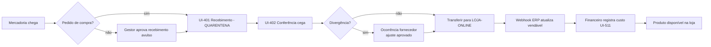

**PRC-007 — Publicação na loja** — Responsável: Gestor. Pré-condições: aprovado, vendável > 0 (ou pré-venda configurada), custo registrado, ERP sincronizado. Etapas: publicar; incluir em coleção/categoria; verificar PDP em celular. Resultado: produto visível e indexável.

**PRC-008 — Alteração de preço** — Responsável: Gestor. Gatilho: solicitação do ministério (UI-304) ou decisão comercial. Etapas: UI-209 com motivo → (aprovação se margem negativa) → vigência → purga de cache. Resultado: `amc_price_history`; carrinhos ativos avisados (BR-019).

**PRC-009 — Promoções** — Responsável: Gestor; participantes: ministério patrocinador, Financeiro. Etapas: definir tipo, escopo, vigência e **quem arca com o desconto** (UI-224/UI-225); simular impacto na margem; aprovar; publicar comunicação. Exceção: cupom sem dono → bloqueado (BR-027). Prazo: configurar até 2 dias úteis antes do início.

**PRC-010 — Reposição** — Responsável: Resp. ministério (decide) + Financeiro (compra). Gatilho: alerta de estoque mínimo (FR-036) ou previsão de evento. Etapas: UI-312 → solicitação → pedido de compra no ERP → PRC-006.

### 20.2. Processos de venda e entrega

**PRC-011 — Venda** — Automático. Etapas: checkout → reserva → pagamento → webhook → ledger (`SALE`, `PAYMENT_FEE`) → outbox ERP → NF-e. Exceções: 15.3. Dados: pedido, alocações, lançamentos.

**PRC-012 — Separação** — Responsável: Operador de expedição. Gatilho: pedido pago com NF-e emitida (ou regra: separar antes da NF-e e emitir no packing — DEC-010). Etapas: UI-403. Prazo: pedidos pagos até 14h separados no mesmo dia útil (proposta).

**PRC-013 — Expedição** — Responsável: Operador de expedição. Etapas: UI-404 → UI-405 → UI-408. Resultado: rastreio enviado ao cliente; `SHIPPING_COST` no ledger. Prazo: ≤ 2 dias úteis após pagamento (OBJ-8).

**PRC-014 — Entrega** — Responsável: transportadora; acompanhamento: Atendimento. Etapas: atualização de rastreio (consulta periódica a cada 4 h — INT-006); entregue → e-mail de avaliação após 10 dias. Exceções: atraso > prazo + 3 dias úteis → ocorrência proativa (UI-222).

**PRC-015 — Atendimento** — Responsável: Atendimento. Gatilho: contato do cliente. Etapas: registrar caso com nº do pedido; responder; resolver ou escalar (Gestor/Financeiro). SLA proposto: 1ª resposta em 1 dia útil; resolução em 5 dias úteis.

### 20.3. Processos pós-venda

**PRC-016 — Troca** — Responsável: Atendimento; participantes: Estoquista, Expedição. Etapas: UI-023 → aprovação automática dentro da política → etiqueta reversa (ou entrega na Igreja) → UI-410 inspeção → envio do novo item (novo pedido de R$ 0,00 vinculado, com baixa de estoque e lançamentos de troca: `REFUND` do item original + `SALE` do novo, mesma competência) → frete conforme política. Exceção: variação desejada esgotada → reembolso.

**PRC-017 — Devolução** — Responsável: Atendimento. Etapas: UI-024 → reversa → UI-410 → PRC-018. Prazo: arrependimento até 7 dias do recebimento (CDC art. 49); demais conforme política (DEC-025).

**PRC-018 — Reembolso** — Responsável: aprovador conforme limite; participantes: Atendimento, Financeiro. Gatilho: devolução recebida, cancelamento, falha de entrega, Pix pago após cancelamento sem estoque. Etapas: UI-226 (cálculo automático) → aprovação (segregação) → API do gateway → confirmação → ledger `REFUND` por ministério → e-mail ao cliente. Exceção: falha no gateway → `failed` com retry e alerta; reembolso manual (Pix fora do prazo do gateway) exige comprovante anexado. Prazo: até 2 dias úteis após o gatilho.

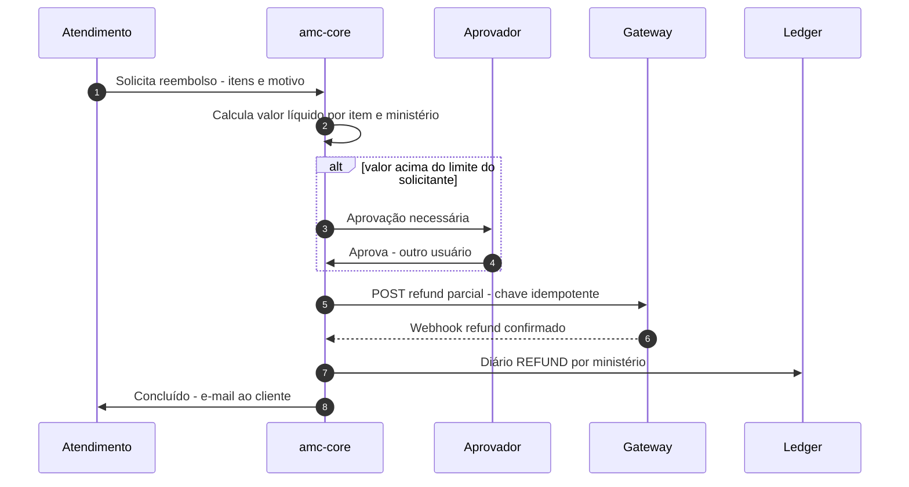

**PRC-019 — Cancelamento** — Responsável: Atendimento/Gestor. Antes do pagamento: automático (expiração). Após pagamento, antes da separação: cancelar pedido no Woo → estorno integral → cancelamento do pedido de venda no ERP (e da NF-e, dentro do prazo legal, ou NF-e de entrada/devolução conforme orientação contábil) → estoque restaurado. Após expedição: vira devolução.

### 20.4. Processos financeiros e de governança

**PRC-020 — Fechamento mensal** — Responsável: Financeiro; participantes: Auditor, Gestor. Gatilho: dia 1 de cada mês. Etapas: 12.10 / UI-515. Prazo: até o 5º dia útil. Resultado: período fechado, relatórios distribuídos.

**PRC-021 — Conciliação financeira** — Responsável: Financeiro. Gatilho: diário (job 06:00) + semanal (extrato bancário). Etapas: 12.7 / UI-506. Prazo: divergências classificadas em até 2 dias úteis.

**PRC-022 — Apuração de resultados por ministério** — Responsável: Financeiro. Etapas: após PRC-020, gerar DRE por ministério (UI-502), enviar relatório a cada Responsável (UI-313), reunião trimestral de resultados (proposta). Se DEC-007 = repasse: UI-514.

**PRC-023 — Auditoria** — Responsável: Auditor. Frequência: trimestral (proposta). Etapas: verificar cadeia de hash, amostra de 30 pedidos (pedido → alocação → lançamentos → recebível → banco), revisar acessos e escopos, revisar ajustes de estoque e reembolsos acima do limite, revisar alterações de regras. Resultado: relatório de auditoria com achados e plano de ação.

**PRC-024 — Transferência de responsabilidade entre ministérios** — Responsável: Gestor; aprovadores: Financeiro + Admin; participantes: ministérios de origem e destino. Etapas: UI-234 → acordo entre ministérios (registrado) → definir tratamento do estoque existente (DEC-022) → vigência futura → execução automática na data (nova linha de `ProductOwnership`; se aplicável, lançamento de transferência do valor do estoque ao custo entre centros) → comunicação. Resultado: vendas futuras atribuídas ao novo ministério; histórico preservado.

**PRC-025 — Desativação de produto** — Responsável: Gestor. Etapas: verificar estoque (zerar por venda, transferência para evento, doação/perda aprovada); arquivar (`archived`); definir 301 para produto substituto/categoria ou manter página "indisponível" (24.6); remover de coleções. Dados: auditoria. Restrição: nunca excluir produto com histórico (BR-024).

### 20.5. Matriz RACI

R = executa · A = responde/aprova · C = consultado · I = informado

| Processo | Adm. central (Admin loja) | Gestor e-commerce | Financeiro | Ministério (Resp.) | Estoque | Expedição | Atendimento | Tecnologia |
|---|---|---|---|---|---|---|---|---|
| PRC-001 Solicitação de produto | I | A | C | R | I | — | — | — |
| PRC-002 Aprovação de produto | C | A/R | C | I | — | — | — | — |
| PRC-003/005 Cadastro e SKU | I | A/R | I | I | C | — | — | C |
| PRC-004/008 Preço | C | A/R | C | C | — | — | I | — |
| PRC-006 Recebimento | I | I | C | I | A/R | — | — | — |
| PRC-007 Publicação | I | A/R | — | I | — | — | — | — |
| PRC-009 Promoções | A | R | C | C | — | — | I | — |
| PRC-010 Reposição | I | C | A | R | C | — | — | — |
| PRC-011 Venda | I | A | I | I | I | I | I | R (sistema) |
| PRC-012/013 Separação e expedição | I | A | — | — | C | R | I | — |
| PRC-014 Entrega | — | A | — | — | — | C | R | — |
| PRC-015 Atendimento | I | A | C | I | — | C | R | — |
| PRC-016/017 Troca e devolução | I | A | I | I | R (inspeção) | R (envio) | R | — |
| PRC-018 Reembolso | A (acima do limite) | R/A (até limite) | A (acima) | I | — | — | R (solicita) | — |
| PRC-019 Cancelamento | I | A | I | I | C | C | R | — |
| PRC-020 Fechamento | I | C | A/R | I | C | — | — | C |
| PRC-021 Conciliação | I | — | A/R | — | — | — | — | C |
| PRC-022 Apuração | A | C | R | I | — | — | — | — |
| PRC-023 Auditoria | C | C | C | I | C | — | — | C |
| PRC-024 Transferência de responsabilidade | A | R | A | C | C | — | — | — |
| PRC-025 Desativação | I | A/R | C | C | C | — | — | — |
| Gestão de usuários e acessos | A/R | C | C | C | — | — | — | C |
| Integrações, atualizações, backups | I | I | — | — | — | — | — | A/R |
| Incidente de segurança/dados | A | C | C | I | — | — | C | R |

---
<a id="s21"></a>

## 21. Requisitos não funcionais

> Metas **propostas** para validação (DEC-012, DEC-013). Nenhuma foi aprovada formalmente; servem de critério de aceite inicial e devem ser revistas após 90 dias de operação.

### 21.1. Catálogo de NFR

| ID | Categoria | Requisito | Meta proposta | Como medir | Validar |
|---|---|---|---|---|---|
| NFR-001 | Performance | Core Web Vitals da loja (p75, dados de campo) | LCP ≤ 2,5 s; INP ≤ 200 ms; CLS ≤ 0,1 (limites "bom" do Google) | CrUX/Search Console + RUM (web-vitals) | — |
| NFR-002 | Performance | TTFB de páginas em cache | ≤ 200 ms (p75) no Brasil | RUM/Cloudflare | — |
| NFR-003 | Performance | Tempo de resposta da Store API (carrinho/checkout) | ≤ 800 ms p95 em carga nominal | APM/logs | Após teste de carga |
| NFR-004 | Performance | Painéis administrativos | Telas de lista ≤ 2 s p95 com 50 mil pedidos | Teste com massa de dados | — |
| NFR-005 | Performance | JavaScript da loja | ≤ 150 KB (comprimido) na Home/PDP, excluindo tags de terceiros carregadas após consentimento | Lighthouse/CI | — |
| NFR-006 | Performance | Imagens | WebP/AVIF, `srcset`, `loading="lazy"` abaixo da dobra, imagem LCP com `fetchpriority="high"`; máx. 200 KB para a imagem do hero no mobile | CI (Lighthouse) | — |
| NFR-007 | Disponibilidade | Loja e checkout | 99,5% mensal (proposta, ~3,6 h de indisponibilidade/mês) excluindo manutenções programadas | Better Stack | DEC-013 |
| NFR-008 | Disponibilidade | Janela de manutenção | Terças 23h–01h, com aviso prévio | — | DEC-013 |
| NFR-009 | Escalabilidade | Pico de evento | Suportar 10× a média diária de pedidos (PRM-06) e 200 usuários simultâneos no checkout sem erro > 1% | Teste de carga (21.3) | DEC-012 |
| NFR-010 | Escalabilidade | Volume de dados | 50 mil pedidos/ano e 10 mil SKUs sem degradação das metas | Teste com massa sintética | — |
| NFR-011 | Confiabilidade das integrações | Processamento de webhooks | 99% processados em ≤ 1 min; 100% em ≤ 24 h ou em dead letter com alerta | Métricas do inbox | — |
| NFR-012 | Confiabilidade | Concorrência de estoque | 0 venda acima do vendável em teste de 100 checkouts simultâneos (TEST-001) | Teste automatizado | — |
| NFR-013 | Confiabilidade | Integridade financeira | 100% dos diários balanceados; 0 divergência de invariantes no fechamento | Job de verificação | — |
| NFR-014 | Segurança | MFA | 100% das contas privilegiadas com MFA | Relatório UI-227 | — |
| NFR-015 | Segurança | Atualizações | Patches de segurança críticos aplicados em ≤ 72 h; atualizações regulares mensais | Registro de manutenção | — |
| NFR-016 | Segurança | Rate limiting | Login: 5 tentativas/10 min por conta e 20/10 min por IP; cupom: 10 tentativas/10 min por sessão; consulta de pedido: 10/h por IP; webhooks: sem limite para IPs do provedor, 60/min para demais | Regras de WAF e plugin | — |
| NFR-017 | Privacidade | Minimização | Integrações recebem apenas os campos necessários (25) | Revisão de contratos | — |
| NFR-018 | Portabilidade | Exportação | Catálogo, pedidos, ledger e clientes exportáveis em CSV/JSON documentados a qualquer momento | Teste trimestral | — |
| NFR-019 | Manutenibilidade | Qualidade de código | PHPStan nível 6+ no `amc-core`, PHPCS (WordPress Coding Standards), cobertura de testes ≥ 80% nos módulos financeiros e de estoque, ≥ 60% no restante | CI | — |
| NFR-020 | Acessibilidade | WCAG 2.2 AA | 0 violação "serious/critical" do axe nas telas críticas; teste manual aprovado | CI + auditoria | — |
| NFR-021 | Observabilidade | Rastreabilidade | 100% das requisições internas com ID de correlação; logs estruturados (JSON) | Revisão | — |
| NFR-022 | Observabilidade | Alertas | Alerta em ≤ 5 min para: site fora, taxa de erro de checkout > 5%, fila de outbox > 100 ou idade > 30 min, falha de verificação de webhook em série, fechamento com invariante falha | Better Stack/Sentry | — |
| NFR-023 | Recuperação de desastres | RPO / RTO | RPO ≤ 1 h para pedidos (backups incrementais/binlog da hospedagem, a confirmar) e ≤ 24 h para mídia; RTO ≤ 4 h | Teste semestral de restauração | DEC-013 |
| NFR-024 | Backup | Retenção | Diário 30 dias; semanal 12 semanas; mensal 12 meses; cópia externa semanal com *object lock* | Verificação mensal | — |
| NFR-025 | Compatibilidade | Navegadores/dispositivos | Últimas 2 versões de Chrome, Safari (iOS ≥ 16), Firefox, Edge, Samsung Internet; Android ≥ 10; largura mínima 320 px | Testes em dispositivos reais + BrowserStack (ou equivalente) | — |
| NFR-026 | SEO | Indexabilidade | 100% de produtos ativos no sitemap; 0 página de filtro indexada; dados estruturados válidos | Search Console | — |
| NFR-027 | Manutenibilidade | Dependências | Inventário de plugins com dono, finalidade e data da última atualização; plugin sem atualização há > 12 meses é substituído ou justificado | Revisão trimestral | — |
| NFR-028 | Segurança | Segredos | Nenhum segredo no repositório; varredura de segredos no CI | CI | — |

### 21.2. Cache, CDN e proteção contra abuso

- **Cloudflare:** cache de estáticos (1 ano com *fingerprint*); cache de HTML anônimo para Home, listagens e PDP com TTL curto (5 min) + purga por evento; *bypass* para cookies de sessão do WooCommerce (`woocommerce_items_in_cart`, `wp_woocommerce_session_*`, `wordpress_logged_in_*`), `/carrinho`, `/checkout`, `/minha-conta`, `/wp-admin`, `/wp-json/wc/store/*`.
- **WAF:** conjunto gerenciado; bloqueio de XML-RPC; desafio em `wp-login.php` acima do limite; regras por país para `/wp-admin` (opcional — DEC); *rate limiting* NFR-016.
- **Turnstile:** login, cadastro, recuperação de senha, contato, Avise-me, aplicação de cupom após 3 falhas, checkout após falhas de cartão repetidas (proteção contra *card testing*).
- **Cache de objetos:** Redis com *drop-in* mantido.

### 21.3. Testes de carga e identificação de gargalos

1. **Ferramenta:** k6 (scripts versionados em `tests/load`).
2. **Ambiente:** cópia de homologação com o **mesmo plano** de hospedagem e Cloudflare; gateway em sandbox; ERP e frete simulados (*mocks*) para não estourar limites de API.
3. **Cenários:** (a) navegação anônima (Home → listagem → PDP) 70%; (b) carrinho 20%; (c) checkout completo com Pix sandbox 10%; (d) corrida pela última unidade (TEST-001); (e) rajada de webhooks (500 em 1 min, com 10% duplicados).
4. **Perfis:** linha de base (média), pico (10×), estresse (aumentar até erro > 5%) e resistência (2 h em 3×).
5. **Métricas:** p95 por endpoint, taxa de erro, CPU/memória/conexões MySQL, *slow query log* (> 200 ms), tempo de fila do Action Scheduler, *hit ratio* do cache.
6. **Diagnóstico:** Query Monitor em homologação, *slow query log*, perfil de PHP (ex.: SPX ou o perfilador da hospedagem), `EXPLAIN` nas consultas do `amc-core`.
7. **Critério:** metas NFR-003 e NFR-009; relatório com gargalos e ações antes do lançamento e antes de cada grande evento.

---

<a id="s22"></a>

## 22. Segurança, privacidade e conformidade

> ⚖️ Itens jurídicos, fiscais e contábeis desta seção **precisam ser validados por profissionais habilitados** (advogado com atuação em LGPD e consumidor; contador; tributarista). Ver 22.7.

### 22.1. Inventário de dados pessoais

| Dado | Titular | Finalidade | Base legal (a validar) | Onde fica | Compartilhado com | Retenção proposta |
|---|---|---|---|---|---|---|
| Nome, e-mail, telefone | Cliente | Executar a compra, contato sobre o pedido | Execução de contrato (art. 7º, V) | WooCommerce | Gateway, frete, ERP, e-mail transacional | 5 anos após a última compra (prazo do CDC/obrigações) — validar |
| CPF/CNPJ | Cliente | Emissão fiscal, antifraude do gateway, transportadora | Obrigação legal/regulatória (art. 7º, II) e contrato | WooCommerce, ERP | Gateway, ERP, frete (quando exigido) | Prazo fiscal (validar com contador — usualmente 5 anos) |
| Endereço | Cliente | Entrega e fiscal | Contrato | WooCommerce, ERP | Frete, ERP | Idem |
| Dados de pagamento (token, últimos 4 dígitos, bandeira) | Cliente | Pagamento e reembolso | Contrato | Gateway (cartão completo **nunca** na loja) | Gateway | Conforme gateway |
| Histórico de pedidos | Cliente | Atendimento, garantia, obrigações | Contrato / obrigação legal | WooCommerce, ledger | ERP | 5 anos (ledger: anonimizado após o prazo) |
| IP, user agent, logs | Cliente/usuário | Segurança, prevenção de fraude | Legítimo interesse (art. 7º, IX) | Logs, Cloudflare | Cloudflare, Sentry (sem PII) | 90 dias (IP completo); 1 ano truncado |
| Cookies de analytics/marketing | Visitante | Estatística e marketing | **Consentimento** (art. 7º, I) | Navegador, GA4, plataformas de anúncio | Google, Meta (se adotado) | Conforme ferramenta; consentimento por 12 meses |
| Consentimentos (marketing, termos) | Cliente | Prova de consentimento | Cumprimento de obrigação/legítimo interesse | `amc-core` | — | Enquanto válido + 5 anos |
| Usuários internos (nome, e-mail, papéis, logs de acesso) | Colaboradores/voluntários | Controle de acesso e auditoria | Legítimo interesse / obrigação | WordPress, auditoria | — | Duração do vínculo + 5 anos (auditoria) |
| Fotos de devolução | Cliente | Avaliar troca/devolução | Contrato | Mídia privada | — | 1 ano |
| Personalização (nome em camiseta) | Cliente/terceiro | Produzir o item | Contrato | Item do pedido | Fornecedor de personalização | Com o pedido |
| **Dado sensível potencial:** convicção religiosa inferida pela compra | Cliente | — | Evitar tratamento: não criar perfis/segmentos de "fé" ou ministério para marketing sem consentimento específico (art. 11) | — | Não enviar a plataformas de anúncio | — |

> **Atenção (art. 5º, II e art. 11 da LGPD):** convicção religiosa é **dado pessoal sensível**. Compras em uma loja de igreja podem permitir inferi-la. Recomendações: não enviar a plataformas de anúncio parâmetros que identifiquem ministério + pessoa; não criar públicos de remarketing por ministério sem avaliação jurídica; fazer RIPD (Relatório de Impacto) antes de ativar remarketing (DEC-028).

### 22.2. Direitos dos titulares e retenção

| Direito | Como é atendido | Prazo proposto |
|---|---|---|
| Confirmação e acesso | UI-021 "Baixar meus dados" (JSON/CSV) ou solicitação ao encarregado | 15 dias |
| Correção | UI-021 / atendimento | Imediato |
| Portabilidade | Mesmo arquivo de acesso | 15 dias |
| Eliminação / anonimização | Solicitação em UI-021 → revisão (pedidos com obrigação legal de guarda são **anonimizados** no que não for exigido; dados fiscais mantidos pelo prazo legal) → ferramenta nativa do WordPress de apagamento + rotina `amc` que substitui nome/e-mail/telefone/endereço por *hash* nos registros próprios | 15 dias |
| Revogação de consentimento | Link de descadastro em todo e-mail de marketing; painel de cookies no rodapé | Imediato |
| Informação sobre compartilhamento | Política de privacidade (UI-028) lista operadores | — |

Encarregado (DPO): indicar formalmente com substituto e publicar contato (Res. CD/ANPD nº 18/2024) — DEC-029. Incidentes: registro interno de todos os incidentes por no mínimo 5 anos e comunicação à ANPD e aos titulares em até **3 dias úteis** quando houver risco ou dano relevante (Res. CD/ANPD nº 15/2024) — plano de resposta em 22.5.

### 22.3. Controles de segurança

| Área | Controle |
|---|---|
| Pagamentos | Campos de cartão do gateway (iframe/SDK/tokenização) — a loja não recebe PAN/CVV; escopo PCI DSS reduzido ao SAQ aplicável ao modelo do gateway (validar com o provedor); nenhum log de payload de cartão |
| Webhooks | Verificação de assinatura (HMAC com `ts` e janela de 5 min contra *replay* — Mercado Pago; Pagar.me/Asaas: credencial no header + **reconsulta do recurso na API** antes de agir); idempotência (BR-015); endpoint exclusivo por provedor; IPs do provedor permitidos no WAF quando publicados |
| Preço | Total sempre recalculado no servidor; Store API não aceita preço vindo do cliente; testes de manipulação (TEST-046) |
| Cupons | Validação no servidor, limite por CPF/e-mail/uso total, orçamento, rate limit e Turnstile após falhas; cupons gerados aleatórios ≥ 8 caracteres para campanhas privadas |
| Estoque | Sem edição direta (capacidade removida); alterações apenas por documento com aprovação; reconciliação diária |
| Reembolso | Segregação, limites, reautenticação, notificação ao Financeiro para todos acima do limite |
| Contas administrativas | MFA, senhas fortes, sessão de 8 h, revisão trimestral, desativação imediata no desligamento, nenhum usuário compartilhado, Superadmin separado |
| Aplicação | Prepared statements (`$wpdb->prepare`), *nonces* + `permission_callback` em todo endpoint, escape de saída, CSP progressiva, `X-Frame-Options`/`frame-ancestors`, cookies `Secure`/`HttpOnly`/`SameSite` |
| Dependências | Inventário de plugins (NFR-027), atualizações via pipeline com testes, monitoramento de vulnerabilidades (ex.: base de vulnerabilidades WordPress da Patchstack/Wordfence/WPScan — escolher uma) |
| Infraestrutura | SFTP/SSH com chave; sem FTP; `DISALLOW_FILE_EDIT` e `DISALLOW_FILE_MODS` em produção (instalação só via pipeline); backups criptografados |
| Dados em repouso | Payload de webhooks criptografado; segredos fora do banco (variáveis de ambiente) |
| Logs | Sem dados pessoais em texto aberto; mascaramento automático de CPF/e-mail no logger |
| Ambientes | Homologação com dados **anonimizados** (nunca cópia crua da produção); bloqueio de indexação e de e-mails reais |

### 22.4. Ameaças e mitigação (modelo resumido)

| Ameaça | Vetor | Mitigação | Teste |
|---|---|---|---|
| Acesso indevido a dados de outro ministério | Troca de parâmetro `ministry_id`, endpoint sem escopo | Scoped Repository + testes de autorização por endpoint (13.3) | TEST-007, TEST-040–044 |
| Escalada de privilégios | Plugin vulnerável, papel mal configurado | Mínimo de plugins, `DISALLOW_FILE_MODS`, revisão de papéis, WAF | TEST-047 |
| Manipulação de preço | Alteração do payload do checkout | Recalcular no servidor | TEST-046 |
| Fraude em cupons | Força bruta, compartilhamento | Rate limit, limites por CPF, orçamento | TEST-005b |
| Falsificação de webhook | POST forjado de "pagamento aprovado" | Assinatura + reconsulta à API do gateway | TEST-002b |
| Repetição de eventos | Reenvio de webhook legítimo | Idempotência por `event_id`, janela de tempo | TEST-002 |
| Alteração indevida de estoque | Edição no wp-admin, ajuste sem aprovação | Capacidade removida, documento com aprovação, reconciliação | TEST-048 |
| Reembolso não autorizado | Usuário de atendimento mal-intencionado | Limites, segregação, auditoria, alerta | TEST-049 |
| Exposição de dados | Logs, exportações, backups, homologação | Mascaramento, links expiráveis, anonimização | TEST-045 |
| Ataque a contas administrativas | *Credential stuffing*, phishing | MFA, rate limit, Turnstile, alerta de login novo | TEST-047 |
| *Card testing* | Bots testando cartões no checkout | Turnstile progressivo, antifraude do gateway, limites por IP | TEST-012 |

### 22.5. Resposta a incidentes

1. **Detecção** (alertas, relato) → registrar no log de incidentes.
2. **Contenção** (até 1 h): revogar credenciais, bloquear IPs, modo manutenção se necessário.
3. **Avaliação** (até 24 h): dados afetados, titulares, risco.
4. **Comunicação**: se houver risco ou dano relevante, ANPD e titulares em até 3 dias úteis (Res. 15/2024), com apoio jurídico.
5. **Erradicação e recuperação**: corrigir, restaurar de backup íntegro.
6. **Lições aprendidas**: relatório em até 10 dias úteis.

### 22.6. Matriz de riscos do projeto

Probabilidade (P) e impacto (I): 1 baixo – 3 alto. Prioridade = P × I (≥ 6 alta, 3–4 média, ≤ 2 baixa).

| ID | Risco | P | I | Prioridade | Mitigação | Responsável |
|---|---|---|---|---|---|---|
| RSK-001 | Indefinição fiscal (NF-e, ICMS, imunidade) atrasa ou invalida o lançamento | 3 | 3 | **9 — alta** | Consulta formal ao contador/tributarista na Fase 0; PRM-07 conservadora | Administração + contador |
| RSK-002 | Ministério acessa dados de outro | 2 | 3 | **6 — alta** | 13.3; testes obrigatórios | Tecnologia |
| RSK-003 | Divergência de estoque Woo × ERP gera venda sem estoque | 2 | 3 | **6 — alta** | Fórmula 11.3, reconciliação, ADR-007 | Tecnologia + Estoque |
| RSK-004 | ERP sobrescreve estoque com saldo antigo | 2 | 2 | 4 — média | Integração nativa desligada; conector próprio | Tecnologia |
| RSK-005 | Webhook forjado ou duplicado confirma pagamento falso | 2 | 3 | **6 — alta** | Assinatura + reconsulta + idempotência | Tecnologia |
| RSK-006 | Regras de rateio contestadas pelos ministérios | 3 | 2 | **6 — alta** | Aprovação formal das regras (DEC-006), transparência no painel, versionamento | Financeiro + liderança |
| RSK-007 | Equipe operacional (voluntários) comete erros de cadastro/expedição | 3 | 2 | **6 — alta** | Telas guiadas, leitura de código de barras, checklists, treinamento | Gestor |
| RSK-008 | Vulnerabilidade em plugin de terceiros | 2 | 3 | **6 — alta** | Mínimo de plugins, atualizações, WAF, monitoramento | Tecnologia |
| RSK-009 | Custos de taxas maiores que o previsto corroem margem | 2 | 2 | 4 — média | Cotação, monitoramento de taxa efetiva (UI-504) | Financeiro |
| RSK-010 | Mudança de preços/planos de fornecedores (ex.: ERP por faixa de pedidos) | 2 | 2 | 4 — média | Adaptadores, exportação, revisão anual | Administração |
| RSK-011 | Pico de evento derruba a loja | 2 | 3 | **6 — alta** | Teste de carga, cache, escalonamento temporário | Tecnologia |
| RSK-012 | Dependência de um único desenvolvedor/fornecedor | 2 | 3 | **6 — alta** | Documentação (este documento + 29), código em repositório da Igreja, testes, contrato de manutenção | Administração |
| RSK-013 | Tratamento inadequado de dado sensível (convicção religiosa) em marketing | 2 | 3 | **6 — alta** | 22.1; RIPD antes de remarketing | Encarregado |
| RSK-014 | Incompatibilidade de plugin de gateway/frete com checkout em blocos | 2 | 2 | 4 — média | PoC (8.7) | Tecnologia |
| RSK-015 | Custo de produto não cadastrado distorce margens | 3 | 2 | **6 — alta** | Publicação bloqueada sem custo (FR-019) | Financeiro |
| RSK-016 | Chargebacks/MED em Pix sem evidências | 1 | 2 | 2 — baixa | Guardar comprovantes de entrega e rastreio | Financeiro |
| RSK-017 | Decisões organizacionais (autonomia dos ministérios) mudam no meio do projeto | 2 | 3 | **6 — alta** | Decisões bloqueadoras formalizadas antes da Fase 3 | Liderança |
| RSK-018 | Prazo de lançamento atrelado a um evento sem folga | 2 | 3 | **6 — alta** | Plano com marco de lançamento ≥ 4 semanas antes do evento | Gestor |

### 22.7. O que precisa de validação profissional

| Tema | Profissional | Pergunta |
|---|---|---|
| Natureza da operação (venda habitual por organização religiosa), inscrição estadual, NF-e/NFC-e, ICMS, imunidade, IBS/CBS | Contador + tributarista | DEC-010 |
| Produtos digitais e serviços (personalização) | Contador | DEC-018 |
| Tratamento de dados (bases legais, dado sensível, retenção, RIPD) | Advogado LGPD | DEC-028, DEC-029 |
| Políticas de troca, devolução, arrependimento, personalizados, frete em devolução parcial | Advogado consumidor | DEC-025 |
| Repasses a ministérios, split, contratos com gateway | Contador + advogado | DEC-007, DEC-008 |
| Plano de contas gerencial ↔ contábil, prazos de guarda | Contador | DEC-017 |
| Termos de uso, política de privacidade | Advogado | UI-028/UI-029 |

---
<a id="s23"></a>

## 23. Analytics, métricas e observabilidade

### 23.1. Separação de responsabilidades

| Camada | Ferramenta | Serve para | **Não** serve para |
|---|---|---|---|
| Analytics de marketing/produto | GA4 via GTM (com Consent Mode) | Funil, origem de tráfego, comportamento | Vendas oficiais, resultado financeiro (amostragem, bloqueadores, consentimento recusado) |
| Registros operacionais | WooCommerce + `amc-core` | Pedidos, estoque, expedição | — |
| Registros financeiros | Ledger `amc-core` | Vendas, resultado por ministério, conciliação | — |
| Observabilidade técnica | Sentry, Better Stack, logs | Erros, disponibilidade, filas | — |

**Regra:** nenhum relatório financeiro ou de ministério lê dados do GA4 (FR-080). Diferenças entre GA4 e o ledger são esperadas e não são "corrigidas".

### 23.2. Plano de eventos

Implementação: `dataLayer` gerado pelo tema/`amc-core` (servidor fornece os dados de itens; o navegador apenas empurra), GTM publica para GA4. Nenhum dado pessoal (nome, e-mail, CPF, endereço, telefone) é enviado. `value` = soma de preço × quantidade (sem frete e impostos, conforme a especificação do GA4) e `currency=BRL` sempre que `value` existir.

**Parâmetros de item (comuns):** `item_id` (SKU), `item_name`, `item_brand` (= **nome do ministério** apenas se DEC-028 permitir; padrão: código neutro do ministério `min_JOV` — ver 22.1), `item_category` (categoria), `item_variant` (cor/tamanho), `price`, `quantity`, `item_list_id`, `item_list_name`, `discount`, `coupon`.

| Evento | Gatilho | Parâmetros adicionais | Origem dos dados | Cuidados com dados pessoais | Responsável | Critério de validação |
|---|---|---|---|---|---|---|
| `view_item_list` | Listagem visível (Home, ministério, categoria, busca) | `item_list_id`, `items[]` (até 20) | Servidor (render) | — | Front-end | DebugView mostra lista correta |
| `select_item` | Clique em card | `item_list_id`, `items[1]` | Front | — | Front-end | — |
| `view_item` | PDP carregado | `value`, `items[1]` | Servidor | — | Front-end | 1 evento por visualização |
| `search` | Busca enviada | `search_term` | Front | Não enviar termos que pareçam e-mail/CPF (filtro por regex) | Front-end | Termo com CPF é mascarado |
| `add_to_cart` | Sucesso da Store API | `value`, `items[]` | Resposta da Store API | — | Front-end | Disparado só após sucesso |
| `remove_from_cart` | Sucesso da remoção | `value`, `items[]` | Store API | — | Front-end | — |
| `view_cart` | Carrinho aberto | `value`, `items[]` | Servidor | — | Front-end | — |
| `begin_checkout` | Checkout carregado | `value`, `coupon`, `items[]` | Servidor | — | Front-end | 1 por sessão de checkout |
| `add_shipping_info` | Frete selecionado | `shipping_tier` (ex.: `PAC`, `retirada`) | Checkout | — | Front-end | — |
| `add_payment_info` | Método selecionado | `payment_type` (`pix`, `cartao`) | Checkout | — | Front-end | — |
| `purchase` | **Pagamento aprovado** (não na criação do pedido) | `transaction_id` (nº do pedido), `value`, `tax`, `shipping`, `coupon`, `items[]` | Servidor: na página de confirmação **se** pago; para Pix pago depois, envio *server-side* via Measurement Protocol (FR-081) | — | Back-end | Deduplicação por `transaction_id`; recarregar não duplica |
| `refund` | Reembolso concluído | `transaction_id`, `value`, `items[]` (parcial) | Servidor (Measurement Protocol) | — | Back-end | Valor igual ao do ledger para o pedido |
| `order_cancelled` (custom) | Cancelamento após pagamento | `transaction_id`, `value` | Servidor | — | Back-end | — |
| `checkout_error` (custom) | Erro exibido | `error_type` | Front | Sem mensagens com dados | Front-end | — |
| `view_promotion` / `select_promotion` | Hero/banners | `promotion_id`, `promotion_name` | Front | — | Front-end | — |
| `filter_apply`, `sort_apply`, `shipping_estimate`, `notify_me`, `pix_code_copied`, `pix_expired`, `return_request`, `reorder` (custom) | Ver 15.2 | Específicos | Front/servidor | — | Front-end | Registrados como dimensões personalizadas quando úteis |

### 23.3. Deduplicação e atribuição

- `purchase` com `transaction_id` único; o `amc-core` marca o pedido como `ga4_purchase_sent` para não reenviar (pelo navegador ou servidor).
- Pix: a confirmação costuma ocorrer fora da sessão do navegador → evento server-side com o `client_id` capturado no checkout (guardado no pedido), preservando a atribuição.
- Plataformas de anúncio (se adotadas — DEC-028): enviar conversão com o mesmo ID de evento no navegador e na API server-side (deduplicação pelo ID), apenas com consentimento de marketing.

### 23.4. Métricas comerciais e operacionais

| Métrica | Fórmula | Fonte | Limitação |
|---|---|---|---|
| Taxa de conversão | Sessões com `purchase` ÷ sessões | GA4 | Subestimada sem consentimento; usar tendência, não valor absoluto |
| Conversão operacional | Pedidos pagos ÷ checkouts iniciados (`begin_checkout` servidor) | `amc-core` | Não mede descoberta |
| Ticket médio | Receita líquida ÷ pedidos pagos | Ledger | Pedidos com reembolso total excluídos |
| Receita por ministério | Receita líquida por centro | Ledger | — |
| Produtos mais vendidos | Unidades líquidas (vendidas − devolvidas) por SKU | Alocações | — |
| Margem por produto | (Líquido − CMV − taxa rateada) ÷ líquido | Ledger | Depende do custo cadastrado |
| Margem por ministério | 12.9 | Ledger | Resultado só após fechamento |
| Taxa de abandono de carrinho | 1 − (pedidos criados ÷ carrinhos com item) | `amc-core` (sessões Woo) | Carrinhos de bots devem ser filtrados |
| Taxa de abandono de checkout | 1 − (pedidos pagos ÷ checkouts iniciados) | `amc-core` | — |
| Taxa de aprovação de pagamentos | Pagamentos aprovados ÷ tentativas (por método) | `amc_payment` | Tentativas repetidas do mesmo cliente contam separadamente |
| Ruptura de estoque | SKUs ativos com vendável = 0 ÷ SKUs ativos (média diária) | Espelho de estoque | Pré-venda excluída |
| Prazo de expedição | Mediana e p90 de (postagem − pagamento) em horas úteis | `amc_shipment` | — |
| Taxa de devolução | Unidades devolvidas ÷ unidades vendidas (por SKU/ministério) | Alocações + reembolsos | Defasagem de até 30 dias |
| Custo operacional por pedido | (Frete não recuperado + embalagem + taxas + despesas compartilhadas) ÷ pedidos | Ledger | Despesas só após fechamento |
| Divergências de conciliação | Nº e valor de registros `difference`/`missing`/`orphan` | `amc_reconciliation_record` | — |
| Acurácia de inventário | SKUs sem divergência ÷ SKUs contados | Contagens | — |

### 23.5. Observabilidade técnica

- **Sentry:** PHP (plugin + tema) e JavaScript (loja e painéis), *release tracking* por versão do deploy, filtros de PII.
- **Uptime:** monitores HTTP de Home, PDP de referência, `/wp-json/amc/v1/health` (verifica banco, Redis, fila, idade do outbox, último job de reconciliação) e checkout sintético diário em sandbox (homologação).
- **Logs estruturados** (`amc-core`): `timestamp`, `level`, `correlation_id`, `module`, `event`, `entity`, `duration_ms`, `outcome` — sem PII.
- **Painel de saúde** (UI-230): filas, dead letter, divergências, tokens a expirar.

---

<a id="s24"></a>

## 24. SEO e aquisição

### 24.1. URLs

| Página | Padrão | Exemplo |
|---|---|---|
| Produto | `/produto/{slug}/` | `/produto/camiseta-conferencia-ide-2027/` |
| Categoria | `/categoria/{pai}/{filho}/` | `/categoria/vestuario/camisetas/` |
| Ministério | `/ministerios/{slug}/` | `/ministerios/jovens/` |
| Coleção/evento | `/colecao/{slug}/` | `/colecao/conferencia-jovens-2027/` |
| Busca | `/?s=` | não indexável |
| Filtros | parâmetros `?tamanho=m&cor=preto` | não indexáveis |

Slugs em minúsculas, sem acentos, hífen como separador; variações **não** têm URL própria indexável (variação selecionada por parâmetro, com canonical para o produto).

### 24.2. Títulos e descrições

- Produto: `{Nome do produto} – {Ministério} | {Nome da loja}` (≤ 60 caracteres; truncar o ministério se necessário). Meta description: 140–155 caracteres com benefício e informação concreta (material, prazo, retirada).
- Categoria/ministério: título com o termo principal; texto introdutório de 50–150 palavras escrito por pessoas.
- Plugin de SEO: um só (ex.: Yoast SEO ou Rank Math), configurado para não gerar páginas desnecessárias (arquivos de autor, anexos, tags).

### 24.3. Dados estruturados (JSON-LD)

- `Product` com `offers` (`price`, `priceCurrency=BRL`, `availability` correta — `InStock`, `OutOfStock`, `PreOrder` com `availabilityStarts`, `priceValidUntil` em promoções), `sku`, `gtin13` quando existir, `brand` (nome da loja/Igreja), `image`.
- `AggregateRating`/`Review` apenas com avaliações reais de compradores.
- `BreadcrumbList` em todas as páginas com breadcrumb.
- `Organization` (nome, logo, contato, `sameAs`) na Home.
- `FAQPage` apenas na página de FAQ com perguntas visíveis.
- Validação no CI (testes de snapshot do JSON-LD) e no Search Console.

### 24.4. Sitemap, robots, canonical

- Sitemap XML gerado pelo plugin de SEO: produtos ativos, categorias, ministérios, coleções, páginas institucionais; exclui arquivados com 301, busca e filtros.
- `robots.txt`: bloquear `/carrinho/`, `/checkout/`, `/minha-conta/`, `/?s=`, `/*?*add-to-cart=`, parâmetros de filtro/ordenação; não bloquear CSS/JS.
- Canonical: autorreferente em produtos e categorias; páginas paginadas com canonical próprio (não para a página 1); filtros com canonical para a listagem sem filtros + `noindex,follow`.
- Homologação: `noindex` global + autenticação básica.

### 24.5. Indexação de filtros

Regra geral: **não indexar** combinações de filtros. Exceção futura: páginas de alta demanda comprovada (ex.: "camisetas do ministério jovem") viram **coleções editoriais** com URL limpa e texto próprio.

### 24.6. Produtos indisponíveis e descontinuados

| Situação | Tratamento |
|---|---|
| Esgotado temporariamente | Página mantida (200), `availability=OutOfStock`, "Avise-me", alternativas |
| Pré-venda | `availability=PreOrder` + data |
| Descontinuado com substituto | 301 para o substituto |
| Descontinuado sem substituto, com tráfego/backlinks | Página mantida 6–12 meses com aviso "produto encerrado" + alternativas, depois 301 para a categoria |
| Descontinuado sem tráfego | 301 para a categoria (ou 410 se não houver categoria relevante) |
| Mudança de slug | 301 automático (plugin de redirecionamento ou `amc-core`) |

### 24.7. Mídia paga, remarketing e campanhas

- UTM padronizado: `utm_source` (instagram, whatsapp, google), `utm_medium` (social, cpc, email, qr), `utm_campaign` (`conf-jovens-2027`), `utm_content` (peça). Gerador de links simples na documentação operacional.
- Google Ads / Meta: somente após DEC-028; tags carregadas via GTM **após consentimento**; conversões server-side deduplicadas (23.3); **não** usar ministério como público-alvo personalizado sem avaliação jurídica (dado sensível).
- Feed de produtos (Google Merchant Center): opcional pós-MVP; exige GTIN ou `identifier_exists=false` para produtos próprios.
- **Performance:** orçamento de terceiros — no máximo 2 tags de marketing além do GA4; carregamento após `load`/interação quando possível; medição de impacto no INP antes de aprovar uma nova tag.

### 24.8. Imagens

Nome de arquivo descritivo, `alt` descritivo, dimensões explícitas, WebP/AVIF, CDN, tamanho mínimo de origem 1200 px (zoom), proporção padronizada por tipo de produto (vestuário 4:5; demais 1:1).

---
<a id="s25"></a>

## 25. Integrações e contratos técnicos

### 25.1. Visão geral

| ID | Integração | Tipo | Direção | MVP |
|---|---|---|---|---|
| INT-001 | Pagamentos (cobrança, status, reembolso) | Tempo real + assíncrona (webhook) | Woo ↔ Gateway | ✔ |
| INT-002 | Recebíveis e liquidações | Periódica | Gateway → `amc-core` | ✔ |
| INT-003 | Pedidos de venda | Assíncrona (outbox) | `amc-core` → ERP | ✔ (cenário B) |
| INT-004 | Produtos e SKUs | Assíncrona (outbox) | `amc-core` → ERP | ✔ |
| INT-005 | Estoque, status de pedido e NF-e | Assíncrona (webhook) + periódica | ERP → `amc-core` | ✔ |
| INT-006 | Frete (cotação, etiqueta, rastreio, reversa) | Tempo real (cotação) + assíncrona/periódica | Woo/`amc-core` ↔ Melhor Envio | ✔ |
| INT-007 | E-mail transacional | Assíncrona | WordPress → SES/Postmark | ✔ |
| INT-008 | Analytics | Tempo real (navegador) + server-side | Loja → GA4 | ✔ |
| INT-009 | Extrato bancário | Periódica (importação manual de arquivo) | Banco → `amc-core` | ◐ |
| INT-010 | Exportação contábil | Periódica (mensal) | `amc-core` → contabilidade | ✔ |
| INT-011 | Consulta de CEP | Tempo real | Loja → serviço de CEP | ✔ |
| INT-012 | Purga de cache | Assíncrona | `amc-core` → Cloudflare API | ✔ |
| INT-013 | Backup externo e âncora de hash do ledger | Periódica | Hospedagem/`amc-core` → bucket | ✔ |
| INT-014 | Observabilidade | Tempo real | Aplicação → Sentry/Better Stack | ✔ |
| INT-015 | CRM | — | — | — (não recomendado sem necessidade definida) |
| INT-016 | Emissão fiscal | Via ERP (NF-e) | ERP ↔ SEFAZ | ✔ (condicional a DEC-010) |

### 25.2. Contratos

#### INT-001 — Pagamentos
- **Origem/destino:** WooCommerce (plugin oficial do gateway) ↔ Gateway.
- **Dados:** valor, itens (descrição resumida), comprador (nome, e-mail, CPF — exigido pelo antifraude), método, parcelas; retorno: id do pagamento, status, taxas (quando disponíveis).
- **Gatilho / frequência:** checkout (tempo real); webhooks a cada mudança de status.
- **Mecanismo:** SDK/API do gateway via plugin; webhooks para endpoint dedicado.
- **Autenticação:** chaves de API em variáveis de ambiente; webhook — Mercado Pago `x-signature` HMAC-SHA256 (`ts` + `v1`); Pagar.me — credencial do webhook + **reconsulta do pagamento pela API**.
- **Erros:** falha de criação → mensagem ao cliente; webhook inválido → 401 + alerta; status desconhecido → registrar e reconsultar.
- **Repetição:** o gateway reenvia webhooks; job próprio reconsulta pedidos `pending` com pagamento iniciado a cada 5 min por 24 h.
- **Idempotência:** `UNIQUE(provider, external_event_id)` no inbox; transições de status só para frente (exceto reembolso/chargeback).
- **Logs/monitoramento:** inbox + taxa de aprovação por método (alerta se cair > 30% em 1 h).
- **Responsável:** Tecnologia. **Dependências:** plugin oficial compatível com checkout em blocos (PoC). **Riscos:** mudanças no plugin; RSK-005.
- **Hook do `amc-core`:** ao receber `processing`, gera diários `SALE` e `PAYMENT_FEE` (taxa estimada pela tabela contratada; ajustada por INT-002).

#### INT-002 — Recebíveis e liquidações
- **Origem/destino:** Gateway → `amc-core`.
- **Dados:** recebíveis por pagamento/parcela (bruto, taxa, líquido, data prevista, data liquidada, status), estornos, chargebacks.
- **Gatilho / frequência:** diária (06:00) + sob demanda.
- **Mecanismo:** Mercado Pago — Relatório de Liberações via API; Pagar.me — `GET /core/v5/payables` com paginação por cursor.
- **Autenticação:** chave secreta de API (somente leitura, se o provedor oferecer escopo).
- **Erros / repetição:** retry exponencial; relatório incompleto → reprocessar janela de 7 dias.
- **Idempotência:** `UNIQUE(provider, provider_receivable_id)`.
- **Logs/monitoramento:** registros importados por dia; alerta se 0 em dia útil com vendas.
- **Responsável:** Tecnologia + Financeiro. **Riscos:** mudança de formato do relatório; adaptador por gateway (ADR-008).

#### INT-003 — Pedidos de venda para o ERP
- **Origem/destino:** `amc-core` → Bling.
- **Dados:** nº do pedido (`WC-10234`), data, cliente (nome, CPF/CNPJ, endereço, e-mail, telefone — mínimo para NF-e), itens por **SKU** (kits explodidos em componentes, conforme a configuração de kit no ERP — validar), valores, desconto, frete, forma de pagamento, depósito (`LOJA-ONLINE` ou `EVENTO-x`), observações.
- **Gatilho:** pedido pago (`processing`); atualizações: cancelamento, reembolso (gera devolução/cancelamento no ERP conforme orientação contábil).
- **Frequência:** assíncrona, despacho a cada 1 min.
- **Mecanismo:** API v3 do Bling (REST, OAuth2).
- **Autenticação:** OAuth2 *authorization code* + *refresh token* (renovação automática; alerta 7 dias antes de falhas recorrentes).
- **Erros:** 4xx de validação → `failed` sem retry automático, alerta com mensagem; 429/5xx → retry com backoff (11.7).
- **Idempotência:** antes de criar, buscar pedido pelo número; `amc_external_ref`; chave `order:{id}:v{n}`.
- **Logs/monitoramento:** outbox (UI-230); alerta se pedido pago sem ERP > 30 min.
- **Responsável:** Tecnologia. **Dependências:** produto existente no ERP (INT-004). **Riscos:** limites de API e plano por volume de pedidos (pedidos via API contam no limite do plano — custo).

#### INT-004 — Produtos e SKUs para o ERP
- **Dados:** SKU, nome, unidade, preço (informativo), peso, dimensões, NCM, GTIN, origem fiscal, variações, composição de kits.
- **Gatilho:** criação/alteração no `amc-core`. **Frequência:** assíncrona.
- **Mecanismo/autenticação:** API v3 Bling, OAuth2.
- **Idempotência:** busca por código (SKU) antes de criar; `amc_external_ref`.
- **Erros:** validação → produto não publica (FR-019).
- **Responsável:** Tecnologia. **Riscos:** limite de tamanho do código no ERP (PoC).

#### INT-005 — Estoque, status e NF-e do ERP
- **Dados:** saldo por SKU × depósito; status do pedido de venda; NF-e (número, chave, XML/DANFE link).
- **Gatilho:** webhooks do Bling (estoque, produto, pedido, NF-e) + consulta periódica de segurança (a cada 15 min para SKUs alterados, se suportado; senão, reconciliação diária completa).
- **Mecanismo:** webhooks para `/wp-json/amc/v1/hooks/erp`; API v3 para reconsulta.
- **Autenticação:** validação conforme mecanismo do Bling (assinatura/segredo — confirmar na PoC) **e** reconsulta do recurso pela API antes de aplicar mudança de saldo.
- **Idempotência:** inbox; aplicar saldo apenas se `erp_updated_at` for mais recente que o registrado.
- **Erros/repetição:** reprocessamento a partir do inbox.
- **Monitoramento:** idade da última atualização (UI-214); divergências diárias.
- **Responsável:** Tecnologia + Estoque.

#### INT-006 — Frete (Melhor Envio)
- **Dados:** cotação — CEP de origem/destino, peso, dimensões, valor declarado; etiqueta — remetente, destinatário, itens, NF-e (chave, quando exigida), serviço; rastreio — eventos.
- **Gatilho:** cotação no PDP/carrinho/checkout (tempo real, com cache de 15 min por CEP+pacote); compra de etiqueta após packing; rastreio a cada 4 h para remessas ativas.
- **Mecanismo:** plugin oficial para cotação no checkout; `amc-core` usa a API para compra/impressão em lote e rastreio.
- **Autenticação:** OAuth2 (*access token* 30 dias, *refresh* 45 dias — renovação automática).
- **Erros:** cotação indisponível → tabela de contingência (FR-045); compra falha → retry manual na UI-405.
- **Idempotência:** uma etiqueta ativa por volume (`amc_shipment`).
- **Responsável:** Tecnologia + Expedição. **Riscos:** webhooks não confirmados (usar polling); plugin "como está".

#### INT-007 — E-mail transacional
- **Dados:** e-mails do WooCommerce e do `amc-core` (confirmação, Pix gerado/expirado, enviado, entregue, reembolso, solicitação de devolução, avise-me, senha, convites internos, alertas).
- **Mecanismo:** SMTP/API autenticada (SES ou Postmark) via plugin de envio; domínio com SPF, DKIM e DMARC (`p=quarantine` após monitoramento).
- **Erros:** fila com retry; bounces registrados. **Monitoramento:** taxa de entrega/bounce. **Responsável:** Tecnologia.

#### INT-008 — Analytics
- 23.2. Autenticação: Measurement Protocol com `api_secret` (servidor). Idempotência: `transaction_id`. Responsável: Tecnologia/Marketing.

#### INT-009 — Extrato bancário
- **Dados:** lançamentos da conta de recebimento. **Mecanismo:** importação manual de OFX/CSV semanal na UI-506 (integração bancária automática — pós-MVP, depende do banco). **Idempotência:** `FITID` do OFX. **Responsável:** Financeiro.

#### INT-010 — Exportação contábil
- **Dados:** razão gerencial do mês por conta e centro, mapeado ao plano de contas contábil (DEC-017). **Mecanismo:** arquivo CSV/XLSX (UI-513). **Responsável:** Financeiro.

#### INT-011 — CEP
- **Mecanismo:** serviço público de CEP ou o do provedor de frete (escolher e validar disponibilidade na Fase 1); cache de 30 dias; falha → preenchimento manual. **Dados:** somente CEP (sem dados pessoais).

#### INT-012 — Purga de cache
- **Gatilho:** mudança de preço, estoque (cruzando 0), publicação/arquivamento. **Mecanismo:** API do Cloudflare (token com escopo apenas de purga). **Idempotência:** natural. **Erros:** retry; TTL curto garante convergência.

#### INT-013 — Backup e âncora de hash
- Backup diário completo da hospedagem + cópia semanal externa; hash diário do ledger enviado ao bucket com *object lock* (12.5.1). Credencial com permissão somente de escrita.

#### INT-014 — Observabilidade
- SDK Sentry (DSN em variável de ambiente; `send_default_pii=false`); monitores Better Stack; logs.

### 25.3. Fonte oficial por tipo de dado (resumo)

Ver [14.2](#s14). Regra de ouro: **um dado, um dono, um sentido de escrita**. Quando dois sistemas precisam do mesmo dado, um escreve e o outro lê (ou recebe cópia identificada como projeção).

---
<a id="s26"></a>

## 26. Custos e viabilidade financeira

### 26.1. Premissas da estimativa

| # | Premissa | Valor adotado | Observação |
|---|---|---|---|
| C1 | Data de consulta de preços | 21/10/2026 | Fontes em [33](#s33); preços mudam |
| C2 | Câmbio para serviços em dólar | **R$ 5,50/US$** (hipótese de cálculo, não cotação) | Recalcular com o câmbio do dia da contratação |
| C3 | Volume | 1.500 pedidos/mês no ano 1 (PRM-06) | — |
| C4 | Ticket médio | R$ 100 (hipótese) → GMV ≈ R$ 150 mil/mês | Validar com dados de vendas atuais (DEC-012) |
| C5 | Mix de pagamento | 50% Pix, 35% cartão à vista/até 3×, 15% parcelado 4×+ (hipótese) | Determina a taxa efetiva |
| C6 | Valor-hora de desenvolvimento | R$ 150 a R$ 220/h (faixa de mercado assumida para profissionais/agência sênior; **não pesquisada**) | Solicitar propostas (DEC-015) |
| C7 | Equipe | Tech lead/arquiteto (50%), 2 devs PHP/React (100%), UX/UI (50% nas fases 2, 5 e 8), QA (50% a partir da fase 4), PM (25%) | — |
| C8 | Horas produtivas | ~130 h/mês por pessoa em tempo integral | — |
| C9 | Não incluídos | Custo dos produtos, pessoal de operação (estoque, expedição, atendimento), fotografia, produção de conteúdo, mídia paga, honorários contábeis/jurídicos | Custos do **negócio**, não da plataforma (26.6) |

### 26.2. Esforço de implementação por fase (cenário B — recomendado)

| Fase | Horas (faixa) | Observação |
|---|---|---|
| 0 — Descoberta e decisões | 60–100 | Inclui workshops e cotações |
| 1 — Arquitetura e PoC | 80–140 | 8.7 |
| 2 — Identidade aplicada e design system | 120–200 | Depende da marca entregue |
| 3 — Catálogo, ministérios e SKUs | 120–180 | |
| 4 — Estoque e integração ERP | 160–260 | Conector, inbox/outbox, reconciliação |
| 5 — Loja pública e checkout | 160–240 | Tema de blocos, PDP, busca, checkout |
| 6 — Pedidos, pagamentos e logística | 140–220 | Gateway, Melhor Envio, expedição, reembolsos |
| 7 — Financeiro e atribuição | 200–320 | Ledger, regras, conciliação, fechamento |
| 8 — Painéis administrativos | 140–220 | Ministério, financeiro, dashboards |
| 9 — Segurança, testes e homologação | 120–200 | Inclui testes de carga e acessibilidade |
| 10 — Migração, treinamento e lançamento | 60–100 | |
| **Total cenário B (completo)** | **1.360–2.180 h** | |
| **MVP do cenário B** (27.2) | **1.100–1.700 h** | |

Prazo de calendário estimado para o MVP com a equipe C7: **5 a 8 meses após as decisões bloqueadoras**, incluindo homologação. O intervalo é largo porque depende de: entrega da marca, respostas fiscais, cotações, qualidade dos dados de produtos existentes e disponibilidade das pessoas da Igreja para homologar.

### 26.3. Implantação (investimento único) — três cenários

| Item | A — Econômico | **B — Recomendado** | C — Maior capacidade |
|---|---|---|---|
| Horas de desenvolvimento e projeto | 700–1.100 h | 1.360–2.180 h (MVP: 1.100–1.700 h) | 3.000–5.000 h |
| Custo de desenvolvimento (C6) | R$ 105 mil – R$ 242 mil | **R$ 204 mil – R$ 480 mil** (MVP: R$ 165 mil – R$ 374 mil) | R$ 450 mil – R$ 1,1 milhão |
| Implantação de ERP | — | Configuração do Bling: incluída nas horas (40–60 h) | Implantação Odoo com parceiro: **sob cotação** (tipicamente projeto próprio) |
| Licenças anuais pagas antecipadamente (extensões) | R$ 0 – R$ 1.500 | R$ 1.000 – R$ 3.000 (ex.: Product Bundles US$ 79/ano) | Depende |
| Certificado digital para NF-e (A1) | Se aplicável | Necessário — **cotação** | Necessário |
| Associação GS1 (GTIN) | Condicional (DEC-023) | Condicional | Condicional |
| Contingência (15%) | Sobre o total | Sobre o total | Sobre o total |

### 26.4. Custos recorrentes mensais da plataforma

| Item | Tipo | A — Econômico | **B — Recomendado** | C — Maior capacidade |
|---|---|---|---|---|
| Hospedagem | Fixo | R$ 150–400 (gerenciada básica) | R$ 300–1.200 (gerenciada intermediária, BR) | R$ 1.500–5.000 (nuvem: containers, Postgres, Redis, storefront) — estimativa |
| Cloudflare | Fixo | R$ 0 (Free) | ~R$ 110–140 (Pro: US$ 20–25) | Pro ou Business (sob cotação) |
| ERP | Fixo (por faixa de pedidos) | — | Bling: R$ 120 (≤ 500 pedidos) a R$ 200 (≤ 2.000 pedidos) — tabela ago/2026 | Odoo Enterprise: ~R$ 48–108 por usuário/mês (S) × usuários + hospedagem |
| Extensões/plugins (rateio anual) | Fixo | R$ 0–100 | R$ 50–250 | — |
| E-mail transacional | Variável | R$ 0–30 | R$ 5–90 (SES ou Postmark) | Idem |
| Monitoramento (Sentry, uptime) | Fixo | R$ 0 (planos gratuitos) | R$ 0–330 (Sentry Team ~US$ 26–29; Better Stack Free) | R$ 500–1.500 |
| Backup externo | Fixo | R$ 5–30 | R$ 5–60 | Incluído na nuvem |
| Cofre de senhas | Fixo | R$ 0–110 | R$ 110–220 (5 usuários × US$ 4–8) | Idem |
| Manutenção evolutiva e corretiva (retainer) | Fixo | 10–20 h/mês: R$ 1.500–4.400 | **20–40 h/mês: R$ 3.000–8.800** | 60–120 h/mês: R$ 9.000–26.400 |
| **Subtotal fixo da plataforma** | | **~R$ 1.700 – R$ 5.000/mês** | **~R$ 3.700 – R$ 11.300/mês** | **~R$ 12.000 – R$ 35.000/mês** |

O maior componente recorrente é **manutenção**, não licenças. Sem manutenção contratada, o cenário B não é recomendável (RSK-008, RSK-012).

### 26.5. Custos variáveis e condicionais

| Item | Tipo | Estimativa (premissas C3–C5) | Observação |
|---|---|---|---|
| Taxas de pagamento | Variável | Taxa efetiva de **2,5% a 4,5%** do GMV ≈ **R$ 3.750 – R$ 6.750/mês** | Pix ~0,99–1,89%; cartão à vista ~3,99–4,99%; parcelado mais caro; **cotação obrigatória** |
| Antecipação de recebíveis | Condicional | Somente se contratada | Custa ~1,15–1,25% a.m. em um dos provedores pesquisados (S) |
| Chargebacks | Condicional | Tarifa por ocorrência (sob consulta) | — |
| Frete | Variável, majoritariamente repassado ao cliente | Custo da diferença (frete grátis/promoções/reenvios) | Atribuído conforme regras |
| Logística reversa | Variável | Por devolução | — |
| Embalagens e etiquetas | Variável | R$ 1,50 – R$ 4,00 por pedido (hipótese) | Custo de operação |
| Plano do ERP acima da faixa | Condicional | Próxima faixa (ex.: R$ 450 até 5.000 pedidos) | Pedidos via API contam |
| Upgrade de hospedagem em eventos | Condicional | Temporário, sob cotação | — |
| Mídia paga | Condicional | Fora do escopo da plataforma | — |

### 26.6. Plataforma × operação do negócio

| Custo da **plataforma** (este projeto) | Custo da **operação** (orçamento da loja) |
|---|---|
| Desenvolvimento, hospedagem, licenças, ERP, monitoramento, e-mail, manutenção | Produtos (CMV), equipe/voluntários, embalagens, frete não repassado, taxas de pagamento, devoluções, perdas, fotografia, marketing, contabilidade |

As despesas da plataforma entram como **despesas compartilhadas** (12.3) se a Igreja decidir ratear entre ministérios (DEC-006).

### 26.7. Ponto de atenção sobre viabilidade

Com as premissas acima, o custo fixo do cenário B (R$ 3,7 mil – R$ 11,3 mil/mês) equivale a **2,5% – 7,5% do GMV** estimado de R$ 150 mil/mês. Se o GMV real for muito menor (ex.: R$ 30 mil/mês), o cenário A ou a alternativa SaaS (8.5) devem ser reconsiderados — isso torna **DEC-012 (volume real)** uma decisão bloqueadora.

---
<a id="s27"></a>

## 27. Plano de implementação e MVP

### 27.1. Ordem das fases (ajustada às dependências)

A sugestão do briefing foi mantida, com dois ajustes: **(1)** o design system (Fase 2) roda em paralelo às Fases 3–4, porque não bloqueia o domínio; **(2)** o núcleo do ledger (Fase 7) começa junto com a Fase 6, porque pagamentos e lançamentos precisam ser testados juntos.

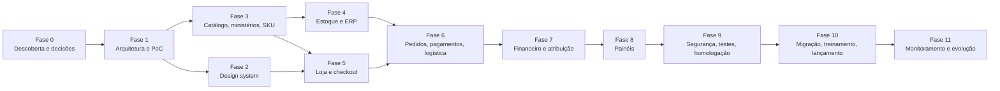

### 27.2. MVP — a menor versão capaz de vender com segurança, controlar estoque e atribuir resultados

**Dentro do MVP**

| Área | Incluído |
|---|---|
| Loja | UI-001 a UI-021, UI-024 a UI-034 (UI-008, UI-009, UI-023, UI-035, UI-036 em versão simplificada) |
| Catálogo | Ministérios, titularidade 100% (sem coprodução), SKU automático, dicionários, produtos simples e variáveis, kits simples, pré-venda, importação CSV |
| Checkout | Pix + cartão (à vista e parcelado), cupons com dono, Melhor Envio + retirada local |
| Estoque | Bling como fonte física (cenário B), depósitos `LOJA-ONLINE`, `QUARENTENA`, `AVARIA`, `EVENTO-x`; reservas; vendável; reconciliação diária; alertas de mínimo |
| Expedição | UI-403 a UI-410 |
| Financeiro | Snapshot por item, regras v1 (12.4) com versionamento e dupla aprovação, ledger com cadeia de hash, reembolso parcial, conciliação com relatório do gateway, fechamento mensal, exportação contábil |
| Painéis | Ministério (UI-301 a UI-309, UI-311 a UI-313), financeiro (UI-501 a UI-508, UI-511 a UI-513, UI-515), admin essencial |
| Segurança | Papéis e escopos, MFA, auditoria, WAF, Turnstile, backups, monitoramento |
| Analytics | GA4 com consentimento, eventos de e-commerce, `purchase` server-side para Pix |

**Fora do MVP (futuro)**

| Funcionalidade | Condição para entrar |
|---|---|
| Coprodução (titularidade < 100%) | DEC-022 |
| Repasses a ministérios (UI-514) | DEC-007 |
| Reprocessamento autorizado (UI-509) | Necessidade comprovada |
| Despesas compartilhadas com rateio automático (UI-510 completo) | DEC-006 — no MVP, rateio pode ser feito no fechamento com lançamento manual aprovado |
| Produtos digitais (UI-022) | DEC-018 |
| Avaliações (UI-037) | Volume de pedidos que justifique |
| PDV em eventos | DEC-021 |
| Ingressos/inscrições | DEC-019 (plataforma especializada) |
| Split de pagamento | DEC-008 |
| Marketplaces, feed do Google Merchant, remarketing | DEC-028 |
| Integração bancária automática | Banco com API disponível |
| BI (Metabase) | Demanda por análises ad hoc |
| WhatsApp transacional | Avaliação de custo e consentimento |

### 27.3. Fases

#### Fase 0 — Descoberta e decisões de negócio
- **Objetivo:** responder as decisões bloqueadoras e coletar dados reais.
- **Entregáveis:** respostas a DEC-001 a DEC-012 (bloqueadoras); inventário de produtos atuais (planilha); volumes históricos; parecer fiscal preliminar; cotações de gateway, hospedagem e ERP; regras de rateio aprovadas pela liderança; versão 1.1 deste documento.
- **Funcionalidades:** nenhuma.
- **Dependências:** disponibilidade da liderança, financeiro, contador.
- **Responsáveis:** PM + Administração da Igreja + Financeiro.
- **Riscos:** RSK-001, RSK-017.
- **Critérios de aceite:** todas as decisões bloqueadoras com resposta registrada e responsável.
- **Testes:** revisão do documento com cada área.
- **Avançar quando:** decisões bloqueadoras respondidas e orçamento aprovado.

#### Fase 1 — Arquitetura e validação técnica
- **Objetivo:** provar as hipóteses técnicas (8.7).
- **Entregáveis:** relatório da PoC; ADRs confirmadas; repositório e pipeline CI; ambientes dev/homologação; contratos de integração revisados.
- **Dependências:** contas sandbox (gateway, Bling, Melhor Envio), hospedagem de homologação.
- **Responsáveis:** Tech lead.
- **Riscos:** RSK-014; incompatibilidade de plugins com blocos/HPOS.
- **Critérios de aceite:** TEST-001, TEST-010, TEST-011, TEST-020 a TEST-026 e TEST-030 executados em homologação com resultado documentado.
- **Avançar quando:** go para cada ADR "validar na PoC" ou plano B aprovado.

#### Fase 2 — Identidade visual e design system (paralela)
- **Objetivo:** aplicar a marca e construir componentes.
- **Entregáveis:** tokens, biblioteca de componentes (Figma + blocos), protótipos navegáveis de UI-001, UI-007, UI-010, UI-011, UI-301, UI-403/404.
- **Dependências:** DEC-020 (marca).
- **Responsáveis:** UX/UI.
- **Riscos:** atraso na marca.
- **Critérios de aceite:** teste de usabilidade com 5 pessoas do público (mobile) no protótipo do checkout; contraste validado.
- **Avançar quando:** protótipos aprovados pela Administração.

#### Fase 3 — Catálogo, ministérios e SKUs
- **Objetivo:** núcleo de domínio do catálogo.
- **Entregáveis/funcionalidades:** `amc_ministry`, escopos, titularidade, dicionários, geração de SKU, painel "Ministério e SKU" no produto, importação CSV, UI-202, UI-203, UI-205–UI-207, UI-211, UI-213, UI-219, UI-304.
- **Dependências:** Fase 1.
- **Critérios de aceite:** FR-001 a FR-021; TEST-008, TEST-063.
- **Testes:** unitários (regras de SKU), integração (CRUD Woo), autorização.
- **Avançar quando:** catálogo-piloto de um ministério importado em homologação.

#### Fase 4 — Estoque e integrações
- **Entregáveis/funcionalidades:** conector Bling (INT-003 a INT-005), outbox/inbox, espelho de saldo, cálculo de vendável, kits, reconciliação diária, alertas, UI-214, UI-215, UI-230, UI-406, UI-407.
- **Dependências:** Fase 3; conta Bling configurada (depósitos).
- **Critérios de aceite:** FR-030 a FR-039; TEST-009, TEST-013, TEST-014, TEST-020–TEST-026.
- **Testes:** integração com sandbox/conta de teste do Bling; testes de falha (ERP fora).
- **Avançar quando:** 7 dias de reconciliação sem divergência em homologação com carga simulada.

#### Fase 5 — Loja pública e checkout
- **Entregáveis:** tema de blocos, UI-001–UI-021, UI-024–UI-036, busca, filtros, SEO técnico, consentimento de cookies, GA4.
- **Dependências:** Fases 2 e 3.
- **Critérios de aceite:** NFR-001, NFR-005, NFR-020, NFR-026; TEST-016, TEST-046.
- **Avançar quando:** auditoria de acessibilidade e performance aprovada em homologação.

#### Fase 6 — Pedidos, pagamentos e logística
- **Entregáveis:** gateway (INT-001, INT-002), Melhor Envio (INT-006), retirada, UI-218, UI-220–UI-222, UI-226, UI-403–UI-405, UI-408–UI-410, e-mails (INT-007).
- **Dependências:** Fases 4 e 5; contrato com gateway.
- **Critérios de aceite:** FR-040 a FR-050; TEST-001 a TEST-003, TEST-006, TEST-010–TEST-012, TEST-030.
- **Avançar quando:** ciclo completo (compra → expedição → devolução → reembolso) aprovado em homologação.

#### Fase 7 — Financeiro e atribuição por ministério
- **Entregáveis:** snapshot por item, regras versionadas, ledger com hash, conciliação, fechamento, exportação contábil, UI-501–UI-508, UI-511–UI-513, UI-515.
- **Dependências:** Fase 6; regras aprovadas (DEC-006); plano de contas (DEC-017).
- **Critérios de aceite:** FR-051 a FR-065; TEST-004, TEST-005, TEST-015, TEST-050–TEST-055.
- **Testes:** testes de propriedade (*property-based*) para rateio (soma sempre exata).
- **Avançar quando:** fechamento simulado de um mês de homologação conferido pelo Financeiro.

#### Fase 8 — Painéis administrativos
- **Entregáveis:** UI-201, UI-301–UI-314, UI-210, UI-224, UI-225, UI-227–UI-229, UI-231–UI-235.
- **Critérios de aceite:** FR-066 a FR-069; TEST-007, TEST-040–TEST-045.
- **Avançar quando:** cada responsável de ministério-piloto valida o seu painel.

#### Fase 9 — Segurança, testes e homologação
- **Entregáveis:** pentest (interno ou terceirizado) com correções; teste de carga; teste de restauração; UAT com usuários reais; checklist de lançamento.
- **Critérios de aceite:** 0 achado crítico/alto aberto; NFR-009, NFR-023 comprovados; UAT assinado por Administração, Financeiro e um ministério-piloto.
- **Avançar quando:** critérios acima.

#### Fase 10 — Migração, treinamento e lançamento
- **Entregáveis:** importação do catálogo real; inventário inicial aprovado; contas reais (gateway produção, Bling produção, Melhor Envio); treinamentos por perfil (gravados); manuais operacionais curtos; lançamento **suave** (*soft launch*) com público interno por 1–2 semanas; lançamento público.
- **Riscos:** RSK-018 (não lançar colado a um evento).
- **Critérios de aceite:** 50 pedidos reais completos no *soft launch* sem divergência financeira.
- **Avançar quando:** reunião de go-live aprovada.

#### Fase 11 — Monitoramento e evolução
- **Entregáveis:** rotina de manutenção (29.17), relatório mensal de indicadores, backlog priorizado das funcionalidades futuras, revisão das metas NFR após 90 dias.

---
<a id="s28"></a>

## 28. Plano de testes e critérios de aceite

### 28.1. Estratégia por tipo

| Tipo | Escopo | Ferramentas (propostas) | Quando roda | Critério |
|---|---|---|---|---|
| Unitário | Regras puras do `amc-core`: geração de SKU, rateio (maior resto), cálculo de vendável, regras de reembolso, máquina de estados, validação de CPF/CNPJ | PHPUnit (+ *property-based* com Eris ou equivalente para rateio); Jest para React | Todo *push* | Cobertura NFR-019 |
| Integração | `amc-core` + WordPress/WooCommerce reais (HPOS ligado), banco de teste | PHPUnit com wp-env/WP test suite | Todo *pull request* | 100% verde |
| API | Endpoints `amc/v1/*` (contratos, autorização), webhooks de entrada | PHPUnit + coleção Postman/Bruno versionada | PR | Contratos documentados (OpenAPI) válidos |
| Interface (E2E) | Jornadas críticas na loja e painéis | Playwright (Chromium, WebKit, mobile emulado) | PR (fumaça) e diário (completo) em homologação | Jornadas 28.3 verdes |
| Acessibilidade | Telas críticas | axe-core no Playwright + roteiro manual (teclado, NVDA, VoiceOver) | PR (automático); por release (manual) | NFR-020 |
| Segurança | Autorização, injeção, XSS, CSRF, webhooks, cabeçalhos | Testes de autorização automatizados, OWASP ZAP (baseline) em homologação, revisão de código, pentest antes do lançamento | PR (autorização), semanal (ZAP), pré-lançamento (pentest) | 0 achado crítico/alto |
| Carga | 21.3 | k6 | Fase 9 e antes de grandes eventos | NFR-003, NFR-009 |
| Recuperação | Restaurar backup em ambiente limpo; medir RTO/RPO | Procedimento documentado | Fase 9 e semestral | NFR-023 |
| Sincronização | Woo × ERP × frete × gateway com falhas injetadas | Mocks com falha controlada (timeouts, 429, 5xx, duplicados, fora de ordem) | Diário em homologação | 0 divergência não detectada |
| Financeiro | Invariantes, rateio, reembolsos, chargeback, conciliação, fechamento | Testes de cenário com valores esperados (tabelas *golden*) | PR | 100% exato ao centavo |
| Estoque | Reserva, concorrência, kits, transferências, devoluções | Integração + carga | PR / Fase 9 | NFR-012 |
| Permissões | Matriz 13.2 completa | Teste gerado a partir da matriz (cada papel × cada ação) | PR | 100% conforme matriz |
| Regressão | Toda a suíte + jornadas | CI + homologação com a próxima versão do WooCommerce (RC) | Antes de cada atualização | Sem regressão |
| Homologação com usuários (UAT) | Roteiros por perfil (cliente, ministério, estoque, expedição, financeiro, atendimento) | Planilha de roteiro + registro de achados | Fase 9 | Assinatura dos responsáveis |

### 28.2. Cenários críticos

| ID | Cenário (briefing nº) | Passos | Resultado esperado | Critério de aprovação |
|---|---|---|---|---|
| TEST-001 | Dois clientes tentam comprar a última unidade (1) | Estoque vendável = 1; 2 sessões (e depois 100 em carga) finalizam ao mesmo tempo | Exatamente 1 pedido avança ao pagamento; os demais recebem "item esgotou" e voltam ao carrinho | 0 pedido pago acima do estoque em 20 repetições; vendável final = 0 |
| TEST-002 | Pagamento aprovado com webhook duplicado (2) | Enviar o mesmo webhook 2× (e 5× em paralelo) | Um único diário `SALE`/`PAYMENT_FEE`; uma única baixa; e-mail único | Contagem de lançamentos e e-mails = 1; inbox registra duplicados como `ignored` |
| TEST-002b | Webhook forjado | POST com assinatura inválida/sem assinatura e com assinatura válida de evento antigo (*replay* fora da janela) | 401; nada muda; alerta após 5 ocorrências | Pedido permanece `pending` |
| TEST-003 | Gateway aprova, ERP indisponível (3) | Simular ERP 503 por 3 h | Pedido `processing`, ledger completo, outbox acumula, alerta em 30 min, vendável desconta o comprometido; ao voltar, pedido criado 1× no ERP | Sem perda nem duplicidade; vendável correto durante a falha |
| TEST-004 | Pedido com produtos de três ministérios (4) | JOV R$ 120, ENS R$ 80, MIS R$ 50, frete R$ 25, cartão | Alocações por item; taxa rateada em 4 centros (3 ministérios + Central) pelo maior resto | Σ por centro = total cobrado; diário balanceado; valores = tabela *golden* |
| TEST-005 | Cupom global em pedido com vários ministérios (5) | Cupom 10% no pedido de TEST-004 | Desconto rateado proporcionalmente ao líquido dos itens | Σ descontos = desconto total; nenhum item com líquido negativo; cupom de ministério só afeta os itens dele |
| TEST-005b | Abuso de cupom | 50 tentativas de códigos aleatórios; reutilização acima do limite por CPF | Rate limit + Turnstile; uso acima do limite rejeitado | Nenhum desconto indevido aplicado |
| TEST-006 | Reembolso parcial de item (6) | Exemplo 12.6.4 | `REFUND` 36,00 ENS; `COGS_REVERSAL` 22,50; reversa 18,90; taxa permanece; estoque +1 após inspeção | Margem ENS = −9,00; ledger balanceado; reembolso via API com chave idempotente |
| TEST-007 | Ministério tenta acessar dados de outro (7) | Usuário JOV chama `GET /amc/v1/ministries/ENS/results`, troca IDs em pedidos/itens, filtros de exportação | 403 em todos; nenhum dado do ENS no payload; tentativa registrada em auditoria | 100% das rotas testadas |
| TEST-008 | Operador altera indevidamente o SKU (8) | Tentar mudar SKU travado via UI, REST do Woo, importação CSV | Bloqueado nas três vias com mensagem; tentativa auditada; correção só via UI-212 | SKU inalterado |
| TEST-009 | Falha de integração durante a sincronização (9) | Derrubar conexão no meio de um lote de 200 eventos; responder 429 | Eventos não confirmados reprocessados; nenhum aplicado 2×; dead letter após 24 h | Reconciliação final sem divergência |
| TEST-010 | Pedido cancelado após a reserva (10) | Reservar; cancelar antes do pagamento; e outro após pagamento antes da separação | Reserva liberada; após pagamento: estorno integral, ERP cancelado, estoque restaurado, `REFUND` total | Vendável volta ao valor original |
| TEST-011 | Pix pago após expiração/cancelamento (11) | Expirar Pix; enviar webhook de pagamento 10 min depois (com e sem estoque) | Com estoque: pedido reaberto e segue; sem estoque: reembolso automático integral e e-mail | Nenhum dinheiro retido sem pedido válido; ledger com `SALE`+`REFUND` |
| TEST-012 | Falha de pagamento e *card testing* | Recusas sucessivas; 20 tentativas de cartões distintos por IP | Mensagens corretas; Turnstile após 3 falhas; bloqueio por IP após limite | Pedido não duplicado; reserva respeita expiração |
| TEST-013 | Transferência de estoque entre depósitos (13) | Transferir 20 un `LOJA-ONLINE → EVENTO-X` no ERP | Vendável online cai 20; estoque do evento +20; nada de ledger (mesmo dono) | Espelho e vendável corretos em ≤ 5 min |
| TEST-014 | Pedido pago, confirmação de estoque falha (14) | ERP rejeita pedido por saldo insuficiente (divergência física) | Pedido marcado `stock_exception`; alerta; fluxo de tratativa: aguardar reposição (com aviso ao cliente) ou cancelar com reembolso | Nenhum pedido "esquecido"; cliente comunicado em ≤ 1 dia útil |
| TEST-015 | Regra de rateio alterada após várias vendas (15) | 100 pedidos com RS-v1; ativar RS-v2 com vigência amanhã; reembolsar um pedido antigo após a vigência | Pedidos antigos inalterados; reembolso usa RS-v1; novos pedidos usam RS-v2 | Relatórios de meses anteriores idênticos antes/depois |
| TEST-016 | Preço muda com o produto no carrinho (12) | Adicionar a R$ 69,90; alterar para R$ 59,90 (e para R$ 79,90) | Aviso no carrinho/checkout; pedido criado com o preço vigente | Valor cobrado = preço vigente; aviso exibido |

### 28.3. Demais casos de teste

| ID | Área | Caso | Resultado esperado |
|---|---|---|---|
| TEST-020 | ERP (PoC) | Criar produto com SKU de 22 caracteres e variações | Aceito com o mesmo código |
| TEST-021 | ERP | Criar pedido via API 2× com o mesmo número | Um pedido no ERP |
| TEST-022 | ERP | Receber webhook de estoque e reconsultar | Espelho atualizado; webhook duplicado ignorado |
| TEST-023 | ERP | Ler custo/entradas pela API | Disponível ou plano B documentado (custo no `amc-core`) |
| TEST-024 | ERP | Emitir NF-e em homologação com grupos IBS/CBS | NF-e autorizada em homologação |
| TEST-025 | ERP | Exceder 3 req/s | Despachante respeita limite; 0 erro 429 persistente |
| TEST-026 | ERP | Kit explodido em componentes | Baixa correta dos componentes |
| TEST-030 | Frete | Cotação no checkout em blocos; compra de etiqueta pela API; rastreio | Valores iguais ao painel do provedor; etiqueta PDF; eventos de rastreio |
| TEST-040 | Permissões | Matriz 13.2 automatizada (papel × ação) | 100% conforme |
| TEST-041 | Permissões | Operador de ministério não vê margem/custo (UI e API) | Campos ausentes no payload |
| TEST-042 | Permissões | Escopo vencido | Acesso negado no dia seguinte ao `valid_to` |
| TEST-043 | Permissões | Usuário de ministério acessa `/wp-admin/admin.php?page=wc-orders` | Negado |
| TEST-044 | Permissões | Exportação respeita escopo e expira o link | Arquivo só do escopo; link inválido após 15 min |
| TEST-045 | Privacidade | Cliente A tenta ver pedido de B (troca de ID/chave) | Negado; dados mínimos em UI-017 |
| TEST-046 | Segurança | Alterar preço/quantidade/frete no payload do checkout | Servidor recalcula; total correto |
| TEST-047 | Segurança | *Credential stuffing* no login admin; usuário sem MFA | Bloqueio por rate limit; MFA exigido |
| TEST-048 | Estoque | Editar estoque no wp-admin com qualquer papel | Campo indisponível; reconciliação corrige se alterado por banco |
| TEST-049 | Financeiro | Atendimento aprova o próprio reembolso acima do limite | Bloqueado |
| TEST-050 | Conciliação | Recebível com diferença de R$ 0,02; recebível órfão; pedido sem recebível após prazo | Registros `difference`, `orphan`, `missing`; conta 9.1 com saldo; classificação zera |
| TEST-051 | Financeiro | Chargeback de pedido de 2 ministérios | `CHARGEBACK` proporcional; tarifa na Central |
| TEST-052 | Financeiro | Custo médio após 3 entradas com custos diferentes | Valor = média ponderada exata |
| TEST-053 | Financeiro | Lançamento com competência em período fechado | Rejeitado; evento tardio vai para período aberto com referência |
| TEST-054 | Financeiro | Adulterar uma linha do ledger diretamente no banco (homologação) | Trigger bloqueia; se forçado, verificação de hash aponta a linha |
| TEST-055 | Financeiro | Fechamento com despesas compartilhadas | Σ rateio = Σ despesas; maior resto |
| TEST-060 | Jornada | Carrinho abandonado com e sem consentimento | E-mail somente com consentimento; máx. 2 |
| TEST-061 | Jornada | Alteração de endereço antes e depois da etiqueta | Antes: permitido; depois: fluxo de cancelamento de etiqueta |
| TEST-062 | Jornada | Extravio | Ocorrência, reenvio ou reembolso; custo atribuído à Central |
| TEST-063 | Catálogo | Mudar categoria de produto com vendas | Relatórios financeiros inalterados |
| TEST-064 | Catálogo | Transferir titularidade com vigência futura | Vendas antes → ministério antigo; depois → novo |
| TEST-065 | Estoque | Kit com componente esgotado | Kit indisponível; mensagem cita componente |
| TEST-066 | Estoque | Pré-venda até o limite | Vendas param no limite; data exibida |
| TEST-067 | Acessibilidade | Checkout completo só com teclado e com leitor de tela | Concluído sem bloqueio |
| TEST-068 | Performance | Lighthouse mobile em Home, PDP, PLP | Metas NFR-001/005/006 em laboratório |
| TEST-069 | Recuperação | Restaurar backup do dia anterior em ambiente limpo | Loja funcional em ≤ 4 h; dados até o ponto do backup |
| TEST-070 | Analytics | Pix pago 20 min depois; recarregar confirmação | 1 `purchase` server-side; nenhum duplicado |

### 28.4. Testes de consistência financeira e reconciliação (contínuos)

Job diário (produção) que verifica e alerta:

1. Todo pedido pago tem diário `SALE` balanceado e alocações cuja soma = total cobrado.
2. Todo reembolso concluído no gateway tem `REFUND` correspondente (e vice-versa).
3. Σ taxas rateadas por pagamento = taxa informada pelo gateway (após INT-002).
4. Todo pagamento liquidado tem `SETTLEMENT`; todo recebível vencido há > 3 dias sem liquidação vira `missing`.
5. Cadeia de hash íntegra.
6. Saldo da conta 1.1 por pedido = valor ainda não liquidado.

Qualquer falha gera alerta e impede o fechamento do período.

---
<a id="s29"></a>

## 29. Documentação para desenvolvedores

> Orientação para a implementação futura. **Nada aqui deve ser implementado antes da aprovação das decisões bloqueadoras.**

### 29.1. Estrutura de repositório (proposta)

Monorrepositório `atitude-commerce` (este repositório):

```
/
├── docs/
│   ├── MASTERPLAN_ECOMMERCE_MINISTERIOS.md   ← este documento
│   ├── adr/                                   ← um arquivo por ADR (ADR-001.md …)
│   ├── api/openapi-amc-v1.yaml                ← contrato REST amc/v1
│   ├── runbooks/                              ← procedimentos operacionais (29.16)
│   └── data-dictionary.md                     ← dicionário de dados e exportações
├── wp-content/
│   ├── plugins/amc-core/                      ← plugin de domínio (PHP 8.3 + React)
│   │   ├── amc-core.php
│   │   ├── src/                               ← PSR-4: Amc\Core\…
│   │   │   ├── Ministry/  Catalog/  Sku/  Inventory/  Orders/
│   │   │   ├── Allocation/  Ledger/  Reconciliation/  Payments/
│   │   │   ├── Shipping/  Erp/  Integration/ (Outbox, Inbox)
│   │   │   ├── Auth/ (Capabilities, Scope, ScopedRepository)
│   │   │   ├── Rest/ (Controllers amc/v1)  Audit/  Admin/  Cli/
│   │   ├── migrations/                        ← migrações versionadas
│   │   ├── assets/admin/                      ← React (painéis), build com @wordpress/scripts
│   │   └── tests/ (unit, integration, fixtures/golden)
│   └── themes/amc-theme/                      ← tema de blocos (theme.json, patterns, templates)
├── config/                                    ← composer, plugins de terceiros fixados por versão
├── tests/
│   ├── e2e/ (Playwright)  load/ (k6)  a11y/
├── .github/workflows/                         ← CI/CD
├── composer.json / package.json / .wp-env.json
└── README.md
```

O núcleo do WordPress, o WooCommerce e plugins de terceiros **não** são versionados como código próprio: são instalados por versão fixa (Composer via WPackagist, ou manifesto de versões aplicado pelo pipeline com WP-CLI).

### 29.2. Estratégia de branches

- `main` = produção (protegida; *merge* apenas por PR aprovado + CI verde).
- `develop` = homologação (deploy automático para staging).
- `feature/<id>-<descricao>`, `fix/<id>-…`, `hotfix/<id>-…` (hotfix parte de `main` e volta para `develop`).
- Commits no padrão Conventional Commits (`feat(ledger): …`), referenciando IDs (`FR-052`, `TEST-006`).
- Releases com *tag* semântica `vMAJOR.MINOR.PATCH` e changelog.

### 29.3. Ambientes

| Ambiente | Finalidade | Dados | Integrações | Acesso |
|---|---|---|---|---|
| Local | Desenvolvimento | Sintéticos (fixtures) | Mocks | Desenvolvedor |
| Homologação | Testes, UAT, PoC | Anonimizados | Sandbox (gateway, frete); conta de teste do ERP | Equipe + usuários de UAT; autenticação básica; `noindex` |
| Produção | Operação | Reais | Produção | Papéis 13.1 |

### 29.4. Configuração e variáveis de ambiente

Todas lidas por `getenv()`/constantes em `wp-config.php`, **nunca** gravadas no repositório:

```
WP_ENVIRONMENT_TYPE=production|staging|local
AMC_GATEWAY_PROVIDER=mercadopago|pagarme
AMC_GATEWAY_ACCESS_TOKEN=***
AMC_GATEWAY_WEBHOOK_SECRET=***
AMC_ERP_PROVIDER=bling
AMC_ERP_CLIENT_ID=***      AMC_ERP_CLIENT_SECRET=***
AMC_SHIPPING_CLIENT_ID=*** AMC_SHIPPING_CLIENT_SECRET=***
AMC_CLOUDFLARE_ZONE_ID=*** AMC_CLOUDFLARE_PURGE_TOKEN=***
AMC_EMAIL_PROVIDER=ses|postmark   AMC_EMAIL_API_KEY=***
AMC_SENTRY_DSN=***
AMC_GA4_MEASUREMENT_ID=G-XXXX   AMC_GA4_API_SECRET=***
AMC_ENCRYPTION_KEY=***            (libsodium, para payloads do inbox)
AMC_LEDGER_ANCHOR_BUCKET=***      AMC_LEDGER_ANCHOR_CREDENTIALS=***
DISABLE_WP_CRON=true
DISALLOW_FILE_EDIT=true
DISALLOW_FILE_MODS=true           (produção)
```

Tokens OAuth renováveis (ERP, frete) são guardados no banco **criptografados** com `AMC_ENCRYPTION_KEY`.

### 29.5. Gerenciamento de segredos

- Produção: variáveis de ambiente do painel da hospedagem; CI: GitHub Actions Secrets por ambiente (*environments* com aprovação para produção).
- Humanos: cofre de senhas da organização; nada de senhas em e-mail/WhatsApp.
- Rotação: a cada 12 meses ou imediatamente em desligamento de pessoa com acesso / suspeita de vazamento; procedimento em runbook.
- Varredura de segredos no CI (ex.: gitleaks) — NFR-028.

### 29.6. Migrações de banco

- Classe `Amc\Core\Migrations\Runner` com migrações numeradas (`0001_create_ministry.php` …), registro em `amc_schema_migrations`.
- Executadas por WP-CLI no deploy (`wp amc migrate`) — nunca no carregamento de página.
- Migrações **somente aditivas** em produção quando possível; remoção de coluna em duas releases (deprecar → remover).
- Tabelas append-only (ledger, auditoria, movimentos) nunca recebem migração que altere dados existentes.

### 29.7. Convenções de nomenclatura

| Item | Convenção | Exemplo |
|---|---|---|
| Tabelas | `{prefix}amc_<entidade_singular>` | `wp_amc_ledger_entry` |
| Colunas monetárias | sufixo `_cents` (BIGINT) | `net_cents` |
| Datas | sufixo `_at` (DATETIME UTC) ou `_date` (DATE) | `approved_at`, `competence_date` |
| Hooks próprios | `amc/<modulo>/<evento>` | `amc/ledger/journal_posted` |
| Capacidades | `amc_<verbo>_<objeto>` | `amc_approve_refund` |
| REST | `amc/v1/<recurso>` no plural | `amc/v1/ministries/{id}/results` |
| Classes PHP | PSR-4, `Amc\Core\<Módulo>\<Classe>` | `Amc\Core\Allocation\LargestRemainderAllocator` |
| Opções | `amc_<chave>` | `amc_pix_expiration_minutes` |
| Metas em objetos Woo | `_amc_<chave>` | `_amc_ministry_id` |

### 29.8. Padrões de código

- PHP 8.3, `declare(strict_types=1)`, PHPCS (WordPress Coding Standards, com exceções documentadas para PSR-4), PHPStan nível 6+ com stubs do WordPress/WooCommerce.
- Domínio sem dependência direta de WordPress (serviços puros testáveis); adaptadores finos para WP/Woo.
- Valores monetários como objeto `Money` (inteiro em centavos + moeda); proibido `float` para dinheiro (regra de lint).
- Todo acesso a dados de domínio por repositórios; repositórios escopados por padrão (13.3).
- React com `@wordpress/components` e `@wordpress/data` nos painéis para consistência com o wp-admin; TypeScript.
- Revisão de código obrigatória (1 aprovação; 2 para `Ledger/`, `Allocation/`, `Auth/`).

### 29.9. Boas práticas específicas de WooCommerce/WordPress

1. Declarar compatibilidade com HPOS e com Cart/Checkout Blocks (`FeaturesUtil::declare_compatibility`).
2. Usar CRUD (`wc_get_order`, `WC_Order`, `WC_Product`) — nunca SQL direto em tabelas do WooCommerce ou `wp_posts`/`wp_postmeta` para pedidos.
3. Estender o checkout em blocos via **Store API** (`woocommerce_store_api_register_endpoint_data`, `ExtendSchema`) e *Additional Checkout Fields API* quando necessário; nunca depender de hooks do checkout legado.
4. Trabalho pesado sempre em **Action Scheduler** (`as_enqueue_async_action`) com grupos `amc-*`; idempotente e reentrante.
5. Hooks de pedido: usar transições de status (`woocommerce_order_status_changed`) e `woocommerce_payment_complete`, tratando repetição.
6. Não sobrescrever templates do WooCommerce sem necessidade; preferir blocos e filtros; manter lista de templates sobrescritos e revisá-los a cada atualização.
7. Prefixar tudo (`amc_`), *nonces* em todas as ações de admin, `current_user_can` + escopo em todo endpoint.
8. Internacionalização com text domain `amc-core` (textos em pt-BR).
9. Compatibilidade com atualizações: matriz testada (WordPress N e N-1; WooCommerce N e N-1; PHP 8.3/8.4); job semanal que roda a suíte contra a versão RC do WooCommerce.
10. Evitar plugins "faz-tudo"; cada plugin de terceiros precisa de justificativa no inventário (NFR-027).

### 29.10. Logs e tratamento de exceções

- Logger PSR-3 próprio com saída JSON (arquivo rotativo + envio ao Better Stack), níveis `debug` (só local), `info`, `warning`, `error`, `critical`.
- Exceções de domínio tipadas (`InsufficientStockException`, `UnbalancedJournalException`, `ScopeViolationException`) — capturadas na borda (controller/job), convertidas em resposta adequada e enviadas ao Sentry com contexto (sem PII).
- `ScopeViolationException` e `UnbalancedJournalException` são `critical` (alerta imediato).

### 29.11. Documentação de APIs

- OpenAPI 3.1 em `docs/api/openapi-amc-v1.yaml`, validado no CI contra os controllers (testes de contrato).
- Cada endpoint documenta: capacidade exigida, escopo, parâmetros, exemplos, erros (`code`, `message`, `correlation_id`).
- Dicionário de dados das exportações em `docs/data-dictionary.md`.

### 29.12. Versionamento

- Plugin e tema com SemVer; API `amc/v1` estável — mudanças incompatíveis exigem `amc/v2` com período de convivência.
- Regras financeiras versionadas no banco (12.4), não no código.

### 29.13. Pipeline de CI/CD

```mermaid
flowchart LR
    PR[Pull request] --> L[Lint PHPCS, ESLint, PHPStan]
    L --> U[Testes unitários e de integração]
    U --> S[Varredura de segredos e dependências]
    S --> B[Build de assets]
    B --> E[E2E fumaça + axe em ambiente efêmero]
    E --> M{Merge em develop}
    M --> DS[Deploy homologação<br/>wp amc migrate]
    DS --> EF[E2E completo + ZAP baseline]
    EF --> R{Release aprovada}
    R --> BK[Backup pré-deploy]
    BK --> DP[Deploy produção<br/>modo manutenção curto se houver migração]
    DP --> SM[Smoke tests + monitoramento 30 min]
    SM -->|falha| RB[Rollback]
```

### 29.14. Backup e rollback

- **Backup:** NFR-024; backup completo imediatamente antes de cada deploy de produção.
- **Rollback de código:** redeploy da *tag* anterior (artefato imutável).
- **Rollback de banco:** migrações aditivas tornam o rollback de código seguro sem reverter o banco; para migração destrutiva, restaurar backup pré-deploy (perda limitada à janela — por isso, deploys com migração destrutiva ocorrem em janela de manutenção com a loja em modo leitura).
- **Ledger:** nunca é restaurado parcialmente; em restauração total, os eventos posteriores ao backup são reprocessados a partir do gateway/ERP (inbox reconstruído por consulta às APIs).

### 29.15. Monitoramento

23.5 + NFR-022. Painel de saúde (UI-230) e endpoint `/wp-json/amc/v1/health` (protegido por token para detalhes; público apenas `ok/degraded/down`).

### 29.16. Rotinas operacionais (runbooks)

| Rotina | Frequência | Dono |
|---|---|---|
| Verificar alertas e fila de sincronização | Diária | Tecnologia (ou Admin treinado) |
| Conciliação | Diária | Financeiro |
| Revisar divergências de estoque | Diária | Estoque |
| Atualizações de segurança | ≤ 72 h após publicação | Tecnologia |
| Atualizações regulares (WordPress, WooCommerce, plugins) | Mensal, via homologação | Tecnologia |
| Teste de restauração | Semestral | Tecnologia |
| Revisão de acessos e escopos | Trimestral | Admin |
| Rotação de segredos | Anual | Tecnologia |
| Limpeza do Action Scheduler e logs | Semanal (automática) | Tecnologia |
| Verificação de renovação de tokens OAuth, certificado A1, domínio | Mensal | Tecnologia + Financeiro |
| Revisão do inventário de plugins | Trimestral | Tecnologia |
| Teste de carga antes de grandes eventos | Por evento | Tecnologia |

### 29.17. Plano de manutenção

- **Corretiva:** SLA proposto — crítico (loja/checkout fora, pagamento sem registro): início em 1 h, 24×7 em semanas de evento; alto: 1 dia útil; médio: 5 dias úteis.
- **Preventiva:** rotinas 29.16.
- **Adaptativa:** atualização de plataforma e integrações (mudanças de API de gateway/ERP/frete; mudanças fiscais).
- **Evolutiva:** backlog priorizado trimestralmente com a Administração.
- Contrato de manutenção com horas mensais (26.4) e documentação sempre atualizada (este documento é revisado a cada release maior).

---
<a id="s30"></a>

## 30. Decisões pendentes e perguntas ao responsável

Nenhuma resposta foi presumida. Onde o documento precisou avançar, registrou uma **premissa** ([5](#s05)) e indicou aqui qual decisão a confirma.

### 30.1. Bloqueadoras — sem resposta, a arquitetura ou as regras podem sair erradas

| ID | Pergunta | Por que importa | Decisão que depende | Hipótese adotada |
|---|---|---|---|---|
| DEC-001 | Qual pessoa jurídica (CNPJ) vende, recebe e emite documentos? É a Igreja, uma associação vinculada ou outra entidade? | Define titularidade da conta de pagamento, obrigações fiscais e contratos | Arquitetura financeira, gateway, ERP | PRM-01: um CNPJ |
| DEC-002 | Quantos ministérios participarão no lançamento e quais? | Escopo de cadastro, vitrines, treinamento, painéis | Plano de migração, design da home | Dezenas no futuro; 3–8 no lançamento |
| DEC-003 | Quantos produtos e SKUs existem hoje e onde estão cadastrados (planilha, sistema, nada)? | Esforço de migração e qualidade dos dados | Fase 3/10, importação | ≤ 2.000 SKUs (PRM-06) |
| DEC-004 | Os ministérios têm estoques fisicamente separados? Existe um depósito central? Onde? | Modelo de depósitos e expedição | 11, cenário de ERP | PRM-04: depósito central |
| DEC-005 | Quem compra, armazena, embala e envia? Equipe contratada, voluntários ou cada ministério? | Processos, perfis, interfaces de expedição | 11, 13, 16.4, 20 | PRM-05: expedição centralizada |
| DEC-006 | **Regras de rateio:** quem arca com cupons globais, frete, taxas, chargebacks, embalagem, despesas da plataforma? Despesas compartilhadas serão rateadas? Por qual critério? | Resultado de cada ministério muda conforme a regra | 12.3, RS-v1 | Regras padrão de 12.3 |
| DEC-007 | Os ministérios **recebem repasses** de dinheiro ou apenas relatórios gerenciais? Com que periodicidade e sobre qual base (venda, margem, resultado)? | Define se haverá processo de pagamento interno, provisões e UI-514 | 12.6.5, 4.2 | PRM-03: só relatórios |
| DEC-008 | Algum ministério tem (ou terá) CNPJ próprio? Há intenção de que recebam diretamente? | Split e marketplace mudam a arquitetura | ADR-003, ADR-009 | Não |
| DEC-009 | Quem aprova preços, produtos e promoções? Os ministérios podem cadastrar seus próprios produtos? | Fluxos de aprovação e permissões | 13.2, PRC-001/002/004 | Ministério solicita; Gestor aprova |
| DEC-010 | **Tratamento fiscal:** a venda exige inscrição estadual e NF-e? Há imunidade reconhecida? Como tratar ICMS e IBS/CBS? Produtos digitais e personalização? | Define se ERP/NF-e são obrigatórios e o custo | Cenário A × B, ERP, INT-016 | PRM-07: NF-e necessária |
| DEC-011 | Já existe ERP, gateway, conta bancária PJ, contrato com Correios ou outro fornecedor contratado? | Reaproveitar reduz custo de troca | 7, 8, 26 | PRM-11: nada contratado |
| DEC-012 | Qual o volume estimado de pedidos/mês e o ticket médio? Quais os picos (eventos)? | Dimensiona hospedagem, faixa do ERP, viabilidade (26.7) | 21, 26 | PRM-06: 1.500 pedidos/mês; R$ 100 |

### 30.2. Importantes — influenciam custo, UX, operação e integrações

| ID | Pergunta | Por que importa | Decisão que depende |
|---|---|---|---|
| DEC-013 | Qual o orçamento disponível (implantação e mensal) e o nível de disponibilidade esperado (ex.: 99,5%)? Quem dará suporte fora do horário comercial? | Escolha de cenário, hospedagem, SLA | 26, NFR-007, NFR-023 |
| DEC-014 | Qual o prazo desejado de lançamento? Há evento-âncora? Quem estará disponível para homologar e operar? | Plano e risco RSK-018 | 27 |
| DEC-015 | Quem desenvolverá e manterá (equipe interna, agência, freelancer)? | Custo, risco de dependência | 26, 29.17 |
| DEC-016 | Limites de aprovação (reembolso, ajuste de estoque, preço abaixo da margem) e quem os aprova? Estoquista pode ver custo? | Segregação de funções | 13.2, 13.4 |
| DEC-017 | Como a contabilidade quer receber os dados? Existe plano de contas? Prazo de guarda? | Exportação contábil, retenção | 12.5, INT-010 |
| DEC-018 | Haverá produtos digitais? Quais e com que direitos autorais? | Módulo de downloads, fiscal | UI-022 |
| DEC-019 | A loja venderá inscrições/ingressos para eventos? | Exige plataforma especializada ou módulo próprio | 4.2 |
| DEC-020 | Existe identidade visual definida (manual de marca, logos, fontes)? Os ministérios têm identidades próprias? | Design system | 18 |
| DEC-021 | Haverá vendas presenciais em eventos? Com que meio de pagamento (maquininha, Pix)? | PDV, NFC-e, depósito de evento | 11.9 |
| DEC-022 | Haverá coprodução entre ministérios? Na transferência de responsabilidade, o estoque existente muda de dono? | Titularidade parcial, PRC-024 | 9.4, UI-234 |
| DEC-023 | Haverá venda em marketplaces ou varejo que exija GTIN (GS1)? | Custo de associação, cadastro | 10.1 |
| DEC-024 | Doações/contribuições serão aceitas na loja? (recomendação: não misturar com vendas) | Natureza jurídica distinta | 4.2 |
| DEC-025 | Políticas de troca/devolução (prazos, personalizados, frete em devolução parcial, cancelamento pelo cliente) — validação jurídica | UI-023/024/031, regras de reembolso | 15, 12.6.4 |
| DEC-026 | Tempo de expiração do Pix e de reserva de estoque | Conversão × estoque preso | BR-013, UI-231 |
| DEC-027 | Haverá comunicação recorrente (newsletter)? Quem produz? | Seção da home e consentimento | 19.1 |

### 30.3. Futuras — podem esperar sem comprometer o MVP

| ID | Pergunta | Por que importa | Quando decidir |
|---|---|---|---|
| DEC-028 | Haverá mídia paga e remarketing? Com quais plataformas? (exige avaliação do dado sensível — 22.1) | Tags, consentimento, RIPD | Antes de ativar campanhas |
| DEC-029 | Quem será o encarregado de dados (DPO) e o substituto? | Obrigação de publicação de contato | Antes do lançamento (pode ser decidido na Fase 9) |
| DEC-030 | Integração com aplicativo institucional da Igreja (login único, catálogo no app)? | API pública, SSO | Pós-MVP |
| DEC-031 | WhatsApp transacional (status do pedido)? | Custo, consentimento | Pós-MVP |
| DEC-032 | Programa de fidelidade, assinaturas, listas de presentes? | Novos módulos | Pós-MVP |
| DEC-033 | BI dedicado (Metabase) para análises ad hoc? | Infraestrutura adicional | Após 3 meses de operação |

### 30.4. Decisões para levar à chefia (resumo)

1. **Qual CNPJ opera a loja e qual o tratamento fiscal** (DEC-001, DEC-010) — exige reunião com o contador.
2. **Os ministérios recebem dinheiro ou só relatórios?** E quem arca com taxas, frete e custos da plataforma? (DEC-006, DEC-007, DEC-008).
3. **Quem opera estoque e expedição** e onde fica o estoque (DEC-004, DEC-005).
4. **Orçamento, prazo e quem desenvolve/mantém** (DEC-013, DEC-014, DEC-015).
5. **Volume esperado** para confirmar a viabilidade do cenário B (DEC-012).

---
<a id="s31"></a>

## 31. Matriz de rastreabilidade

Cada linha liga uma necessidade de negócio (NB) às regras, requisitos, telas, dados, integrações e testes que a atendem. Uma necessidade sem teste é considerada **não atendida**.

| NB | Necessidade de negócio | Regras | Requisitos | Telas | Entidades | Integrações | Testes | Critério de aceite |
|---|---|---|---|---|---|---|---|---|
| NB-01 | Identificar o ministério responsável por cada produto | BR-001, BR-002, BR-005 | FR-001, FR-004, FR-012 | UI-203, UI-205, UI-234 | `amc_ministry`, `amc_product_ownership` | — | TEST-063, TEST-064 | Todo produto ativo tem 1 responsável vigente; mudança de categoria não altera relatórios |
| NB-02 | SKUs únicos, estáveis e legíveis | BR-004, BR-005, BR-033 | FR-005–FR-008, FR-020 | UI-206, UI-207, UI-212, UI-219 | `amc_sku`, `amc_sku_sequence`, `amc_dictionary` | INT-004 | TEST-008, TEST-020 | SKU no padrão 10.3, imutável após movimentação |
| NB-03 | Vender a partir de uma única loja com Pix e cartão | BR-013, BR-019, BR-028 | FR-032, FR-046, FR-047, FR-071, FR-075 | UI-007, UI-010, UI-011, UI-015, UI-016 | Pedidos (Woo), `amc_payment` | INT-001 | TEST-001, TEST-002, TEST-012, TEST-016, TEST-046 | Pedido pago com valores recalculados no servidor; nenhum dado de cartão na loja |
| NB-04 | Não vender o que não existe | BR-012, BR-013, BR-014, BR-030 | FR-030–FR-034, FR-017 | UI-214, UI-007 | `amc_inventory_balance`, `wc_reserved_stock` | INT-005 | TEST-001, TEST-011, TEST-014, TEST-065, TEST-066 | 0 venda acima do vendável |
| NB-05 | Estoque confiável e rastreável | BR-012, BR-017 | FR-030, FR-035, FR-036 | UI-401, UI-402, UI-411, UI-412, UI-215 | `amc_inventory_movement`, `amc_sync_discrepancy` | INT-005 | TEST-013, TEST-022, TEST-048 | Acurácia ≥ 98%; divergências detectadas em ≤ 24 h |
| NB-06 | Estoque reservado para eventos | BR-029 | FR-039 | UI-214, UI-035 | `amc_warehouse` (`EVENTO-x`) | INT-005 | TEST-013 | Saldo do evento não vendável online |
| NB-07 | Atribuir receita a cada ministério no nível do item | BR-003, BR-006, BR-023 | FR-051, FR-052 | UI-220, UI-307 | `amc_order_item_allocation` | — | TEST-004 | Σ alocações = total cobrado |
| NB-08 | Distribuir descontos, frete e taxas por regras | BR-007, BR-008, BR-009, BR-027 | FR-052, FR-053, FR-074 | UI-508, UI-224 | `amc_allocation_rule_set` | — | TEST-005, TEST-004 | Rateios exatos ao centavo pelas regras vigentes |
| NB-09 | Não contar o mesmo valor duas vezes | BR-010, BR-015, BR-035 | FR-054, FR-056, FR-058 | UI-512 | `amc_ledger_entry`, `amc_inbox_event` | INT-001, INT-005 | TEST-002, TEST-009, TEST-021 | Lançamentos únicos por evento; diários balanceados |
| NB-10 | Mudar regras sem reescrever o passado | BR-011, BR-022 | FR-053, FR-059 | UI-508, UI-509, UI-515 | `amc_allocation_rule_set`, `amc_period` | — | TEST-015, TEST-053 | Meses anteriores idênticos após mudança |
| NB-11 | Auditoria financeira | BR-010 | FR-054, FR-055, FR-073 | UI-512, UI-232 | `amc_ledger_entry`, `amc_audit_log` | INT-013 | TEST-054 | Cadeia de hash íntegra; alteração detectada |
| NB-12 | Saber o resultado de cada ministério (margem, resultado) | BR-020, BR-021 | FR-060, FR-062, FR-066 | UI-301, UI-309, UI-502 | Ledger, `amc_cost_history`, `amc_shared_expense` | — | TEST-052, TEST-055 | DRE do ministério = soma dos lançamentos |
| NB-13 | Conciliar vendas e recebimentos | BR-031 | FR-057, FR-064 | UI-506, UI-507 | `amc_receivable`, `amc_reconciliation_record` | INT-002, INT-009 | TEST-050 | Conta 9.1 zerada no fechamento |
| NB-14 | Tratar reembolsos parciais e devoluções corretamente | BR-017, BR-032 | FR-049, FR-050 | UI-024, UI-226, UI-410 | `amc_refund_request` | INT-001, INT-006 | TEST-006, TEST-049 | Valores por ministério corretos; segregação respeitada |
| NB-15 | Tratar chargebacks | BR-026 | FR-063 | UI-505 | Ledger | INT-001, INT-002 | TEST-051 | Chargeback rateado por item |
| NB-16 | Isolar dados entre ministérios | BR-016 | FR-003, FR-066, FR-068, FR-069 | UI-301–UI-314 | `amc_user_scope` | — | TEST-007, TEST-040–TEST-044 | 0 vazamento em testes de autorização |
| NB-17 | Segurança de contas e operações sensíveis | BR-017 | FR-072, FR-073 | UI-227, UI-228, UI-210 | `amc_audit_log`, `amc_approval` | — | TEST-047, TEST-049 | MFA 100%; aprovações por terceiros |
| NB-18 | Expedir rápido e sem erro | — | FR-040–FR-044 | UI-403–UI-409 | `amc_shipment` | INT-006 | TEST-030 | Prazo ≤ 2 dias úteis; conferência 100% |
| NB-19 | Integrações confiáveis | BR-015 | FR-035 | UI-229, UI-230 | `amc_outbox_event`, `amc_inbox_event`, `amc_external_ref` | INT-001–INT-006 | TEST-003, TEST-009, TEST-025 | Sem perda nem duplicidade sob falha |
| NB-20 | Emitir documento fiscal quando exigido | — | (FR via ERP) | UI-220 | `amc_external_ref` | INT-003, INT-016 | TEST-024 | NF-e autorizada vinculada ao pedido |
| NB-21 | Conformidade com consumidor (informação, arrependimento) | BR-032 | FR-050 | UI-024, UI-025, UI-028–UI-031 | — | — | TEST-060 | Requisitos do Decreto 7.962/2013 presentes |
| NB-22 | Conformidade LGPD | BR-028 | FR-076, FR-077, FR-068 | UI-021, UI-034 | Consentimentos | INT-008 | TEST-045, TEST-070 | Exportação/exclusão funcionam; sem tags antes do consentimento |
| NB-23 | Boa experiência mobile e acessível | — | FR-078, FR-079 | UI-001–UI-011 | — | — | TEST-067, TEST-068 | NFR-001, NFR-020 |
| NB-24 | Medir conversão sem misturar com financeiro | — | FR-080, FR-081 | — | — | INT-008 | TEST-070 | 1 `purchase` por pedido pago |
| NB-25 | Ser encontrado em buscadores | BR-024 | FR-018 | UI-004, UI-007, UI-032 | — | INT-012 | TEST-068 | NFR-026 |
| NB-26 | Ministérios proporem produtos sem acesso ao WooCommerce | BR-018 | FR-013, FR-014 | UI-304, UI-211, UI-210 | `amc_product_request`, `amc_approval` | — | TEST-041 | Solicitação → produto com vínculo |
| NB-27 | Transferir produtos entre ministérios | BR-025 | FR-004 | UI-234 | `amc_product_ownership` | — | TEST-064 | Histórico preservado |
| NB-28 | Recuperar de desastres | — | — | — | Backups | INT-013 | TEST-069 | RTO ≤ 4 h |
| NB-29 | Portabilidade (não ficar preso a fornecedores) | — | FR-021, FR-061 | UI-513 | `amc_external_ref` | INT-010 | TEST-020 | Exportações completas e documentadas (NFR-018) |

---

<a id="s32"></a>

## 32. Catálogo de regras de negócio e requisitos funcionais

### 32.1. Regras de negócio (BR)

| ID | Regra | Critério de aceite | Teste |
|---|---|---|---|
| BR-001 | Todo produto ativo tem exatamente um ministério responsável vigente (ou coprodução somando 100%) | Publicação bloqueada sem responsável; consulta de vigência retorna 1 registro (ou soma 10000 bp) | TEST-063 |
| BR-002 | A responsabilidade é um atributo com vigência; o histórico é preservado | Nenhum registro de titularidade é apagado; mudanças geram nova linha | TEST-064 |
| BR-003 | A atribuição financeira é feita no item do pedido e congelada no momento da criação do pedido (ministério, preço, regra, custo-snapshot) | Alterar titularidade/preço/regra depois não muda alocações existentes | TEST-015, TEST-064 |
| BR-004 | SKU único global, imutável após a 1ª movimentação ou venda; nunca reutilizado | Tentativas de alteração bloqueadas em UI, REST e importação | TEST-008 |
| BR-005 | O prefixo do SKU indica o ministério de **origem**, não o responsável atual; relatórios nunca derivam o ministério do SKU | Relatório de produto transferido mostra o novo dono com SKU antigo | TEST-064 |
| BR-006 | Valores em centavos inteiros; rateios pelo método do maior resto, com soma exata | Testes de propriedade: Σ partes = total em 10 mil casos aleatórios | TEST-004 |
| BR-007 | Desconto de pedido global é rateado proporcionalmente ao líquido dos itens elegíveis (padrão configurável) | Rateio confere com fórmula | TEST-005 |
| BR-008 | Receita e custo de frete pertencem à Loja Central (padrão configurável) | Lançamentos de frete com centro Central | TEST-004 |
| BR-009 | Taxa de pagamento é rateada proporcionalmente ao valor cobrado de cada centro | Σ taxas rateadas = taxa do pagamento | TEST-004 |
| BR-010 | O ledger é append-only; correções apenas por reversão/ajuste | UPDATE/DELETE bloqueados; reversões referenciam o original | TEST-054 |
| BR-011 | Mudança de regra vale apenas para eventos de pedidos criados a partir da vigência; recálculo retroativo só por reprocessamento autorizado com dupla aprovação | Meses anteriores inalterados | TEST-015 |
| BR-012 | Estoque físico só muda por documento (recebimento, ajuste aprovado, inventário, transferência, devolução); nunca por edição direta | Campo de estoque não editável; movimentos com documento | TEST-048 |
| BR-013 | Reserva de estoque no checkout com expiração; Pix: expiração do Pix + 5 min | Reserva liberada no tempo configurado | TEST-010, TEST-011 |
| BR-014 | Pagamento confirmado para pedido expirado/cancelado: reabrir se houver estoque; senão reembolso integral automático | Nenhum valor retido sem pedido válido | TEST-011 |
| BR-015 | Todo evento externo é processado de forma idempotente (provedor + id do evento) | Duplicados ignorados e registrados | TEST-002, TEST-009 |
| BR-016 | Usuário de ministério acessa apenas dados dos ministérios em seu escopo vigente, aplicado no backend | 403 e payload sem dados fora do escopo | TEST-007, TEST-040–TEST-044 |
| BR-017 | Segregação de funções: solicitante ≠ aprovador acima de limites; conferente ≠ comprador; regras com dupla aprovação | Sistema impede autoaprovação | TEST-049 |
| BR-018 | Alterações de preço registradas com autor, motivo e vigência; preço do pedido congelado | `amc_price_history` completo | TEST-016 |
| BR-019 | Se o preço mudar com o item no carrinho, o cliente é avisado antes de pagar e o pedido usa o preço vigente | Aviso exibido; valor cobrado correto | TEST-016 |
| BR-020 | CMV pelo custo médio ponderado, com snapshot no momento da venda e confirmação na baixa (método a validar com a contabilidade) | Cálculo confere | TEST-052 |
| BR-021 | Despesas compartilhadas são rateadas no fechamento mensal por critério versionado | Σ rateio = Σ despesas | TEST-055 |
| BR-022 | Período fechado não recebe lançamentos; eventos tardios vão para o período aberto com referência | Lançamento rejeitado no período fechado | TEST-053 |
| BR-023 | Preço do kit é rateado entre componentes pelo preço de referência; componentes de ministérios diferentes geram alocações separadas | Exemplo 10.6 reproduzido | TEST-026, TEST-004 |
| BR-024 | Produto com histórico nunca é excluído; é arquivado, com redirecionamento conforme 24.6 | Exclusão indisponível; 301 configurado | TEST-063 |
| BR-025 | Transferência de responsabilidade tem vigência futura e define o tratamento do estoque existente | Vendas antes/depois atribuídas corretamente | TEST-064 |
| BR-026 | Chargeback estorna a receita dos itens contestados proporcionalmente; tarifa conforme regra | Lançamentos por ministério | TEST-051 |
| BR-027 | Todo cupom tem emissor (Central ou ministério); cupom de ministério só se aplica a itens dele e seu custo é dele | Cupom sem emissor não é salvo | TEST-005 |
| BR-028 | Dados de cartão nunca são armazenados ou trafegam pelo servidor da loja | Inspeção de payloads e logs | TEST-046 |
| BR-029 | Estoque reservado para evento fica em depósito próprio e não é vendável on-line | Vendável não inclui `EVENTO-x` | TEST-013 |
| BR-030 | Pré-venda só com data prevista e limite de quantidade, informados ao cliente | Vendas param no limite | TEST-066 |
| BR-031 | Todo pagamento capturado deve ter recebível correspondente; qualquer diferença (> R$ 0,00) gera registro de conciliação | Registros `difference`/`missing`/`orphan` | TEST-050 |
| BR-032 | Direito de arrependimento em 7 dias do recebimento exercido pela mesma ferramenta da compra; regras de produtos personalizados conforme validação jurídica | Fluxo UI-024 disponível; política publicada | TEST-060 |
| BR-033 | Código do ministério (3 letras) é único e imutável após o primeiro produto | Campo bloqueado | — (teste unitário de validação) |
| BR-034 | Soma das participações de titularidade em qualquer instante = 100% | Validação transacional | — (unitário) |
| BR-035 | Lançamentos são únicos por (evento de origem, tipo, item, centro, conta, direção) e todo diário é balanceado | Restrição única + verificação | TEST-002 |

### 32.2. Requisitos funcionais (FR)

| ID | Requisito | Telas | Teste |
|---|---|---|---|
| FR-001 | Cadastrar, editar e arquivar ministérios sem desenvolvimento | UI-202, UI-203 | — |
| FR-002 | Gerar vitrine pública por ministério a partir da titularidade | UI-003 | TEST-063 |
| FR-003 | Atribuir escopo de ministério a usuários, com vigência | UI-228 | TEST-042 |
| FR-004 | Registrar titularidade de produto com vigência e transferência agendada | UI-205, UI-234 | TEST-064 |
| FR-005 | Gerar SKU automaticamente conforme 10.3 | UI-205, UI-206 | TEST-008 |
| FR-006 | Manter dicionários de tipo, cor, tamanho e atributos | UI-219 | — |
| FR-007 | Bloquear SKU após a primeira movimentação/venda | UI-207 | TEST-008 |
| FR-008 | Executar correção excepcional de SKU com aprovação | UI-212 | TEST-008 |
| FR-009 | Registrar histórico de preços | UI-209 | TEST-016 |
| FR-010 | Cadastrar kits com componentes e preço de referência | UI-205, UI-008 | TEST-026, TEST-065 |
| FR-011 | Capturar personalização no item do pedido | UI-007, UI-404 | — |
| FR-012 | No MVP, aceitar apenas titularidade de 100% (modelo preparado para coprodução) | UI-205 | — |
| FR-013 | Permitir que ministérios solicitem produtos e alterações | UI-304, UI-211 | TEST-041 |
| FR-014 | Fluxo de aprovação genérico com diff e segregação | UI-210 | TEST-049 |
| FR-015 | Importar catálogo por CSV com validação, simulação e idempotência | UI-213 | — |
| FR-016 | Vender produtos digitais com downloads limitados (pós-MVP) | UI-022 | — |
| FR-017 | Configurar pré-venda com data e limite | UI-205 | TEST-066 |
| FR-018 | Arquivar produtos e configurar redirecionamento | UI-205 | — |
| FR-019 | Bloquear publicação sem ministério, SKU, custo, peso/dimensões e vínculo ERP | UI-205 | TEST-020 |
| FR-020 | Validar formato e comprimento do SKU compatíveis com o ERP | UI-205 | TEST-020 |
| FR-021 | Exportar catálogo completo em CSV/JSON | UI-235 | — |
| FR-030 | Manter espelho de saldo por SKU × depósito | UI-214 | TEST-022 |
| FR-031 | Calcular e publicar estoque vendável (11.3) | UI-214 | TEST-003 |
| FR-032 | Reservar estoque no checkout com expiração configurável | UI-231 | TEST-001, TEST-010 |
| FR-033 | Verificar estoque na confirmação do pagamento e tratar exceção | UI-220 | TEST-011, TEST-014 |
| FR-034 | Calcular disponibilidade de kits pelo mínimo dos componentes | UI-008 | TEST-065 |
| FR-035 | Reconciliar diariamente estoque e pedidos com o ERP e alertar divergências | UI-230 | TEST-009 |
| FR-036 | Alertar estoque abaixo do mínimo (diário consolidado) | UI-312 | — |
| FR-037 | Registrar "Avise-me" e notificar na reposição | UI-036 | — |
| FR-038 | Tratar pedidos com itens em pré-venda e pronta entrega (envio único ou dividido) | UI-011 | TEST-066 |
| FR-039 | Registrar pedidos manuais/evento com canal e depósito de origem | UI-220 | TEST-013 |
| FR-040 | Separação com lista por endereço e confirmação por leitura | UI-403 | — |
| FR-041 | Embalagem com conferência 100% antes da etiqueta | UI-404 | — |
| FR-042 | Compra e impressão de etiquetas em lote | UI-405 | TEST-030 |
| FR-043 | Atualizar rastreio periodicamente e notificar o cliente | UI-017, UI-408 | TEST-030 |
| FR-044 | Retirada local com conferência de identidade | UI-409 | — |
| FR-045 | Tabela de contingência de frete quando a cotação falhar | UI-011 | — |
| FR-046 | Pix com expiração, contagem e geração de novo código | UI-015 | TEST-011 |
| FR-047 | Exibir parcelamento com e sem juros de forma transparente | UI-007, UI-011 | — |
| FR-048 | Tratar Pix pago após expiração/cancelamento (BR-014) | — | TEST-011 |
| FR-049 | Workflow de reembolso total/parcial com cálculo automático, aprovação e API do gateway | UI-226 | TEST-006, TEST-049 |
| FR-050 | Solicitação de troca/devolução/arrependimento pelo cliente | UI-023, UI-024, UI-410 | TEST-006 |
| FR-051 | Gravar snapshot de atribuição por item na criação do pedido | UI-220 | TEST-004 |
| FR-052 | Ratear descontos, taxas e custos pelo maior resto conforme regras | UI-220 | TEST-004, TEST-005 |
| FR-053 | Versionar regras com simulação e dupla aprovação | UI-508 | TEST-015 |
| FR-054 | Ledger de partidas dobradas append-only | UI-512 | TEST-054 |
| FR-055 | Cadeia de hash e âncora externa diária | UI-512 | TEST-054 |
| FR-056 | Gerar lançamentos automaticamente por evento (tabela 12.5) | — | TEST-002, TEST-006 |
| FR-057 | Importar recebíveis e conciliar com pagamentos | UI-506 | TEST-050 |
| FR-058 | Verificar invariantes financeiros (12.3, 28.4) | UI-515 | TEST-050 |
| FR-059 | Fechamento mensal com bloqueio de período | UI-515 | TEST-053 |
| FR-060 | Registrar e ratear despesas compartilhadas | UI-510 | TEST-055 |
| FR-061 | Exportação contábil mensal | UI-513 | — |
| FR-062 | Custo médio ponderado por SKU | UI-511 | TEST-052 |
| FR-063 | Registrar chargebacks e tarifas por ministério | UI-505 | TEST-051 |
| FR-064 | Importar extrato bancário (OFX/CSV) | UI-506 | TEST-050 |
| FR-065 | Registrar repasses internos (condicional a DEC-007) | UI-514 | — |
| FR-066 | Painel do ministério com escopo aplicado no backend | UI-301–UI-314 | TEST-007 |
| FR-067 | Painéis financeiros consolidados e por ministério | UI-501–UI-507 | — |
| FR-068 | Mascarar dados pessoais conforme perfil no servidor | UI-306 | TEST-041 |
| FR-069 | Exportações escopadas, auditadas e com link expirável | UI-313, UI-513 | TEST-044 |
| FR-070 | Validar CPF e CNPJ (inclusive alfanumérico) | UI-011 | — (unitário) |
| FR-071 | Checkout como convidado | UI-011 | — |
| FR-072 | MFA obrigatório para perfis privilegiados | UI-227 | TEST-047 |
| FR-073 | Registro de auditoria append-only | UI-232 | — |
| FR-074 | Cupons com emissor, escopo, limites e orçamento | UI-224 | TEST-005, TEST-005b |
| FR-075 | Recalcular preços, descontos e frete no servidor | UI-011 | TEST-046 |
| FR-076 | Gestão de consentimento de cookies com Consent Mode | UI-034 | TEST-070 |
| FR-077 | Exportação e exclusão/anonimização de dados do titular | UI-021 | TEST-045 |
| FR-078 | Busca com sugestões, tolerância e busca por SKU | UI-005 | — |
| FR-079 | Filtros e ordenação refletidos na URL | UI-006 | — |
| FR-080 | Relatórios financeiros nunca dependem de analytics | — | — (revisão) |
| FR-081 | Enviar `purchase`/`refund` server-side com deduplicação | — | TEST-070 |

---
<a id="s33"></a>

## 33. Fontes consultadas

Todas consultadas em **21/10/2026**. Tipo: **(O)** oficial do fornecedor/órgão; **(S)** secundária. Como explicado em [7.0](#s07), várias páginas oficiais foram lidas por trechos indexados em mecanismos de busca, por bloqueio de acesso direto no ambiente de pesquisa; **confirmar os valores antes de contratar.**

### 33.1. Plataformas de e-commerce

| Fonte | Tipo | O que sustenta |
|---|---|---|
| https://developer.woocommerce.com/2026/10/09/woocommerce-11-2-1-release-notes/ | O | Versão 11.2.1 |
| https://developer.woocommerce.com/2026/10/07/woocommerce-11-2-0-release-notes/ | O | Versão 11.2.0 |
| https://developer.woocommerce.com/docs/category/hpos | O | HPOS e tabelas |
| https://developer.woocommerce.com/docs/apis/rest-api/ | O | REST API v3 |
| https://developer.woocommerce.com/docs/apis/rest-api/v2/webhooks/ | O | Webhooks e assinatura |
| https://developer.woocommerce.com/docs/apis/store-api/ | O | Store API |
| https://developer.woocommerce.com/2025/04/02/store-api-updates-coming-in-woocommerce-9-8/ | O | `PUT /checkout` |
| https://docs.woocommerce.com/wc-apidocs/files/woocommerce-src-checkout-helpers-reservestock.html | O | Reserva de estoque |
| https://woocommerce.com/document/woocommerce-store-editing/customizing-cart-and-checkout/checkout-block/woocommerce-blocks-local-pickup/ | O | Local Pickup |
| https://woocommerce.com/document/product-bundles-product-recommendations-composite-products-or-product-add-ons/ | O | Preços de extensões |
| https://ja.wordpress.org/plugins/woocommerce-extra-checkout-fields-for-brazil/ | O | Brazilian Market |
| https://stackharbor.com/en/knowledge-base/woo-oversell-stock-race-conditions/ | S | Concorrência na reserva |
| https://hookdeck.com/webhooks/platforms/guide-to-woocommerce-webhooks-features-and-best-practices | S | Verificação de webhooks |
| https://webkul.com/blog/wordpress-action-scheduler-with-high-volume-stores/ | S | Action Scheduler em volume |
| https://www.shopify.com/pricing | O | Planos, taxas, localizações |
| https://help.shopify.com/en/manual/payments/shopify-payments/supported-countries | O | Países do Shopify Payments |
| https://www.pagbrasil.com/news/shopify-local-payment-processing/ | S | Shopify Payments no Brasil |
| https://changelog.shopify.com/posts/the-checkout-liquid-theme-file-is-being-deprecated | O | Checkout Extensibility |
| https://shopify.dev/docs/apps/build/metafields/metafield-limits | O | Metafields |
| https://atendimento.nuvemshop.com.br/pt_BR/minha-conta-nuvem-pago/como-alterar-o-prazo-de-recebimento-no-nuvem-pago | O | Taxas Nuvem Pago |
| https://atendimento.nuvemshop.com.br/pt_BR/centro-de-distribuicao/como-cadastrar-multiplos-centros-de-distribuicao-na-minha-loja | O | Multi-CD |
| https://tiendanube.github.io/api-documentation/resources/product-variant | O | API de estoque por local |
| https://litextension.com/pt/blog/nuvemshop-pricing-plans | S | Planos Nuvemshop |
| https://docs.medusajs.com/resources/commerce-modules/product/variant-inventory | O | Medusa inventário |
| https://docs.medusajs.com/resources/commerce-modules/sales-channel/links-to-other-modules | O | Medusa canais |
| https://docs.saleor.io/developer/stock/overview | O | Saleor estoque |
| https://costbench.com/software/enterprise-ecommerce/vtex/ | S | VTEX (estimativas) |
| https://litextension.com/pt/blog/planos-tray | S | Tray |
| https://empreender.com.br/planos-da-loja-integrada/ | S | Loja Integrada |

### 33.2. ERPs

| Fonte | Tipo | O que sustenta |
|---|---|---|
| https://www.bling.com.br/planos-e-precos | O | Planos Bling |
| https://ajuda.bling.com.br/hc/pt-br/articles/30224184866583 | O | Reestruturação de planos 2026 |
| https://ajuda.bling.com.br/hc/pt-br/articles/19966749418391 | O | Pedidos via API contam no limite |
| https://developer.bling.com.br/limites | O | 3 req/s, 120 mil/dia |
| https://developer.bling.com.br/webhooks | O | Webhooks |
| https://ajuda.bling.com.br/hc/pt-br/articles/360036193214 | O | Transferência entre depósitos |
| https://ajuda.bling.com.br/hc/pt-br/articles/38601853643287 | O | Multiempresas |
| https://ajuda.bling.com.br/hc/pt-br/articles/360037984974 | O | Integração WooCommerce |
| https://ajuda.bling.com.br/hc/pt-br/articles/360044185094 | O | DRE e categorias |
| https://www.suno.com.br/noticias/locaweb-lwsa3-aquisicao-bling | S | Controle pela Locaweb |
| https://olist.com/sistema-erp/ | O | Olist ERP (antigo Tiny) |
| https://ajuda.olist.com/hubs-e-plataformas-via-api/aplicativos-api-v3-configuracoes-e-utilizacao | O | API v3 e limites |
| https://ajuda.olist.com/gestao-de-estoque/como-controlar-estoques-de-varios-depositos | O | Multidepósito |
| https://ajuda.olist.com/plataformas-de-e-commerce/como-integrar-o-erp-com-o-woocommerce | O | Integração WooCommerce (compatibilidade) |
| https://capturama.com.br/guias/tiny-olist/ | S | Preços Olist ERP |
| https://raw.githubusercontent.com/odoo/odoo/19.0/addons/l10n_br/__manifest__.py | O | `l10n_br` no Community |
| https://raw.githubusercontent.com/odoo/documentation/19.0/content/applications/finance/fiscal_localizations/brazil.rst | O | NF-e via Avalara |
| https://raw.githubusercontent.com/odoo/documentation/19.0/content/applications/finance/accounting/reporting/analytic_accounting.rst | O | Contabilidade analítica |
| https://github.com/OCA/l10n-brazil | O | Localização OCA |
| https://oec.sh/odoo-pricing/enterprise | S | Preços Odoo em BRL |
| https://apps.odoo.com/apps/modules/19.0/woo_commerce_cx_at | O (loja de apps) | Conector WooCommerce de terceiros |
| https://www.omie.com.br/precos/ | O | Preços Omie |
| https://ajuda.omie.com.br/pt-BR/articles/498779-o-que-e-um-departamento | O | Departamentos = centros de custo |
| https://ajuda.omie.com.br/pt-BR/articles/4701649-configurando-a-integracao-com-woocommerce | O | Omie.Hub |
| https://www.contaazul.com/planos | O | Planos Conta Azul |
| https://contaazul.com/desenvolvedores/ | O | API Conta Azul |
| https://docs.frappe.io/erpnext/cost-center | O | ERPNext centros de custo |

### 33.3. Pagamentos e regulação

| Fonte | Tipo | O que sustenta |
|---|---|---|
| https://www.mercadopago.com.br/ferramentas-para-vender/link-de-pagamento | O | Taxas de cartão |
| https://www.mercadopago.com/developers/es/docs/your-integrations/notifications/webhooks | O | Assinatura `x-signature` |
| https://www.mercadopago.com.br/developers/pt/docs/split-payments/split-1-1/prerequisites | O | Split e requisitos |
| https://mercadopago.com.br/developers/en/docs/wallet-connect/payment-flow/refund-payment/refund-partial-amount | O | Reembolso parcial |
| https://www.mercadopago.com.br/developers/pt/docs/checkout-api-payments/payment-management/chargebacks/management | O | Chargebacks |
| https://mercadopago.com.br/developers/es/docs/reports/released-money/api | O | Relatório de Liberações |
| https://wordpress.org/plugins/woocommerce-mercadopago/ | O | Plugin oficial |
| https://sellsync.ai/pt/blog/taxa-mercado-pago-2026-guia-completo/ | S | Taxas 2026 |
| https://www.pagar.me/ofertas | O | Ofertas Pagar.me |
| https://nfe.io/blog/pagamentos/pagar-me-taxas/ | S | Taxas Pagar.me |
| https://docs.pagar.me/reference/recebedores-1 | O | Recebedores |
| https://docs.pagar.me/reference/split-1 | O | Split |
| https://docs.pagar.me/reference/retornando-receb%C3%ADveis | O | Payables |
| https://wordpress.org/plugins/pagarme-payments-for-woocommerce/ | O | Plugin oficial |
| https://docs.asaas.com/docs/receba-eventos-do-asaas-no-seu-endpoint-de-webhook | O | Webhook com token |
| https://docs.asaas.com/docs/split-de-pagamento | O | Split |
| https://docs.asaas.com/docs/estornos | O | Estornos (taxas não devolvidas) |
| https://www.asaas.com/antecipacao-de-recebiveis | O | Antecipação |
| https://heropay.ai/guias/taxas-de-pagamento | S | Taxas comparadas |
| https://pagbank.com.br/para-seu-negocio/online/checkout | O | Taxas PagBank |
| https://developer.pagbank.com.br/reference/confirmar-autenticidade-da-notificacao | O | Autenticidade de notificação |
| https://wordpress.org/plugins/pagbank-connect/ | O | Plugin de parceiro |
| https://stripe.com/en-br/pricing | O | Taxas Stripe |
| https://wordpress.org/plugins/woo-gerencianet-official/ | O | Plugin Efí |
| https://canaltech.com.br/mercado/bc-confirma-lancamento-do-pix-automatico-em-junho-de-2025-296277/ | S | Pix Automático |
| https://normativos.bcb.gov.br/Votos/BCB/20267/Voto_do_BC_7_2026.pdf | O | MED |
| https://contadores.cnt.br/projetos/34/noticias/empresariais/2026/02/02/med-2-0-passa-a-ser-obrigatorio-em-todas-as-plataformas-que-oferecem-pix.html | S | MED 2.0 |

### 33.4. Frete, fiscal, LGPD, consumidor

| Fonte | Tipo | O que sustenta |
|---|---|---|
| https://wordpress.org/plugins/melhor-envio-cotacao/ | O | Plugin Melhor Envio |
| https://docs.melhorenvio.com.br/docs/autenticacao | O | OAuth2 |
| https://docs.melhorenvio.com.br/reference/solicitacao-do-token | O | Validade de tokens |
| https://melhorenvio.com.br/blog/frete-e-logistica/lista-de-transportadoras/ | O | Transportadoras |
| https://ajuda.bling.com.br/hc/pt-br/articles/19541868598167 | O | Logística reversa via Melhor Envio |
| https://wordpress.org/plugins/superfrete/ | O | Plugin SuperFrete |
| https://ajuda.superfrete.com/artigo/preciso-pagar-alguma-taxa-ou-mensalidade-para-o-super-frete/ | O | Modelo SuperFrete |
| https://www.correios.com.br/atendimento/developers/manuais/manual-uso-da-api-token | O | API Correios |
| https://www.nuvemshop.com.br/blog/frenet | S | Planos Frenet |
| https://portal.stf.jus.br/jurisprudenciaRepercussao/verAndamentoProcesso.asp?incidente=3837900&numeroProcesso=608872&classeProcesso=RE&numeroTema=342 | O | Tema 342 (ICMS, contribuinte de fato) |
| https://www.migalhas.com.br/depeso/346466/imunidade-tributaria-dos-templos-religiosos | S | RE 325.822 |
| https://noticias.stf.jus.br/?p=3100 | O | RE 210.251 |
| https://www.planalto.gov.br/ccivil_03/leis/lcp/lcp214.htm | O | LC 214/2025 (IBS/CBS, imunidade) |
| https://www.nfe.fazenda.gov.br | O | NT 2025.002 (IBS/CBS na NF-e) |
| https://www.projetoacbr.com.br/forum/topic/93915-reforma-tribut%C3%A1ria-nt-2025002-v151-suspende-data-fixa-de-obrigatoriedade-do-ibscbs-na-nf-e-e-adia-exig%C3%AAncia-em-produ%C3%A7%C3%A3o/ | S | Cronograma de rejeição |
| https://fenacon.org.br/reforma-tributaria/nota-fiscal-de-servico-eletronica-nfs-e-sera-obrigatoria-a-partir-de-janeiro-de-2026/ | S | NFS-e nacional |
| https://www.planalto.gov.br/ccivil_03/leis/l8078compilado.htm | O | CDC art. 49 |
| https://www.planalto.gov.br/ccivil_03/_ato2011-2014/2013/decreto/d7962.htm | O | Decreto 7.962/2013 |
| https://www.mattosfilho.com.br/unico/regulamento-incidente-seguranca/ | S | Res. CD/ANPD 15/2024 |
| https://www.irib.org.br/resolucao-cd-anpd-n-18-de-16-de-julho-de-2024/ | S | Res. CD/ANPD 18/2024 |
| https://www.mattosfilho.com.br/unico/anpd-guia-cookies-protecao-dados/ | S | Guia de cookies ANPD |

### 33.5. Infraestrutura, acessibilidade, desempenho, analytics

| Fonte | Tipo | O que sustenta |
|---|---|---|
| https://www.cloudflare.com/plans/ | O | Planos Cloudflare |
| https://developers.cloudflare.com/turnstile/plans/ | O | Turnstile |
| https://sentry.io/pricing/ | O | Sentry (valores via fonte secundária last9.io) |
| https://notifier.so/guides/better-stack-vs-uptimerobot/ | S | Monitoramento |
| https://aws.amazon.com/ses/pricing/ | O | SES (planos novos não verificados) |
| https://costbench.com/compare/mailgun-vs-postmark/ | S | Postmark/Mailgun |
| https://www.linuxteck.com/guides/kinsta-review/ | S | Kinsta |
| https://comparedge.com/tools/cloudways/pricing | S | Cloudways |
| https://www.w3.org/WAI/news/2023-10-05/wcag22rec/ | O | WCAG 2.2 |
| https://www.w3.org/WAI/news/2025-10-21/wcag22-iso | O | ISO/IEC 40500:2025 |
| https://web.dev/articles/defining-core-web-vitals-thresholds | O | Limites CWV |
| https://web.dev/blog/inp-cwv-launch | O | INP substitui FID |
| https://developers.google.com/analytics/devguides/collection/ga4/ecommerce | O | Eventos GA4 |

### 33.6. Itens não verificados nesta pesquisa (exigem confirmação)

- Preço oficial da Shopify em BRL; tabela oficial atual da Nuvemshop; taxas de Pix/boleto do Nuvem Pago.
- Taxas exatas de parcelamento do Mercado Pago; mecanismo de autenticação de webhooks da Pagar.me; taxas de Iugu, Cielo, Getnet e Efí.
- Eventos de webhook e endpoint de reversa do Melhor Envio; API pública da SuperFrete; volume mínimo de contrato dos Correios.
- Mecanismo de assinatura dos webhooks do Bling; disponibilidade de multidepósito por plano; leitura de custo pela API; limite de caracteres do código de produto.
- Compatibilidade atual da integração Olist ERP ↔ WooCommerce.
- Preço oficial do Odoo Enterprise em BRL; conector OCA WooCommerce para Odoo 18/19.
- Licença MIT do Medusa (conhecimento prévio, não verificado nesta pesquisa).
- Data exata de emissão do CNPJ alfanumérico e suporte nos plugins de campos brasileiros.
- Tese específica sobre ICMS na venda habitual por templos.
- Planos de pacote do Amazon SES; preços oficiais das hospedagens.

---

<a id="s34"></a>

## 34. Histórico de versões

| Versão | Data | Autor | Alterações |
|---|---|---|---|
| 1.0.0 | 21/10/2026 | Time multidisciplinar (apoio de IA) | Versão inicial para validação: pesquisa de mercado, arquitetura recomendada, modelo organizacional, SKU, estoque, financeiro, permissões, dados, jornadas, 113 interfaces, design system, processos, NFR, segurança, analytics, SEO, integrações, custos, plano, testes, documentação técnica, decisões pendentes e rastreabilidade |
| 1.1.0 | (prevista) | PM | Incorporar respostas das decisões bloqueadoras (Fase 0) |
| 1.2.0 | (prevista) | Tech lead | Incorporar resultados da PoC (Fase 1) e confirmar ADRs |

---
<a id="s35"></a>

## 35. Anexo — revisão de consistência

Checklist executado na elaboração desta versão (seção 29 do briefing):

| # | Verificação | Resultado |
|---|---|---|
| 1 | Todas as seções obrigatórias presentes (capa, sumário, contexto, objetivos, escopo, premissas, glossário, mercado, arquitetura, diagramas, modelo de dados, regras, fluxos, UX/UI, design system, segurança, integrações, financeiro, testes, plano, rastreabilidade, decisões, fontes, histórico) | ✔ Seções 0–35 |
| 2 | Consistência arquitetura × estoque × financeiro × permissões | ✔ Fonte oficial única por dado (11.1, 14.2); atribuição congelada no item (12.2) usada por painéis (17.3) e testes (28); escopo aplicado no backend (13.3) e testado (TEST-007, TEST-040–044) |
| 3 | Interfaces mapeadas individualmente | ✔ 113 interfaces (16), cada uma especificada (17) |
| 4 | Regras de negócio com critérios de aceite | ✔ BR-001 a BR-035 (32.1) |
| 5 | Decisões pendentes identificadas | ✔ DEC-001 a DEC-033 (30), ligadas às premissas (5) |
| 6 | Sintaxe dos diagramas Mermaid | ✔ Diagramas validados com o renderizador Mermaid CLI na elaboração (ver nota abaixo) |
| 7 | Fontes acessíveis e confiáveis | ◐ Fontes oficiais priorizadas; limitações de acesso declaradas (7.0, 33.6) |
| 8 | Estimativas financeiras com premissas explícitas | ✔ 26.1 (C1–C9) |
| 9 | MVP separado das funcionalidades futuras | ✔ 27.2 e coluna "MVP" em 16 |
| 10 | Detalhamento suficiente para o desenvolvimento | ✔ Modelo de dados (14.5), contratos (25), convenções (29); pendências explícitas onde depende de decisão ou PoC |

**Contradições resolvidas durante a revisão**

- Vendável × reservas: as reservas de checkout **não** entram na fórmula de vendável publicado porque o WooCommerce já as considera no checkout (11.3); o comprometido não refletido no ERP entra.
- Regra de reembolso após mudança de regra: segue a versão do pedido original (12.4), consistente com BR-003 e TEST-015.
- Taxa do gateway em reembolso: tratada como não devolvida por padrão (Asaas documenta isso; demais a confirmar), configurável em `fee_on_refund`.
- Frete em devolução parcial por arrependimento: exemplo não devolve frete apenas por simplificação; tratamento definitivo depende de validação jurídica (DEC-025).
- Telas de recebimento/ajuste/inventário: hospedadas no ERP no cenário B; a especificação serve como requisito da PoC e como tela própria nos cenários A/C (16.4).

**Pendências conhecidas desta versão**

- Taxas e preços dependem de confirmação oficial e cotação (33.6).
- ADR-007, ADR-008, ADR-011 dependem da PoC.
- Plano de contas gerencial → contábil depende de DEC-017.
